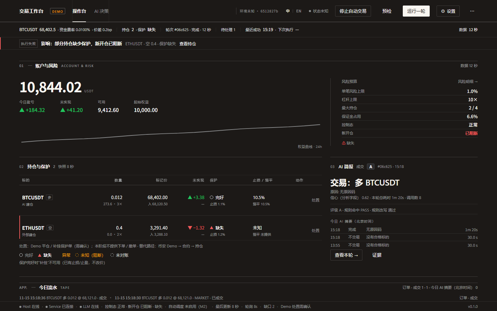

# dsh-trading-workbench

> 本仓库同时托管 **DSH Trading Workbench**（DeepSeek Harness 交易工作台插件 + Python 交易服务），
> 源码在 [`trading-workbench/`](trading-workbench/README.md)；下面是它所依赖的参考交易引擎 multi-agent-trader。




一键安装（DSH 插件，npm 发布后）：

```sh
dsh plugin --profile <profile> add dsh-trading-workbench
```

或在 DSH 里「设置 → 插件 → 搜索 dsh-trading-workbench」。没有交易服务的机器上，插件会给出
「初始化服务」向导：检测 Python → 建虚拟环境 → 安装依赖 → 启动 → 用服务自己的 `/health` 校验。

---
# multi-agent-trader

本地运行的多 Agent 数字货币合约实验系统。系统仅处理币安 USD-M、USDT 本位永续合约
白名单，默认连接 Binance Demo Trading；AI 生成候选决策，确定性代码负责风控、幂等
下单、保护单、账户对账和完整审计。

Demo 资金核算以 500 U 为会话起点；live 使用首次接管时的真实账户权益独立建账，不继承
Demo 基线。Web3 与市场微观结构情报处于只读影子阶段，执行权重固定为 0，不会改变现有
风险档或交易决策。

LLM 默认通过 SenseNova OpenAI 兼容网关调用 `deepseek-v4-flash`。本机凭据建议放在
`.env.local`；该文件后加载并覆盖 `.env`，两者均不会进入 Git。

实盘 `ai_trader` 可通过显式进程变量临时切换到 WorkBuddy 内置
`deepseek-v4.1-flash`。该适配器只开放结构化输出，不向 WorkBuddy 提供文件、终端、MCP、
浏览器或 Binance 权限；行情查询、证据校验、风控、签名和下单仍由本系统确定性链路完成。
技术与回退说明见
[`docs/WorkBuddy_DeepSeek_V4.1_实盘决策适配说明_2026-09-16.md`](docs/WorkBuddy_DeepSeek_V4.1_实盘决策适配说明_2026-09-16.md)。

## 快速开始

环境要求：Windows、PowerShell、Python 3.11+。

```powershell
python -m venv .venv
.venv\Scripts\pip.exe install -r requirements-lock.txt
Copy-Item .env.example .env
.venv\Scripts\python.exe scripts\verify_profile_lock.py
.venv\Scripts\python.exe scripts\run_web.py
```

维护重构前后可用 `scripts/benchmark_runtime_baseline.py` 做同机离线性能对照；结果不代表
交易所网络性能，也不会改变风险或执行阈值。

双控制台地址：Demo 为 `http://127.0.0.1:8000`，live 为
`http://127.0.0.1:8001`。两个 profile 使用独立账本；同一出口的公共行情限流状态有意共享。

正式无人值守运行应使用 Windows SCM 托管入口，不与 `run_web.py`、Popen/WMI 入口并行。
当前项目按用户决定暂缓 SCM 安装，现有双控制台属于受监控的临时运行方式：

```powershell
.venv\Scripts\python.exe scripts\validate_windows_service_plan.py `
  --config config\windows_service.json --require-files --print-install
# 在受控管理员终端人工执行上一步打印的 sc.exe 命令
sc.exe query MultiAgentTrader
```

SCM 服务复用 `scripts/run_web.py` 的统一生命周期；`start_web_detached.py`、
`run_web_service.py` 仅用于隔离诊断。托管配置不包含凭据、代理或执行模式覆盖，日志在
`data/web_console.log` 达到上限后有限轮转。完整停止、恢复、回滚和严格发布门禁见
[`docs/运行与故障恢复手册_2026-09-06.md`](docs/运行与故障恢复手册_2026-09-06.md)。

执行环境由 `.env` 中的 `EXECUTION_MODE` 决定：

- `demo`：币安模拟盘，主网行情与虚拟资金，当前默认模式；
- `testnet`：传统测试网；
- `paper`：本地纸面成交；
- `live`：真实账户，必须显式配置对应密钥并完成上线核验。

非 paper 环境缺少密钥时，Broker 工厂会拒绝启动，绝不静默切换资金口径。不要把
`.env`、API 密钥、签名请求或 `data/` 运行状态提交到 Git。

## 运行模型

- 慢循环每 10 分钟运行：行情与策略扫描、双通道决策、确定性风控和执行。
- 快循环每 30 秒运行：账户/订单/保护单对账与存量仓位安全检查。
- `strategy` 通道消费内置策略运行时生成的确定性策略票据；研究仓库不参与生产导入。
- `ai` 通道使用 LLM 和白名单行情工具形成候选决策。
- 默认 LLM 节点使用 `deepseek-v4-flash`；实盘试用时仅 `ai_trader` 可显式切换到
  WorkBuddy `deepseek-v4.1-flash`，Risk/Execution 始终是确定性代码。
- AI 决策节点使用 SenseNova 支持的最高 `xhigh` 推理档；其他节点按职责使用 low/high。
- 所有新开仓必须携带初始止损和止盈，并依次经过证据契约、影子决策质量、
  组合状态、ActionSpace、RiskGuard、运行时签名和 Outbox。Broker 会拒绝未签名开仓。
- Position Guardian 独立复核已有 AI 仓位的结构无效点，当前保持 `shadow`；
  数据不可验证时显示 `REVIEW_DUE`，不会猜测退出。
- 市场情报覆盖 20 个明确配置的 USD-M 合约；AI 单轮行情查询预算为 4 次。
- 公共行情统一经过权重感知网关；市场简报、扫描器、市场池、Web页面和只读情报不得
  各自重试。429/418 会立即触发共享熔断，排队请求在发送前统一短路。
- 20币白名单通过新版 Binance `/market` 与 `/public` WebSocket 获取 ticker、markPrice、
  bookTicker、1m和15m K线；高周期在本地聚合，REST只负责首次回补、断线补洞及低频情报。
- `/api/health` 的 `public_market_rate_limit` 会显示冷却、实际分钟权重、估算权重和端点调用；
  `public_market_stream` 会显示订阅、数据新鲜度及K线缓存状态。
- 公共行情冷却保存在 `data/public_rate_limit_state.json`，服务重启仍会遵守未到期封禁；
  该无凭据状态随完整恢复包保存，但不会进入 Git。

## 核心安全边界

- 风险参数由 `config/risk_learning.yaml` 与 `config/risk_profile.lock.json` 锁定。
- 交易范围由 `config/settings.yaml` 的 `market_universe.core_symbols` 限定。
- 账户流、账户镜像和订单镜像目前主要用于观察、持久化与对账。
- Outbox 对不确定提交进行隔离，避免网络超时后重复下单。
- 保护单镜像检查缺失、孤儿、方向和数量不一致。
- SQLite 保存决策、意图、风控、订单、快照、事件、incident 和影子评估结果。
- Binance 已确认的普通平仓、风险退出及交易所侧 SL/TP/人工平仓会以稳定成交键写入
  `trade_outcomes`，并连回原始开仓论点；未确认成交不会用估算值污染策略评价。

## 常用检查

```powershell
# 核心配置未漂移
.venv\Scripts\python.exe scripts\verify_profile_lock.py

# 当前环境与精确依赖锁一致
.venv\Scripts\python.exe scripts\verify_dependency_lock.py

# 基础回归
.venv\Scripts\python.exe scripts\check_quality.py
.venv\Scripts\python.exe scripts\run_offline_regression.py
.venv\Scripts\python.exe scripts\check_execution_boundaries.py
.venv\Scripts\python.exe scripts\smoke_service_lifecycle.py
.venv\Scripts\python.exe scripts\smoke_ui.py

# 只读查看 Demo 候选、闭合归因交易和观察天数门槛
.venv\Scripts\python.exe scripts\report_demo_acceptance.py

# 服务运行时只读采样本地 API；可显式追加 --include-binance-public 测公共网络
.venv\Scripts\python.exe scripts\benchmark_demo_endpoints.py --samples 20

# 显式联网验证 LLM 文本与 Function Calling（会产生一次小额 API 调用）
.venv\Scripts\python.exe scripts\verify_llm_provider.py

# 显式验证 WorkBuddy 的受限工具协议（不读取账户、不调用 Binance、不下单）
$env:MTA_AI_DECISION_PROVIDER="workbuddy"
.venv\Scripts\python.exe scripts\verify_llm_provider.py
Remove-Item Env:MTA_AI_DECISION_PROVIDER

# 安装精确锁定的运行依赖和开发工具
.venv\Scripts\pip.exe install -r requirements-dev-lock.txt
```

`requirements.txt`/`requirements-dev.txt` 表示允许升级范围；日常安装和 CI 使用对应的
`*-lock.txt` 精确版本。依赖升级必须在隔离环境重新解析锁文件，并通过全量离线回归，
禁止只改某个传递依赖后直接部署。

## 目录

- `src/core`：服务生命周期、图编排、资金、通道、控制和风险守卫；
- `src/agents`：Agent 节点、模型、策略与执行逻辑；
- `src/exchange`：Binance Broker、Outbox、私有流、镜像和安全监控；
- `src/intel`：只读 USD-M/Web3 情报与 A/B/C 影子评估；
- `src/audit`：SQLite 迁移、审计查询和 JSONL 日志；
- `src/dashboard`：FastAPI 控制台；
- `scripts`：启动、离线回归、恢复、诊断与显式在线核验脚本；其中 `probe_*`、
  `diag_*`、`verify_*_live` 不进入默认 CI，`cleanup_*`/`repair_*` 必须先预览并做后置核验；
- `docs`：架构、运行恢复、维护规范和历史设计记录。

文档入口与新旧状态以 [`docs/文档索引.md`](docs/文档索引.md) 为准；日期型计划和事故报告
用于保留决策背景，不应覆盖 README、项目说明书和运行手册中的当前行为。

USD-M 回放位于 `src/core/usdm_replay.py` 和 `src/core/strategy_evaluation.py`，支持重复
开仓加权、部分平仓余量、费用/资金费/滑点及信号到成交延迟归因。事故夹具必须去敏、
带内容哈希并显式声明数据覆盖。仓库同时保留合成边界样本与 9 月 7 日真实审计成交导出的
归一化夹具；后者不包含订单 ID、审计原文、提示词或账户字段。真实夹具仍不能代替
200 候选、30 笔 Demo 闭合交易和 7 天观察门槛。

进一步阅读：

- [文档索引](docs/文档索引.md)
- [项目说明书](docs/项目说明书.md)
- [运行与故障恢复手册](docs/运行与故障恢复手册_2026-09-06.md)
- [问题盘点与整改状态](docs/项目问题盘点与优化计划_2026-09-07.md)
- [代码维护规范](docs/代码维护规范.md)
- [稳定性与 AI 情报升级计划](docs/USD-M合约系统稳定性与AI情报升级开发计划_2026-09-05.md)
- [Binance行情接入与418治理](docs/Binance行情接入与418治理_2026-09-14.md)

本项目不保证盈利。Demo 测试通过不代表实盘安全，也不构成投资建议。
