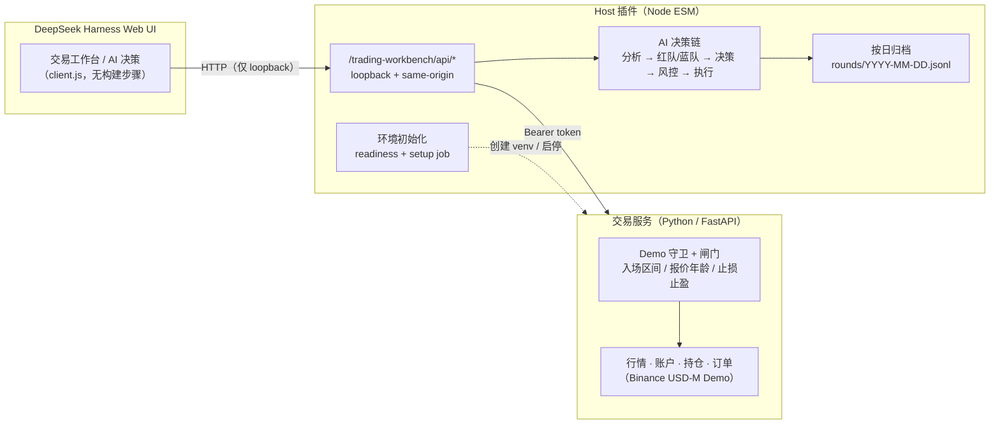

<div align="center">

# DSH Trading Workbench

**把 AI 决策链、交易执行与风控，搬进 DeepSeek Harness 的工作台。**

<p>
  <a href="https://www.npmjs.com/package/dsh-trading-workbench"></a>
  <a href="https://github.com/Clusm/dsh-trading-workbench/actions"></a>
  <a href="package.json"></a>
  <a href="package.json"></a>
  
  
</p>

[English](#english) · [快速开始](#快速开始) · [架构](#架构) · [安全边界](#安全边界) · [开发](#开发与测试)

</div>


<p align="center"><sub>操作台 —— 账户与风险带、持仓与保护状态、AI 摘要、今日流水、待处理清单</sub></p>


<p align="center"><sub>AI 决策 —— 本轮结论与原因码、确定性评分卡、红蓝对比、证据抽屉</sub></p>

---

## 为什么做这个

LLM 进入交易回路后，最贵的不是「下单」这个动作，而是两个问题：**它为什么这么决定**，以及**当时到底发生了什么**。

市面上多数"AI 交易"面板只给你一个结论。这个工作台把每一轮决策做成可复核的事实：分析、辩论、决策、风控、执行逐段留痕，失败也留痕；每轮带原因码与一句话归因；逐调用审计角色、延迟、token 与结束方式；归档按日分文件、全量保留，默认只看今天，其余日期按需查询。

> Demo only。不接真钱、不代管资金、不读取浏览器里的密钥；没有凭据时全链路只读。

---

## 功能

| 模块 | 你会看到 |
| --- | --- |
| **操作台** | 权益与今日盈亏、单笔风险/杠杆/持仓上限、持仓与保护单状态、AI 摘要卡、今日流水、待处理清单 |
| **AI 决策 · 本轮** | 结论与原因码、确定性评分卡（S/A/B/C + 门禁）、红蓝对比与辩论双侧、决策依据、证据抽屉 |
| **AI 决策 · 历史** | 按归档日期查询（今天默认）、按结果筛选、耗时分布、单轮详情与调用审计 |
| **AI 决策 · 分析** | 轮次分布、原因码构成、权益曲线、资金口径（服务端 `/pnl`）、AI 日报 |
| **设置** | 连接与账户、Demo/实盘凭据接入（只写本机 0600 文件）、自动调度、只读限额、运行身份诊断 |
| **顶栏** | 预检、运行一轮、启停自动交易、服务一键启动、**环境初始化向导** |

### 环境初始化向导

新机器上没有任何 Python 环境也能装：插件先如实检测（Python / 虚拟环境 / 依赖 / 服务），再一键初始化 —— 创建 `<dataDir>/service-venv`、安装 `service/requirements.txt`、启动服务，最后**用服务自己的 `/health` 校验**。每一步都有状态与最近输出，失败带日志尾部、可重试；检测不到 Python 就直接说明，不会给你一个假装可用的按钮。

---

## 架构



三条硬约束：

1. **浏览器不直连交易所、不持 token** —— 所有数据经 Host 路由，写命令要求 loopback + same-origin + JSON。
2. **服务是事实源** —— 行情、账户、持仓、订单只来自服务；拿不到就显示不可用，绝不编数。
3. **决策可复核** —— 每轮的输入、闸门结论、风控拒绝、执行结果都写进归档，跨进程重启也不丢。

### 决策与归档模型

- **一轮（round）**：一次完整决策，包含 N 次 LLM 调用、闸门判定与（可能的）下单。
- **原因码**：`按类别的稳定编码 + 一句话归因 + 下一步建议`，中英双语，由 Host 给出，客户端只做本地化映射。
- **归档**：`data/rounds/YYYY-MM-DD.jsonl`（Asia/Shanghai，追加写、按 `round_id` upsert），默认保留全部；历史页按日查询。
- **评分卡**：确定性评分（S/A/B/C）+ 门禁通过/降级，**不是收益预测**；UI 里明确标注。

---

## 快速开始

**要求**：DSH ≥ `0.2.2-rc.1`、Node ≥ 22.19；Python 3.11+（建议 3.13，用于交易服务）。

```sh
# npm（推荐）
dsh plugin --profile <profile> add dsh-trading-workbench

# 或者从 Git 安装（仓库根即 bundle）
dsh plugin --profile <profile> add github:Clusm/dsh-trading-workbench

# 本地打包安装
npm pack && dsh plugin --profile <profile> add ./dsh-trading-workbench-0.1.0.tgz
```

在 DSH 里也可以：**设置 → 插件 → 搜索 `dsh-trading-workbench` → 安装**。

安装后重载插件（或重启 DSH）：侧边栏出现「交易工作台」，顶栏多出「AI 决策」。

**首次运行**：打开工作台 → 横幅提示服务不可达 → 点「初始化服务」→ 检测 → 一键初始化 → 服务就绪。要真正下单，再到「设置 → 连接与账户」录入 Demo 凭据。

### 配置

| 键 | 默认 | 说明 |
| --- | --- | --- |
| `dataDir` | `$DSH_HOME/data/trading-workbench`（无 `DSH_HOME` 时 `~/.dsh/data/trading-workbench`）；包内 `data/` 已有内容则沿用 | 归档、配置、日志、token、凭据 |
| `serviceBaseUrl` | `http://127.0.0.1:8791` | 交易服务地址 |
| `tokenFile` | `dataDir/.api-token` | 服务 token（首次由服务生成） |
| `autoSchedule.enabled` | `true` | 本机每 10 分钟自动跑一轮 |

环境变量：`WORKBENCH_SERVICE_PYTHON`、`WORKBENCH_SERVICE_ENTRY`、`WORKBENCH_ALLOW_SERVICE_START=off`、`WORKBENCH_DATA_DIR`、`WORKBENCH_ROUNDS_RETENTION_DAYS`。

---

## 安全边界

- **Demo only**：服务启动时要求 demo 行情基址；没有凭据时全链路只读。
- **两把独立开关**：本机调度器（是否自动跑）与服务端控制态（是否允许开新仓）互不代替 —— 停掉调度不等于让服务继续开仓，反之亦然。
- **凭据只在磁盘**：Demo/实盘 key 经设置页写入本机 `0600` 文件，浏览器不缓存、日志不记录、归档不落库。
- **插件不代管资金**：卸载插件不平仓、不撤保护单；任何环境切换都需要显式确认。
- **可审计**：每个写命令走审计日志，带 request id；跨域请求被拒绝。

---

## 开发与测试

```sh
npm test                  # 源码约束 + 渲染冒烟 + 单测
node client/checks.mjs    # 177 条源码约束（路由/文案键/安全边界/分发前提）
node client/render-smoke.mjs  # 320 条渲染断言（夹具驱动的小型 DOM 运行时）
node --test test/*.test.mjs   # 204 条 Host/服务/归档/初始化单测
```

客户端**没有构建步骤**：`client.js` 由 DSH 直接加载；渲染冒烟用自带的迷你 DOM 运行时，所以测试不需要浏览器。

```
index.js / client.js      # Host 入口 + 客户端 UI
host/                     # integration / ai 决策链 / round-archive / service-setup / scheduler
locale/  icon.svg         # 中英文案与图标
service/                  # Python 交易服务（FastAPI：守卫、闸门、账本）
test/                     # node --test 套件
client/*.mjs              # 源码约束检查 + 渲染冒烟
docs/                     # 设计文档与截图
```

---

## 路线图与已知限制

- 交易服务是独立 Python 进程，随 DSH 关闭可能退出；长期后台运行用 `scripts/start-service.ps1`（Windows）或等价命令。
- 插件不代管交易所凭据；没有凭据时全链路只读。
- 归档默认全量保留，最坏约 2 MB/日；磁盘紧张用 `WORKBENCH_ROUNDS_RETENTION_DAYS`。
- 实盘接入目前是「真实环境 + 显式确认」的独立流程，不在本仓默认路径内。

---

## English

**DSH Trading Workbench** is a DeepSeek Harness plugin that puts an AI decision chain, a per-day round archive and Demo execution/risk views inside the Harness Web UI, backed by a local Python trading service.

- Every round is archived per day (`rounds/YYYY-MM-DD.jsonl`, append-only) with reason codes and one-line attribution; failures are archived too.
- Deterministic scorecard (S/A/B/C + gates) next to each decision — explicitly **not** a return forecast.
- The service is optional at install time: a first-run wizard checks Python/venv/deps/service, then creates the venv, installs requirements, starts the service and verifies its own `/health`.
- Demo-only, loopback-only. No credentials → read-only. Credentials are written to a local `0600` file from the settings UI, never stored in the browser.

```sh
dsh plugin --profile <profile> add dsh-trading-workbench
```

---

<div align="center"><sub>研究用途，不构成投资建议 · Demo 环境，不接真钱</sub></div>
