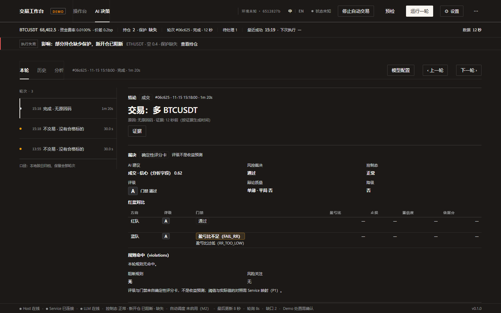
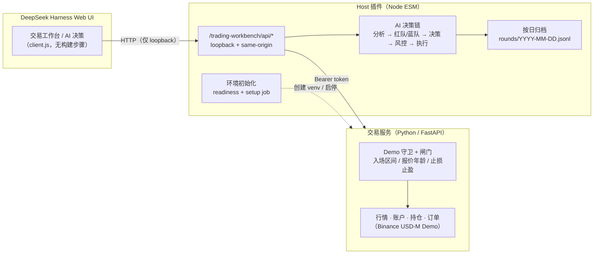

<div align="center">

# DSH Trading Workbench

**把 AI 决策链、确定性策略挂载、交易执行与风控，搬进 DeepSeek Harness 的工作台。**

<p>
  <a href="https://www.npmjs.com/package/dsh-trading-workbench"></a>
  <a href="https://github.com/Clusm/dsh-trading-workbench/actions"></a>
  <a href="package.json"></a>
  <a href="package.json"></a>
  
  
</p>

[English](#english) · [v0.2.1 更新日志](#v021--v020-更新说明) · [AI 交易范围](#ai-交易的范围与决策链) · [策略管理与双执行引擎](#策略管理与双执行引擎) · [快速开始](#快速开始) · [架构](#架构) · [安全边界](#安全边界) · [开发](#开发与测试)

</div>


<p align="center"><sub>操作台 —— 账户与风险带、持仓与保护状态、AI 摘要、今日流水、待处理清单</sub></p>



<p align="center"><sub>AI 决策 —— 本轮结论与原因码、确定性评分卡、红蓝对比、证据抽屉</sub></p>

---

## AI 交易的范围与决策链

**范围** —— 在固定的 20 币白名单内，每 10 分钟跑一轮，决定「这轮做不做、做多还是做空、什么价位进、止损止盈在哪、下多少」；有持仓时只做减风险的管理动作。

**不做** —— 不选品（白名单运行时固定，不自动轮换）、不联网、不调用工具、不改风控阈值、不越过确定性闸门、不碰实盘资金。

### 一轮的 7 个角色

| # | 角色 | 决定什么 | 明确不能做 |
|---|---|---|---|
| 1 | `analysis` | 在候选中排序、选出 `primary_symbol`、给触发与失效条件 | 不给订单参数、不做交易决定 |
| 2 | `red_team` | 固定做多，对称两轮辩论 | 不做空、R2 前不看蓝队回应 |
| 3 | `blue_team` | 固定做空，对称两轮辩论 | 不做多、R2 前不看红队回应 |
| 4 | `decision` | 三选一：做多 / 做空 / 不交易，并复制所选方案 | 不折中、不改 entry/SL/TP |
| 5 | `risk` | 审核、否决、降仓（只能收紧） | 不放宽硬上限、不翻转方向 |
| 6 | `execution` | 把已批准方案转成订单计划；管理已有仓位 | 不直接下单、不加仓、不反向开仓 |
| 7 | `review` | 每日归因、校准、经验沉淀（不阻塞交易循环） | 不改规则、不评价未平仓盈亏 |

红蓝固定立场、R1 并行开场、R2 看对方开场后回应；由**确定性评分卡**（无 LLM）打分，防止「和稀泥」与方向漂移。每角色档位、超时与 token 上限固定；任一角色失败按 `no_trade` + 原因码收口，不无界重试。

### 输入是什么

模型只看**一份预先生成的证据快照**（`md-evidence/1`）：闭合 K 线、指标、衍生品（资金费 / 持仓量 / 多空比）、关键位、流动性、数据健康，外加账户、持仓、硬上限与历史教训。快照由服务端确定性生成、落盘并带 hash，同轮同角色切片字节级可复现 —— 所以「它为什么这么决定」能被复核，而不是靠模型自述。

唯一例外是 `universe.market_scan`：它把**白名单外**的全市场异动也列出来，让模型看见「外面在涨什么」，但每行标记 `in_whitelist=false`，**不能**当候选交易。

### 输出怎么约束

模型只输出结构化 JSON，逐份过 schema + 语义校验 + 数值红线；不合法就重试或降级为 `no_trade`，绝不把自由文本当订单。通过后还要过硬风控与执行前闸门（入场区间、报价年龄、止损止盈合法性、轮内规则冻结）。AI 的建议只能比硬规则**更严**，不能更松。

> Demo only。不接真钱、不代管资金、不读取浏览器里的密钥；没有凭据时全链路只读。

---
## 功能

| 模块 | 你会看到 |
| --- | --- |
| **操作台** | 权益与今日盈亏、单笔风险/杠杆/持仓上限、持仓 2 秒轻量标记价与官方/参考双轨浮盈、低价币自适应小数精度、保护单状态、AI 摘要卡、今日流水、待处理清单 |
| **策略管理** | 一键策略模板、自然语言导入与 AI 澄清问答、可视化自然语言规则核对卡、实时行情距离与**当前已满足条件立即触发预警**、「规则直通（0 LLM 延迟）」与「AI 辅助过滤」双执行引擎切换、单策略自动熔断与独立绩效归因看板 |
| **AI 决策 · 本轮** | 结论与原因码、所选授权策略与执行模式徽章、确定性评分卡（S/A/B/C + 门禁）、红蓝对比与辩论双侧、决策依据、证据抽屉 |
| **AI 决策 · 历史** | 按归档日期查询（今天默认）、按结果筛选、耗时分布、单轮详情与调用审计 |
| **AI 决策 · 分析** | 轮次分布、原因码构成、权益曲线、资金口径（服务端 `/pnl`）、AI 日报 |
| **设置** | 连接与账户、Demo/实盘凭据接入（只写本机 0600 文件）、自动调度、只读限额、运行身份诊断 |
| **顶栏** | **主屏幕模拟盘/实盘一键切换与安全预检弹窗（`⇄ 切换实盘` / `⇄ 切回模拟盘`）**、全局运行模式徽章（`原生 AI` / `已授权策略`）、空转与熔断注意力提醒、预检、运行一轮、启停自动交易、服务一键启动、**环境初始化向导** |

---

## 策略管理与双执行引擎

在「原生 AI」模式之外，工作台一级栏目提供独立的 **策略管理（`?ws=strategies`）**，支持将用户的自然语言/Markdown 交易策略转化为受版本控制与确定性校验的执行规则：

1. **挂载与启用严格分离**：粘贴文本或选择内置模板 → AI 澄清缺项并生成结构化规则（超出当前执行能力的附加条件原样保留并禁止启用，绝不静默丢弃）→ 核对自然语言规则卡与实时触发距离后确认挂载（生成 SQLite Trigger 保护的不可变版本）→ 单独授权启用（最多同时启用 5 个策略、合计监控 10 个标的）。
2. **双执行引擎可选**：
   - **AI 辅助过滤（`ai_assisted`，默认）**：确定性条件触发后唤醒 AI 决策链评估，意见冲突不开新仓（`STRATEGY_AI_CONFLICT`）；被 AI 跳过/否决的信号自动记录并在后续闭合 K 线上做**事后归因（成功避险 vs 踏空）**。
   - **规则直通执行（`rule_direct`，0 LLM 延迟）**：确定性条件满足后跳过大模型辩论，由确定性代码生成计划直接进入服务端 `createCycle` → **P1 硬风控（R00–R25 全部生效）→ P2 下单**。
3. **二阶段确定性规则原语（零 `eval` 纯函数求值）**：
   - 支持 `mark_threshold`（实时标记价阈值）、`candle_close`（**最新闭合 K 线收盘确认**，防插针假突破）、`ema_cross`（双均线金叉/死叉）、`ema_compare`（均线排列或收盘价对比）、`rsi_threshold`（Wilder RSI 过滤）、`funding_threshold`（资金费率阈值）以及 `all`（最多 4 项原子条件 AND 组合）。
4. **策略级独立绩效归因与自动熔断**：
   - 按策略聚合统计触发次数、成交次数、已平仓胜率、累计已实现净盈亏与 AI 否决绩效；
   - 支持配置单策略熔断（`max_consecutive_losses` 连续亏损笔数 / `max_cumulative_loss_usdt` 累计亏损金额），触发后自动停用该策略新开仓（保留已有仓位保护），人工核查后一键解除熔断并重置统计基线。

---

## v0.2.1 & v0.2.0 更新说明

相比 `v0.1.1`，`v0.2.0` / `v0.2.1` 主要新增与优化：

- **主界面顶栏 Demo（模拟盘）↔ Live（实盘）一键切换与安全预检弹窗（`v0.2.1`）**：在主界面顶栏 `S0` 环境徽标旁直接提供 `⇄ 切换实盘` / `⇄ 切回模拟盘` 交互按钮（同时也在「设置 → 连接与账户」中提供入口），后端配套 `/trading-workbench/api/venue/switch` 路由：
  1. 切换前自动核验 4 项安全指标（当前账户无未平仓位、无未决/在途挂单、目标环境凭据就绪、本机启动器可用）；
  2. 若切换至实盘但尚未录入 `live.env` 凭据，支持直接在切换弹窗内录入实盘 API Key / Secret（仅写本机 `0600` 文件）并立即重检，无需跳出弹窗；
  3. 切换时先自动暂停调度与控制态（`pause`，绝不误平仓），并以独立物理隔离账本目录（Demo: `<dataDir>`，Live: `<dataDir>/live`）重启本地 Python 服务，切换完成后自动交易默认处于暂停状态，需人工核对后显式开启。
- **独立轻量持仓标记价通道（`/api/market/marks`）**：可见页面持仓标记价 2 秒单飞刷新（服务端校准时钟 `age_ms`、按标的 singleflight 合并、≥5 标的自动批量拉取、乱序报价拒绝、页面隐藏自动暂停）；持仓表保留官方账户快照 `uPnL` 同时提供实时标记价参考浮盈，并对 `< $1` 低价币自适应 2/4/5/6 位小数精度。
- **一级「策略管理」工作区与生命周期闭环**：新增策略草稿 CAS、AI 澄清、不可变版本挂载、独立启停授权（`generation` CAS）与运行模式切换（`mode_revision` CAS）。
- **「规则直通」与「AI 辅助」双执行引擎 + AI 否决归因**：支持 0 LLM 延迟规则直通 P1/P2 执行，以及 AI 辅助模式下的否决避险/踏空回溯统计。
- **二阶段确定性规则原语**：新增闭合 K 线收盘确认（`candle_close`）、EMA 金叉/死叉与排列（`ema_cross` / `ema_compare`）、RSI 阈值（`rsi_threshold`）、资金费率阈值（`funding_threshold`）与 `all` 复合条件。
- **策略级绩效归因与自动熔断**：新增 `/api/strategies/attribution` 与单策略连亏/累亏自动熔断保护。
- **体验与安全加固**：20 币白名单在行情/风控/策略三端统一；策略校验前置对齐 `R09`（止损 `0.2%–5.0%`）与 `R10`（盈亏比 `≥ 1.2R`）；P1 信号前置去重与 `15m` 跨周期容差；已有持仓优先进入风险管理防短路；顶栏 `S1` 常驻模式徽章与 `S2` 空转/熔断提醒；内置 3 套开箱即用策略模板与当前已满足条件立即触发预警。

### 环境初始化向导

新机器上没有任何 Python 环境也能装：插件先如实检测（Python / 虚拟环境 / 依赖 / 服务），再一键初始化 —— 创建 `<dataDir>/service-venv`、安装 `service/requirements.txt`、启动服务，最后**用服务自己的 `/health` 校验**。每一步都有状态与最近输出，失败带日志尾部、可重试；检测不到 Python 就直接说明，不会给你一个假装可用的按钮。

---

## 架构



三条硬约束：

1. **浏览器不直连交易所、不持 token** —— 所有数据经 Host 路由，写命令要求 loopback + same-origin + JSON。
2. **服务是事实源** —— 行情、账户、持仓、订单只来自服务；拿不到就显示不可用，绝不编数。
3. **决策可复核** —— 每轮的输入、闸门结论、风控拒绝、执行结果都写进归档，跨进程重启也不丢。

### 决策与归档模型

- **一轮（round）**：一次完整决策，包含 N 次 LLM 调用、闸门判定与（可能的）下单。
- **原因码**：`按类别的稳定编码 + 一句话归因 + 下一步建议`，中英双语，由 Host 给出，客户端只做本地化映射。
- **归档**：`data/rounds/YYYY-MM-DD.jsonl`（Asia/Shanghai，追加写、按 `round_id` upsert），默认保留全部；历史页按日查询。
- **评分卡**：确定性评分（S/A/B/C）+ 门禁通过/降级，**不是收益预测**；UI 里明确标注。

---

## 快速开始

**要求**：DSH ≥ `0.2.2-rc.1`、Node ≥ 22.19；Python 3.11+（建议 3.13，用于交易服务）。

```sh
# npm（推荐）
dsh plugin --profile <profile> add dsh-trading-workbench

# 或者从 Git 安装（仓库根即 bundle）
dsh plugin --profile <profile> add github:Clusm/dsh-trading-workbench

# 本地打包安装
npm pack && dsh plugin --profile <profile> add ./dsh-trading-workbench-0.2.0.tgz
```

在 DSH 里也可以：**设置 → 插件 → 搜索 `dsh-trading-workbench` → 安装**。

安装后重载插件（或重启 DSH）：侧边栏出现「交易工作台」，顶栏多出「AI 决策」。

**首次运行**：打开工作台 → 横幅提示服务不可达 → 点「初始化服务」→ 检测 → 一键初始化 → 服务就绪。要真正下单，再到「设置 → 连接与账户」录入 Demo 凭据。

### 配置

| 键 | 默认 | 说明 |
| --- | --- | --- |
| `dataDir` | `$DSH_HOME/data/trading-workbench`（无 `DSH_HOME` 时 `~/.dsh/data/trading-workbench`）；包内 `data/` 已有内容则沿用 | 归档、配置、日志、token、凭据 |
| `serviceBaseUrl` | `http://127.0.0.1:8791` | 交易服务地址 |
| `tokenFile` | `dataDir/.api-token` | 服务 token（首次由服务生成） |
| `autoSchedule.enabled` | `true` | 本机每 10 分钟自动跑一轮 |

环境变量：`WORKBENCH_SERVICE_PYTHON`、`WORKBENCH_SERVICE_ENTRY`、`WORKBENCH_ALLOW_SERVICE_START=off`、`WORKBENCH_DATA_DIR`、`WORKBENCH_ROUNDS_RETENTION_DAYS`。

---

## 安全边界

- **升级提示**：HTTP 准入修复从 0.1.1 起生效；npm 上的 0.1.0 不包含修复。可立即安装已修复的 GitHub 标签：`dsh plugin --profile <profile> add github:Clusm/dsh-trading-workbench#v0.1.1`。升级后重载插件，并确认 `/health` 的版本为 0.1.1。
- **DSH 统一准入（0.1.1 起）**：所有工作台 HTTP 路由先调用 `ctx.connection.requestRejection(req)`，再执行原有本机/同源及业务校验。遵循 DSH 的 Host、Origin 和已配置的登录规则；准入服务不可用时返回 503，不放行。脚本、代理和健康检查也需满足宿主访问规则；Python Service 到币安的行情与交易请求不经过这一层。
- **Demo only**：服务启动时要求 demo 行情基址；没有凭据时全链路只读。
- **两把独立开关**：本机调度器（是否自动跑）与服务端控制态（是否允许开新仓）互不代替 —— 停掉调度不等于让服务继续开仓，反之亦然。
- **凭据只在磁盘**：Demo/实盘 key 经设置页写入本机 `0600` 文件，浏览器不缓存、日志不记录、归档不落库。
- **插件不代管资金**：卸载插件不平仓、不撤保护单；任何环境切换都需要显式确认。
- **可审计**：每个写命令走审计日志，带 request id；跨域请求被拒绝。

---

## 开发与测试

```sh
npm test                      # 源码约束 + 渲染冒烟 + 单测
node client/checks.mjs        # 184 条源码约束（路由/文案键/安全边界/分发前提）
node client/render-smoke.mjs  # 359 条渲染断言（夹具驱动的小型 DOM 运行时）
node --test test/*.test.mjs   # 225 条 Host/服务/归档/策略/双引擎单测
```

客户端**没有构建步骤**：`client.js` 由 DSH 直接加载；渲染冒烟用自带的迷你 DOM 运行时，所以测试不需要浏览器。

```
index.js / client.js      # Host 入口 + 客户端 UI
host/                     # integration / ai 决策链 / round-archive / service-setup / scheduler
locale/  icon.svg         # 中英文案与图标
service/                  # Python 交易服务（FastAPI：守卫、闸门、账本）
test/                     # node --test 套件
client/*.mjs              # 源码约束检查 + 渲染冒烟
docs/                     # 设计文档与截图
```

---

## 路线图与已知限制

- 交易服务是独立 Python 进程，随 DSH 关闭可能退出；长期后台运行用 `scripts/start-service.ps1`（Windows）或等价命令。
- 插件不代管交易所凭据；没有凭据时全链路只读。
- 归档默认全量保留，最坏约 2 MB/日；磁盘紧张用 `WORKBENCH_ROUNDS_RETENTION_DAYS`。
- 实盘接入目前是「真实环境 + 显式确认」的独立流程，不在本仓默认路径内。

---

## English

**DSH Trading Workbench** is a DeepSeek Harness plugin that puts an AI decision chain, a per-day round archive and Demo execution/risk views inside the Harness Web UI, backed by a local Python trading service.

- Every round is archived per day (`rounds/YYYY-MM-DD.jsonl`, append-only) with reason codes and one-line attribution; failures are archived too.
- Deterministic scorecard (S/A/B/C + gates) next to each decision — explicitly **not** a return forecast.
- The service is optional at install time: a first-run wizard checks Python/venv/deps/service, then creates the venv, installs requirements, starts the service and verifies its own `/health`.
- Demo-only, loopback-only. No credentials → read-only. Credentials are written to a local `0600` file from the settings UI, never stored in the browser.

**Scope** — inside a fixed 20-symbol whitelist, one round every 10 minutes decides *whether* to trade, the side, the entry zone, SL/TP and size; with an open position it only takes risk-reducing management actions. It does **not** pick symbols (the whitelist is frozen at runtime), go online, call tools, change risk thresholds, bypass the deterministic gates, or touch real money.

**The chain (7 roles)** — `analysis` (ranks candidates, picks `primary_symbol`) → `red_team` / `blue_team` (fixed long / short, two symmetric rounds) → `decision` (long / short / no-trade, three-way) → `risk` (veto or size down, tighten only) → `execution` (turns the approved plan into an order plan, never places it) → `review` (daily attribution, off the trading loop). A deterministic, LLM-free scorecard scores each debate so the decision cannot paper over a weak case.

**Input** — the model only reads one pre-built, hashed, byte-reproducible evidence snapshot (`md-evidence/1`): closed candles, indicators, derivatives (funding / OI / long-short ratio), key levels, liquidity, data health, plus account, positions, hard limits and past lessons. `universe.market_scan` is the one exception: it shows whole-market movers *outside* the whitelist for awareness only, each row flagged `in_whitelist=false` and never tradeable.

```sh
dsh plugin --profile <profile> add dsh-trading-workbench
```

---

<div align="center"><sub>研究用途，不构成投资建议 · Demo 环境，不接真钱</sub></div>
