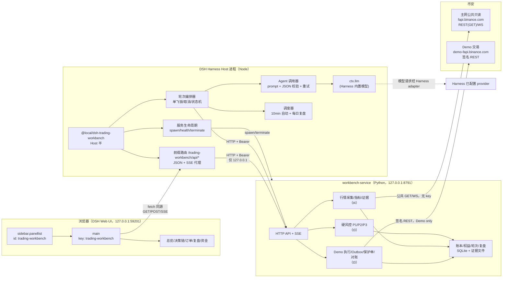
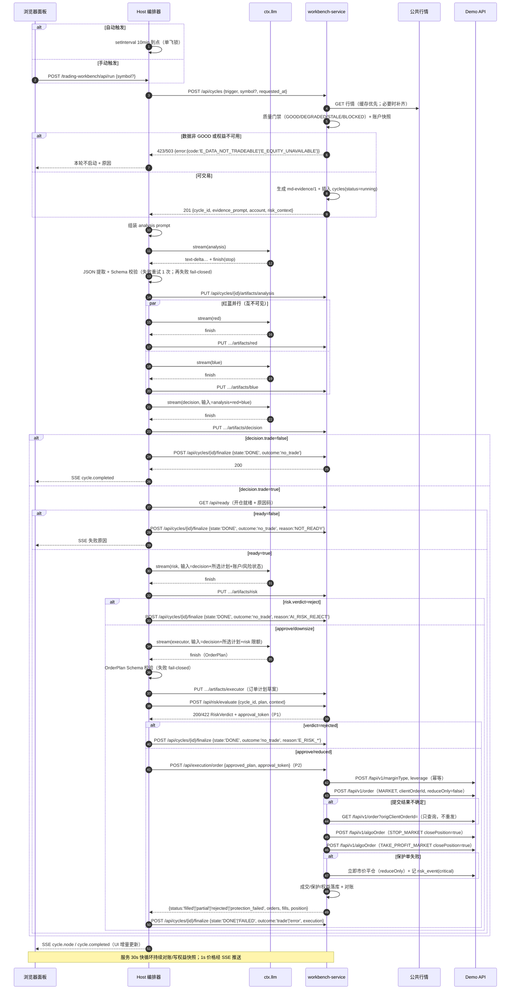

# 01 · 交易工作台 v1 总体架构与模块边界

- 日期：2026-11-09（Asia/Shanghai）
- 状态：设计稿（对应任务 t1，待评审）
- 唯一需求输入：`trading-workbench/docs/00-需求基线.md`
- 回答基线 §6 问题：**Q1（插件与服务边界）**、**Q2（Demo 执行复用）**、**Q3（账户与账本）**、**Q9（进程与部署）**、**Q10（失败路径）**
- 交付性质：**只做设计**。本文编撰期间未安装插件、未启动服务、未下 Demo 单、未修改 `multi-agent-trader`（只读代码审阅）、未读取任何密钥。
- 下游消费者：t2 AI 链、t3 Demo 执行与风控、t4 行情、t5 UI、t6 评审、t7 整合。

---

## 0. 结论摘要（先看这一页）

| 议题 | 结论 |
|---|---|
| **Q1 边界** | **推荐方案 A′**：DSH 插件 **Host = AI 编排 + 控制面**；本机 **单个 Python 进程 `workbench-service` = 行情 + Demo 执行 + 硬风控 + 账本 + 证据/轮次持久化**；Client = `main` 面板 + `sidebar.panellist` 入口，只读 Host 路由。不采用 B（全 Node）、不采用 C（复用原服务）。 |
| **Q2 复用** | **新写轻量 Demo 适配器**（`demo_broker`/`demo_outbox`/`risk_rules`/`ledger`），只**语义移植**原项目 7 条不变量与 Algo 保护单/签名/过滤器等已踩坑逻辑；不 import `BinanceFuturesBroker`（3456 行）与 `AuditDatabase`（3139 行）。与 t3 结论一致，见 §4、§13.2。 |
| **Q3 账户** | 首选**独立 Demo 账户/新 key**；若只能复用现有 Demo 账户，必须满足 t3 §3.1 的“空仓/无挂单/无 Algo 单/账本干净”前置，否则拒绝启动。**新库新曲线**：`data/workbench-v1.sqlite` + `equity_snapshots`；旧 `agent_trader.sqlite`（193 MB）不 attach、不 import、不混算。会话权益 = 交易所权益 − baseline。 |
| **Q9 进程** | 默认 **managed**：插件用 DSH `ctx.subprocess` 拉起/守护 Python 服务（`127.0.0.1:8791`），`/health` 存活、`/api/ready` 就绪分层；单实例锁；配置/日志/升级/备份见 §10。也支持 `external`（用户自行启动，插件只发现）。 |
| **Q10 失败** | 原则：**fail-closed、UNKNOWN 只查询不重发、保护失败即平仓、权益不可用禁止开仓、过期数据禁止开仓**。跨组件失败矩阵（20 条）见 §12；执行侧细分见 t3 §9（F01–F20），行情侧见 t4 §13。 |
| **DSH 事实** | 已用 `cordis_inspect_list` + Host `Service` 查询核实 `llm`/`webServer`/`connection`/`storage`/`storageDomain`/`subprocess`/`timer`/`agentDefaultModel` 等服务；**Client 侧检查本会话无页面可连**（`Slots.listSubTree` 3 次、`Theme.listTokens` 与 Client `Service` 各 1 次，均 10s 超时），`main`/`sidebar.panellist` 改以本机 DSH 0.2.2-rc.1 包文档 + 已安装插件 `dshmarket` 的真实注册代码交叉核实（§3.3）。实现第一步必须在有页面的会话复核一次。 |
| **跨文档修正** | 浏览器侧路由建议用 **`/trading-workbench/api/*`**（t5 现写 `/api/trading-workbench/*`）；轮次标识统一 **`cycle_id`**（UI 的 `roundId` 为别名）；**Host 持有 10 分钟调度权**，t4 的“10 分钟慢循环”改为按需生成证据；公共行情主网只读与 Demo-only 交易边界见 §11.1。 |

---

## 1. 设计输入、事实与方法

### 1.1 唯一需求输入

`00-需求基线.md` 的 §2（17 条已确认需求）、§3（非目标）、§4（agent 链）、§5（技术边界）、§6（待回答问题）为本文唯一需求来源。本文不新增产品需求；超出基线的决定都列入 §15 未决问题。

### 1.2 核实方法

| 对象 | 方法 | 结论位置 |
|---|---|---|
| Host 服务清单与签名 | `cordis_inspect_list` + `cordis_inspect_query`（Host `Service.listService`，目录模式） | §3.2 |
| Host 服务精确契约 | 对 `llm` 读取 DSH 0.2.2-rc.1 安装包 README + `lib/index.js`（`ctx.llm.stream` 分块协议） | §3.2 |
| Client Slots | `Slots.listSubTree` 3 次均 10s 超时（另有 `Theme.listTokens`、Client `Service` 各 1 次超时）；改读 `@deepseek-ai/dsh-client-ui-layout`、`-ui-sidebar` README 与本机已安装 `dshmarket` 的 `client.js` 注册代码 | §3.3 |
| 插件安装方式 | `cordis-plugin-development` 技能 + 本机 profile `package.json`/`cordis.patch.yml` + `dsh-base`/`dsh-web-app` 的 bundle patch | §3.4 |
| 原项目复用面 | 只读审阅 `multi-agent-trader/src`、`config`、`data` 清单；与 t3/t4 已产出文档交叉核对 | §4、§13.2 |
| 端口 | `Get-NetTCPConnection`：8791 空闲；DSH Web 为 59201（宿主占用，不新增监听） | §10.4 |

### 1.3 本文不做什么

- 不定义 6 个 agent 的 prompt 正文与逐字段 JSON Schema（t2 权威，本文只给编排契约与落库边界）。
- 不定义 26 条硬风控规则阈值与订单生命周期（t3 权威，本文只给执行位置与门禁顺序）。
- 不定义指标公式、证据 schema 字段（t4 权威，本文只给存储与引用方式）。
- 不定义页面组件与视觉（t5 权威，本文只给 Slot 注册、路由与刷新语义）。
- 不写实现代码、不安装、不下单、不改原项目。

---

## 2. 关键约束（从基线推导出的架构硬约束）

| # | 约束 | 架构落点 |
|---|---|---|
| C1 | AI 只在 Harness 内，Client 不调模型，不接外部 LLM API | 只有 Host 半 `ctx.llm`；配置只允许 Harness provider/model；Client 无模型配置项 |
| C2 | Demo-only，不存在 live 写入路径 | 交易客户端只有 `demo-fapi.binance.com` 白名单；代码不出现 live 域名常量与 live 环境变量名（§11） |
| C3 | 密钥只在本机凭据存储，不进插件配置/日志/前端 bundle | 密钥只被 Python 服务读取；Host 只拿到“key 指纹”与 `key_source`；日志统一脱敏 |
| C4 | AI 输出结构化校验；校验失败走 no_trade/重试 | Host 侧 JSON 提取 + Schema 校验 + 一次重试 + fail-closed |
| C5 | 订单幂等、开仓带 SL/TP、下单前硬风控、以交易所对账为准 | t3 的 P1/P2 双闸 + Outbox + 保护失败即平仓 + 30s 对账 |
| C6 | 行情 10 分钟慢循环 + 30 秒快循环，限流与新鲜度降级 | 全部在 Python 服务；Host 不直接访问币安 |
| C7 | 每轮可审计回看 | `cycle_runs`/`cycle_agents` + 证据文件 + 订单/成交/权益快照，全部落服务库 |
| C8 | 原项目只读 | 不 import 原项目包、不写其 `data/`、不启动其主循环 |
| C9 | 本机单用户、桌面优先、主面板 + 侧栏入口 | 插件 Host + Client 两半；路由同源；无多用户鉴权系统 |
| C10 | 一个出口 IP 只有一个进程持有行情采集与权重预算 | 单一 Python 服务是唯一币安出口（公共与私有都经它）；Host/Client 不连币安 |

---

## 3. DSH 平台事实核查（设计依据）

### 3.1 插件形态与安装（已核实）

- 交付物是一个 **workspace bundle** 包，包名 `@local/dsh-trading-workbench`，通过 `plugin_manager(action="install_bundle", target="<绝对目录>")` 安装到当前 profile（此处为 `desktop`）。安装由管理器写 profile 的 `package.json`/`cordis.patch.yml`，插件作者不手写这两个用户态文件。
- bundle 的 `package.json` 声明 `dsh.bundle.patch`，patch 用 `insert` 插入一行 Host 插件；`dsh.client` 声明 Client 半（`platform:'web'`、`inject` 仅用于激活顺序）；客户端 bundle 是 `window.__ModuleLoader__.load({ id, factory(require) {…} })`，`id` 必须等于包名，只从模块表 `require('react')`，不 import 任何 `@deepseek-ai/dsh-client-*` 包。
- 本机 profile `C:\Users\Tao\.dsh\profiles\desktop` 已是 Electron 托管 profile；`package.json` 的 `dsh.profile.bundles` 含 `@deepseek-ai/dsh-base`、`@deepseek-ai/dsh-web-app` 等。bundle 装好后 Host 行立即激活，Client 行随页面刷新/重建加载；`install_bundle` 返回的 `application` 与 `warnings` 才是“是否生效”的判据，不以进程或日志推断。
- 本机已安装第三方插件（如 `dshmarket`）表明：**不要假设 profile 安装的 bundle 能 import 宿主安装目录里的 `@deepseek-ai/*` 包**（profile `node_modules` 无这些包；除非把某个 `@deepseek-ai/*` 包作为自身 dependency 再装一份，带来版本耦合与安装面）。因此本插件 Host 半选择**零运行时依赖**：只用 `ctx.*` 服务 + Node 内置模块，不 import `BlockAssembler`/`createUserMessage`/`schemastery`（§3.5）。

### 3.2 Host 服务（`cordis_inspect_list` + `Service.listService` 已核实）

| 服务 | 本设计用途 | 关键方法/事实 |
|---|---|---|
| `llm` | 6 个 agent + 每日复盘的模型调用 | `listProviders()`、`listModels(provider)`、`resolveModelInfo(provider, model)`、`prepareCall(config, signal, configure)`、`stream(options)`；流块协议 `block-start/text-delta/reasoning-delta/tool-call-delta/usage/finish`；`finish.reason.kind ∈ stop/tool-calls/max-tokens/error/aborted`；失败码 `NO_ADAPTER/AUTH/RATE_LIMIT/CONTEXT_WINDOW_EXCEEDED/TIMEOUT/ABORTED` 等 |
| `agentDefaultModel` | 默认模型路由 | `currentSelection(): ModelSelection`；未在插件 Config 指定 provider/model 时用它，保证“只用 Harness 内置 LLM”且用户可在 Settings 切换 |
| `webServer` | 浏览器侧 HTTP/SSE 载体 | `register(route)`；`route.kind` 为 `exact` 或 `prefix`，`handler(request, response)` 原始 Node 请求响应；返回 disposer；HTTP 匹配“exact → 最长 prefix → fallback” |
| `connection` | 宿主同源/准入能力（可选） | `admit`/`requestRejection`/`createSharedFetchHandler`/`browserPeer`；本插件只做 loopback 校验，必要时可复用宿主 gate |
| `storage` / `storageDomain` | 宿主侧 KV/域存储（**v1 不使用**） | v1 的所有持久化在 Python 服务库；Host 保持无状态，避免双写 |
| `subprocess` | 拉起/守护 Python 服务 | `resolveExecutable`、`spawn({argv,cwd,stdio,graceMs,env,signal})` → `handle.done`/`terminate()`/`waitForExit()`/`collected.stdout.readFrom()`；子进程环境默认清除凭据型变量与 `DSH_*`，只保留显式 `env` |
| `timer` | 10 分钟自动轮次、每日复盘、健康轮询 | Cordis timer：`ctx.setInterval`/`setTimeout`（若当前组合只暴露 `ctx.timer.interval/timeout`，用后者；两者语义相同，随 effect 释放） |
| `configEditor` | 可选：保存插件自身配置 | `ctx.fiber.entry` + `ctx.get('configEditor').edit(...)`；v1 不做在线改配置，避免额外权限面 |

补充事实：

- `dsh-base` 的 patch 已挂载 `llm`、`llm-retry`、`timer`、`storage`/`storage-json`/`storage-domain`、`subprocess`（`@deepseek-ai/dsh-subprocess-local`）、`agent-default-model`；`dsh-web-app` 的 patch 已挂载 `webserver`、`connection`、`ui-layout`、`ui-sidebar` 等。插件无需自带这些依赖。
- `llm/stream` 是**单次 provider attempt**，服务本身不重试；重试由 `llm-retry` 在 agent 步骤边界执行。本插件是旁路调用（不经过 agent loop），因此**自己在 Host 侧做一次有限重试**（仅限可重试错误/JSON 解析失败）。
- `llm` 请求接受“仅请求态 user 输入”（无 `id`/`source` 的 user 消息）；本插件用 `{role:'user', content:[{type:'text', text}]}` 构造提示，不需要 `createUserMessage`，从而保持零依赖。
- `GenerateOptions` 支持 `provider/model/messages/system/maxTokens/temperature/stop/reasoningEffort/signal`；`purpose` 是可选传输元数据（未声明也可运行）。插件不写 Session 日志、不注册 Tool、不改 system prompt。

### 3.3 Client Slots（`main`、`sidebar.panellist`）

**查询结果**：本会话 `cordis_inspect_query(client, Slots, listSubTree)` 调用 3 次均在 10s 后超时（提示 “Open or reconnect the Harness page”）；`Theme.listTokens` 与 Client `Service.listService` 各 1 次同样超时。原因是**当前会话没有可响应的已连接 Web 页面**。因此 Slot 事实改由以下本机证据交叉核实：

| 证据 | 内容 |
|---|---|
| `@deepseek-ai/dsh-client-ui-layout` README（0.2.2-rc.1） | “Global panels occupy the root-scoped **`main` keyed slot**; `conversation` is the reserved key… `ctx.layout.selectPanel(id)` selects a registered panel, and `null` selects the Conversation.” |
| `@deepseek-ai/dsh-client-ui-sidebar` README | “Plugins add an icon component to the root-scoped **`sidebar.panellist`** list with an `id`, optional `order`, and a string or locale-aware `label`. The same id addresses the component registered in the layout's root-scoped **`main` keyed slot**; selecting a missing main entry throws without changing the current selection.” |
| 本机 `dshmarket/client/client.js`（真实运行代码） | `main` 注册形态：`ctx.slots.register({ name:'main', key:'dsh-market', locale:NS, inject:()=>({t}) }, Component)`；`sidebar.panellist` 注册形态：`ctx.slots.register({ name:'sidebar.panellist', id:'dsh-market', order:1, label:()=>t('nav'), locale:NS }, Icon)`；两者用同一 id/key 关联；用 `ctx.slots.inject('sidebar.panellist', …)` 做“宿主是否声明该槽”的探测；用 `ctx.layout.panelInfo`/`selectPanel` 控制选中 |
| `dsh-client-ui-layout/lib/client.js`（反编译安装产物） | `main: { kind:'keyed', scope:'root' }`；渲染 `renderSlot('main', {}, { entryKey: panelId ?? 'conversation' })`；`selectPanel(id)` 先校验 live `main` 注册表，key 不存在抛错 |
| `dsh-client-ui-sidebar/lib/client.js`（反编译安装产物） | `sidebar.panellist: { kind:'list', scope:'root' }`；从 `entriesOfSlot('sidebar.panellist')` 读取 `options.id/order/label`；行点击调用 `ctx.layout.selectPanel(id)` |

**本插件注册结论（可实现）**：

```js
// client.js 内（示意，不是实现代码）
const NS = 'tradingWorkbench'
ctx.slots.inject('sidebar.panellist', () => {
  const offMain = ctx.slots.register({
    name: 'main', key: 'trading-workbench', locale: NS,
    inject: () => ({ t }),
  }, WorkbenchPanel)
  const offRow = ctx.slots.register({
    name: 'sidebar.panellist', id: 'trading-workbench', order: 40,
    locale: NS, label: () => t('panel.title'),
  }, WorkbenchIcon)
  return () => { offRow(); offMain() }
})
```

- `main` 的 `key` 与 `sidebar.panellist` 的 `id` **必须同为 `trading-workbench`**；侧栏点击由宿主调用 `selectPanel(id)`，插件无需自己监听点击。
- 可选：`sidebar.toggle.badge`（收起态状态点，运行中/异常）、`sidebar.panellist.actions`（More 菜单）。v1 不占用 `shell.overlay`/`shell.bottom`。
- **实现第一步**：在页面已连接时执行 `cordis_inspect_query(client, Slots, listSubTree, {root:'sidebar.panellist'})` 与 `{root:'main'}`，复核注册选项与 `inject` props；若与本文不符，以实测为准并更新 t5/本文。

### 3.4 Client 半的加载与约束（已核实）

- `dsh.client` 声明：`platform:'web'`、`immediately:true`（侧栏入口首屏可见，不能等面板打开才加载）、`inject` 只列激活顺序（如 `@deepseek-ai/dsh-client-ui-renderer`、`@deepseek-ai/dsh-client-locale`），**不 import** 它们。
- bundle 是构建产物：包内必须已有 `client.js`（手写或构建均可）；Host 端 `dsh-client-modules` 扫描启用行并通过 `/plugins/<id>/client.js` 提供；页面懒加载并执行 `window.__ModuleLoader__.load` 注册的 factory。
- React 来自浏览器模块表；客户端不得安装第二份 React、不得 CDN、不得 append 到 `document.body`、不得读宿主 DOM。
- 可见文案必须走 `ctx.locale.register(NS, {zh, en})`（同时要求 `zh`/`en` 两个基线），`label` 支持字符串或 locale-aware 值。
- 样式只用宿主 token（`--dsw-alias-bg-*`、`--dsw-alias-border-l1..l4`、`--dsw-alias-label-primary/secondary/tertiary`、`--dsw-alias-state-{success,error,warn,idle,business}-primary`、`--dsw-radius-*`、`--dsw-shadow-lv*`、`--dsh-hairline-width`）；字面颜色仅限图表/品牌 artwork。
- 插件元数据：`locale/zh.json`/`locale/en.json` 的 `meta.title`/`meta.description`，`icon.svg`（原创、≤256 KiB、包内），`files` 必须包含运行文件。

### 3.5 为什么 Host 半零依赖是可实现且必要的

- 按本机 profile 的事实，bundle 不应假设能 import DSH 安装目录（asar）里的 `@deepseek-ai/dsh-llm` 等包；把它列为依赖又会引入第二份版本。因此按“可达的 `ctx.llm` 公开 API”设计，而不是复用其内部类。
- 本插件需要的 LLM 能力全部可通过 `ctx.llm` 的公开方法完成：
  - 调用：`ctx.llm.stream({provider, model, messages, system, maxTokens, reasoningEffort, signal})`；
  - 取文本：监听 `type === 'text-delta'` 累加（块协议已核实），`type === 'finish'` 取 `reason.kind`；
  - 校验能力：`ctx.llm.resolveModelInfo(provider, model)` 读取 `reasoning.efforts`/`defaultMaxTokens`。
- 因此 Host 不需要 `BlockAssembler`、`createUserMessage`、`schemastery`、`zod`。设计文档中不再出现“import DSH 包”的调用。

---

## 4. 三方案对比（Q1/Q2）

### 4.1 评估维度

1. 需求贴合（AI 只在 Harness、Demo-only、新账本）；
2. 原项目可复用度与改造量；
3. 失败隔离与可运维性（一个进程崩了会怎样）；
4. 安全边界（live 路径、密钥、AI 输出）；
5. 交付/安装复杂度（本机单用户、DSH 插件形态）；
6. 演进空间（后续 tool loop、复盘、更多数据源）。

### 4.2 方案 A′（推荐）：Host 编排 + 单 Python 服务

**形态**：DSH 插件 Host 负责 6+1 agent 编排、prompt、Schema 校验、轮次状态机、调度、对 UI 的路由/SSE；本机 `workbench-service`（Python 3.13，FastAPI/uvicorn 或等价）负责行情、Demo 执行、Outbox、硬风控、账本、证据、轮次落库；两者只走 `127.0.0.1:8791` + Bearer token。

**理由**：

1. **AI 与交易解耦**：模型调用天然在 Host；交易/行情是 Python 已有生态（httpx 签名、过滤器、Algo 单、限流语义），按 t3/t4 的“新写 + 语义移植”改造量约 3,200–3,800 行 Python + ~1,500 行 Node，可控。
2. **失败隔离**：服务崩溃不会拖垮 DSH Host（UI 仍在，可显示离线并重启服务）；Host 重载不会杀交易所侧保护单（保护单在交易所）。
3. **单一币安出口**：满足“一个出口 IP 一个 owner”，避免 Host 与 Python 各自限流互相打穿。
4. **安全边界清晰**：密钥只进 Python；Host 配置、前端 bundle、日志都不出现 key；交易客户端与行情客户端分离，demo-only 可静态证明。
5. **可演进**：后续行情查询工具、复盘、更多 agent 都在 Host；执行/风控保持独立可测试。

**改造量（估算）**：

| 部分 | 估算 | 说明 |
|---|---|---|
| Python 服务 | ~3,200–3,800 行 | t3 执行/风控 ≈1,300–1,600 + t4 行情 ≈1,900–2,200（API/循环共用，已去重）；函数级移植 |
| Host 插件 | ~1,200–1,700 行 JS（编排/路由/生命周期/SSE/校验/prompt） | 零依赖 |
| Client 面板 | ~2,000–3,500 行 JS（5 视图 + 图表 + SSE 客户端） | 手写或构建，M1 可先 2 视图 |
| 部署脚本/文档 | ~200 行 | venv、启动、备份、探针 |
| 原项目改动 | **0**（只读） | 符合基线 §5.8 |

**风险**：双进程/双语言（§12 已列失败路径）；Python venv 与依赖管理；端口/令牌管理；Host 卸载时服务生命周期（默认 managed 会随之停止——但交易所侧 SL/TP 仍在，风险有界）。

### 4.3 方案 B：全部放插件 Host/Node

**形态**：Host 内用 Node `fetch` 直接签名访问 Demo、计算指标、写 SQLite（`node:sqlite`）或 JSON、跑定时器、出 UI。

**优点**：单进程、零端口、安装即用、Host 生命周期天然一致；没有 Python venv。

**缺点/风险**：

1. **必须重写全部币安执行语义**：签名/时钟校准/过滤器/Algo 保护单/Outbox/UNKNOWN 对账/分片/hedge 分支（t3 的 D1–D10 坑位），缺少可复用代码；Node 侧无原项目验证资产。
2. **单进程爆炸半径**：一个未捕获异常/长任务会拖垮或卡住 DSH Host；交易与 UI 同生共死。
3. **行情/执行同进程**：限流、WS 重连、30s 对账与 Host 事件循环竞争；出问题时无法独立重启交易侧。
4. **密钥进入 Host 进程**：Node Host 读取 `.env` 会扩大密钥暴露面（日志/异常/插件配置），与 C3 冲突。
5. **后续演进**：需在 Node 重建 Python 侧已有的 numpy 指标/数据管线。

结论：**不推荐**；仅当“不能有 Python 运行时”时作为降级方案（M1 可先做只读+模拟成交，不下真单）。

**改造量（估算）**：Node 侧需重写执行/行情/账本 ≈2,800–4,000 行（不含 UI），另需为 Binance 签名/过滤器/Algo 单/Outbox 建立全新测试面；原项目可复用≈0，风险显著高于 A′。

### 4.4 方案 C：复用原 `multi-agent-trader` 服务

**形态**：直接启动原 FastAPI 控制台（`scripts/run_web.py`）或复用其 `TradingService`/`BinanceFuturesBroker`/`AuditDatabase`，插件只做 UI 代理。

**不可行原因（硬冲突）**：

1. 原服务默认接**外部 LLM**（SenseNova/OpenCode/WorkBuddy），违反基线 #2 与 §5.1；要改必须剥离其 LLM/决策图。
2. 原服务会启动**交易主循环**（10min 慢循环 + 30s 快循环）、策略通道、策略漏斗、影子情报；基线 #14 明确移除策略相关，且 §5.8 要求不启动其主循环。
3. 原服务带 **live 路径**（`BASE_URLS` 含 `fapi.binance.com`、`EXECUTION_MODE=live`、`capital` live 锚点），与“代码中不存在 live 下单路径”冲突。
4. 旧账本 193MB、30+ 表、旧曲线；基线 #17 要求新账本/新曲线，不混入旧历史。
5. 原项目正在演进（worktree/补丁在途），插件与其同仓耦合会互相拖拽；且其运行目录被明确标记为“禁止写入/启动开发代码”。

结论：**不采用**。只允许“读代码取语义”，不允许运行/import/写入。

**改造量（估算）**：若强行复用，需要剥离外部 LLM/决策图、去除 live 路径、裁剪策略/通道/漏斗、重写 API 与账本口径，预计改动/新增 ≥3,000 行且要持续跟原项目演进；同时仍违反“原项目只读/不启动主循环”的硬约束。

### 4.5 结论表

| 维度 | A′（推荐） | B（全 Node） | C（复用原服务） |
|---|---|---|---|
| AI 只在 Harness | ✅ | ✅ | ❌ 需剥离外部 LLM |
| Demo-only 可证明 | ✅ 两客户端隔离 | ⚠️ 需从零证明 | ❌ 自带 live 路径 |
| 原项目复用 | ✅ 语义移植 | ❌ 无 | ⚠️ 强耦合 |
| 失败隔离 | ✅ 双进程 | ❌ 单进程 | ⚠️ 原主循环 |
| 安装复杂度 | 中（Python venv） | 低 | 高（改造原项目） |
| 新账本/新曲线 | ✅ | ✅ | ❌ 旧库混用风险 |
| 改造量 | 中 | 中高（重写执行） | 高（且违反边界） |
| **结论** | **采用** | 备选 | 拒绝 |

**推荐落地顺序**：A′；M1 先做“服务 + Host 编排 + UI 只读/手动一轮”，M2 完整 UI，M3 复盘/优化。若 Python 环境不可用，降级 B 的只读/paper 版本，但**不接 Demo 真单**。

---

## 5. 总体架构

### 5.1 组件图



> 图中所有币安访问都在 Python 服务内；Host/Client 不持有币安凭据、不直连币安。

### 5.2 职责表

| 组件 | 负责 | 不负责 |
|---|---|---|
| **Client 半**（`main` 面板） | 5 视图渲染、SSE 订阅、运行/取消/手动 Demo 操作按钮、空态/离线/过期/错误展示、中英文、主题 token | 不读数据库、不调模型、不持密钥、不直连 Python、不写 session 日志 |
| **Host 半** | 10min/手动轮次调度、6+1 agent 编排与 prompt、LLM 调用与 JSON 校验/重试、轮次状态机与单飞锁、把 agent 产物写回服务、对 UI 的路由与 SSE 聚合、服务生命周期与健康缓存、日志脱敏 | 不直接访问币安、不持有密钥、不做最终风控裁决（硬规则在服务）、不把自由文本当订单 |
| **Python 服务：行情** | 公共 REST/WS、K 线缓存、指标、`md-evidence/1`、新鲜度四态、限流/冷却、SSE 价格 | 不调 LLM、不下单 |
| **Python 服务：执行** | Demo 签名 REST、过滤器、Outbox、普通单/Algo 保护单、成交/持仓对账、平仓/减仓、保护修复（**撮合在币安 Demo，本地不实现撮合引擎/PaperBroker**） | 不改 AI 输出、不做策略判断 |
| **Python 服务：风控** | 26 条硬规则（R00–R25）、P1 计划闸、P2 提交闸、P3 巡检、账户日亏/回撤 latch、控制态、kill switch | 不决定方向、不生成交易论点 |
| **Python 服务：账本/轮次** | `workbench-v1.sqlite`：轮次/agent 产物/订单/成交/仓位/权益快照/风险状态/复盘；证据文件与哈希 | 不做 UI 渲染、不做 AI 调用 |
| **Harness `ctx.llm`** | 模型路由与流式输出 | 不重试（本插件自行有限重试）、不校验业务 JSON |

### 5.3 数据流与单一事实源

1. **行情证据**：服务采集 → 质量门禁 → `md-evidence/1` → 文件 + DB 引用；Host 只从服务 `POST /api/cycles` 的响应里拿“prompt 视图”，不自己采集。
2. **AI 产物**：Host 生成 → 校验 → `PUT /api/cycles/{id}/artifacts/{agent}` 落库；UI 通过 Host 路由读同一份。
3. **订单/成交/仓位/权益**：**交易所为准**；服务对账后写库；Host 不缓存为权威。
4. **轮次状态**：服务是 `cycle_runs` 的唯一写入者；Host 通过 API 推进状态；UI 只读。
5. **旧历史**：旧库只作为只读参考，运行时零依赖；UI 空态不 fallback 旧曲线。

---

## 6. 一轮完整时序

### 6.1 主时序（手动或自动触发 → 决策 → 风控 → 执行 → UI）



### 6.2 时序的可实现要点

1. **触发权在 Host**：自动 10 分钟由 Host `ctx.setInterval` 驱动；服务不自行开 AI 轮次。手动 `POST /run` 与自动触发共用 Host 单飞锁（`running` 时返回 409）。
2. **服务端原子性**：`POST /api/cycles` 在一次请求内完成“数据门禁 → 证据 → 账户快照 → 插入 cycles”，失败则不产生轮次。
3. **阶段落库**：每个 agent 产物即时 `PUT`（幂等键 `cycle_id + agent`），UI 可实时看到进度；不把 6 个 JSON 攒到最后一次写。
4. **重试边界**：LLM 失败仅对 `RATE_LIMIT/TIMEOUT/SERVER/EMPTY_RESPONSE` 与 JSON 解析失败重试 1 次；`AUTH/NO_ADAPTER/CONTEXT_WINDOW_EXCEEDED/ABORTED` 不重试，直接 fail-closed。
5. **失败即终态**：6 个核心 agent 任一失败 → `cycle_runs.state='FAILED'`（`outcome='error'`），不下单；已下单的保护单不受影响。
6. **终态映射（库 → UI）**：库内用 t3 的 `state ∈ RUNNING/DONE/FAILED/SKIPPED/CANCELLED` + `outcome ∈ trade/no_trade/error`；UI 的 `RoundView.status`（t5 枚举 `running|done|no_trade|rejected|failed|cancelled`）由二者派生：`done`（DONE+trade）、`no_trade`（DONE+no_trade 且无拒绝码）、`rejected`（DONE+no_trade 且 `error_code` 为 `AI_RISK_REJECT`/`E_RISK_*`/`NOT_READY`）、`failed`（FAILED）、`cancelled`（CANCELLED）。`protection_failed` 记为 FAILED + `error_code=E_PROTECTION_FAILED`，同时保留执行摘要。
7. **执行前二次门禁**：P1 用当时的行情/账户；P2 再做一次 P2 提交闸（复算价格、滑点、余额、保护、幂等），不信任 P1 之后的时间窗。
8. **取消语义**：`POST /run/:id/cancel` 只取消未提交的 AI 阶段；已进入 P2 的订单**不可取消**（只能在交易所侧平仓/撤单），返回 `execution_started=true`。
9. **复盘（第 7 个 agent）**：独立调度，不在主链内；见 §10.9。

### 6.3 节假日/暂停等非功能时序

- `control_state=pause`：Host 自动轮次跳过（但手动可尝试，仍受 `/api/ready` 约束）；`close_only/emergency` 时 `/api/ready` 返回 `ready=false`，手动 `run` 返回 423。
- 数据 `DEGRADED`：允许平/减/保护修复，不允许开新仓；`STALE/BLOCKED`：仅保护性指令。
- 权益不可用：只允许平仓/撤单/保护，不允许开仓（t3 I7）。

---

## 7. 插件 Host/Client 结构

### 7.1 文件树（workspace bundle）

```text
trading-workbench/
  plugin/                          # 交付给 plugin_manager 的 bundle 目录
    package.json
    cordis.patch.yml
    index.js                       # Host 半入口（零依赖）
    client.js                      # Client 半构建产物（window.__ModuleLoader__）
    locale/en.json
    locale/zh.json
    icon.svg
    src/                           # Host 源码（可选拆分，index.js 汇总或直接引用）
      config.js
      lifecycle.js
      service-client.js
      router.js
      orchestrator.js
      agents.js
      schemas.js
      prompts/
      sse.js
      log.js
  service/                         # Python 服务（由 Host 拉起或用户自行启动）
    pyproject.toml / requirements.txt
    workbench_service/
      __main__.py  app.py  config.py
      guard.py  db.py  models.py
      market/    execution/    risk/    ledger/    routes/
    config.yaml
    .env.local                     # BINANCE_DEMO_API_KEY/SECRET（gitignored）
  docs/
    00-需求基线.md  01-总体架构.md  02-AI决策链.md  03-Demo执行与风控.md  04-行情与指标.md  05-工作台UI.md
  data/                            # 运行时（gitignored）
    workbench-v1.sqlite
    evidence/  logs/  backups/
```

> 设计稿不创建上述文件；目录只表达交付边界。`data/` 与 `.env.local` 永不进包/进 Git。

### 7.2 `package.json`（形态）

```jsonc
{
  "name": "@local/dsh-trading-workbench",
  "version": "0.1.0",
  "private": true,
  "type": "module",
  "exports": {
    ".": "./index.js",
    "./client": "./client.js",
    "./locale/*.json": "./locale/*.json",
    "./icon": "./icon.svg"
  },
  "files": ["index.js", "client.js", "cordis.patch.yml", "locale/*.json", "icon.svg"],
  "dsh": {
    "bundle": { "patch": "./cordis.patch.yml" },
    "client": {
      "platform": "web",
      "immediately": true,
      "inject": ["@deepseek-ai/dsh-client-ui-renderer", "@deepseek-ai/dsh-client-locale"]
    }
  }
}
```

> 若 Host 代码拆到 `src/`，`files` 必须把 `src/**` 一并列出（linked directory 安装不筛 `files`，但打包/发布时会漏文件）。

### 7.3 `cordis.patch.yml`（形态）

```yaml
- insert:
    - id: trading-workbench
      name: '@local/dsh-trading-workbench'
      config:
        service:
          mode: managed          # managed | external | disabled
          port: 8791
          dataDir: 'C:\Users\Tao\Desktop\币安\trading-workbench\data'
        autoRun:
          enabled: true
          intervalMinutes: 10
        llm:
          provider: null         # null = 跟随 agentDefaultModel 当前选择
          model: null
```

- 插件**不导出** `Config`（避免 schemastery 依赖）：`apply(ctx, config)` 自行校验/补默认值；非法关键值（端口、mode、provider 组合）抛出明确错误，插件行显示失败而不是静默降级。
- 用户若要改配置，改 profile 的 `cordis.patch.yml` 中该行（由用户/插件管理器维护），或由 `configEditor` 的 UI 编辑（v1 不做）。

### 7.4 Host 半模块职责

| 模块 | 职责 | 关键细节 |
|---|---|---|
| `index.js` | `export function apply(ctx, config)`；`export const inject = ['webServer','llm','timer']`；可选服务用 `ctx.inject([...])` | 在 `ctx.effect` 中注册路由/定时器/服务句柄/SSE；unload 全量释放 |
| `config.js` | 默认值、类型/范围校验、路径解析、`llm` 路由解析 | `provider`/`model` 必须同时为空（跟随默认）或同时非空；端口 1–65535；interval ≥1 min |
| `lifecycle.js` | token 文件、服务探测、spawn/terminate、健康缓存、单实例 | 见 §10；`ctx.subprocess` 缺失时降级为 external 模式并提示 |
| `service-client.js` | 封装对 Python 的 HTTP：超时、Bearer、GET 有限重试、POST 不自动重试（业务幂等交给服务） | 统一错误映射；不打印 token/密钥 |
| `router.js` | 一条 `prefix` 路由 `/trading-workbench/api`，内部按 method+path 分发；JSON 读写与大小限制 | GET/HEAD 可走 `resource`；POST/SSE 走 `handler`；loopback 校验；`cache-control: no-store` |
| `orchestrator.js` | 单飞、轮次状态机、agent 顺序/并行、取消、超时、错误归并、finalize | 状态只从服务 `cycle_runs` 读回；不自行发明“完成” |
| `agents.js` | prompt 渲染、`ctx.llm.stream` 调用、chunk 收集、JSON 提取、schema 校验、token 统计 | 零依赖；`AbortController` 贯穿；结果 hash |
| `schemas.js` | 6 个 agent 输出与 OrderPlan 的最小校验器（手写） | 严格 `additionalProperties:false` 语义；未知字段拒绝 |
| `sse.js` | 浏览器 SSE 帧、心跳、断线清理、与服务 SSE 合并 | 见 §8.6 |
| `log.js` | `[twb]` 前缀日志、Host 日志文件追加、密钥/长文本脱敏 | 不记录 prompt 全文（记录 hash + token 数） |

**模型路由与预算（Host 侧）**：

- 路由优先级：插件 Config 的 `llm.provider/model`（成对出现）> `ctx.agentDefaultModel.currentSelection()`；不允许只配一个。
- 启动时对每个 agent 的 `reasoningEffort` 调 `ctx.llm.resolveModelInfo` 校验：显式配置不支持 → 插件启动失败；跟随默认且默认档不支持 → 用模型默认档并 warning（不静默改显式配置）。
- 预算：每 agent `maxTokens`；每轮 `maxTokensTotal`；每日 `maxTokensPerDay`。超限时本轮 fail-closed（`E_BUDGET_EXCEEDED`），下一轮不自动补偿；用量取 `usage` 块并落 `cycle_agents.tokens_*`。
- 每次调用带 `AbortController`（单 agent 超时 + 轮次总超时 + 用户取消），取消后 `finish.kind='aborted'`；Host 统一按失败收口。

### 7.5 Client 半结构

- `client.js` 是一个 factory：内部按“store / api / components / views / styles”分区（可多文件构建后合并；M1 允许单文件手写）。
- 注册：`ctx.slots.inject('sidebar.panellist', …)` 内同时注册 `main` 与侧栏行；locale 用 `ctx.locale.register('tradingWorkbench', {zh, en})`；样式在 `ctx.effect` 内注入一个 `<style data-tw-style>`，类名前缀 `.twb-`。
- 数据：`EventSource('/trading-workbench/api/stream')` + 首次全量 `GET /trading-workbench/api/state`；断线指数退避并回退 10s 轮询；所有 fetch `credentials:'same-origin'`、`cache:'no-store'`。
- 组件：顶栏（Demo 标识/权益/健康/运行/倒计时）、5 视图、运行进度条、证据抽屉、确认对话框、空态/离线/过期/错误。
- 交互命令只发 Host 路由；不在前端拼风控判断（以服务 `ready`/`verdict` 为准）。

### 7.6 Host ↔ Client 通道（不放 `@Remote`）

- 不使用 Typert/`@Remote`：那需要构建期 TypeScript 生成物，纯 JS 外部插件不适用。
- 使用 `webServer` 的 **一个 prefix 路由** `/trading-workbench/api`：
  - 理由：`/api` 已被 `@deepseek-ai/dsh-client-connection` 以 prefix 占用做宿主桥；在其下嵌套子路径会和宿主准入/Electron IPC 桥产生不必要的交互。`dshmarket` 同样使用顶层 `/dsh-market/*` 的先例。
  - 兼容：若评审坚持 t5 的 `/api/trading-workbench/*`，只需改 `router.js` 的前缀常量；**推荐本方案的顶层前缀**。
- 同源、无 CORS；写接口仅接受 `application/json`（限制 64 KiB）；SSE 用 `text/event-stream`（宿主 gzip 排除，安全）。
- 无 Session 依赖：不创建/不修改 Session，不写 session 事件；面板全局存在。

---

## 8. 服务 API 草案

### 8.1 通用约定

| 项 | 约定 |
|---|---|
| 监听 | `127.0.0.1:8791`（配置 `WORKBENCH_PORT`）；只绑定 loopback |
| 鉴权 | `/health` 免鉴权；其余所有 `/api/*` 要求 `Authorization: Bearer <WORKBENCH_API_TOKEN>`。token 是 **per-dataDir 稳定密钥**：存 `data/.api-token`（0600），先到者创建；managed 模式 Host 在 spawn 前确保存在并经 env 注入，external 模式服务在缺失时生成并写文件；双方都读同一文件，重启/重连不失效 |
| 内容 | `application/json; charset=utf-8`；金额/数量一律十进制字符串；时间 ISO-8601 UTC（`…Z`）；所有响应带 `trace_id` |
| 幂等 | `POST /api/cycles`、`POST /api/execution/order` 支持 `Idempotency-Key`；服务端以 `cycle_id`/`clientOrderId` 保证重放安全 |
| 错误信封 | `{ "error": { "code": "E_*", "message": "...", "retryable": false, "details": {...} }, "trace_id": "..." }` |
| 读缓存 | GET 可 `cache-control: no-store`；`/api/status` 内部 2s 缓存；价格走 SSE |
| 版本 | `/health` 返回 `service_version` 与 `schema_version`；不兼容时 Host 警告并禁止开仓 |

### 8.2 服务对外路由（Host 与 UI 共用，Host 负责代理/编排）

**服务自检/只读**

| 方法 | 路径 | 用途 | 备注 |
|---|---|---|---|
| GET | `/health` | 存活 + 版本 + `venue:"demo"` + `key_fingerprint` + `ledger_id` + 启动阶段 | 不查询币安；Host 10s 轮询 |
| GET | `/api/ready` | 是否允许开新仓 + `reasons[]` + 控制态 + 权益/风险摘要 | 与执行层同一判定器（t3） |
| GET | `/api/status` | 账户/权益/仓位/保护/挂单/未决单/控制态/新鲜度 | UI 10s |
| GET | `/api/equity-curve?range=&bucket=` | 权益曲线（`equity_session` 主、`equity_exchange` 副） | t3 §4 |
| GET | `/api/orders?status=&limit=` | 订单 + 保护单 | 分页 |
| GET | `/api/fills?limit=` | 成交 | |
| GET | `/api/positions` | 仓位 + 保护状态 + `origin` | |
| GET | `/api/market/*` | `health/clock/universe/klines/prices/snapshot` | t4 §14；Host 仅代理 UI 所需子集 |
| GET | `/api/stream` | SSE：`price`(1Hz)/`state`(5s)/`order`/`cycle`/`health` | Host 转成浏览器帧 |

**轮次编排（Host 专用写接口）**

| 方法 | 路径 | 用途 | 幂等/失败 |
|---|---|---|---|
| POST | `/api/cycles` | 创建轮次：门禁 → 证据 → 账户快照 → 插入 `cycles(running)` | `Idempotency-Key`；非 GOOD/权益不可用 → 423/503；已有 running → 409 |
| GET | `/api/cycles?limit=&cursor=` | 轮次列表 | |
| GET | `/api/cycles/{cycle_id}` | 单轮完整视图（含 agent 产物/风控/执行） | 404 |
| GET | `/api/cycles/{id}/evidence?agent=` | 证据抽屉：按 agent 返回 evidence 引用 + prompt 视图 + 产物（大对象按需） | 404/410（证据已过保留期） |
| PUT | `/api/cycles/{id}/artifacts/{agent}` | 落库一个 agent 产物（`analysis/red/blue/decision/risk/executor/review`） | 幂等（同 cycle+agent 覆盖为最终一次；带 `attempt` 序号则追加历史）；非法 agent → 422 |
| POST | `/api/cycles/{id}/finalize` | 收口 `{state,outcome,reason,execution}`（映射见 §6.2） | 只允许 RUNNING→终态；重复调用幂等 |
| POST | `/api/cycles/{id}/cancel` | 取消未提交轮次 | 已执行 → 409 |

**执行/风控（t3 权威，Host 编排调用）**

| 方法 | 路径 | 用途 |
|---|---|---|
| POST | `/api/risk/evaluate` | P1 计划闸：入参 `OrderPlan` + context，返回 `RiskVerdict` + `approval_token`（绑定 plan 哈希，TTL 60s，单次） |
| POST | `/api/execution/order` | P2 提交闸 + 下单：入参 `ApprovedPlan` + `approval_token`；按 `clientOrderId` 幂等 |
| POST | `/api/execution/close` | 平仓/减仓 `{symbol, qty?}` 或 `{symbol, all:true}` |
| POST | `/api/protection/repair` | 手动保护核对/修复 |
| POST | `/api/recovery/reconcile` | 手动全量对账（启动 12 步） |
| POST | `/api/control` | 控制态 `normal/pause/close_only/emergency`（需 `confirm`） |
| POST | `/api/capital/reanchor` | 人工重锚 baseline（需 `confirm:"REANCHOR"` + 两处权益） |
| POST | `/api/orders/{cid}/resolve` | 人工收口 UNKNOWN（只允许无成交终态） |
| GET | `/api/reviews?date=` / `GET /api/reviews/{date}/context` / `PUT /api/reviews/{date}` | 复盘列表/上下文/写回复盘 |
| GET | `/api/logs?source=service&lines=200` | 诊断尾部 |

> 兼容 t3：`POST /api/cycle/run` 作为 `POST /api/cycles` 的别名保留（旧文档引用），返回同一结构；`/api/risk/evaluate` 的 `approval_token` 是新增字段，不改变既有 `RiskVerdict` 语义。

### 8.3 关键请求/响应示例

**POST /api/cycles**

```json
// 请求
{ "trigger": "manual|auto", "symbol": "BTCUSDT?", "requested_at": "2026-11-09T01:40:00.000Z" }
// 201
{
  "cycle_id": "cyc-20261109T014000Z-a1b2c3",
  "symbol": "BTCUSDT",
  "status": "running",
  "evidence": {
    "schema_version": "md-evidence/1",
    "evidence_path": "data/evidence/cyc-.../evidence.json.gz",
    "evidence_sha256": "…",
    "prompt_view": { "…": "t4 渲染的紧凑视图，供 Host 拼 prompt" }
  },
  "account": {
    "equity_exchange": "5000.00", "equity_session": "4987.20",
    "available": "4321.55", "positions": [], "open_orders": []
  },
  "risk_context": {
    "ready": true, "reasons": [], "control_state": "normal",
    "max_risk_pct": "0.0100", "max_leverage": 10, "max_positions": 3,
    "daily_loss_ratio": "0.0026", "drawdown_ratio": "0.0031"
  },
  "server_time": "2026-11-09T01:40:01.120Z",
  "trace_id": "01J…"
}
```

**PUT /api/cycles/{id}/artifacts/{agent}**

```json
{
  "agent": "analysis",
  "attempt": 1,
  "status": "done",
  "started_at": "…", "finished_at": "…", "duration_ms": 12140,
  "provider": "opencode-go", "model": "deepseek-v4.1-flash", "effort": "high",
  "prompt_version": "analysis.v1", "prompt_sha256": "…", "input_sha256": "…",
  "output": { "…": "t2 定义的 JSON" },
  "schema": { "ok": true, "issues": [] },
  "tokens": { "in": 2841, "out": 1001 },
  "error": null
}
```

**POST /api/risk/evaluate（P1，t3 契约 + token）**

```json
// 请求
{ "cycle_id": "cyc-…", "plan": { "symbol":"BTCUSDT","side":"LONG","action":"open",
  "entry_type":"MARKET","leverage":8,"qty":"0.015","sl":"99000.0","tp":"102800.0",
  "confidence":"0.72","reasoning_ref":"decision:cyc-…" },
  "context": { "mark":"100200.0","snapshot_age_ms":3200,"evidence_age_ms":45000,
               "equity_session":"4987.20" } }
// 200
{ "verdict":"reduced","approved_qty":"0.0124","leverage":8,
  "risk":{"amount":"49.87","pct":"0.0100","rr":"2.65"},
  "violations":[{"rule":"R05","action":"downsize","detail":"…"}],
  "approval_token":"v1.<base64url>.<sig>", "approval_expires_at":"…",
  "trace_id":"…" }
```

**POST /api/execution/order（P2）**

```json
// 请求
{ "approved_plan": { "…": "P1 通过后的 plan（含 approved_qty/leverage/sl/tp）" },
  "approval_token": "v1.…", "cycle_id": "cyc-…" }
// 200（已成交） / 202（已提交待确认） / 207（部分成交） / 4xx
{ "status":"filled", "orders":[{"client_order_id":"tw-cyc-…-a1","exchange_order_id":"…",
  "type":"MARKET","status":"FILLED","avg_price":"100210.5","qty":"0.0124"}],
  "fills":[{"trade_id":"…","qty":"0.0124","price":"100210.5","commission":"0.04",
  "realized_pnl":"0"}],
  "position": {"symbol":"BTCUSDT","side":"LONG","qty":"0.0124","entry_price":"100210.5",
  "sl":"99000.0","tp":"102800.0","protection":{"sl_algo_id":"…","tp_algo_id":"…","state":"ok"}},
  "trace_id":"…" }
```

**POST /api/cycles/{id}/finalize**

```json
{ "state": "DONE", "outcome": "trade|no_trade", "reason": "AI_RISK_REJECT|NOT_READY|…",
  "execution": { "status":"filled|partial|rejected|protection_failed",
                 "orders":["tw-…"], "avg_price":"100210.5" },
  "error": {"code":"E_LLM_TIMEOUT","message":"…","retryable":true} }
```

### 8.4 错误码（架构层，t3 细分见其 §8.3）

| 码 | HTTP | 含义 | Host 行为 |
|---|---|---|---|
| `E_ALREADY_RUNNING` | 409 | 已有轮次 | 手动返回 409；自动跳过并记录 |
| `E_DATA_NOT_TRADEABLE` | 423 | 数据非 GOOD/过期 | 本轮 failed(no_trade)，UI 提示 |
| `E_EQUITY_UNAVAILABLE` | 503 | 权益不可用 | 禁止开仓；如已有仓位只允许保护 |
| `E_NOT_READY` | 503 | `/api/ready` false | 拒绝开仓，返回 reasons |
| `E_RISK_REJECTED` | 422 | P1 拒绝 | 轮次 rejected |
| `E_APPROVAL_INVALID` | 409 | token 过期/哈希不符/已用 | 拒绝执行；不重试下单 |
| `E_OUTBOX_UNKNOWN` | 409 | 存在未收口订单 | 只查询/人工收口，禁止新开 |
| `E_PROTECTION_FAILED` | 502 | 保护单失败且平仓失败 | risk_event(critical) + UI 红警 |
| `E_UPSTREAM` | 502/503 | 币安/LLM 上游失败 | 按 retryable 决定 |
| `E_SCHEMA` | 422 | 输出/请求 schema 不符 | fail-closed |

### 8.5 浏览器侧路由（Host 注册，t5 使用）

统一前缀 **`/trading-workbench/api`**（单条 `kind:'prefix'` 路由，内部路由表）：

| 方法 | 路径 | 代理/编排到 | 说明 |
|---|---|---|---|
| GET | `/health` | Host 本地 + 服务 `/health` + `/api/ready` | 顶栏/运行前 |
| GET | `/state?view=overview&range=` | Host 聚合服务 `/api/status`、`/api/equity-curve`、`/api/cycles` | 总览 10s |
| GET | `/rounds?limit=&cursor=` | 服务 `/api/cycles` | 决策链列表 |
| GET | `/rounds/:id` | 服务 `/api/cycles/{id}` + Host 映射 `RoundView` | 5s / SSE |
| GET | `/rounds/:id/evidence/:agent` | 服务 `/api/cycles/{id}/evidence?agent=` | 抽屉懒加载 |
| POST | `/run` | Host 编排器 | 202/409/423/503 |
| POST | `/run/:id/cancel` | Host 编排器 → 服务 cancel | 202/409 |
| GET | `/orders` | 服务 `/api/orders` + `/api/fills` | 5–15s |
| POST | `/orders/:cid/cancel` | 服务（人工撤单，t3） | 202/423 |
| GET | `/positions` | 服务 `/api/positions` | 10s |
| POST | `/positions/:symbol/close` | 服务 `/api/execution/close` | 二次确认 |
| POST | `/positions/:symbol/protect` | 服务 `/api/protection/repair`（或单 symbol 改保护） | 二次确认 |
| GET | `/reviews?date=` | 服务 `/api/reviews` | 60s |
| GET | `/capital` | 服务 `/api/status` + `/api/ready` 的账户区 | 15s |
| POST | `/capital/reset` | 服务 `/api/capital/reanchor`（Demo only，二次确认） | 危险区 |
| GET | `/stream` | Host SSE（合并服务 `/api/stream` + 本地轮次事件） | 1s/10s/事件 |
| GET | `/logs?source=<host 或 service>&lines=200` | Host 本地/服务日志尾部 | 诊断 |
| POST | `/service/start`、`/service/restart`、`/service/stop` | Host 生命周期 | 管理按钮 |
| GET | `/config` | Host 安全子集（只读） | 设置页 |

`GET /trading-workbench/api/state?view=overview` 聚合示例（Host 组装，字段与 t5 §15 对齐）：

```jsonc
{
  "asOf": "2026-11-09T01:52:31.402Z",
  "venue": "demo",
  "schedule": { "mode": "auto", "intervalMinutes": 10,
                "nextRunAt": "2026-11-09T02:00:00+08:00",
                "lastRunAt": "2026-11-09T01:50:03+08:00",
                "runningCycleId": null },
  "health": { "service": {"state":"online","version":"0.1.0"},
              "orchestrator": {"state":"idle"},
              "llm": {"available":true},
              "risk": {"canTrade":true},
              "freshness": {"level":"GOOD","asOf":"…"} },
  "account": { "equitySession":"4987.20","equityExchange":"5000.00",
               "available":"4321.55","upnl":"-12.80" },
  "positions": [ { "symbol":"BTCUSDT","side":"LONG","qty":"0.0124",
                   "entry":"100210.5","mark":"100205.1","upnl":"-0.07",
                   "sl":"99000.0","tp":"102800.0","protection":"OK","origin":"OPENED_BY_WORKBENCH" } ],
  "lastCycle": { "cycleId":"cyc-…","status":"done","outcome":"trade","finishedAt":"…" },
  "reconcile": { "local":"…","exchange":"…","delta":"0.00","checkedAt":"…" }
}
```

### 8.6 SSE 帧

```text
event: state
id: 10231
data: {"rev":10231,"asOf":"2026-11-09T01:52:31.402Z","patch":{"equity":{...},"positions":[...]}}

event: price
id: 10232
data: {"rev":10232,"ts":"...","prices":{"BTCUSDT":{"last":"100210.5","mark":"100205.1","changePct24h":"1.23"}}}

event: cycle
id: 10233
data: {"rev":10233,"cycleId":"cyc-...","status":"running","node":"decision","nodeStatus":"running"}

event: order
id: 10234
data: {"rev":10234,"clientOrderId":"tw-...","status":"FILLED","symbol":"BTCUSDT"}

event: heartbeat
data: {"rev":10235,"ts":"..."}
```

- `id` 单调递增；客户端丢弃 `rev` 回退/重复帧；断线后**重新拉全量** `/state` + `/rounds`（v1 不做服务端补帧，简单可靠）。
- Host 对每个浏览器连接单独转发；客户端断开必须清理服务端订阅/定时器（`ctx.effect`）。

---

## 9. 存储 schema 概览

### 9.1 数据库与文件

| 介质 | 路径 | 说明 |
|---|---|---|
| 主库 | `trading-workbench/data/workbench-v1.sqlite`（WAL） | 唯一写入者 = Python 服务；Host 只经 API 读写 |
| 证据文件 | `data/evidence/<YYYY-MM-DD>/<cycle_id>/evidence.json.gz` + `latest.json` | t4 schema/布局；DB 的 `snapshots` 存 `cycle_id → path + sha256` |
| 行情缓存 | `data/market.sqlite3`（t4 自有，可为同一库另一文件） | K 线/聚合缓存；与主库分离便于重建 |
| 备份 | `data/backups/workbench-v1-<UTC>.sqlite` | 启动迁移前 + 每日一次；保留 N 天 |
| 日志 | `data/logs/service.log`（轮转 10MB×5）、`data/logs/host.log` | 不含密钥/prompt 全文 |
| 旧库 | `multi-agent-trader/data/agent_trader.sqlite`（193 MB） | **只读参考，不 attach/不 import** |

### 9.2 表（v1 概览）

| 表 | 关键列 | 说明 |
|---|---|---|
| `meta` | `key,value` | `schema_version=1`、`ledger_id`、`created_at`、`plugin_version` |
| `cycle_runs` | `cycle_id PK, seq, slot_id, trigger, symbol, state, outcome, started_at, finished_at, data_health, decision_json, risk_summary_json, execution_status, error_code, error_detail, provider, model` | 一轮一行；`state ∈ RUNNING/DONE/FAILED/SKIPPED/CANCELLED`，`outcome ∈ trade/no_trade/error`（与 t3 的 `cycle_runs` 同名同义，本文追加 trigger/symbol/agent/模型列） |
| `snapshots` | `cycle_id PK, path, sha256, schema_version, produced_at_ms, data_health, created_at` | **t4 权威**；证据文件引用（`md-evidence/1`），`cycle_runs` 通过 join 读取 |
| `cycle_agents` | `cycle_id, agent, seq, status, started_at, finished_at, duration_ms, provider, model, effort, prompt_version, prompt_sha256, input_sha256, output_json, output_text, schema_ok, schema_issues_json, tokens_in, tokens_out, error_code, error_detail, PK(cycle_id,agent)` | 6 个 agent + review；`status ∈ pending/running/done/warning/failed/skipped` |
| `cycle_events` | `id PK, cycle_id, at, kind, payload_json` | 时间线/审计；SSE 重放可不用 |
| `orders` | `client_order_id PK, exchange_order_id, kind(STANDARD/PROTECTION), purpose(ENTRY/EXIT/SL/TP), symbol, side, position_side, order_type, qty_requested, qty_filled, avg_price, trigger_price, reduce_only, close_position, status, cycle_id, error_msg, raw_json, created_at, updated_at, resolved_at` | **t3 §10 权威**；提交前落库（I1），`status` 含 `SUBMITTING/UNKNOWN` |
| `order_outbox` | `client_order_id PK, environment, business_key, endpoint, request_json, status, attempts, unknown_since, next_retry_at, last_error, created_at, updated_at, resolved_at` | **t3 §10 权威**；UNKNOWN 恢复与幂等 |
| `order_events` | `id PK, client_order_id, at, source(OUTBOX/REST/USER), status, payload_json` | **本文新增（可选）**：状态迁移时间线 |
| `fills` | `fill_id PK, client_order_id, symbol, side, price, qty, realized_pnl, commission, trade_time_ms, source` | **t3 §10 权威**（幂等键=交易所 tradeId） |
| `positions` | `ledger_id, symbol, position_side, qty, entry_price, mark_price, upnl, leverage, margin, margin_mode, liq_price, sl_price, tp_price, protection_status, origin, opened_at, updated_at, PK(ledger_id,symbol,position_side)` | **t3 §10 权威**；交易所为准 |
| `position_events` | `id PK, at, symbol, position_side, kind, before_json, after_json, note` | **t3 §10 权威**（收养/外平/同步） |
| `protective_orders` | `symbol, kind(SL/TP), client_algo_id, algo_id, trigger_price, qty, status, updated_at, PK(symbol,kind)` | **本文新增（可选）**；也可由 `orders(kind=PROTECTION)` + P3 覆盖校验代替 |
| `equity_snapshots` | `ledger_id, ts_bucket, equity_exchange, equity_session, wallet_balance, available, upnl, margin_used, day_start_equity, peak_equity, daily_loss_ratio, drawdown_ratio, source, PK(ledger_id,ts_bucket)` | **t3 §10 权威**；30s 一行，曲线主口径 `equity_session` |
| `account_snapshots` | `ts PK, payload_json` | **本文新增（可选）**：账户原始快照 |
| `risk_state` | `id=1, anchor_id, date, day_start_equity, peak_equity, daily_loss_latched(+at), drawdown_latched(+at), consecutive_losses, cooldown_until, recovery_required, updated_at` | **t3 §10 权威**；同构移植 `AccountRiskGuard` |
| `risk_events` | `id PK, at, rule_id, event_type, severity, action, details_json, trace_id` | **t3 §10 权威**；UI 时间线/红警 |
| `risk_verdicts` | `id PK, cycle_id, plan_sha256, verdict, approved_qty, leverage, violations_json, approval_token_hash, approval_expires_at, created_at` | **本文新增**：P1 审计 + 一次性 token 核验 |
| `control_state` | `id=1, state, reason, updated_at, updated_by` | **t3 §10 权威**；`normal/pause/close_only/emergency` |
| `daily_reviews` | `date PK, status, context_json, review_json, model, tokens, created_at` | 第 7 个 agent |
| `schema_migrations` | `version PK, name, applied_at` | 独立于旧库迁移 |

**索引**：`cycle_runs(started_at DESC)`、`cycle_runs(state)`、`cycle_agents(cycle_id)`、`orders(symbol, created_at DESC)`、`orders(status)`、`fills(trade_time_ms)`、`equity_snapshots(ts_bucket)`、`risk_events(at)`。

**保留**：权益 30s 行 14 天（之后按天聚合，M2）；证据 30 天（可配 7–90）；订单/成交/轮次永久（Demo 数据量小）；日志轮转。

### 9.3 与 t3/t4 的 schema 边界

- t3 的 `risk_state`/`orders`/`fills`/`positions`/`equity_snapshots` 是权威字段定义；本文只固定**表名与归属**。
- t4 的 `md-evidence/1` 是证据文件权威 schema；DB 只存引用（路径/哈希/`data_health`）。
- t2 的 agent JSON 是 `cycle_agents.output_json` 的内容；本文只固定 `agent` 枚举与落库时序。
- 旧库任何表都不在新库出现；不建立 foreign key 到旧库。

---

## 10. 进程生命周期、健康检查、端口、配置、日志、升级（Q9）

### 10.1 运行模式

| 模式 | 行为 | 适用 |
|---|---|---|
| `managed`（默认） | 插件 `apply` 时探测 `/health`；无服务则用 `ctx.subprocess.spawn` 拉起；插件卸载时 `terminate()`（grace 5s） | 单用户日常；一条命令装好即可用 |
| `external` | 用户用脚本/终端自行启动服务；插件只探测/代理/显示离线，不杀进程 | 想让服务在 DSH 关闭后继续 30s 对账；调试 |
| `disabled` | 不启动不探测；UI 显示“服务未启用” | 只想看历史/演示 |

> managed 模式下 DSH 退出 = 服务退出 = 30s 对账停止；但**交易所侧 SL/TP 仍在**，且有算法保护，风险有界。若用户要求“关掉 Harness 仍保护”，用 external 模式（未决问题 Q5）。

**managed 守护**：`handle.done` 退出或 `/health` 连续 3 次失败 → 退避 2s/5s/10s 重启，最多 3 次；仍失败则标 `service_offline` 并停止重试（不无限重启）。重启不自动恢复在飞轮次，轮次按 §10.8 收口。

### 10.2 启动序列（服务自检）

1. 读取 `service/config.yaml` + `.env.local`；**L1 demo guard**：`environment=="demo"`、`base_url=="https://demo-fapi.binance.com"`，否则退出码非 0（`E_DEMO_GUARD_CONFIG`）。
2. 打开/迁移 `workbench-v1.sqlite`（迁移前备份）；加载 `meta/ledger_id`。
3. 读取/校验 `WORKBENCH_API_TOKEN`：优先 env；否则读 `data/.api-token`；两者都缺失时生成 32 字节随机值并原子写文件（0600），再加载。
4. 获取 `data/service.lock`（pid + start_at）；已有存活实例 → 退出码 3 `E_ALREADY_RUNNING`。
5. 绑定 `127.0.0.1:8791`（端口占用 → 退出码 4 `E_PORT_IN_USE`）；`/health` 立即可达（`phase:"starting", ready:false`）。
6. 初始化行情客户端/WS、Demo 客户端、时钟校准（`/fapi/v1/time`，失败只 warn + 放宽 `recvWindow`）。
7. 加载 `exchangeInfo` 过滤器、`positionSide/dual`；失败 → `ready=false` 原因码（不阻塞 /health）。
8. 启动对账 12 步（t3 §6.1）：账户/持仓/挂单/Algo/未决 Outbox/权益锚点/风险状态；完成后 `phase:"ready"`。
9. 启动 30s 快循环、行情 WS/1s 价格缓存、SSE；`/api/ready` 依真实状态返回。
10. Host 轮询 `/health` 直至 `ready`（最长 20s 等待进程起来，`ready` 可更久）；期间 UI 显示“服务启动中 + 原因”。

### 10.3 健康检查分层

| 检查 | 端点 | 频率 | 判定 | 用途 |
|---|---|---|---|---|
| 存活 | `/health` | Host 10s；UI 30s | HTTP 200 + `service_version`/`ledger_id` 匹配 | 进程是否在、是否我们的服务 |
| 就绪 | `/api/ready` | 每次开轮前 + UI 10s | `ready=true` 且 `reasons=[]` | 是否允许开新仓（与执行层同一判定器） |
| 数据 | 服务内部 + `/api/market/health` | 1s/30s | GOOD/DEGRADED/STALE/BLOCKED | 开仓/平仓/仅保护 |
| 交易证据 | `/api/status` | 10s | 权益/持仓/保护/未决单 | 对账条、UI 告警 |
| Host 自身 | `/trading-workbench/api/health` | 30s | 服务 + 调度器 + 最近轮次 | 顶栏总状态 |

**Stale 语义**：Host 连续 3 次（30s）拿不到 `/health` → 标记 `service_offline`；UI 禁用 `run`，保留“启动/重启/日志”。服务返回的 `equity.stale_ms`、`freshness.*` 原样透出，UI 不自行推断。

### 10.4 端口与地址

| 端口 | 归属 | 说明 |
|---|---|---|
| `8791` | Python 服务 | 默认；`WORKBENCH_PORT` 可改；只绑 `127.0.0.1` |
| `59201` | DSH Web（宿主） | 已存在；插件只注册路由，不新增监听 |
| 其他 | — | 不开放；不使用 Unix socket（Windows 兼容差） |

**端口冲突**：服务退出码 4；Host 若发现 8791 被非本服务占用（`/health` 不匹配 `service:"trading-workbench"`），显示“端口被占用，请修改配置”，**不自动换端口**（避免 UI/文档/防火墙漂移）。

### 10.5 配置分层

| 层 | 位置 | 内容 | 谁改 |
|---|---|---|---|
| 插件 Config | profile `cordis.patch.yml` 的 `trading-workbench` 行 | `service.mode/port/dataDir/python`、`autoRun`、`llm` 路由与每 agent 推理档/超时/预算、`ui` 默认 | 用户/插件管理器；v1 不做在线编辑 |
| 服务配置 | `service/config.yaml` | 白名单、周期、指标、限流预算、证据保留、日志级别、`risk.v1.yaml` 引用 | 维护者/高级用户 |
| 风险阈值 | `service/config/risk.v1.yaml` | 26 条规则阈值、单笔/日亏/回撤/杠杆/仓位上限 | 维护者；改动需评审 |
| 密钥 | `service/.env.local` | `BINANCE_DEMO_API_KEY/SECRET` | 用户；**不进任何其他层** |
| 运行时 | `data/` | SQLite、证据、日志、锁、token 文件 | 服务独占 |

**配置优先级**：env（`WORKBENCH_*`，仅非敏感）> `service/config.yaml` > 内置默认。密钥只来自 `.env.local`/进程环境，**插件 Config 中出现 key 字段即校验失败**。

### 10.6 日志

| 日志 | 位置 | 内容 | 脱敏 |
|---|---|---|---|
| 服务运行日志 | `data/logs/service.log`（轮转 10MB×5） | 启动阶段、请求摘要、对账、订单状态迁移、错误码 | key 只留 `sha256[:8]`；signature/Authorization 永不打印 |
| 服务审计（DB） | `risk_events`/`order_events`/`cycle_events` | 事件化审计 | 同上 |
| Host 日志 | `data/logs/host.log` + 控制台 `[twb]` | 轮次 id/agent/耗时/token、服务状态、错误 | 不记录 prompt 全文；仅 hash |
| 子进程输出 | `data/logs/service-stdout.log`（collect + spill） | 启动/崩溃栈 | 服务自身已脱敏 |

### 10.7 升级/回滚

- **插件升级**：`plugin_manager install_bundle` 覆盖安装 → Host 行重启 → 服务重启（managed）或提示重启（external）→ DB 自动迁移（前备份）。安装后必须读 `application`/`warnings` 并观察能力，不以日志推断。
- **服务升级**：代码/依赖更新后 `POST /trading-workbench/api/service/restart`；版本不匹配时 `/health` 返回 `service_version`，Host 若发现 `major` 不兼容 → 禁止开仓并提示升级。
- **回滚**：保留上一版插件包 + 迁移前 DB 备份；回滚 = 重装旧 bundle + 恢复备份（服务启动检测到 schema 版本高于自身 → 拒绝启动，提示恢复备份/升级代码）。
- **数据迁移**：`schema_migrations` 单向；只允许“向前 + 备份回滚”，不做原地降级。
- **保留**：`data/backups/` 至少 7 天；证据/权益按 §9.2 保留。

### 10.8 关闭与崩溃

- **正常关闭**：SIGTERM/插件 dispose → 停止接受新轮次 → 取消未提交 LLM（AbortController）→ 等 P2 落库/保护挂单 ≤5s → 关 SSE/HTTP → 关 DB → 释放锁。已提交订单不撤（由交易所保护单兜底）。
- **崩溃**：OS 释放锁；下次启动检测 `SUBMITTING/UNKNOWN` 订单 → 只查询收口；持仓/保护对账；`cycle_runs` 中 `state='RUNNING'` 且超过 10 分钟无心跳 → 标 `FAILED(STALE_RUNNING)`，不重复下单。
- **Host 崩溃/重载**：服务（managed）随 Host 退出；重启后按上一条恢复。external 模式服务继续运行。

### 10.9 每日复盘（第 7 个 agent）的调度

- Host 在本地时间每日 00:10（可配，默认 Asia/Shanghai）触发：`GET /api/reviews/{date}/context`（date=昨天）取当日轮次/订单/成交/权益/风险上下文 → 调用复盘 agent（`ctx.llm`）→ `PUT /api/reviews/{date}` 落库；UI 复盘视图读同一份。
- DSH/Host 在触发时刻未运行：**不补跑历史多天**；下次启动时若发现“昨日无复盘”，只补最近一天（一次），其余标 `SKIPPED`。
- 复盘 agent 失败：`daily_reviews.status='failed'`，保留上下文，UI 可手动“重新生成”；不影响交易与对账。
- 复盘只读数据，不写订单/仓位/风险状态；不能修改历史 `cycle_runs`/`orders`。

---

## 11. Demo-only 安全边界

### 11.1 两个客户端，两条边界（硬隔离）

| 客户端 | 主机白名单 | 凭据 | 方法/端点 | 用途 |
|---|---|---|---|---|
| `DemoBroker`（交易） | **仅** `demo-fapi.binance.com`（https，端口 443/空），`follow_redirects=False` | `BINANCE_DEMO_*` | 白名单端点：`/fapi/v1/{time,exchangeInfo,positionSide/dual,account,positionRisk,openOrders,order,algoOrder,openAlgoOrders,userTrades,leverage,marginType,income}`；**无提现/划转/API key 管理端点** | 下单/撤单/保护/对账 |
| `PublicMarket`（行情） | **仅** `fapi.binance.com`（https），可另配 WS `fstream.binance.com` | **无** | **只读 GET**：`/fapi/v1/{klines,ticker/24hr,ticker/price,premiumIndex,openInterest,depth,exchangeInfo,time}` + WS 公共流 | 指标/证据/价格 |

**与基线 §5.2 的解释（需用户确认，未决问题 Q1）**：基线“任何非 `demo-fapi.binance.com` 的 base URL 必须拒绝启动/拒绝下单”按**交易/签名端点**执行；币安 Demo 的行情本身来自主网公共数据（基线 §5.6 也要求“币安 USD-M 公共数据”），因此允许一个**独立、无凭据、只读、GET-only** 的公共行情客户端访问 `fapi.binance.com`。两条边界在代码中分离为两个类/两个 httpx client，**永不共享**；交易客户端看不到公共 host，公共客户端看不到密钥。

### 11.2 静态可证明（评审/CI）

1. 全仓 `fapi.binance.com`（排除 `demo-fapi.` 前缀后）只允许出现在公共行情常量的**唯一**定义处，且不得以可拼接方式进入交易客户端；交易客户端的 `ALLOWED_HOSTS` 只有 `demo-fapi.binance.com`。
2. 交易客户端构造时断言 `urlparse(base_url).hostname == "demo-fapi.binance.com"`，否则抛 `DemoGuardViolation` 且不创建 HTTP 客户端（单测：mock 的 `request` 调用次数 = 0）。
3. 全仓不得出现 `BINANCE_LIVE`/`EXECUTION_MODE=live`/`environment="live"`；配置 schema 只接受 `demo`。
4. 服务不提供“切换环境”的 API；UI 不显示环境切换器，只显示只读 `DEMO` 徽标。

### 11.3 密钥

- 只存 `trading-workbench/service/.env.local`（`.gitignore` 必须包含）或用户级凭据管理器；服务启动读一次入内存；不热更新。
- 不进插件 Config、不进 `cordis.patch.yml`、不进前端 bundle、不进日志、不进 DB、不进设计文档。
- 日志/异常统一 `redact()`：key 仅 `sha256[:8]` 指纹；`X-MBX-APIKEY`/`Authorization`/`signature` 永不打印。
- `/health` 仅返回 `key_source:"env"` + `key_fingerprint:"ab12cd34"`；UI 不显示完整 key。

### 11.4 AI 输出与订单安全

1. **结构化**：每个 agent 输出必须过 Host 的 JSON 提取 + Schema（strict，未知字段拒绝）；失败重试 1 次，再失败 fail-closed（`cycle_runs.state='FAILED'`，不下单）。
2. **有限长度**：每 agent `maxTokens` + 输出字节上限；超限按失败处理。
3. **无 tool loop**：v1 不给模型工具，模型不能直接发订单；订单只能由 Host 的 executor agent 产出 JSON，再经服务 P1/P2。
4. **双闸**：P1 计划闸（`/api/risk/evaluate`）返回一次性 `approval_token`（绑定 plan 哈希 + TTL 60s）；P2 提交闸校验 token + **复算**，AI/UI 不能跳过。
5. **硬上限不可突破**：AI 风控只能收紧；P1 取 `min(AI 建议, 硬规则上限)`；P2 再校验 `approved_qty/leverage/sl/tp`。
6. **订单幂等**：`clientOrderId = tw-<cycle_id>-<seq>`；POST 前落库；超时/网络异常 → UNKNOWN → **只查询不重发**（t3 I1/I2）。
7. **保护强制**：开仓必须带初始 SL/TP；保护挂单失败 → 立即市价平仓（t3 I3/I6）；保护查询失败（`None`）≠ 无保护（I5）。
8. **最后保险**：服务级 `max_notional_per_order`、`max_leverage_hard`、`max_open_positions_hard`、`daily_loss_latch`、`drawdown_latch`、`emergency` 控制态。
9. **UI 不持有写权限绕过**：手动平仓/保护也走服务硬风控；`close_only/emergency` 下只能减风险。

### 11.5 浏览器/本机安全

- 服务只绑 loopback + Bearer；Host 路由只绑宿主同源；无 CORS 放开。
- 浏览器不直连 8791，不接触 token；Host 不把 token 写进任何响应。
- 面板不做 HTML 注入（React 转义）；证据抽屉只渲染 JSON/文本，不渲染模型 HTML。
- 本机单用户模型下不引入账号体系；如未来远程访问，另立鉴权设计（非 v1）。

---

## 12. 失败路径矩阵（Q10 汇总）

| # | 场景 | 检测 | 行为 | 恢复 |
|---|---|---|---|---|
| F01 | Python 未安装/venv 缺失/启动失败 | `subprocess` spawn 失败/退出码 | UI 离线横幅 + 安装指引；不开轮 | 安装/修路径后“启动服务” |
| F02 | 服务崩溃/被杀 | Host `/health` 连续 3 次失败 | 标记 offline；取消在飞轮次（failed）；UI 红警 | 自动重启（managed，退避 3 次）或手动 |
| F03 | 端口被占用/非本服务 | `/health` 不匹配 | 不自动换端口；提示改配置 | 改 `service.port` 或停占用进程 |
| F04 | 单实例冲突 | 服务启动见活锁 | 退出码 3；Host 视为已有实例（external） | 关闭重复进程 |
| F05 | Demo API 不可用/5xx | 请求错误 | GET 有界重试；POST 不重试 → UNKNOWN（只查询）；不开新仓 | 等下轮/自动恢复 |
| F06 | `-1021/-1022` 时钟/签名 | 错误码 | GET 重校准后重试一次；POST 转查询 | 自动 |
| F07 | 429/418 限流 | 响应头/状态码 | 全局冷却（429≥60s、418≥480s），不重试；只允许保护/平仓 | 冷却结束；UI 显示剩余 |
| F08 | 行情 DEGRADED/STALE/BLOCKED | t4 四态 | 开仓 423；平/减/保护按状态允许 | 恢复 GOOD 后下一轮 |
| F09 | 权益不可用/锚点损坏 | `/api/ready` reasons | 禁止开新仓；不写 baseline；只允许保护/平仓 | 人工核验 + reanchor |
| F10 | LLM 超时/限流/服务错误 | `finish.reason`/异常 | 可重试错误重试 1 次；否则 failed（fail-closed） | 下一轮/手动 |
| F11 | LLM 鉴权/无适配器/上下文超限 | 失败码 | 不重试；failed；UI 显示配置问题 | 修 Harness 模型配置 |
| F12 | 输出非 JSON/Schema 不符 | 解析/校验 | 重试 1 次；仍失败 failed（不下单） | 修 prompt/下一轮 |
| F13 | 部分成交/未成交 | 订单查询 | 记录真实 qty；未成交按 t3 收口（不标 FILLED） | 对账/人工 |
| F14 | 提交结果未知 | 网络超时 | Outbox UNKNOWN → 按 `clientOrderId` 查询；**不重发** | 查询收口/人工 resolve |
| F15 | 保护单失败/缺失 | 覆盖校验 | 重试 1 次；仍失败立即市价平仓 + risk_event 红警 | 人工复核 |
| F16 | 重复触发（自动+手动） | Host 单飞 + 服务 `running` 唯一 | 409/跳过；不产生第二轮 | 等当前轮结束 |
| F17 | Host 重启时轮次在飞 | 服务 `running` + 心跳超时 | 标 failed(STALE_RUNNING)；订单/保护照常对账 | 手动重跑（新 cycle） |
| F18 | 浏览器 SSE 断线 | EventSource error | 指数退避重连 + 全量刷新；不影响后端 | 自动 |
| F19 | DB 锁/损坏/迁移失败 | 服务启动/运行错误 | fail-closed，`/api/ready` false；不自动修复 | 恢复备份/人工 |
| F20 | 插件卸载/重载（轮次中） | dispose | abort 在飞 LLM/HTTP；服务按模式终止或保留；轮次 failed | 重载后从服务状态重建 |

> t3 §9 的 F01–F20 是执行/风控细分；本表是跨组件视角，两者不冲突。两表编号同号但不同表，引用时必须带文档号（如“t3 §9 F05”“本文 §12 F05”）。

---

## 13. 对基线 §6 五个问题的直接回答

### 13.1 Q1 插件与服务边界

**答**：AI 编排、prompt、Schema 校验、轮次状态机、调度、UI 路由全部在插件 Host（Node）；行情、Demo 执行、硬风控、账本、证据/轮次持久化在本地 Python 服务。理由见 §4.2：AI 必须在 Harness 内、交易语义可复用 Python 资产、失败隔离、单一币安出口、密钥不进入 Host/前端。对比 B/C 见 §4。

### 13.2 Q2 Demo 执行复用

**答**：**新写轻量适配器 + 语义移植**，不整包复用。原 `BinanceFuturesBroker`（3456 行）依赖 30+ 表审计库/Outbox/保护命令/来源台账/live 路径，且 `factory.py` 自带 live 域；`AuditDatabase`（3139 行）与 v1 需要的 10 张表不匹配。移植清单与 t3 §2.3 一致：签名/时钟/过滤器/普通单/Algo 保护单/Outbox 语义/AccountRiskGuard。改造量：Python ≈ 3,200–3,800 行（含 t3/t4），原项目改动 0。风险：Demo 端点差异（D1–D10）需 M1 探针逐条验证；保护单/部分成交/UNKNOWN 是重点测试面。

### 13.3 Q3 账户与账本

**答**：首选独立 Demo 账户/新 key（干净、零共享）；若只能复用，必须满足 t3 §3.1 的空仓/无挂单/无 Algo/账本干净前置，否则拒绝启动。账本用**新库** `data/workbench-v1.sqlite`，旧库不 attach/不 import；会话权益 = `equity_exchange − baseline`，baseline 在首次启动按 `initial_equity`（默认 5000）锚定，权益不可用时不写 baseline；UI 主曲线读新库 `equity_snapshots`，空态不 fallback 旧曲线。订单用 `tw-` 前缀 + `cycle_id` 归因；外部仓位标 `EXTERNAL` 并兜底保护（t3 §4.5）。

### 13.4 Q9 进程与部署

**答**：默认 managed：Host 用 `ctx.subprocess` 拉起 `workbench-service`（`127.0.0.1:8791`），20s 等待 `/health`，10s 轮询；`/api/ready` 与开仓门禁同一判定器；单实例锁 + 固定端口 + Bearer token；配置分层（插件 Config / 服务 config / `.env.local` / data）；日志轮转 + 脱敏；升级走插件重装/服务重启 + DB 迁移前备份。也支持 external（服务独立存活）。详见 §10。

### 13.5 Q10 失败路径

**答**：见 §12 的 20 条跨组件矩阵，核心原则：fail-closed、UNKNOWN 只查询不重发、保护失败即平仓、权益不可用禁开仓、数据过期禁开仓、重复触发单飞、Host/服务崩溃可恢复且不重复下单。执行侧细分见 t3 §9，行情侧细分见 t4 §13。

---

## 14. 跨文档对齐与修正（评审重点）

> 本章引用的 t2/t3/t4/t5 章节号以 2026-11-09 当前稿为准；整合时以内容为准，不因章节移动而改变结论。

| # | 冲突/空白 | 本文决定 | 需要谁跟进 |
|---|---|---|---|
| A1 | t5 写浏览器命名空间 `/api/trading-workbench/*`；宿主 `@deepseek-ai/dsh-client-connection` 以 prefix 占用 `/api` | 改为 **`/trading-workbench/api/*`**（顶层，避开宿主桥与 Electron IPC 桥；`dshmarket` 同先例） | t5 更新；t7 整合 |
| A2 | t5 用 `roundId`，t3/t4 用 `cycle_id` | **`cycle_id` 为权威**（`cyc-<UTC>-<6hex>`）；Host 的 `RoundView.roundId = cycle_id` | t5/t2/t7 |
| A3 | t4 的“10 分钟慢循环”自动生成证据并“交 AI 链”；AI 在 Host | **Host 持有调度权**；`POST /api/cycles` 按需生成证据；t4 的慢循环仅保留数据刷新/预取，不自行开 AI 轮 | t4 更新 |
| A4 | t3 的 `/api/cycle/run` | 保留为 `POST /api/cycles` 的别名；Host 用后者；UI 的 `/run` 走 Host 编排器 | t3 标注；t7 |
| A5 | t3 的 P1 只返回 `RiskVerdict`；P2 需要防绕过 | P1 新增一次性 `approval_token`（绑定 plan 哈希/TTL/单次），P2 校验；不改变 `RiskVerdict` 字段 | t3 评审 |
| A6 | 轮次/agent 产物由谁存 | 服务 DB 的 `cycle_runs`/`cycle_agents`；Host 只经 API 写；证据文件 t4 所有 | t2 的 prompt/输出落库字段对齐 |
| A7 | 服务端口/鉴权 | **8791 + Bearer token**；token 存 `data/.api-token`（先到者创建，双方读同一文件）；`/health` 免鉴权 | t3 确认 Q8 |
| A8 | 行情主网只读 vs 基线 §5.2 字面 | 交易/签名 demo-only；公共行情独立、无凭据、GET/WS 只读；见 §11.1 | 用户确认（Q1） |
| A9 | t4 SSE `/api/market/stream` 与 UI 需要的统一 SSE | 服务额外提供 `/api/stream` 聚合；Host 只代理 `/api/stream`；`/api/market/stream` 保留给行情细项 | t4/t5 |
| A10 | t5 的 `GET /health` 字段 | Host `/health` 聚合 `service`/`orchestrator`/`llm`/`risk` 四块；服务 `/health` 保持最小 | t5 |
| A11 | 每日复盘（第 7 agent）调度 | Host 每日定时（默认 00:10 Asia/Shanghai）；错过则下次启动补一次（只补最近一天） | t2 提供复盘契约 |
| A12 | 服务代码如何安装 | `service/` 独立 venv（Python 3.13）；插件不 pip install；启动脚本/文档负责创建 | t7 部署章节 |

---

## 15. 未决问题（需要用户/上游拍板）

| # | 问题 | 影响 | 建议 |
|---|---|---|---|
| Q1 | 公共行情是否允许访问主网 `fapi.binance.com`（只读、无 key）？ | 交易与行情边界、基线 §5.2 解释 | 建议接受（Demo 行情即主网公共数据；交易仍 demo-only） |
| Q2 | 是否新建独立 Demo 账户/新 key？ | Q3 账户方案 A/B/C、接管风险 | 建议新建（t3 推荐 B） |
| Q3 | 账户持仓模式能否设为 One-way？ | `reduceOnly`/`positionSide` 分支 | 建议 One-way；否则走 Hedge 分支 |
| Q4 | 初始会话权益锚点 `initial_equity` 取多少？ | 风险绝对阈值、曲线基准 | 建议 5000（可配，首次启动锚定） |
| Q5 | 服务进程默认 managed 还是 external？ | DSH 关闭后是否继续对账 | 建议 managed；需要“关机仍保护”时切 external |
| Q6 | 每轮标的选择：固定 BTC / 白名单轮换 / 分析 agent 自选？ | 调度、prompt、成本、复盘可比性 | 建议 Host 白名单轮换（跳过持仓币），手动可指定 |
| Q7 | 自动轮次在 DSH 关闭期间是否补跑？ | 数据缺口、成本 | 建议**不补跑**；错过即标记 `DATA_GAP`，下次正常运行 |
| Q8 | 浏览器命名空间接受 `/trading-workbench/api/*`？ | t5 路由与前端代码 | 建议接受（避开宿主 `/api` 桥） |
| Q9 | AI 预算：每轮/每日 token 上限？ | 成本/超时/是否降级 | 待 t2 给出建议后定；架构支持按轮/按日熔断 |
| Q10 | 复盘时区用 UTC 还是 Asia/Shanghai？ | 日切/日亏/复盘归属 | 建议日亏 UTC（t3），复盘展示本地日（可配） |
| Q11 | 手动操作范围：是否允许 UI 手动开仓，还是只允许平/减/改保护？ | 安全面/责任 | 建议 v1 只允许“平/减/撤/改保护”，不允许手动开新仓 |
| Q12 | 服务代码的 Python 版本与依赖管理（3.13 + FastAPI/uvicorn？） | 部署/兼容 | 建议 Python 3.13 + FastAPI/uvicorn（与本机现有 venv 一致） |

---

## 16. 里程碑与验收（与后续任务衔接）

### M1 最小闭环（架构可运行）

- 服务：demo guard、`/health`、`/api/ready`、`/api/status`、`/api/cycles`、`/api/risk/evaluate`、`/api/execution/order`、`/api/cycles/{id}/finalize`、SQLite 表、单实例锁、token、日志脱敏。
- Host：生命周期（spawn/health/terminate）、单轮编排（analysis→red/blue→decision→risk→executor）、JSON 校验、P1/P2 调用、`/run`、`/state`、`/stream`（价格+轮次）、`main`/`sidebar.panellist` 注册。
- Client：总览（权益/仓位/运行按钮/状态）+ 决策链骨架。
- 验收：手动一轮可走完；拒绝路径（no_trade/risk reject）可展示；服务离线/数据过期可展示；无重复下单。

### M2 完整 UI（t5）

5 视图、证据抽屉、订单/成交、复盘、资金、空态/错误矩阵、SSE 断线回退、中英文、主题 token 对齐。

### M3 复盘与优化

每日复盘 agent、权益归因、成本/延迟看板、规则调档、30s 对账优化、外部模式稳定性。

### 与 t6/t7 的接口

- t6 评审本文时重点核对：A1–A12 的跨文档修正、Q1–Q12 未决、§11 安全边界、§12 失败矩阵是否覆盖 t3/t4。
- t7 整合时以本文为“组件/边界/API/进程/安全”主源；t2/t3/t4/t5 为领域权威；冲突以“领域权威 + 本文边界”裁决并记录变更。

---

## 17. 证据附录（可复核）

### 17.1 DSH 事实

| 事实 | 证据 |
|---|---|
| Host 服务目录（含 `llm`/`webServer`/`connection`/`storage`/`storageDomain`/`subprocess`/`timer`/`agentDefaultModel`） | 本会话 `cordis_inspect_list` + `cordis_inspect_query(host, Service, listService)` 输出 |
| `llm` 方法签名 | Service 目录：`registerAdapter/listProviders/listModels/resolveModelInfo/resolveCallConfig/prepareCall/stream` |
| `llm` 流块类型与 `finish` 语义 | `@deepseek-ai/dsh-llm/lib/index.js`（0.2.2-rc.1）：`BlockAssembler.push` 的 `block-start/text-delta/reasoning-delta/tool-call-delta/block-end/usage/finish`；`adapterFailureChunk` |
| `subprocess` 生命周期 | `@deepseek-ai/dsh-subprocess/README.md`：`spawn({argv,cwd,stdio,graceMs,env,signal})`、`done`/`terminate()`/`waitForExit()`/`collected` |
| `webServer` 路由 | `@deepseek-ai/dsh-host-webserver/README.md`：`register`、`kind` 为 `exact`/`prefix`、`handler(request,response)`、`resource` |
| 基础 bundle 已挂载服务 | `@deepseek-ai/dsh-base/cordis.patch.yml`：`llm`、`llm-retry`、`timer`、`storage`/`storage-json`/`storage-domain`、`subprocess`(`subprocess-local`) |
| Web bundle 已挂载 | `@deepseek-ai/dsh-web-app/cordis.patch.yml`：`webserver`、`connection`、`ui-layout`、`ui-sidebar` 等 |
| `main` 是 root keyed slot | `@deepseek-ai/dsh-client-ui-layout/README.md`（“Global panels occupy the root-scoped main keyed slot…”）+ 安装产物 `.../dsh-client-ui-layout/lib/client.js`（0.2.2-rc.1）`main:{kind:'keyed',scope:'root'}`、`renderSlot('main',{}, {entryKey:panelId??'conversation'})`、`selectPanel` 校验 live 注册表 |
| `sidebar.panellist` 是 root list | `@deepseek-ai/dsh-client-ui-sidebar/README.md` + 安装产物 `.../dsh-client-ui-sidebar/lib/client.js`：`sidebar.panellist:{kind:'list',scope:'root'}`、`entriesOfSlot('sidebar.panellist')` 读 `id/order/label`、行点击 `ctx.layout.selectPanel(id)` |
| 两槽用同一 id/key 关联 | `ui-sidebar` README：“The same id addresses the component registered in the layout's root-scoped main keyed slot”；本机 `C:\Users\Tao\.dsh\profiles\desktop\node_modules\dshmarket\client\client.js`（1.73.11）中 `main.key='dsh-market'` 与 `sidebar.panellist.id='dsh-market'` 的真实注册代码 |
| Client inspect 不可用 | 本会话 `Slots.listSubTree`/`Theme.listTokens` 各多次 10s 超时；需页面连接后复核 |
| 插件安装方式 | `cordis-plugin-development` 技能；本机 profile `package.json`/`cordis.patch.yml`；`dshmarket` 已安装为同形态 bundle |
| 端口 | 8791 空闲；59201 为 DSH Web 监听 |

### 17.2 原项目只读审阅（t3/t4 引用同一出处）

| 事实 | 证据 |
|---|---|
| `BinanceFuturesBroker` 3456 行、依赖 AuditDatabase/Outbox/保护命令/来源台账 | `multi-agent-trader/src/exchange/binance_futures.py`（类定义/导入/`__init__`） |
| Demo Algo 保护单 | `binance_futures.py:1600-1639`：Demo 下 `STOP_MARKET/TAKE_PROFIT_MARKET` 必走 `POST /fapi/v1/algoOrder`（`algoType=CONDITIONAL`） |
| Outbox UNKNOWN 语义 | `src/exchange/order_outbox.py`：`prepare`→`acknowledge`/`mark_unknown`/`reconcile_unknown` |
| 日亏/回撤 latch | `src/core/risk_guard.py`（204 行，零依赖） |
| live 路径存在 | `src/exchange/factory.py` 的 `BASE_URLS`/`VALID_MODES` 含 `fapi.binance.com`/`live` |
| 旧库规模 | `multi-agent-trader/data/agent_trader.sqlite` 193 MB；30+ 表（t3 §2.1） |

### 17.3 术语

- **cycle_id**：一轮决策的唯一标识（`cyc-<UTC yyyyMMddTHHmmssZ>-<6hex>`）；UI 的 `roundId` 是别名。
- **P1/P2/P3**：计划闸/提交闸/巡检闸（t3）。
- **Outbox**：POST 前落库 + 未知结果只查询的状态机（t3）。
- **evidence / md-evidence/1**：行情证据快照（t4）。
- **ready**：`/api/ready` 的开仓就绪判定，与执行层同一判定器。

---

## 18. 变更记录

| 日期 | 变更 |
|---|---|
| 2026-11-09 | 初版：基于 00 基线、DSH 0.2.2-rc.1 实测/包文档、原项目只读审阅，以及 t3/t4/t5 已产出设计，回答 §6 Q1/Q2/Q3/Q9/Q10，给出 A′ 推荐、组件/时序/API/schema/进程/安全/失败矩阵与 12 项未决。 |
