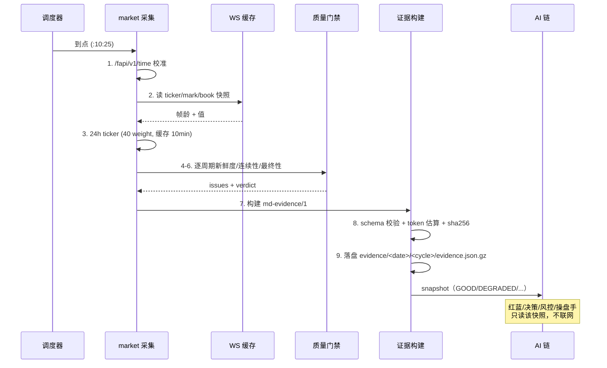

# 04 行情与指标数据管线（v1 设计）

- 日期：2026-11-09（Asia/Shanghai）
- 状态：设计稿（对应任务 t4）
- 上游：`00-需求基线.md`（§5.6 行情约束、§5.7 可审计、§5.8 原项目只读、§6.7 待回答问题、§4 分析 agent 输入）
- 下游：`01-总体架构.md`（组件归属/服务边界）、`02-AI决策链.md`（agent 输入）、`03-Demo执行与风控.md`（下单前新鲜度门禁）、`05-工作台UI.md`（数据来源/刷新）
- 范围：**只做设计**。本文不写实现代码、不启动原项目、不下单、不修改 `multi-agent-trader`

---

## 0. 结论摘要（TL;DR）

1. **数据源**：币安 USD-M 永续**公共只读**行情。REST `https://demo-fapi.binance.com`（无 key，与交易同域，仓内不出现主网常量）+ WS `wss://fstream.binance.com`（公共只读、无鉴权）。域名边界与"Demo 公开行情一致性探针"见 §4.2；**若探针证明 demo 行情不可用，才需要拍板 Q1（是否加只读主网白名单）**。
2. **币种池**：保留 **20 币固定白名单**作为"可交易边界"；每轮只对 **8 个 deep（含全部持仓）+ 20 个 index 行** 做证据序列化。限制来自 **prompt token 与模型注意力，不是权重**：20 币全深约 1.1 万 token/agent/轮，8 币约 4.8 千。
3. **周期**：15m 主分析（500 根 warmup）+ 1h/4h/1d 背景（300/300/200 根）；1m 微结构块 M1 默认关闭。高周期由 15m 本地聚合出当前 bar、每根闭合再用 REST 校准，省一半权重。
4. **指标**：EMA20/50/200、RSI14、MACD(12,26,9)、ATR14+ATR%、ADX14、BB(20,2)+带宽分位、Donchian/区间位置、量能比、taker 买入比、资金费率、OI 及 15m/1h 变化、多空账户比、主动买卖比、点差/盘口失衡。**全部只读闭合 bar**，无未来函数。
5. **两个循环**：10 分钟慢循环**只做**"数据刷新 → 质量门禁 → 生成证据快照 → 交 AI 链"（≤ 6s p95，不含 LLM）；30 秒快循环做价格/标记价/OI 刷新、新鲜度巡检、闭合 bar 事件、UI 推送，**不调 LLM、不下单**。1s 价格由 WS 直推 UI。
6. **限流**：本地预算 **600 weight/min**（官方 2400 的 25%）、后台 75% 让路、普通 90% 让路、`/futures/data` 独立 **800 次/5min**；429 默认冷却 60s（夹 5–3600）、418 默认 480s（夹 480–604800），**两者都不重试**，冷却跨进程重启保留。稳态预计 **≈14–19 weight/min（本地预算 2.4%–3.2%）**。
7. **新鲜度**：`GOOD / DEGRADED / STALE / BLOCKED` 四态门禁，硬规则：只有 GOOD 允许开新仓、DEGRADED 只允许平/减、STALE/BLOCKED 只允许保护性指令。15m 闭合 bar 新鲜 ≤960s、不可用 >1800s；下单门禁对齐 03 R14：**决策证据 ≤180s、下单时点价格 ≤15s**。
8. **复用 vs 新写**：**新写 `market/` 包（约 1,900–2,200 LOC），函数级移植原项目已验证逻辑**；`strategy_runtime/indicators.py` 原样复制（0 改造），`prepare_closed_klines`/`BarMeta`/权重表/429-418 语义移植，**不 import 原项目包**（原因见 §3）。

---

## 1. 范围与边界

### 1.1 本文负责

| 负责 | 说明 |
|---|---|
| 行情采集 | USD-M 公共 REST/WS 接入、订阅管理、重连、聚合 |
| 指标计算 | 闭合 bar 上的确定性指标与派生标记 |
| 证据快照 | `md-evidence/1` 的生成、校验、持久化、渲染 |
| 节拍 | 10 分钟慢循环的数据段、30 秒快循环、bar 闭合事件 |
| 限流 | 权重预算、429/418、退避、单出口 owner |
| 质量门禁 | 新鲜度/连续性/最终性判定与四态 verdict |
| 存储 | K 线库、证据文件、保留期、审计哈希 |

### 1.2 本文不负责（交给其它文档）

- 插件 Host / Python 服务的归属与进程生命周期 → `01-总体架构.md`。本文只提一条硬约束：**同一出口 IP 只能有一个进程持有行情采集与权重预算**（§4.3）。
- 6 个 agent 的 prompt 文本、输出 schema、并行/超时/预算 → `02-AI决策链.md`。本文只交付**输入证据 schema** 与建议 token 预算。
- 下单、SL/TP、对账、账户权益 → `03-Demo执行与风控.md`。本文只交付**下单前必须复核的数据门禁**（§9.5）。
- 页面布局、图表组件 → `05-工作台UI.md`。本文只交付**数据源接口与刷新语义**（§7、§14）。
- 新闻/宏观/链上情报：v1 **明确不做**（基线 §3 已删策略/情报独立角色）。证据里保留 `news: null` 字段位，避免以后改 schema 版本。

---

## 2. 只读现状核实（原项目 `multi-agent-trader`）

### 2.1 文件清单与一处路径修正

任务书给的路径是 `src/exchange/binance_public.py`，**实际不存在**；行情代码在 `src/data/` 下（`src/exchange/` 只有交易/镜像相关模块）。本次核实的真实文件：

| 文件 | 行数 | 关键内容 |
|---|---|---|
| `src/data/binance_public.py` | 624 | `prepare_closed_klines`（闭合投影+质量字典）、`analyze_symbol`、`build_market_brief`、`FALLBACK_SYMBOLS` |
| `src/data/market_query.py` | 666 | 工具层：`query_symbol_detail`、`_pack_candles`（列式压缩）、`_sig`、`_source_quality`、`get_live_prices`、共享 httpx client |
| `src/data/kline_store.py` | 801 | 闭合优先增量缓存、`BarMeta` 三态最终性、15m→1h/2h/4h/8h/1d 聚合、原子落盘 |
| `src/data/rate_limit.py` | 961 | 权重预算、响应头观测、429/418 全局冷却、跨进程状态文件、遥测 |
| `src/data/binance_request_policy.py` | 188 | 端点权重登记表、`parse_retry_after`、优先级 |
| `src/data/binance_transport.py` | 144 | 唯一发送入口：发送锁、权重节流、429/418 硬熔断、有界重试 |
| `src/data/price_stream.py` | 451 | WS 组合流、首帧超时判据、`/market` 与 `/public` 路由、重连退避 |
| `src/data/market_stream_cache.py` | 119 | WS 快照（ticker/mark/book），带接收时点，过期即空 |
| `src/data/market_universe.py` | 217 | 固定白名单 + 短周期异动 + 每小时全扫 |
| `src/strategy_runtime/indicators.py` | 302 | 纯 numpy 向量化指标，warmup 为 NaN，无未来函数 |
| `src/agents/research_evidence.py` | 1672 | 证据门禁：源级 TTL、bar 时效、claim 数值一致性（**阈值参考价值高**） |
| `config/settings.yaml` | 290 | 权重预算、WS 只订 1m/15m、20 币白名单、10min/30s 节拍 |

### 2.2 值得继承的六个机制（全部有实证理由）

| # | 机制 | 出处 | 为什么必须继承 |
|---|---|---|---|
| 1 | **闭合 K 线投影**：只把已收盘 bar 交给指标层，正在形成的 bar 单独作为 `live_bar` | `prepare_closed_klines` | 否则刚开盘几分钟的低量会被读成"缩量健康"，瞬时价会被读成"收盘突破" |
| 2 | **三态最终性** `final: true/false/null` | `BarMeta` | `null`（旧缓存/缺 `x=true` 帧）**不能**当 `true`，否则重启后墙钟跨过收盘时间就把陈旧 bar 当可交易数据 |
| 3 | **权重登记 + 响应头校正** | `binance_request_policy` + `rate_limit` | 未登记端点直接报错，防止新代码默默按 1 权重发；运行时以 `X-MBX-USED-WEIGHT-1M` 校正 |
| 4 | **429/418 永不重试、全局冷却** | `binance_transport` | 被封时重试等于把出口打穿；冷却必须跨请求/跨进程共享 |
| 5 | **WS 首帧超时是唯一可用判据** | `price_stream` | 某些出口对 `fstream` 精确域名拦截：握手成功、SUBSCRIBE 有回执、但零帧，只有首帧超时能识别 |
| 6 | **列式 K 线压缩 + 有效数字取整** | `_pack_candles`、`_sig` | 同样信息省约 60% token；时间戳改相对秒，模型读结构不需要绝对 epoch |

### 2.3 不能照搬的五个点

| 问题 | 现状 | v1 必须改的原因 |
|---|---|---|
| 全有或全无 | `analyze_symbol` 任一周期 `quality["ok"]=False` 就抛错，整币丢失 | v1 要**逐周期降级**：4h 陈旧不应让 15m 可交易的币彻底消失 |
| 隐式 1m 依赖 | 固定拉 1m 600 根 + 15m 80/1h 60/4h 60/1d 30 | 1m 600 根权重 5、token 高；v1 用 15m 为主，1m 默认关 |
| 返回体无版本、无 schema | `analyze_symbol` 返回裸 dict | 证据要给 AI 并落审计，必须版本化 + 可校验 |
| 强耦合 | `binance_public` → `agents.models.MarketBrief` + 全局 `SnapshotCache` | 新服务不应拉起旧 agent 模型层 |
| 跨进程限流 884 行 | 状态文件 + 锁文件 + 遥测 2000 事件 | v1 单进程单 owner，保留语义即可，不需要跨进程协调（§4.3） |

---

## 3. 复用 vs 新写（结论）

**结论：新写 `market/` 包，函数级移植；不 import 原项目包、不只读复用运行数据。**

理由：
1. 原项目是完整应用（`agents.models`/`core.*`/SQLite 审计/190KB Broker），任何 `import data.binance_public` 都会连带拉起模型层与配置加载，违背"原项目只读、不启动"的边界（§5.8）。
2. 原代码面向"工具循环 + 策略扫描"，v1 面向"10 分钟一轮的固定证据快照"，输入输出契约不同；函数级移植比包级复用改造量更小、风险更可控。
3. 移植的是**被生产事故验证过的语义**（闭合投影、三态最终性、权重登记、429/418），不是架构。

| 模块 | 原出处 | 处理 | 新代码量估 | 风险 |
|---|---|---|---|---|
| 指标计算 | `strategy_runtime/indicators.py` | **原样复制**（保留出处注释），补 `nan_policy` 包装 | 0–40 | 低 |
| 闭合投影 + 质量字典 | `binance_public.prepare_closed_klines` | 移植，改为逐周期返回而非抛错 | ~90 | 低 |
| K 线缓存/最终性/增量 | `kline_store.py` | 移植核心（去掉 2h/8h，保留 15m→1h/4h/1d 聚合与 `_merge_row_locked` 优先级） | ~450 | 中（合并语义易写错，需单测） |
| 权重/限流 | `rate_limit.py`+`request_policy.py`+`binance_transport.py` | **重写精简**：保留预算/让路/冷却/响应头/遥测，去掉跨进程文件锁 | ~300 | 中（并发与冷却边界） |
| 行情客户端 | `binance_public.py` | 重写：HTTP 客户端、批量/单点、多源组装 | ~250 | 低 |
| WS 流 | `price_stream.py` | 移植核心：组合流、首帧判据、`/market`→`/public`→`/stream` 回退、重连退避 | ~250 | 中（代理/域名差异） |
| 证据压缩 | `market_query._pack_candles/_sig/_source_quality` | 直接移植成 `evidence/compact.py` | ~120 | 低 |
| 池/异动 | `market_universe.py` | 重写：固定白名单选池（deep ≤8）+ **全市场异动扫描**（`universe.market_scan`，每小时刷新，复用同一份 24h ticker 全量快照，不新增请求） | ~140 | 低 |
| 证据构建/校验/渲染 | 新增 | 新写 | ~350 | 中（schema 稳定性） |
| **合计** | | | **≈1,900–2,200** | |

测试资产：原项目 `tests/integration/test_market_evidence_quality.py`（27KB）里的证据质量场景（源级缺失、时序错配、数值矛盾）思路可参考，但测试需重写为 v1 schema 的离线夹具（§16）。

---

## 4. 数据源与边界

### 4.1 端点与权重（本文使用的全部端点）

权重为本地保守值，**运行时仍以响应头 `X-MBX-USED-WEIGHT-1M` 为准**。

| 用途 | 端点 | 权重 | 频率 | 备注 |
|---|---|---|---|---|
| K 线 | `GET /fapi/v1/klines` | limit<100→1；<500→2；≤1000→5 | 启动回补 + 增量 | 带 `startTime` 只取缺失 |
| 24h 全市场 | `GET /fapi/v1/ticker/24hr`（无 symbol） | **40** | 10min 一次 | 池排序/异动；**最贵的常规请求** |
| 24h 单币 | `GET /fapi/v1/ticker/24hr?symbol=` | 1 | 兜底 | WS 有则不用 |
| 最新价（全市场） | `GET /fapi/v1/ticker/price` | 2 | 30s（WS 断时） | 单 symbol 为 1 |
| 标记价/资金费 | `GET /fapi/v1/premiumIndex`（单 symbol） | 1 | 兜底 | 全市场为 10，禁用 |
| 持仓量 | `GET /fapi/v1/openInterest` | 1 | 30s（持仓） | 无历史 |
| OI 历史 | `GET /futures/data/openInterestHist` | 1（独立窗口） | 10min（deep 币） | 取 5m/15m/1h |
| 多空账户比 | `GET /futures/data/globalLongShortAccountRatio` | 1（独立窗口） | 10min（deep 币） | period=1h |
| 主动买卖比 | `GET /futures/data/takerlongshortRatio` | 1（独立窗口） | 10min（deep 币） | period=1h |
| 盘口（兜底） | `GET /fapi/v1/depth?limit=20` | 2 | 兜底 | 正常走 bookTicker WS |
| 服务器时间 | `GET /fapi/v1/time` | 1 | 启动 + 每轮慢循环 | 时钟校准 |
| 合约元数据 | `GET /fapi/v1/exchangeInfo` | 1 | 启动 + 每日 | 白名单校验（`TRADING`/`PERPETUAL`/`USDT`） |
| 行情 WS | `wss://fstream.binance.com` 组合流 | — | 常驻 | ticker/markPrice/kline/bookTicker |

**不使用**：`/fapi/v1/aggTrades`（权重高、token 无收益）、`/fapi/v1/depth` 大档位、任何需要 key 的端点。

### 4.2 域名与环境隔离（与 03 的 demo-only 静态扫描对齐）

| 流量 | 域名 | 密钥 | 说明 |
|---|---|---|---|
| 行情 REST（只读） | `https://demo-fapi.binance.com` | 无 | 与交易同域；**仓内不出现主网行情常量** |
| 行情 WS（只读） | `wss://fstream.binance.com` | 无 | 公共只读、无鉴权、无下单能力；Demo 无独立行情 WS |
| 交易/账户（签名） | `https://demo-fapi.binance.com` | Demo key | 只允许这一个域名（03 文档负责） |

**为什么行情 REST 也走 demo 域名**：基线 §5.2 要求"任何非 `demo-fapi.binance.com` 的 base URL 必须拒绝启动/拒绝下单"，03 文档把这条升级成了**静态扫描**（仓内 `grep "fapi\.binance\.com"` 除 `demo-fapi` 外必须 0 命中，见 03 §11.3 T12）。行情层若硬编码主网域名，会直接让该门禁失败，也会让"不存在 live 路径"从"代码保证"退化成"约定保证"。因此 v1 默认**不引入主网行情域名**。

WS 是唯一例外，需明确记录理由：Demo 没有独立的行情推送域名，行情 WS 只能连 `wss://fstream.binance.com`。它不匹配 03 的 grep 模式、不需要密钥、也没有任何下单/账户能力。若评审要求更严格，配置 `market.ws.enabled=false` 即可退化为纯 REST 轮询（每 30s 一次全市场价格，权重 2，完全可接受），代价是 1s 价格与 bar 闭合事件消失。

**上线前必须用只读探针验证 demo 公开行情**（M1 第一步，不通过则升级 Q1）：

1. 同一根 15m bar 在 demo 与公开行情的 OHLCV + `close_time` 对齐（偏差 < 0.1%，`close_time` 完全一致）；
2. `/fapi/v1/klines`、`/fapi/v1/ticker/24hr`、`/fapi/v1/premiumIndex`、`/fapi/v1/openInterest` 返回 200 且字段完整；
3. `/futures/data/openInterestHist`、`globalLongShortAccountRatio`、`takerlongshortRatio` 是否可用——**不可用不算失败**：字段置 `null` + `DERIVATIVES_PARTIAL`（warn），证据仍可交易；
4. 若第 1 条不成立（demo 行情与主网不一致/陈旧）→ 触发 Q1，由用户决定是否批准**只读**主网行情白名单。

保护机制：行情请求一律走 `market/transport.py`，该层**拒绝携带任何凭据**（无 `X-MBX-APIKEY`、无签名参数），并断言 host ∈ `MARKET_ALLOWED_HOSTS`（默认只有 `demo-fapi.binance.com`，主网域名仅在 Q1 批准后加入）；交易层**不 import** 行情层，从依赖方向上保证"行情层不可能下单"。

### 4.3 单 owner 原则

- 同一出口 IP 只允许**一个进程**持有 WS 连接与权重预算。若架构把行情放插件 Host（Node），则 Python 服务不得再发任何币安公共请求；反之亦然。
- 该 owner 在 `/api/market/health` 暴露 `collector_pid / started_at / last_frame_at`，另一侧只能读接口。
- 违反后果：两套预算各自以为有 600 weight/min，共享出口实际被打到 1200/min，叠加其他流量易触发 429 → 418。这是原项目用跨进程状态文件解决的问题，v1 用"单 owner"从架构上消除。

---

## 5. 币种池

### 5.1 可交易白名单（20 币，固定）

沿用原项目 `market_universe.core_symbols`（2026-09-02 按 24h 成交额快照生成）：

```
BTC ETH SOL ZEC XRP ARB UNI DOGE BNB NEAR SUI FIL ADA LINK OP TRX AAVE AVAX LTC DOT
```
（均带 `USDT` 后缀，共 20 个。）

**为什么用白名单而不是"全市场按成交额 top N"**（继承原项目结论）：币安有美股/商品代币化合约（`SOXLUSDT` 半导体 ETF、`XAGUSDT` 白银、`XAUUSDT` 黄金、`SKHYNIXUSDT`、`SNDKUSDT`、`SPCXUSDT` 等），美股时段成交额会冲进前十，但与加密交易无关。盲选会：a) 浪费约 60% 采集预算与 prompt 字符；b) 把 regime 判定带偏（拿美股涨跌当币圈趋势）。

**启动校验**（`exchangeInfo`，每日一次）：
1. `status == "TRADING"`、`contractType == "PERPETUAL"`、`quoteAsset == "USDT"`；
2. 不在代币化股票/商品黑名单（配置项，人工维护）；
3. 校验失败 → 从池中剔除 + `UNIVERSE_INVALID_SYMBOL` 告警，**不自动补位**（补位会让 v1 的评估口径漂移）。

**维护策略**：白名单**只在安装/人工评审时更新**，运行时不自动轮换。v1 的目的是验证决策链而不是选品；池子每轮变化会让"这轮为什么交易这个币"无法归因。建议安装时用当周 24h 成交额复核一次并冻结（Q2）。

### 5.2 每轮分层：deep 8 / index 20

| 层 | 数量 | 内容 | 目的 |
|---|---|---|---|
| 白名单 | 20 | 可交易边界；风险硬规则只允许这 20 个 | 稳定、可归因 |
| **deep** | **8**（含全部持仓） | 5 周期指标 + 15m 20 根 K 线 + 衍生品 + 关键位 + 流动性 | 给 AI 足够证据做判断 |
| **index** | 其余 ≤12（合计 20 行） | 1 行 7 字段 | 提供市场宽度与"外面还有什么" |
| omitted | 0–N | 有致命质量问题（如缺口）的币 | 显式告知 AI "看不到" |

**deep 选择算法**（确定性，输入：白名单、持仓、24h ticker、上一轮决策）：

```
deep = 去重并按优先级取前 8：
  1. 当前持仓/挂单币（全部，硬性）            reason: held
  2. 上一轮决策选中的币（若仍在前 20）         reason: prev_pick
  3. 白名单内 24h 成交额 top 3（已持仓的跳过）  reason: top_volume
  4. 白名单内 |24h 涨跌| 最大且成交额 ≥ 2 亿 USD 的 2 个  reason: anomaly
  5. 不足 8 个：按成交额顺序补                   reason: fill
硬约束：
  - 24h 成交额 < 2 亿 USD 的币不进 deep（流动性不足，SL 打滑不可控），除非是持仓
  - 有 STALE/BLOCKED 级质量问题的币不进 deep，改记 omitted
```

### 5.3 为什么不是 20 全深，也不是先做小子集

| 方案 | 每轮 prompt（仅行情） | 权重/轮 | 评价 |
|---|---|---|---|
| 20 全深 | ≈11,000 token | 20×4 次 `/futures/data` = 80 | **否决**：单 agent 输入就吃满预算，"注意力稀释"比 token 更致命——红蓝辩论会围绕 20 个币各说一句，无法形成可执行论点 |
| 先做 3–5 币子集 | ≈2,000 token | ≈12 | **否决**：池子太小，β 与板块轮动全被过滤；v1 评估结论无法外推；且持仓若在池外无法管理 |
| **20 白名单 + 8 deep + 20 index** | **≈4,800 token** | **≈20–32** | **推荐**：可交易边界稳定，证据聚焦，市场宽度仍可见 |

补充：**指标计算本身对 20 币全量做**（numpy 成本可忽略），只是**不序列化**进 prompt。这样 UI 可以显示全部 20 币的状态，风险规则也能对任意白名单币做校验。

---

### 5.4 全市场异动扫描（`universe.market_scan`）

原项目 `market_universe.py` 有"5 分钟异动雷达 + 每小时全量扫描"。v1 早期把这层简化掉了，
结果是**白名单外的币再怎么涨也进不了任何人的视野**。现在补回来，但**不改可交易边界**：

| 项 | 取值 |
|---|---|
| 数据源 | 已有的 `GET /fapi/v1/ticker/24hr`（无 symbol）全量快照，**不新增请求** |
| 刷新 | 排序结果缓存 1h（`MARKET_SCAN_REFRESH_S`）；ticker 本身仍按 30s 缓存 |
| 流动性下限 | 与选池同一口径 `MIN_QUOTE_VOLUME_USD`（2 亿），不足者计入 `below_volume_floor` |
| 异动阈值 | `ANOMALY_PCT`（5%） |
| 输出 | `top_gainers` / `top_losers` / `anomalies` / `outside_whitelist_anomalies`，每行 `symbol` `pct_24h` `quote_volume_usd` `in_whitelist` |

**硬边界（不可违反）**：扫描只做知情与发现。

1. `in_whitelist=false` 的行**永不**进入 `deep`/`index`，可交易集合仍由白名单唯一决定（§5.1）；
2. 扫描块是 `md-evidence/1` 的**可选**字段——缺它时旧证据仍然合法，不会因新增块让历史快照失效；
3. 阈值只在"过了流动性下限"的集合内统计，避免低成交量假异动占据视野；
4. 字段缺失（如 `quoteVolume` 为 null）一律跳过，**不折算成 0**。

**为什么要它**：`analysis` 唯一的候选来源是 `deep`/`index`。没有这一块时，"外面正在发生什么"
在证据里完全不可见，选品口径也无法被复盘质疑；有了它，模型能看到"白名单外的某币 24h +42%"
并把它写进 `warnings`，但依然**不能**把它当候选交易——知情与可交易被刻意分开。

## 6. 周期与指标

### 6.1 周期与 warmup

| 周期 | 角色 | 保留根数 | 启动回补 | warmup 需求 | 单次 REST 权重 |
|---|---|---|---|---|---|
| **15m** | 主分析 | 1200（12.5 天） | 500 | EMA200 + 20 根统计 + 50 根结构 | 5 |
| **1h** | 背景 | 1500（62 天） | 300 | EMA200 | 2 |
| **4h** | 背景 | 1500（250 天） | 300 | EMA50 + ATR14 | 2 |
| **1d** | 背景 | 1500（4 年） | 200 | EMA50 + ATR14 | 2 |
| 1m | 微结构（M1 关） | — | 60（若开） | — | 1 |

- warmup 判据：指标输出 `nan` 即视为未就绪；快照里 `timeframes[tf].ready=false` 并列入 `issues`。
- 15m 保留 1200 根同时是 1h/4h/1d 聚合的底座（1 天 = 96 根 15m，1200 根只够 12.5 天，因此高周期必须另有 REST 回补，不能只靠聚合）。

### 6.2 指标集（全部闭合 bar）

| 类别 | 指标 | 参数 | 周期 | 输出字段 |
|---|---|---|---|---|
| 趋势 | EMA（SMA 种子，α=2/(n+1)） | 20/50/200 | 15m/1h/4h/1d（4h/1d 只需 20/50） | `ema20` `ema50` `ema200` |
| 趋势强度 | ADX / +DI / −DI（Wilder） | 14 | 15m、1h | `adx14` `pdi` `ndi` |
| 动能 | RSI（Wilder） | 14 | 15m、1h | `rsi14` |
| 动能 | MACD | 12/26/9 | 15m、1h | `macd.line/signal/hist` |
| 波动 | ATR（Wilder）+ ATR% | 14 | 15m/1h/4h/1d | `atr14` `atr_pct` |
| 波动 | 布林带 + 带宽分位 | 20, 2σ | 15m | `bb.mid/upper/lower/width_pct/width_pctile_100` |
| 结构 | Donchian / 区间位置 | 20、50 | 15m；20 用于 1h/4h/1d | `range_high_20` `range_low_20` `range_pos` |
| 量能 | 成交额量比 | 最近闭合 vs 前 20 均值 | 15m | `volume.quote_ratio_20` |
| 订单流 | taker 买入占比 | 最近 bar + 20 均值 | 15m、1h | `volume.taker_buy_ratio` `taker_buy_ratio_avg20` |
| 衍生品 | 资金费率 / 下次结算 | — | — | `funding_rate` `funding_bp` `next_funding_at` `funding_pctile_7d` |
| 衍生品 | 持仓量及变化 | — | — | `oi_usd` `oi_change_15m_pct` `oi_change_1h_pct` `oi_change_24h_pct` |
| 衍生品 | 多空账户比 / 主动买卖比 | period=1h | — | `long_short_ratio_1h` `taker_buy_sell_ratio_1h` |
| 微观 | 点差 / 盘口失衡 / 估算滑点 | — | — | `liquidity.spread_bps` `top_imbalance` `est_slippage_bps_10k` |
| 关键位 | 前日高低 / 7 日高低 / 20 根极值 / EMA | — | — | `levels.supports[]` `levels.resistances[]` `levels.anchors` |

### 6.3 计算口径（必须写死的细节）

1. **只用闭合 bar**：`close_time <= now_server` 且 `final is True`；形成中的 bar 只进 `price.last`，不进任何指标。
2. **EMA 种子**：前 n 根 SMA 作种子（与 `indicators.py` 一致），不是交易所的"从第一根开始递推"。
3. **RSI/ATR/ADX**：Wilder 平滑（α=1/n），不是简单移动平均。
4. **量比**：`quote_volume[last] / mean(quote_volume[-21:-1])`；分母为 0 → `null`，不是 0。
5. **taker 买入比**：`taker_buy_quote_volume / quote_volume`（K 线第 10 / 第 8 列），最近 1 根与 20 根均值。
6. **区间位置**：`(close - min(low[-20:])) / (max(high[-20:]) - min(low[-20:]))`，分母 0 → 0.5。
7. **带宽分位**：`width_pct` 在过去 100 根中的分位（0–1），不足 100 根 → `null`。
8. **funding 分位**：过去 7 天（21 次结算）的绝对值分位，不足 7 天 → `null`。
9. **OI 变化**：`(oi_now / oi_15m_ago - 1) * 100`；缺历史 → `null`，**不得**用 0 代替（"OI 没变"与"没取到"是两件事）。
10. **有效数字**：价格 6 位、百分比 2 位、`*_usd` 3 位有效数字（≥1e9 用科学计数）、比率 4 位。原始精度另存 SQLite。
11. **无未来函数**：所有指标在 t 时刻只用 ≤ t 的数据；测试用"前缀重算一致性"验证（截断到 k 根重算，前 k 个值不变）。

### 6.4 派生标记 `flags`（确定性规则，供 AI 快速扫读）

| flag | 触发条件 | 用途 |
|---|---|---|
| `trend_aligned_up` / `trend_aligned_down` | 1h/4h/1d 的 `trend` 同向 | 趋势跟随候选 |
| `trend_conflict` | 15m 与 1h 反向 | 逆势/回调提示 |
| `volume_spike` | `quote_ratio_20 ≥ 2.0` | 突破可信度 |
| `volatility_expansion` | `atr_pct_15m ≥ 1.2` 且 `bb.width_pctile_100 ≥ 0.8` | 止损距离要放宽 |
| `volatility_compression` | `bb.width_pctile_100 ≤ 0.2` | 变盘前兆 |
| `near_24h_high` / `near_24h_low` | 距 24h 高低点 ≤ 0.5% | 突破/假突破 |
| `extended_from_ema20` | `|last/ema20_15m − 1| ≥ 1.5 × atr_pct` | 追单风险 |
| `funding_extreme` | `|funding_rate| ≥ 0.0005`（8h，沿用原项目异动阈值） | 拥挤交易 |
| `oi_surge` / `oi_flush` | `oi_change_1h_pct ≥ 5` / `≤ −5` | 增仓/减仓 |
| `taker_skew_buy` / `taker_skew_sell` | `taker_buy_ratio ≥ 0.60` / `≤ 0.40` | 主动买卖失衡 |
| `stale_some_sources` | 任一源 age 超过 warn 阈值 | 提示证据不全 |

规则阈值进配置，改阈值必须同步改文档与测试（避免"文档一套、代码一套"）。

---

## 7. 循环节拍

### 7.1 四个节拍

| 节拍 | 周期 | 发起 | 做什么 | 绝不做什么 |
|---|---|---|---|---|
| **P1 价格推送** | 1s（WS） | WS 帧 → 服务 → UI（SSE） | 最新价/标记价/盘口节流后推 UI；持仓浮盈重算 | 不调 LLM、不落库每次 tick |
| **P2 快循环** | 30s | 定时器 | 刷新持仓/焦点币 OI、标记价；新鲜度巡检；bar 闭合事件；UI 状态 | 不调 LLM、不下单、不做全池深分析 |
| **P3 慢循环** | 10min (+手动) | 定时器/按钮 | 数据刷新 → 质量门禁 → 证据快照 → 交 AI 链 → 交执行 | 不直接下单（执行由 03 负责） |
| **P4 维护** | 1h / 1d | 定时器 | 每小时池排序重算；每日 `exchangeInfo` 校验、证据/日志清理 | 不做决策 |

### 7.2 慢循环（P3）数据段

固定相位 `:00:25 / :10:25 / :20:25 ...`（本地墙钟，允许 ±2s 抖动）。**不强制等待 15m 收盘**：`as_of.last_closed_bar` 会把"最后一次收盘 bar 的时间与年龄"明确写给 AI。

| # | 步骤 | 时限 | 失败行为 |
|---|---|---|---|
| 1 | `GET /fapi/v1/time` 校准时钟 | 300ms | 用上次 offset；偏差 >5s → `CLOCK_SKEW` |
| 2 | 新鲜度巡检（内存 + WS 快照），必要时补 REST | 1.5s | 补失败 → 用缓存 + 标记 |
| 3 | 24h 全市场 ticker（40 权重，10min 一次） | 1.0s | 用上次快照 + `UNIVERSE_DEGRADED` |
| 4 | 计算 deep 集合（§5.2） | 10ms | 退化：持仓 + 白名单前 8 |
| 5 | deep 币指标计算（读 K 线缓存；缺则增量拉） | 1.5s | 单币失败 → omitted |
| 6 | 衍生品补齐（OI hist / 多空比 / taker 比） | 1.5s | 单源缺失 → `null` + `DERIVATIVES_PARTIAL` |
| 7 | 组装 + 校验 `md-evidence/1`（含 token 估算） | 200ms | 校验失败 → **本轮 fail-closed**，不调 LLM |
| 8 | 落盘（gzip + sha256 + DB 索引） | 200ms | 写失败 → **本轮 fail-closed**（审计断链不允许交易） |
| 9 | 交给 AI 链（`02` 文档）| — | 由 02 定义 |

p95 预算：步骤 1–8 **≤ 6s**（不含 LLM）。超时 → 使用已有数据出 `DEGRADED` 快照，AI 仍可分析但不可开新仓（§9.2）。



### 7.3 快循环（P2）

| 动作 | 频率 | 说明 |
|---|---|---|
| 持仓 + 焦点币 OI 刷新 | 30s | `/fapi/v1/openInterest`，≤3 币 = 3 权重 |
| 标记价/资金费兜底 | 30s | WS 正常时不发（`get_marks(max_age=30)` 命中即跳过） |
| 全市场价格兜底 | 30s | 仅 WS 断流时：`/ticker/price` 全市场（权重 2） |
| 新鲜度巡检 | 30s | 更新 `data_health`，变化时广播 `health` 事件 |
| bar 闭合事件 | 每 15m 收盘 + ≤5s | WS `x=true` 为**主判据**；WS 断时以 server_time ≥ close_time + 1s 且 REST 校验为副判据 |
| 指标轻量刷新 | bar 闭合时 | 只对持仓 + deep 重算 15m 指标（供 UI 与风控读取） |
| UI 推送 | 1s（价格）/ 30s（状态） | SSE；客户端断线重连拿最近快照 |

快循环**不写证据文件**、不触发 AI；它产出的"最新价/最新指标"快照带 `age_s`，慢循环直接复用。

### 7.4 触发、幂等、重入

- `cycle_id = cyc-<UTC yyyyMMddTHHmmssZ>-<6 hex>`，由慢循环入口生成；**同一 cycle_id 重放返回同一快照**（落盘文件即幂等键）。
- 手动"运行一轮"：
  - 若距上一轮 < `manual_min_gap_s=60`，**复用上一轮快照**并返回 `reused=true`（避免连点造成重复权重 + 重复决策）；
  - 若上一轮仍在跑 → 409 `CYCLE_RUNNING`，不排队（v1 不做队列）；
  - 手动轮次同样写审计，`trigger=manual`。
- 定时器补偿：进程休眠/重启后，若错过 >3 个周期，**只跑一次**并标记 `DATA_GAP`，不补跑历史轮次（避免启动风暴与陈旧数据决策）。

### 7.5 时间预算（端到端）

```
P3 数据段 ≤6s  →  分析 ≤25s  →  R1 红蓝开场并行 ≤20s  →  R2 红蓝回应并行 ≤25s  →  决策 ≤20s  →  风控 ≤10s  →  操盘手 ≤15s
端到端 p95 ≈130s，链硬超时 140s；下单门禁 180s（对齐 03 R14 `decision_evidence_max_age_ms=180000`，超时即 no_trade）
```

---

## 8. 缓存与限流

### 8.1 三层缓存

| 层 | 内容 | TTL/失效 | 作用 |
|---|---|---|---|
| L1 内存 | WS 快照（ticker/mark/book）、K 线 ring buffer、指标缓存 | 帧龄 >15s 视为陈旧；bar 闭合即更新 | 1s UI、快循环、慢循环读取 |
| L2 SQLite | `bars`（含 final/complete/source/revision）、`universe_state` | 每 TF 保留上限 | 重启恢复、增量判断、图表 |
| L3 证据文件 | `evidence/<date>/<cycle>/evidence.json.gz` | 30 天 | 审计、UI 决策链回看、复盘 |

**缓存不可跨币混用**：某币数据陈旧时返回该币的 issue，不得用别的币或全市场均值填充。

### 8.2 权重预算与让路

| 参数 | 值 | 依据 |
|---|---|---|
| 官方额度 `weight_limit_1m` | 2400 | USD-M 当前公开额度（响应头校正） |
| 本地预算 `local_weight_budget_1m` | **600（25%）** | 为执行对账/保护单/共享出口未知流量留余量 |
| 后台让路 | 已用 ≥**75%** 时 background 请求直接 `BudgetDeferred` | 情报/全市场扫描可丢 |
| 普通让路 | 已用 ≥**90%** 时非 critical 请求延后 | 决策数据仍可排队 |
| critical | 绕过本地软预算，**不绕过** 418/429 冷却 | 平仓/保护永不因预算卡死 |
| `/futures/data` 窗口 | **800 次 / 300s**（官方 1000，留 20% 余量） | 独立 IP 窗口 |
| 发送平滑 | `interval = max(0.05s, 60 × weight / 600)`；weight=5 的 K 线至少间隔 0.5s | 避免瞬时打满 |
| 发送锁 | 全局单锁覆盖"冷却检查 + HTTP + 响应登记" | 429 返回与登记之间不被穿透 |

### 8.3 429 / 418 语义

| 状态 | 判定 | 冷却 | 重试 | 其它动作 |
|---|---|---|---|---|
| **429** | 响应码 429 | `Retry-After`（秒或 HTTP 日期），缺省 **60s**，夹 **[5, 3600]** | **禁止** | 全局冷却；本轮剩余 REST 取消；转缓存；`RATE_LIMITED_429` |
| **418** | 响应码 418 | `Retry-After`，缺省 **480s**，夹 **[480, 604800]** | **禁止** | 标记 IP 封禁；REST 全停，仅 WS；`IP_BANNED_418`；开新仓硬阻断 |
| 5xx / 网络 | 超时、连接重置、502/503/504 | — | 最多 3 次尝试，退避 0.25/0.5/1.0s（不超过剩余 deadline） | 失败后用缓存 + issue |
| 4xx 其它 | 400/401/403/404 | — | **禁止** | 记录 `REQUEST_REJECTED`，按端点降级（如 `/futures/data` 404 → 衍生品置 null） |

补充：
- 冷却状态持久化到 `state/rate_limit.json`（`cooldown_until_ms`），**重启不清零**（否则重启即撞墙）。
- 冷却期内 `check_available()` 抛 `PublicMarketCooldown`，慢循环改用缓存快照并把 `verdict` 降级；**不 sleep 等待**（等待会让 10 分钟节拍漂移）。
- 418 期间 WS 若也在断，`verdict=BLOCKED`，UI 顶部横幅 + 风控禁止新开仓（§9.5）。

### 8.4 预计用量（稳态）

| 来源 | 频率 | 权重/次 | 折算 weight/min |
|---|---|---|---|
| 24h 全市场 ticker | 1/10min | 40 | 4.0 |
| K 线增量（WS 正常时 0；断流时 8 币） | 1/10min | 0–8 | 0–0.8 |
| OI 当前（deep 8） | 1/10min | 8 | 0.8 |
| OI 历史（deep 8） | 1/10min | 8 | 0.8 |
| 多空账户比 + 主动买卖比（8 币 ×2） | 1/10min | 16 | 1.6 |
| 时钟 + 元数据 | 1/10min | 1–2 | 0.1–0.2 |
| **慢循环小计** | | **73–82** | **≈7.3–8.2** |
| 快循环 OI（持仓 ≤3 币） | 2/min | 3 | 6.0 |
| 快循环全市场价格（仅 WS 断流时） | 2/min | 2 | 0–4.0 |
| 1h 周期校准（20 币 ×2） | 1/h | 40 | 0.7 |
| **合计（稳态）** | | | **≈14–19 weight/min** |

相对本地预算 600/min：**2.3%–3.2%**；相对官方 2400/min：**0.6%–0.8%**。突发回补峰值约 300 权重/2 分钟（仍 < 600/min）。结论：**瓶颈不是权重，而是 prompt token**；因此 v1 不需要为省权重牺牲证据质量，限流设计的目标是"绝不撞墙"，不是"省着用"。

### 8.5 启动与回补节奏

1. 启动：`exchangeInfo`（1）+ `time`（1）+ 白名单 ticker（40）→ 建立 deep 集合；
2. **第一波只回补 deep 8 币**（8×11=88 权重，含 15m 500/1h 300/4h 300/1d 200 + OI + premium），≤10s 内可用；
3. 剩余 12 币在后台按 weight=1 的节奏慢慢回补（每分钟 2 币，6 分钟完成），不阻塞第一轮决策；
4. 回补失败重试 2 次后标记 `BOOTSTRAP_INCOMPLETE`，该币 `ready=false`，不进 deep。

---

## 9. 数据新鲜度与质量门禁

### 9.1 时效阈值（全部为硬编码默认值 + 配置可调）

时间以**服务器校正时间**计算，`age = now_server − last_closed_at`。

| 数据项 | 新鲜（fresh） | 警告（warn） | 不可用（unusable） |
|---|---|---|---|
| 最新价 ticker（WS） | ≤ 5s | 5–15s | >15s：先 REST 补一次；**持仓/deep 币仍 >15s → `TICKER_STALE` error（DEGRADED）**；>60s → STALE |
| 标记价 / 资金费（WS） | ≤ 15s | 15–60s | > 300s |
| bookTicker（点差） | ≤ 5s | 5–30s | > 60s（仅影响滑点估计） |
| **15m 闭合 bar** | ≤ **960s** | 960–1800s | > **1800s** |
| 1h 闭合 bar | ≤ 3900s | 3900–7200s | > 7200s |
| 4h 闭合 bar | ≤ 15600s | 15600–28800s | > 28800s |
| 1d 闭合 bar | ≤ 93600s | 93600–172800s | > 172800s |
| OI 当前值 | ≤ 120s | 120–300s | > 600s |
| OI 历史（15m/1h 变化） | ≤ 900s | — | 缺失 → `null` |
| 多空比 / 主动买卖比 | ≤ 1800s | — | 缺失 → `null` |
| **证据快照本身** | ≤ 300s | 300–600s | > **600s** |
| 下单门禁：决策证据 age（03 R14） | ≤ 130s | 130–180s | > **180s** 拒绝新开 |
| 下单门禁：时点价格 age（03 R14） | ≤ 5s | 5–15s | > **15s** 拒绝新开 |
| 服务器时钟偏差 | ≤ 1000ms | 1000–5000ms | > **5000ms** |

阈值依据：15m 的 960s = 900s 周期 + 60s 宽限（覆盖 bar 闭合检测与 30s 快循环相位）；1h 的 7200s 对齐原项目 `DEFAULT_MAX_BAR_AGE_MS`（2h）；快照 600s 对齐 `DEFAULT_MAX_SNAPSHOT_AGE_MS`；下单门禁直接采用 03 的 R14（证据 180s / 时点价 15s），本文档只负责**按同一阈值生成 `snapshot_age_ms` 与 `price_age_ms`**，避免两处各写一套。

### 9.2 四态 verdict（机器门禁，非文案）

| verdict | 判定 | 允许的动作 | UI |
|---|---|---|---|
| **GOOD** | 全部 deep 的 15m/1h ready，持仓币全部 ready；无 error 级 issue；`clock_ok` | 开新仓 / 平仓 / 减仓 / 调仓 | 正常 |
| **DEGRADED** | 存在任一 error 级 issue（非持仓币缺口、429 冷却、TICKER_STALE 升级等），或累计 ≥4 个 warn（score < 0.85）；15m 对持仓币仍可用 | **只允许平/减/调整保护**，不允许开新仓 | 黄色角标"数据降级" |
| **STALE** | 任一持仓币 15m 不可用，或快照 age > 600s | 只允许保护性指令（撤单、SL/TP 修正、平仓） | 橙色横幅 |
| **BLOCKED** | 418 封禁 / WS 全断且 REST 冷却 / 时钟偏差 >5s / 证据落盘失败 | **任何新订单都不允许**，只允许本地告警与人工处置 | 红色横幅 |

判定是**确定性代码**，AI 不参与；AI 可以在理由里引用 verdict，但不能改变它。风控硬规则读取同一个 verdict（03 文档），保证两处一致。

verdict 计算规则（伪代码）：

```
score = 1 - Σ(weight_i for issue_i)     # error=0.25, warn=0.05
if any BLOCKING condition: verdict = BLOCKED
elif any held symbol 15m unusable or snapshot_age > 600s: verdict = STALE
elif any error issue or score < 0.85: verdict = DEGRADED
else: GOOD
```

### 9.3 issue code 枚举（固定词表，落盘/UI/风控共用）

| code | 级别 | 含义 | 典型处置 |
|---|---|---|---|
| `KLINE_STALE` | error | 闭合 bar 超不可用阈值 | 该币 omitted；持仓币 → STALE |
| `KLINE_GAP` | error | 最近 20 根有缺口（非整周期递进） | 该币 omitted，**不插值** |
| `KLINE_NOT_FINAL` | error | 已过收盘时间但 `final != true` | 该币 omitted |
| `KLINE_FINALITY_UNKNOWN` | error | 旧缓存/缺 `x=true`，三态为 null | 该币 omitted；REST 重取一次 |
| `KLINE_INSUFFICIENT` | error | 闭合根数 < warmup | `ready=false`，该周期指标为 null |
| `KLINE_STRUCTURE_INVALID` | error | 乱序/重复/非法行 | 该币 omitted |
| `TICKER_STALE` | warn→error | 最新价过期 | 先 REST 补；持仓/deep 币 >15s 升 error（对齐 03 R14 与 05 expired） |
| `MARK_STALE` | warn | 标记价/资金费过期 | 用 REST premiumIndex 补 |
| `BOOK_STALE` | warn | 盘口过期 | 滑点估计置 null，不阻断 |
| `OI_STALE` | warn | OI 过期 | 字段 null + 标记 |
| `FUNDING_STALE` | warn | 资金费过期 | 字段 null + 标记 |
| `DERIVATIVES_PARTIAL` | warn | 衍生品源部分缺失 | 允许开仓（非必需源） |
| `UNIVERSE_DEGRADED` | warn | 24h ticker 用缓存 | deep 集合用上次结果 |
| `UNIVERSE_INVALID_SYMBOL` | warn | 白名单校验失败 | 剔除该币 |
| `RATE_LIMITED_429` | error | 429 冷却中 | 用缓存；verdict ≥ DEGRADED |
| `IP_BANNED_418` | error | 418 封禁 | BLOCKED |
| `WS_DOWN` | warn | WS 断流 | REST 兜底；连续 3 次失败转 blocked 探测 |
| `STREAM_LAG` | warn | 收帧时延 > 10s | 标记该源时间不可信 |
| `CLOCK_SKEW` | error | 服务器偏差 > 5s | BLOCKED（禁止开新仓） |
| `DATA_GAP` | warn | 进程休眠/重启错过周期 | 只跑一次恢复轮 |
| `PERSIST_FAILED` | error | 证据落盘失败 | BLOCKED（审计断链） |
| `SNAPSHOT_TRUNCATED` | warn | 因 token 预算裁剪字段 | 记录 `dropped_fields` |
| `BOOTSTRAP_INCOMPLETE` | warn | 回补未完成 | 该币不进 deep |

### 9.4 降级矩阵（场景 → 行为）

| 场景 | 检测 | 数据行为 | 证据行为 | 门禁（按 §9.2 规则算出） |
|---|---|---|---|---|
| WS 握手成功但零帧（域名被拦） | 首帧 > 15s | 转 REST 轮询（≤预算），每 5min 重试 | `WS_DOWN` | REST 兜底且新鲜 → GOOD（warn）；REST 也失败/受限 → DEGRADED |
| WS 断流（>45s 无业务帧） | 帧龄 | 主动重连，指数退避 5s→120s；连续 3 次转慢探测 120s | `STREAM_LAG` | 重连成功前 GOOD（warn）；>5min 未恢复 → DEGRADED |
| 429 | 响应码 | 冷却 + 取消本轮剩余 REST，用缓存 | `RATE_LIMITED_429`（error） | DEGRADED；持仓币 15m 随之不可用 → STALE |
| 418 | 响应码 | REST 全停，仅 WS | `IP_BANNED_418`（error） | **BLOCKED** |
| 某周期缺口 | 递进校验 | **不插值**，该周期 `ready=false` | 该币 omitted / `KLINE_GAP` | 非持仓币 → DEGRADED；持仓币 15m 缺口 → STALE |
| 单币全部失败 | 异常/质量 | 保留上次指标但标 `age_s` | omitted | 非持仓 → DEGRADED；持仓 → STALE |
| 24h ticker 失败 | 异常 | 用上次快照（≤60min） | `UNIVERSE_DEGRADED`（warn） | GOOD（warn）；快照 >60min → DEGRADED |
| 衍生品端点 404（Demo 域名） | 404 | 字段 null | `DERIVATIVES_PARTIAL`（warn） | GOOD（不阻断） |
| 时钟漂移 | `/time` | 用 offset 校正 | `CLOCK_SKEW` | >5s **BLOCKED** |
| 进程休眠 20min | 定时器漂移 | 恢复轮一次（不补跑） | `DATA_GAP` + 实际 `KLINE_STALE` | 通常 DEGRADED；持仓币 15m 陈旧 → STALE |
| 证据落盘失败 | IO 异常 | 内存保留但不产出可用快照 | `PERSIST_FAILED`（error） | **BLOCKED** |
| 连点"运行一轮" | 幂等键（<60s） | 复用快照 | — | 沿用上一轮 verdict，不重复决策 |

> 说明：单个 warn 不降级（GOOD），累计 4 个 warn（score=0.80<0.85）或任一 error 才降 DEGRADED；这避免"代理拦了 fstream 就永远不能开仓"的僵局——只要 REST 兜底仍能保证新鲜度，交易应照常进行。

---

## 10. 证据快照 `md-evidence/1`

### 10.1 设计原则

1. **给 AI 读，不给 AI 猜**：字段名自带单位（`_pct` `_usd` `_ms` `_s` `_bps`），`null` 一律表示"没取到"，**不存在用 0 冒充缺失**。
2. **可机器校验**：JSON Schema + 生成端校验；校验失败即本轮 fail-closed，不"尽力而为"。
3. **一份真源，两种视图**：`evidence.json`（完整，落盘审计）与 `evidence.prompt.json`（裁剪，进 prompt）由同一对象确定性派生，裁剪只删字段不改语义。
4. **自我描述**：`data_health.verdict` 与 `issues` 让模型知道"这份证据有多可信"；`as_of.last_closed_bar` 让它知道"看到的是哪根 bar"。
5. **确定性**：同输入必出同字节（排序、取整、无时间戳随机数），可复现、可 diff。
6. **不含账户与订单**：账户/仓位/近期成交由 `02` 在拼接 prompt 时合并（避免行情与账本两个 owner 打架）。

### 10.2 顶层结构

| 字段 | 类型 | 说明 |
|---|---|---|
| `schema_version` | `"md-evidence/1"` | 版本；破坏性变更升 `/2` |
| `snapshot_id` | `ev-<UTC ts>-<6hex>` | 含内容哈希前 6 位 |
| `cycle_id` | `cyc-...` | 与决策轮次一一对应 |
| `mode` | `"demo"` | 固定；出现其它值即拒绝 |
| `produced_at_ms` / `produced_at` | int / ISO(+08:00) | 生成时刻 |
| `as_of` | object | 服务器时间、偏差、各周期最后闭合 bar |
| `data_health` | object | verdict / score / issues / 源状态 |
| `market` | object | regime / 宽度 / movers / anomalies |
| `universe` | object | 白名单 / deep / index / omitted |
| `symbols` | object | symbol → deep 或 index 块 |
| `limits` | object | token 预算、估算、裁剪记录 |
| `provenance` | object | 服务版本、请求数、缓存命中、sha256 |
| `delivery` | object | 下单门禁 TTL、受众、渲染版本 |

### 10.3 完整示例（节选：1 个 deep + 1 个 index，可直接进 prompt）

> 为便于阅读，示例只列 2 个标的；真实快照 `symbols` 覆盖全部 20 个（8 deep + 12 index），`universe` 与 `symbols` 的键集合必须一致。

```json
{
  "schema_version": "md-evidence/1",
  "snapshot_id": "ev-20261109T014520Z-7f3a1c",
  "cycle_id": "cyc-20261109T014520Z-7f3a1c",
  "mode": "demo",
  "produced_at_ms": 1794188720000,
  "produced_at": "2026-11-09T09:45:20+08:00",
  "as_of": {
    "server_time_ms": 1794188719960,
    "local_time_ms": 1794188719900,
    "offset_ms": -60,
    "rtt_ms": 38,
    "clock_trusted": true,
    "last_closed_bar": {
      "15m": "2026-11-09T01:30:00Z",
      "1h": "2026-11-09T01:00:00Z",
      "4h": "2026-11-09T00:00:00Z",
      "1d": "2026-11-09T00:00:00Z"
    },
    "bar_age_s": { "15m": 20, "1h": 2720, "4h": 9920, "1d": 9920 }
  },
  "data_health": {
    "verdict": "GOOD",
    "score": 0.95,
    "issues": [
      { "code": "OI_STALE", "severity": "warn", "scope": "SOLUSDT", "detail": "open_interest age 320s > 120s" }
    ],
    "sources": {
      "rest": { "state": "ok", "cooldown_s": 0, "weight_used_1m": 132, "weight_limit_1m": 2400, "local_budget_1m": 600 },
      "ws": { "state": "live", "last_frame_age_s": 0.4, "reconnects": 0, "streams": 100 }
    }
  },
  "market": {
    "regime": "trend_up",
    "regime_basis": { "breadth_up": 13, "breadth_down": 4, "median_pct_24h": 1.4, "btc_pct_24h": 2.1 },
    "movers": [
      { "symbol": "ZECUSDT", "pct_24h": 11.2, "quote_vol_24h_usd": 1.24e9, "why": ["volume_spike", "near_24h_high"] },
      { "symbol": "ARBUSDT", "pct_24h": -6.4, "quote_vol_24h_usd": 4.1e8, "why": ["taker_skew_sell"] }
    ],
    "anomalies": ["BTCUSDT funding 0.062%/8h (>0.05%)"],
    "notes": ["20 symbols scanned; 8 deep, 12 index-only"]
  },
  "universe": {
    "whitelist": ["AAVEUSDT", "ADAUSDT", "ARBUSDT", "AVAXUSDT", "BNBUSDT", "BTCUSDT", "DOGEUSDT", "DOTUSDT", "ETHUSDT", "FILUSDT", "LINKUSDT", "LTCUSDT", "NEARUSDT", "OPUSDT", "SOLUSDT", "SUIUSDT", "TRXUSDT", "UNIUSDT", "XRPUSDT", "ZECUSDT"],
    "deep": [
      { "symbol": "BTCUSDT", "reason": ["held", "top_volume"] },
      { "symbol": "ETHUSDT", "reason": ["top_volume"] },
      { "symbol": "SOLUSDT", "reason": ["held"] },
      { "symbol": "ZECUSDT", "reason": ["anomaly"] },
      { "symbol": "XRPUSDT", "reason": ["fill"] },
      { "symbol": "DOGEUSDT", "reason": ["fill"] },
      { "symbol": "BNBUSDT", "reason": ["fill"] },
      { "symbol": "ADAUSDT", "reason": ["fill"] }
    ],
    "index": ["AAVEUSDT", "ARBUSDT", "AVAXUSDT", "DOTUSDT", "FILUSDT", "LINKUSDT", "LTCUSDT", "NEARUSDT", "OPUSDT", "SUIUSDT", "TRXUSDT", "UNIUSDT"],
    "omitted": []
  },
  "symbols": {
    "BTCUSDT": {
      "depth": "deep",
      "price": {
        "last": 68234.5, "mark": 68240.1, "bid": 68234.0, "ask": 68235.0,
        "spread_bps": 0.15, "pct_24h": 2.35, "high_24h": 68820.0, "low_24h": 66110.0,
        "quote_vol_24h_usd": 1.24e10, "age_s": 0.4
      },
      "trend": { "15m": "up", "1h": "up", "4h": "range", "1d": "up", "aligned": false },
      "timeframes": {
        "15m": {
          "ready": true, "bars": 500, "last_closed_at": "2026-11-09T01:30:00Z", "age_s": 20,
          "ema20": 67410.2, "ema50": 66980.1, "ema200": 65120.4,
          "rsi14": 61.2,
          "macd": { "line": 210.4, "signal": 180.2, "hist": 30.2 },
          "atr14": 412.5, "atr_pct": 0.61, "adx14": 27.4,
          "bb": { "mid": 67300.1, "upper": 68100.5, "lower": 66500.2, "width_pct": 2.38, "width_pctile_100": 0.41 },
          "volume": { "quote_ratio_20": 1.82, "taker_buy_ratio": 0.57, "taker_buy_ratio_avg20": 0.51 },
          "structure": { "range_high_20": 68400.0, "range_low_20": 66100.0, "range_pos": 0.78 },
          "candles": {
            "n": 20, "t0_epoch_ms": 1794186000000,
            "t_sec": [0, 900, 1800, 2700, 3600, 4500, 5400, 6300, 7200, 8100, 9000, 9900, 10800, 11700, 12600, 13500, 14400, 15300, 16200, 17100],
            "o": [67100.0, 67180.5, 67240.0, 67120.0, 67260.5, 67310.0, 67280.0, 67400.5, 67520.0, 67480.0, 67590.0, 67640.0, 67510.0, 67680.0, 67750.0, 67890.0, 68010.0, 67950.0, 68100.0, 68200.0],
            "h": [67180.5, 67240.0, 67260.0, 67200.0, 67320.0, 67350.0, 67410.0, 67520.0, 67560.0, 67530.0, 67640.0, 67690.0, 67680.0, 67740.0, 67820.0, 67960.0, 68060.0, 68020.0, 68150.0, 68260.0],
            "l": [67080.0, 67120.0, 67160.0, 67090.0, 67200.0, 67260.0, 67240.0, 67360.0, 67450.0, 67420.0, 67520.0, 67560.0, 67480.0, 67610.0, 67690.0, 67830.0, 67940.0, 67900.0, 68020.0, 68130.0],
            "c": [67180.5, 67240.0, 67120.0, 67260.5, 67310.0, 67280.0, 67400.5, 67520.0, 67480.0, 67590.0, 67640.0, 67510.0, 67680.0, 67750.0, 67890.0, 68010.0, 67950.0, 68100.0, 68200.0, 68234.5],
            "v": [812.4, 640.1, 590.7, 745.2, 698.3, 512.9, 903.1, 1204.6, 880.2, 761.5, 940.8, 700.3, 655.9, 821.4, 1042.7, 1310.5, 990.2, 870.6, 1180.3, 1240.9]
          }
        },
        "1h": {
          "ready": true, "bars": 300, "last_closed_at": "2026-11-09T01:00:00Z", "age_s": 2720,
          "ema20": 66950.0, "ema50": 66010.0, "ema200": 63200.0,
          "rsi14": 58.4, "atr_pct": 1.12, "adx14": 22.1,
          "structure": { "range_high_20": 69100.0, "range_low_20": 64200.0, "range_pos": 0.82 }
        },
        "4h": {
          "ready": true, "bars": 300, "last_closed_at": "2026-11-09T00:00:00Z", "age_s": 9920,
          "ema20": 65200.0, "ema50": 63800.0, "atr_pct": 2.05,
          "structure": { "range_high_20": 70100.0, "range_low_20": 60100.0, "range_pos": 0.81 }
        },
        "1d": {
          "ready": true, "bars": 200, "last_closed_at": "2026-11-09T00:00:00Z", "age_s": 9920,
          "ema20": 63800.0, "ema50": 61500.0, "atr_pct": 3.40,
          "structure": { "range_high_20": 71200.0, "range_low_20": 54100.0, "range_pos": 0.83 }
        }
      },
      "derivatives": {
        "funding_rate": 0.00062, "funding_bp": 6.2, "funding_pctile_7d": 0.94,
        "next_funding_at": "2026-11-09T08:00:00Z",
        "oi_usd": 4.82e9, "oi_change_15m_pct": 1.4, "oi_change_1h_pct": 2.8, "oi_change_24h_pct": -1.2,
        "long_short_ratio_1h": 1.85, "taker_buy_sell_ratio_1h": 1.07,
        "age_s": { "funding": 3, "oi": 8, "ratios": 240 }
      },
      "levels": {
        "resistances": [
          { "price": 68400.0, "kind": "range_high_20_15m", "dist_pct": 0.24 },
          { "price": 68820.0, "kind": "high_24h", "dist_pct": 0.86 },
          { "price": 71200.0, "kind": "high_20d", "dist_pct": 4.35 }
        ],
        "supports": [
          { "price": 67410.2, "kind": "ema20_15m", "dist_pct": -1.21 },
          { "price": 66100.0, "kind": "range_low_20_15m", "dist_pct": -3.13 },
          { "price": 64200.0, "kind": "low_20h", "dist_pct": -5.91 }
        ],
        "anchors": { "ema20_15m": 67410.2, "ema50_1h": 66010.0, "prior_day_high": 68820.0, "prior_day_low": 66110.0 }
      },
      "liquidity": { "spread_bps": 0.15, "top_imbalance": 0.12, "quote_vol_24h_usd": 1.24e10, "est_slippage_bps_10k": 0.8, "book_age_s": 0.3 },
      "flags": ["near_24h_high", "funding_extreme", "trend_conflict"],
      "quality": { "ok": true, "issues": [], "bar_sources": { "15m": "ws", "1h": "rest", "4h": "aggregate_15m", "1d": "rest" }, "missing_fields": [] }
    },
    "XRPUSDT": {
      "depth": "index",
      "last": 2.13, "pct_24h": -1.2, "quote_vol_24h_usd": 1.24e9,
      "trend_15m": "down", "trend_1h": "range", "funding_bp": 0.8,
      "oi_change_1h_pct": -2.1, "flags": ["taker_skew_sell"], "age_s": 0.6
    }
  },
  "limits": {
    "prompt_token_budget": 6000,
    "prompt_token_estimate": 4780,
    "truncated": false,
    "dropped_fields": []
  },
  "provenance": {
    "service": "market-gateway",
    "version": "1.0.0",
    "collector_pid": 48212,
    "requests": 18,
    "cache_hits": 240,
    "snapshot_hash": "sha256:7f3a1cb0e5d4c3a2918f7062543d1e0f9a8b7c6d5e4f3a2b1c0d9e8f7a6b5c4d",
    "git_commit": "unknown"
  },
  "delivery": {
    "order_gate_ttl_s": 180,
    "audience": ["analysis", "red", "blue", "decision", "risk", "operator"],
    "render": "md-evidence-prompt/1",
    "news": null
  }
}
```

### 10.4 JSON Schema（生成端校验用，draft-07）

```json
{
  "$schema": "http://json-schema.org/draft-07/schema#",
  "$id": "https://trading-workbench.local/schemas/md-evidence-1.json",
  "title": "md-evidence/1",
  "type": "object",
  "additionalProperties": false,
  "required": ["schema_version", "snapshot_id", "cycle_id", "mode", "produced_at_ms", "produced_at", "as_of", "data_health", "market", "universe", "symbols", "limits", "provenance", "delivery"],
  "properties": {
    "schema_version": { "const": "md-evidence/1" },
    "snapshot_id": { "type": "string", "pattern": "^ev-[0-9]{8}T[0-9]{6}Z-[0-9a-f]{6}$" },
    "cycle_id": { "type": "string", "pattern": "^cyc-[0-9]{8}T[0-9]{6}Z-[0-9a-f]{6}$" },
    "mode": { "const": "demo" },
    "produced_at_ms": { "type": "integer", "minimum": 1 },
    "produced_at": { "type": "string" },
    "as_of": { "$ref": "#/$defs/as_of" },
    "data_health": { "$ref": "#/$defs/data_health" },
    "market": { "$ref": "#/$defs/market" },
    "universe": { "$ref": "#/$defs/universe" },
    "symbols": {
      "type": "object",
      "minProperties": 1,
      "additionalProperties": { "oneOf": [{ "$ref": "#/$defs/symbol_deep" }, { "$ref": "#/$defs/symbol_index" }] }
    },
    "limits": { "$ref": "#/$defs/limits" },
    "provenance": { "$ref": "#/$defs/provenance" },
    "delivery": { "$ref": "#/$defs/delivery" }
  },
  "$defs": {
    "as_of": {
      "type": "object",
      "additionalProperties": false,
      "required": ["server_time_ms", "local_time_ms", "offset_ms", "clock_trusted", "last_closed_bar", "bar_age_s"],
      "properties": {
        "server_time_ms": { "type": "integer" },
        "local_time_ms": { "type": "integer" },
        "offset_ms": { "type": "integer" },
        "rtt_ms": { "type": "integer", "minimum": 0 },
        "clock_trusted": { "type": "boolean" },
        "last_closed_bar": {
          "type": "object",
          "required": ["15m", "1h", "4h", "1d"],
          "additionalProperties": { "type": ["string", "null"] }
        },
        "bar_age_s": {
          "type": "object",
          "required": ["15m", "1h", "4h", "1d"],
          "additionalProperties": { "type": ["integer", "null"], "minimum": 0 }
        }
      }
    },
    "data_health": {
      "type": "object",
      "additionalProperties": false,
      "required": ["verdict", "score", "issues", "sources"],
      "properties": {
        "verdict": { "enum": ["GOOD", "DEGRADED", "STALE", "BLOCKED"] },
        "score": { "type": "number", "minimum": 0, "maximum": 1 },
        "issues": {
          "type": "array",
          "items": {
            "type": "object",
            "additionalProperties": false,
            "required": ["code", "severity", "scope", "detail"],
            "properties": {
              "code": {
                "enum": ["KLINE_STALE", "KLINE_GAP", "KLINE_NOT_FINAL", "KLINE_FINALITY_UNKNOWN", "KLINE_INSUFFICIENT", "KLINE_STRUCTURE_INVALID", "TICKER_STALE", "MARK_STALE", "BOOK_STALE", "OI_STALE", "FUNDING_STALE", "DERIVATIVES_PARTIAL", "UNIVERSE_DEGRADED", "UNIVERSE_INVALID_SYMBOL", "RATE_LIMITED_429", "IP_BANNED_418", "WS_DOWN", "STREAM_LAG", "CLOCK_SKEW", "DATA_GAP", "PERSIST_FAILED", "SNAPSHOT_TRUNCATED", "BOOTSTRAP_INCOMPLETE"]
              },
              "severity": { "enum": ["warn", "error"] },
              "scope": { "type": "string" },
              "detail": { "type": "string", "maxLength": 180 }
            }
          }
        },
        "sources": {
          "type": "object",
          "additionalProperties": false,
          "required": ["rest", "ws"],
          "properties": {
            "rest": {
              "type": "object",
              "additionalProperties": false,
              "required": ["state", "cooldown_s", "weight_used_1m", "weight_limit_1m", "local_budget_1m"],
              "properties": {
                "state": { "enum": ["ok", "deferred", "cooldown", "banned"] },
                "cooldown_s": { "type": "number", "minimum": 0 },
                "weight_used_1m": { "type": "integer", "minimum": 0 },
                "weight_limit_1m": { "type": "integer", "minimum": 1 },
                "local_budget_1m": { "type": "integer", "minimum": 1 }
              }
            },
            "ws": {
              "type": "object",
              "additionalProperties": false,
              "required": ["state", "last_frame_age_s"],
              "properties": {
                "state": { "enum": ["live", "reconnecting", "blocked", "disabled"] },
                "last_frame_age_s": { "type": ["number", "null"], "minimum": 0 },
                "reconnects": { "type": "integer", "minimum": 0 },
                "streams": { "type": "integer", "minimum": 0 }
              }
            }
          }
        }
      }
    },
    "market": {
      "type": "object",
      "additionalProperties": false,
      "required": ["regime", "regime_basis", "movers", "anomalies", "notes"],
      "properties": {
        "regime": { "enum": ["trend_up", "trend_down", "range", "volatile", "unknown"] },
        "regime_basis": {
          "type": "object",
          "additionalProperties": false,
          "required": ["breadth_up", "breadth_down", "median_pct_24h"],
          "properties": {
            "breadth_up": { "type": "integer", "minimum": 0 },
            "breadth_down": { "type": "integer", "minimum": 0 },
            "median_pct_24h": { "type": "number" },
            "btc_pct_24h": { "type": "number" }
          }
        },
        "movers": {
          "type": "array",
          "maxItems": 5,
          "items": {
            "type": "object",
            "additionalProperties": false,
            "required": ["symbol", "pct_24h", "quote_vol_24h_usd", "why"],
            "properties": {
              "symbol": { "type": "string" },
              "pct_24h": { "type": "number" },
              "quote_vol_24h_usd": { "type": "number", "minimum": 0 },
              "why": { "type": "array", "items": { "type": "string" }, "maxItems": 4 }
            }
          }
        },
        "anomalies": { "type": "array", "maxItems": 8, "items": { "type": "string", "maxLength": 120 } },
        "notes": { "type": "array", "maxItems": 3, "items": { "type": "string", "maxLength": 90 } }
      }
    },
    "universe": {
      "type": "object",
      "additionalProperties": false,
      "required": ["whitelist", "deep", "index", "omitted"],
      "properties": {
        "whitelist": { "type": "array", "minItems": 1, "maxItems": 20, "items": { "type": "string" }, "uniqueItems": true },
        "deep": {
          "type": "array",
          "maxItems": 8,
          "items": {
            "type": "object",
            "additionalProperties": false,
            "required": ["symbol", "reason"],
            "properties": {
              "symbol": { "type": "string" },
              "reason": { "type": "array", "minItems": 1, "items": { "enum": ["held", "prev_pick", "top_volume", "anomaly", "fill"] } }
            }
          }
        },
        "index": { "type": "array", "items": { "type": "string" }, "uniqueItems": true },
        "omitted": {
          "type": "array",
          "items": {
            "type": "object",
            "additionalProperties": false,
            "required": ["symbol", "reason"],
            "properties": { "symbol": { "type": "string" }, "reason": { "type": "string", "maxLength": 60 } }
          }
        }
      }
    },
    "symbol_index": {
      "type": "object",
      "additionalProperties": false,
      "required": ["depth", "last", "pct_24h", "quote_vol_24h_usd", "trend_15m", "age_s"],
      "properties": {
        "depth": { "const": "index" },
        "last": { "type": "number", "exclusiveMinimum": 0 },
        "pct_24h": { "type": "number" },
        "quote_vol_24h_usd": { "type": "number", "minimum": 0 },
        "trend_15m": { "enum": ["up", "down", "range", "unknown"] },
        "trend_1h": { "enum": ["up", "down", "range", "unknown"] },
        "funding_bp": { "type": ["number", "null"] },
        "oi_change_1h_pct": { "type": ["number", "null"] },
        "flags": { "type": "array", "items": { "type": "string" }, "maxItems": 3 },
        "age_s": { "type": "number", "minimum": 0 }
      }
    },
    "symbol_deep": {
      "type": "object",
      "additionalProperties": false,
      "required": ["depth", "price", "trend", "timeframes", "derivatives", "levels", "liquidity", "flags", "quality"],
      "properties": {
        "depth": { "const": "deep" },
        "price": {
          "type": "object",
          "additionalProperties": false,
          "required": ["last", "mark", "bid", "ask", "spread_bps", "pct_24h", "quote_vol_24h_usd", "age_s"],
          "properties": {
            "last": { "type": "number", "exclusiveMinimum": 0 },
            "mark": { "type": ["number", "null"] },
            "bid": { "type": ["number", "null"] },
            "ask": { "type": ["number", "null"] },
            "spread_bps": { "type": ["number", "null"], "minimum": 0 },
            "pct_24h": { "type": "number" },
            "high_24h": { "type": ["number", "null"] },
            "low_24h": { "type": ["number", "null"] },
            "quote_vol_24h_usd": { "type": "number", "minimum": 0 },
            "age_s": { "type": "number", "minimum": 0 }
          }
        },
        "trend": {
          "type": "object",
          "additionalProperties": false,
          "required": ["15m", "1h", "4h", "1d"],
          "properties": {
            "15m": { "enum": ["up", "down", "range", "unknown"] },
            "1h": { "enum": ["up", "down", "range", "unknown"] },
            "4h": { "enum": ["up", "down", "range", "unknown"] },
            "1d": { "enum": ["up", "down", "range", "unknown"] },
            "aligned": { "type": "boolean" }
          }
        },
        "timeframes": {
          "type": "object",
          "additionalProperties": false,
          "required": ["15m", "1h", "4h", "1d"],
          "properties": {
            "15m": { "$ref": "#/$defs/tf_detail" },
            "1h": { "$ref": "#/$defs/tf_summary" },
            "4h": { "$ref": "#/$defs/tf_summary" },
            "1d": { "$ref": "#/$defs/tf_summary" }
          }
        },
        "derivatives": {
          "type": "object",
          "additionalProperties": false,
          "required": ["funding_rate", "oi_usd", "age_s"],
          "properties": {
            "funding_rate": { "type": ["number", "null"] },
            "funding_bp": { "type": ["number", "null"] },
            "funding_pctile_7d": { "type": ["number", "null"], "minimum": 0, "maximum": 1 },
            "next_funding_at": { "type": ["string", "null"] },
            "oi_usd": { "type": ["number", "null"], "minimum": 0 },
            "oi_change_15m_pct": { "type": ["number", "null"] },
            "oi_change_1h_pct": { "type": ["number", "null"] },
            "oi_change_24h_pct": { "type": ["number", "null"] },
            "long_short_ratio_1h": { "type": ["number", "null"] },
            "taker_buy_sell_ratio_1h": { "type": ["number", "null"] },
            "age_s": {
              "type": "object",
              "additionalProperties": false,
              "required": ["funding", "oi", "ratios"],
              "properties": {
                "funding": { "type": ["number", "null"] },
                "oi": { "type": ["number", "null"] },
                "ratios": { "type": ["number", "null"] }
              }
            }
          }
        },
        "levels": {
          "type": "object",
          "additionalProperties": false,
          "required": ["resistances", "supports", "anchors"],
          "properties": {
            "resistances": { "$ref": "#/$defs/level_list" },
            "supports": { "$ref": "#/$defs/level_list" },
            "anchors": { "type": "object", "additionalProperties": { "type": "number" } }
          }
        },
        "liquidity": {
          "type": "object",
          "additionalProperties": false,
          "required": ["spread_bps", "quote_vol_24h_usd"],
          "properties": {
            "spread_bps": { "type": ["number", "null"], "minimum": 0 },
            "top_imbalance": { "type": ["number", "null"], "minimum": -1, "maximum": 1 },
            "quote_vol_24h_usd": { "type": "number", "minimum": 0 },
            "est_slippage_bps_10k": { "type": ["number", "null"], "minimum": 0 },
            "book_age_s": { "type": ["number", "null"], "minimum": 0 }
          }
        },
        "flags": { "type": "array", "maxItems": 8, "items": { "type": "string" } },
        "quality": {
          "type": "object",
          "additionalProperties": false,
          "required": ["ok", "issues", "bar_sources", "missing_fields"],
          "properties": {
            "ok": { "type": "boolean" },
            "issues": { "type": "array", "items": { "type": "string" } },
            "bar_sources": { "type": "object", "additionalProperties": { "enum": ["ws", "rest", "aggregate_15m", "legacy_cache", "unknown"] } },
            "missing_fields": { "type": "array", "items": { "type": "string" } }
          }
        }
      }
    },
    "tf_summary": {
      "type": "object",
      "additionalProperties": false,
      "required": ["ready", "bars", "last_closed_at", "age_s"],
      "properties": {
        "ready": { "type": "boolean" },
        "bars": { "type": "integer", "minimum": 0 },
        "last_closed_at": { "type": ["string", "null"] },
        "age_s": { "type": ["integer", "null"], "minimum": 0 },
        "ema20": { "type": ["number", "null"] },
        "ema50": { "type": ["number", "null"] },
        "ema200": { "type": ["number", "null"] },
        "rsi14": { "type": ["number", "null"], "minimum": 0, "maximum": 100 },
        "atr14": { "type": ["number", "null"], "minimum": 0 },
        "atr_pct": { "type": ["number", "null"], "minimum": 0 },
        "adx14": { "type": ["number", "null"], "minimum": 0 },
        "structure": {
          "type": "object",
          "additionalProperties": false,
          "required": ["range_high_20", "range_low_20", "range_pos"],
          "properties": {
            "range_high_20": { "type": "number" },
            "range_low_20": { "type": "number" },
            "range_pos": { "type": "number", "minimum": 0, "maximum": 1 }
          }
        }
      }
    },
    "tf_detail": {
      "type": "object",
      "additionalProperties": false,
      "required": ["ready", "bars", "last_closed_at", "age_s", "ema20", "atr_pct", "structure", "macd", "bb", "volume", "candles"],
      "properties": {
        "ready": { "type": "boolean" },
        "bars": { "type": "integer", "minimum": 0 },
        "last_closed_at": { "type": ["string", "null"] },
        "age_s": { "type": ["integer", "null"], "minimum": 0 },
        "ema20": { "type": ["number", "null"] },
        "ema50": { "type": ["number", "null"] },
        "ema200": { "type": ["number", "null"] },
        "rsi14": { "type": ["number", "null"], "minimum": 0, "maximum": 100 },
        "atr14": { "type": ["number", "null"], "minimum": 0 },
        "atr_pct": { "type": ["number", "null"], "minimum": 0 },
        "adx14": { "type": ["number", "null"], "minimum": 0 },
        "structure": {
          "type": "object",
          "additionalProperties": false,
          "required": ["range_high_20", "range_low_20", "range_pos"],
          "properties": {
            "range_high_20": { "type": "number" },
            "range_low_20": { "type": "number" },
            "range_pos": { "type": "number", "minimum": 0, "maximum": 1 }
          }
        },
        "macd": {
          "type": "object",
          "additionalProperties": false,
          "required": ["line", "signal", "hist"],
          "properties": {
            "line": { "type": "number" },
            "signal": { "type": "number" },
            "hist": { "type": "number" }
          }
        },
        "bb": {
          "type": "object",
          "additionalProperties": false,
          "required": ["mid", "upper", "lower", "width_pct", "width_pctile_100"],
          "properties": {
            "mid": { "type": "number" },
            "upper": { "type": "number" },
            "lower": { "type": "number" },
            "width_pct": { "type": "number", "minimum": 0 },
            "width_pctile_100": { "type": ["number", "null"], "minimum": 0, "maximum": 1 }
          }
        },
        "volume": {
          "type": "object",
          "additionalProperties": false,
          "required": ["quote_ratio_20", "taker_buy_ratio", "taker_buy_ratio_avg20"],
          "properties": {
            "quote_ratio_20": { "type": ["number", "null"], "minimum": 0 },
            "taker_buy_ratio": { "type": ["number", "null"], "minimum": 0, "maximum": 1 },
            "taker_buy_ratio_avg20": { "type": ["number", "null"], "minimum": 0, "maximum": 1 }
          }
        },
        "candles": {
          "type": "object",
          "additionalProperties": false,
          "required": ["n", "t0_epoch_ms", "t_sec", "o", "h", "l", "c", "v"],
          "properties": {
            "n": { "type": "integer", "minimum": 0, "maximum": 20 },
            "t0_epoch_ms": { "type": "integer" },
            "t_sec": { "type": "array", "items": { "type": "number" } },
            "o": { "type": "array", "items": { "type": "number" } },
            "h": { "type": "array", "items": { "type": "number" } },
            "l": { "type": "array", "items": { "type": "number" } },
            "c": { "type": "array", "items": { "type": "number" } },
            "v": { "type": "array", "items": { "type": "number" } }
          }
        }
      }
    },
    "level_list": {
      "type": "array",
      "maxItems": 6,
      "items": {
        "type": "object",
        "additionalProperties": false,
        "required": ["price", "kind", "dist_pct"],
        "properties": {
          "price": { "type": "number", "exclusiveMinimum": 0 },
          "kind": { "type": "string" },
          "dist_pct": { "type": "number" }
        }
      }
    },
    "limits": {
      "type": "object",
      "additionalProperties": false,
      "required": ["prompt_token_budget", "prompt_token_estimate", "truncated", "dropped_fields"],
      "properties": {
        "prompt_token_budget": { "type": "integer", "minimum": 1000 },
        "prompt_token_estimate": { "type": "integer", "minimum": 0 },
        "truncated": { "type": "boolean" },
        "dropped_fields": { "type": "array", "items": { "type": "string" } }
      }
    },
    "provenance": {
      "type": "object",
      "additionalProperties": false,
      "required": ["service", "version", "requests", "cache_hits", "snapshot_hash"],
      "properties": {
        "service": { "const": "market-gateway" },
        "version": { "type": "string" },
        "collector_pid": { "type": "integer" },
        "requests": { "type": "integer", "minimum": 0 },
        "cache_hits": { "type": "integer", "minimum": 0 },
        "snapshot_hash": { "type": "string", "pattern": "^sha256:[0-9a-f]{64}$" },
        "git_commit": { "type": "string" }
      }
    },
    "delivery": {
      "type": "object",
      "additionalProperties": false,
      "required": ["order_gate_ttl_s", "audience", "render"],
      "properties": {
        "order_gate_ttl_s": { "const": 180 },
        "audience": { "type": "array", "items": { "enum": ["analysis", "red", "blue", "decision", "risk", "operator"] } },
        "render": { "const": "md-evidence-prompt/1" },
        "news": { "type": "null" }
      }
    }
  }
}
```

### 10.5 prompt 渲染规则（`md-evidence-prompt/1`）

同一对象派生给模型的紧凑视图，规则**确定性**、可测试：

1. **删 `null` 字段**；`missing_fields` 非空时必须保留（告知模型"这些没取到"）。
2. **数字精度**：价格 6 位有效数字；百分比 2 位小数；`*_usd` 3 位有效数字（≥1e9 用 `4.82e9`）；比率 4 位。
3. **时间**：只用 ISO-8601 UTC（`2026-11-09T01:30:00Z`）；`bar_age_s` 保留整数秒；K 线用相对秒。
4. **K 线块**：只保留 `candles`，最多 20 根；仅 15m 与非持仓 deep 币都保留（持仓币可放宽到 30 根）。
5. **index 行**：字段固定为 `symbol/last/pct_24h/quote_vol_24h_usd/trend_15m/trend_1h/funding_bp/oi_change_1h_pct/flags/age_s`，不增不减。
6. **`notes`/`anomalies`**：各 ≤3 条，每条 ≤90 字符，机器生成，不带自然语言推测。
7. **确定性排序**：`whitelist` 字母序；`deep` 按 `(held, top_volume, anomaly, fill)` 稳定序；`resistances` 按价格升序、`supports` 降序。
8. **超预算裁剪顺序**（只删这些，且必须记入 `limits.dropped_fields`）：
   a. 非持仓 deep 币的 `candles`；
   b. index 行从尾部删到 10 行；
   c. 非持仓 deep 币的 1d 块；
   d. `levels` 中 `dist_pct` 最远的 3 个。
   **永不裁剪**：`data_health`、`as_of`、`price`、15m 的 `age_s/ready`、`universe.omitted`、`limits`。
9. **token 估算**：`ceil(len(compact_json) / 3.6)`（中英混排保守值），写入 `limits.prompt_token_estimate`；与实际 tokenizer 偏差以实测校准（Q4）。

建议预算（**输入侧证据切片**上限，与 `02` 的 `max output` 不是同一口径；`02` 最终决定）：

| agent | 证据切片预算 | 说明 |
|---|---|---|
| 分析 | 5,000 | 全部 deep + index（完整快照估算 4,780，留 220 余量） |
| 红队 / 蓝队 | 1,800 | 分析结论 + `primary_symbol` deep 精简（去 candles/4h/1d）+ 3 个对照标的 index |
| 决策者 | 1,200 | 分析 + 红蓝 + 价格/趋势/关键位，不含 candles |
| 风控 | 600 | 只要 verdict + 持仓币价格/ATR/点差/快照年龄 |
| 操盘手 | 400 | 持仓币最新价、点差、ATR、SL/TP 触发价距离 |

合计证据 ≈ **10,800 token**；加上 6 次 system/user 公共段（≈2,500×6）与上游输出，落在 `02` §1 的"一轮典型 25–30k input"区间内。若 `02` 调整该总量，**只调切片、不改 schema**。

> 口径提醒：`02` §2.1 表里的 `max output`（analysis 2,500 / red 1,800 / …）是**输出**上限，不是输入证据预算，两者不要混算。

### 10.6 消费规则（防止"用证据之外的事实"）

- 6 个 agent 的 prompt 只允许引用快照内字段；`02` 在 system prompt 里写明"不得编造快照外的价格/指标"。
- 输出若引用价格（`entry/stop/target`），由 `02`/`03` 做**数值一致性校验**（原项目 `research_evidence` 的 `claim` 思路）：与快照 `price.last`、`atr_pct` 的偏差超阈值即拒绝，不进入下单。
- 风控硬规则读取 `data_health.verdict` 与 `as_of`（不是读 AI 的理由）。

### 10.7 版本与兼容

- `schema_version` 破坏性变更 → `md-evidence/2`；新增可选字段不升版本，但 `provenance.version` 必须变。
- 快照落盘时同时写 `schema_version` 与 `render`，UI/复盘按版本渲染。
- 回放：给定 `evidence.json.gz` + `market.sqlite3` 的对应时间片，可离线重算同一指标（用于复盘争议）。

---

## 11. 存储与保留

### 11.1 SQLite（`market/market.sqlite3`）

```sql
CREATE TABLE bars (
  symbol         TEXT    NOT NULL,
  interval       TEXT    NOT NULL,           -- 15m | 1h | 4h | 1d
  open_time_ms   INTEGER NOT NULL,
  close_time_ms  INTEGER NOT NULL,
  open REAL, high REAL, low REAL, close REAL,
  volume REAL, quote_volume REAL, trades INTEGER,
  taker_buy_base REAL, taker_buy_quote REAL,
  final          INTEGER NOT NULL,           -- 1 true / 0 false / -1 unknown（三态）
  complete       INTEGER NOT NULL,
  source         TEXT    NOT NULL,           -- ws | rest | aggregate_15m | legacy_cache
  revision       INTEGER NOT NULL DEFAULT 0,
  received_at_ms INTEGER NOT NULL,
  PRIMARY KEY (symbol, interval, open_time_ms)
);
CREATE INDEX bars_cover ON bars (symbol, interval, open_time_ms DESC);

CREATE TABLE snapshots (
  cycle_id       TEXT PRIMARY KEY,
  produced_at_ms INTEGER NOT NULL,
  slot           TEXT,                        -- 定时相位 :00:25 等
  trigger        TEXT,                        -- auto | manual
  verdict        TEXT NOT NULL,
  health_score   REAL,
  deep_symbols   TEXT,                        -- JSON 数组
  path           TEXT NOT NULL,
  sha256         TEXT NOT NULL,
  bytes          INTEGER,
  prompt_tokens  INTEGER
);

CREATE TABLE universe_state (k TEXT PRIMARY KEY, v TEXT NOT NULL);
```

- K 线写放：**只在 bar 闭合时落盘**（`final=true`），形成中的 bar 不写；`_merge_row_locked` 语义保证迟到的未定稿帧不会回退已定稿 bar。
- 每日 `VACUUM`（低峰）、`PRAGMA journal_mode=WAL`、`synchronous=NORMAL`（丢 1 秒不影响，因为可从 REST 重取）。

### 11.2 文件布局

```
<workbench-data>/
  market/
    market.sqlite3
    state/rate_limit.json          # cooldown_until_ms / observed_weight（重启保留）
    state/universe_state.json
  evidence/
    2026-11-09/
      cyc-20261109T014520Z-7f3a1c/evidence.json.gz
      cyc-20261109T014520Z-7f3a1c/health.json     # 便于 UI/告警快速读
    latest.json -> 2026-11-09/.../evidence.json   # 覆盖写，UI 兜底
  logs/market.jsonl                                # 10MB × 5 轮转
```

`evidence.json.gz` 是**审计真源**；`latest.json` 是缓存副本，损坏不影响审计。

**旧数据不迁移**：原项目 `data/cache/*.json` 的 K 线 `final` 多为 `null`（legacy），且周期集合/字段口径不同；迁移等于把"最终性未知"的 bar 注入新账本。启动时按 §8.5 重新回补（20 币全量 ≈300 权重，一次性），旧库只作为人工排障参考，不进入新服务读写路径。

### 11.3 保留与容量

| 数据 | 保留 | 估算 |
|---|---|---|
| bars | 15m 1200 / 1h 1500 / 4h 1500 / 1d 1500 根/币 | 20 币 × 5700 行 ≈ 114k 行 ≈ **12–14MB** |
| 证据快照 | **30 天**（可配 7–90） | 原始 ≈45KB → gzip ≈7KB × 144 轮/天 ≈ **1MB/天 → 30MB/30 天** |
| `snapshots` 索引 | 与证据同 | <1MB |
| 日志 | 7 天（10MB×5） | ≤50MB |
| **合计** | | **< 120MB** |

- 超过保留期由 P4 维护任务清理（先删最旧的目录，再删 DB 行，最后 `VACUUM`）。
- 证据**不允许静默丢弃**：删除前写一条 `retention_pruned` 审计行，记录周期区间与条数。

### 11.4 审计哈希与重放

- `snapshot_hash = sha256(canonical_json(evidence_without_provenance_hash))`，canonical = 键排序 + 无空格 + UTF-8。
- `snapshot_id` 末 6 位 = hash 前 6 位，肉眼可对。
- 决策链 UI 回看：`cycle_id → snapshots.path` 只读打开，展示与当轮 agent 输入**逐字节一致**的证据。

---

## 12. 时区与时间同步

| 项 | 约定 |
|---|---|
| 内部时间 | 全部 epoch **毫秒 UTC**；不存本地时间字符串 |
| 展示 | ISO-8601 带偏移（`+08:00`）；UI 默认 Asia/Shanghai 并显式标注 |
| K 线边界 | UTC；15m 对齐 :00/:15/:30/:45，1d 对齐 00:00 UTC |
| 日切（复盘/权益） | **UTC**（与交易所一致，避免对账错位）；UI 同时显示本地日期 |
| 服务器校准 | `GET /fapi/v1/time`：`offset ≈ server_time − (t_send + rtt/2)`；启动 + 每轮慢循环（权重 1） |
| 单调时钟 | 冷却/间隔/重试用 `time.monotonic()`；数据时点用 `time.time()`/服务器时间 |
| 时钟偏差 | ≤1s 正常；1–5s `CLOCK_SKEW` warn；>5s BLOCKED（禁止开新仓） |
| 休眠/唤醒 | 记录 `last_loop_at`，间隔 >3× 周期 → 恢复轮 + `DATA_GAP`；不补跑历史轮次 |
| bar 闭合判定 | **主判据** WS `x=true`；**副判据** `now_server ≥ close_time + 1s` 且存在 `final=true` 证据；**禁止**仅用本地墙钟推断 |
| 收帧时延 | `received_at − event_time > 10s` → `STREAM_LAG`，该源时点不可信 |
| 对外暴露 | `GET /api/market/clock` 给执行侧签名用（`recvWindow` 建议 5000ms，03 文档） |

---

## 13. 进程级失败与恢复

| 场景 | 检测 | 行为 |
|---|---|---|
| 服务重启 | 启动自检 | 读 SQLite 恢复 bar；`final=-1` 的 bar 全部标记 unknown，**不得**直接参与指标；触发一次回补 |
| 采集协程崩溃 | 心跳 > 60s 未更新 | 主进程重启协程；连续 3 次 → `WS_DOWN` / `REST` 限流保护 |
| 证据目录不可写 | 启动时探针 | 拒绝启动（fail-closed）：不能落审计就不允许跑决策 |
| 磁盘满 | 写入异常 | `PERSIST_FAILED` → BLOCKED；清理旧证据后恢复 |
| 慢循环重入 | 互斥锁 + `cycle_id` | 409 `CYCLE_RUNNING`；不排队 |
| 与执行侧时间漂移 | `clock` 接口比对 | 偏差 >5s → 执行侧拒绝下单（03 文档） |
| 配置热更新 | 文件 mtime | 只允许改阈值类（TTL/预算/池），schema/版本变更需重启 |

---

## 14. 数据侧接口草案（只读，无写端点）

| 方法 | 路径 | 用途 | 缓存 |
|---|---|---|---|
| GET | `/api/market/health` | verdict/score/issues/源状态/冷却剩余 | 5s |
| GET | `/api/market/clock` | server_time、offset_ms、rtt_ms | 无 |
| GET | `/api/market/universe` | 白名单、deep/index、omitted、选择理由 | 10min |
| GET | `/api/market/klines` | `symbol/interval/limit/include_live=false`，仅闭合 bar | 按 bar |
| GET | `/api/market/prices` | `symbols=` 最新价（UI 1s 兜底） | 1s |
| GET | `/api/market/snapshot/latest` | 最近证据快照（完整 JSON） | 无 |
| GET | `/api/market/snapshot/{cycle_id}` | 指定轮次证据（审计回看） | 文件 |
| POST | `/api/market/collect` | **内部**：`{cycle_id, trigger}` 生成快照；幂等 | 90s 复用 |
| GET | `/api/market/stream` | SSE：`price`(1Hz) `bar_close` `health` `evidence_ready` | — |

- 所有端点**只读**（`collect` 也只写自己的证据文件），没有任何交易/账户写能力，从接口层面强化 demo-only 边界。
- 错误码：`MARKET_COOLDOWN` `IP_BANNED` `CYCLE_RUNNING` `SCHEMA_INVALID` `PERSIST_FAILED` `SYMBOL_NOT_IN_WHITELIST`。

**`/api/market/health` 的固定字段**（03 明确要求 t4 提供新鲜度字段，见 03 §12 接口表；字段名以此为准，03 不另造）：

```json
{
  "verdict": "GOOD",
  "score": 0.95,
  "stale": false,
  "snapshot_age_ms": 42000,
  "evidence_age_ms": 42000,
  "price_age_ms": { "BTCUSDT": 400, "SOLUSDT": 910 },
  "cooldown_s": 0,
  "issues": [{ "code": "OI_STALE", "severity": "warn", "scope": "SOLUSDT" }],
  "sources": { "rest": { "state": "ok", "weight_used_1m": 132 }, "ws": { "state": "live", "last_frame_age_s": 0.4 } },
  "collector": { "pid": 48212, "started_at": "2026-11-09T09:30:00+08:00", "last_frame_at": "2026-11-09T09:45:19+08:00" }
}
```

- `snapshot_age_ms` = 最近证据快照的生成时刻距今；`evidence_age_ms` 同义（03 两个名字都接受）；`stale` = `verdict != "GOOD"`；`price_age_ms` 只对持仓 + deep 币返回，供 03 的"下单时点价格 ≤15s"门禁直接使用。
- **与 05 的展示层阈值不冲突**：05 §8 把"价格 >15s / 状态 >60s"标为 expired，是**展示层**判据；数据层在 ticker >15s 时先做一次 REST 兜底，兜底成功后 age 回到 <5s。只有兜底也失败，age 才会持续增长到 UI 变红，此时本服务同时把 `verdict` 降级，运行前门禁读 `verdict` 而不是 UI 颜色。
- **Host 代理**：05 的浏览器端只访问 `/api/trading-workbench/*`（05 §4.1、A2），由插件 Host 代理到本文档的 `/api/market/*` 与 SSE；行情服务不直接暴露给浏览器，避免 CORS 与密钥面扩大。
- UI 证据抽屉的 `quality.gaps/stale` 两个展示字段由 `quality.issues` 与 `data_health.verdict` 派生（gaps = issues 中 `KLINE_GAP` 的数量；stale = verdict != GOOD），不新增数据源。

**对 03 的执行侧数据供给**（R14/R15 需要，但不进 AI 证据，避免 prompt 膨胀）：`GET /api/market/prices?symbols=BTCUSDT,SOLUSDT` 返回：

```json
{
  "as_of_ms": 1794188719960,
  "prices": {
    "BTCUSDT": { "last": 68234.5, "mark": 68240.1, "index": 68230.0, "bid": 68234.0, "ask": 68235.0,
                 "spread_bps": 0.15, "age_ms": 400, "source": "ws" },
    "SOLUSDT": { "last": 168.42, "mark": 168.4, "index": 168.38, "bid": 168.41, "ask": 168.43,
                 "spread_bps": 1.19, "age_ms": 910, "source": "ws" }
  }
}
```

- 03 的 R15 用 `mark` 的 60s 变化与 `|mark−index|/index`、`spread_bps` 判定异常行情；R14 用 `age_ms` 判"下单时点价格 ≤15s"。这些字段只走接口，不写入 `md-evidence/1`。
- 若 WS 断流，`source` 变为 `rest`，`age_ms` 按 REST 拉取时刻计算；REST 也失败时该 symbol 不出现在 `prices` 中（**不要**返回 last=0）。

---

## 15. 配置清单（草案）

```yaml
market:
  mode: demo
  public_rest_base: https://demo-fapi.binance.com   # 唯一默认值；主网域名仅 Q1 批准后加入
  public_ws_base: wss://fstream.binance.com
  market_allowed_hosts: [demo-fapi.binance.com]     # 只读行情白名单（无 key/无签名）
  trading_hosts: [demo-fapi.binance.com]            # 签名请求唯一白名单（03 文档）
  weight_limit_1m: 2400
  local_weight_budget_1m: 600
  background_defer_ratio: 0.75
  normal_defer_ratio: 0.90
  data_endpoint_budget_5m: 800
  cooldown_429_default_s: 60
  cooldown_418_default_s: 480
  ws:
    enabled: true                                  # false → 纯 REST 轮询（最严格 demo-only 读法）
    market_path: /market/stream                   # 回退 /stream
    book_path: /public/stream
    first_frame_timeout_s: 15
    stale_s: 45
    fast_retry_s: 5
    slow_retry_s: 120
    rotation_s: 72000
    intervals: [15m]                              # 1m 默认关
  universe:
    whitelist: [BTCUSDT, ETHUSDT, SOLUSDT, ZECUSDT, XRPUSDT, ARBUSDT, UNIUSDT,
                DOGEUSDT, BNBUSDT, NEARUSDT, SUIUSDT, FILUSDT, ADAUSDT, LINKUSDT,
                OPUSDT, TRXUSDT, AAVEUSDT, AVAXUSDT, LTCUSDT, DOTUSDT]
    deep_max: 8
    min_quote_volume_24h_usd: 200000000
    anomaly_pct: 5.0
    refresh_interval_s: 600
  cycles:
    slow_interval_s: 600
    slow_phase_s: 25
    fast_interval_s: 30
    manual_min_gap_s: 60
    snapshot_reuse_s: 90
    order_gate_ttl_s: 180
  freshness:
    ticker_fresh_s: 5
    ticker_stale_s: 60
    mark_fresh_s: 15
    mark_stale_s: 300
    book_fresh_s: 5
    book_stale_s: 60
    oi_fresh_s: 120
    oi_stale_s: 600
    bar_fresh_s: {15m: 960, 1h: 3900, 4h: 15600, 1d: 93600}
    bar_unusable_s: {15m: 1800, 1h: 7200, 4h: 28800, 1d: 172800}
    snapshot_stale_s: 600
    clock_skew_block_ms: 5000
  indicators:
    ema_periods: [20, 50, 200]
    rsi_period: 14
    atr_period: 14
    adx_period: 14
    bb: {period: 20, std: 2.0}
    structure_lookback: [20, 50]
    candle_bars: 20
  evidence:
    schema_version: md-evidence/1
    prompt_token_budget: 6000
    retention_days: 30
    gzip: true
```

---

## 16. 测试与验收要点

| 类型 | 用例 | 断言 |
|---|---|---|
| 单测 | 指标前缀一致性 | 截断到 k 根重算，前 k 个值不变（无未来函数） |
| 单测 | 闭合投影 | 形成中的 bar 不进指标；`final=null` 的 bar 不进指标 |
| 单测 | 三态合并 | 已定稿 bar 不被迟到未定稿帧覆盖；同 bar 修订 revision+1 |
| 单测 | 缺口/乱序/重复 | 不插值；`KLINE_GAP`/`KLINE_STRUCTURE_INVALID` 正确 |
| 单测 | 权重表 | 每个端点权重与文档表一致；未登记端点抛错 |
| 单测 | 429/418 | 收到 429/418 **不重试**；`Retry-After` 解析（秒/HTTP 日期/缺失）；冷却持久化 |
| 单测 | TTL 边界 | 15m 960/1800s、快照 600s、下单 180s/15s 的边界值 |
| 单测 | 只读域名守卫 | 行情 transport 拒绝携带 `X-MBX-APIKEY`；host 不在 `market_allowed_hosts` 时抛错且不发包 |
| 单测 | 源码静态扫描 | 源码目录（`src/`、`plugins/`，**不含 docs**）`grep "fapi\.binance\.com"` 除 `demo-fapi` 外 0 命中（与 03 T12 同一条命令） |
| 集成 | demo 公开行情一致性探针 | 同一 15m bar 与公开行情的 OHLCV/close_time 对齐（偏差 <0.1%）；不一致 → `DEMO_MARKET_MISMATCH` 并触发 Q1 |
| 集成 | demo 衍生品端点缺失 | `/futures/data/*` 404 → 字段 null + `DERIVATIVES_PARTIAL`，verdict 仍可为 GOOD |
| 单测 | verdict 计算 | GOOD/DEGRADED/STALE/BLOCKED 四例 + 持仓币降级 |
| 单测 | schema 校验 | 示例通过；缺 `data_health`、`verdict=FOO`、`score=1.2` 均失败 |
| 单测 | token 预算 | 8 deep + 12 index ≤ 6000；裁剪顺序与 `dropped_fields` 一致 |
| 单测 | 确定性 | 同一输入两次生成字节相同（含 hash） |
| 集成 | 离线回放夹具 | 用录制的 REST/WS 帧跑完整慢循环，输出与 golden 文件一致 |
| 集成 | 限流模拟 | 假 transport 返回 429→断言本轮剩余请求取消、快照降级 |
| 集成 | 落盘失败 | 只读目录 → `PERSIST_FAILED` + 不产出可用快照 |
| 手工 | 真实只读冒烟 | 连公共端点跑 1 轮，人工核对价格/bar 时间；**不进 CI** |

CI 禁止联网；所有币安响应走 `tests/fixtures/market/*.json`。

**验收自检（对应任务书三条）**：

| 验收项 | 落地位置 | 状态 |
|---|---|---|
| 证据快照 schema 可直接给 AI 用 | §10.2–§10.5（结构 + 完整示例 + JSON Schema + 渲染规则 + 预算） | ✅ |
| 限流/过期有明确阈值 | §8.2–§8.3、§9.1（数值 + 夹取区间 + 判定四态） | ✅ |
| 复用 vs 新写有结论 | §3（结论 + 逐模块表 + LOC + 风险） | ✅ |

---

## 17. 未决问题（需要拍板）

| # | 问题 | 建议 | 影响 |
|---|---|---|---|
| Q1 | 若 M1 探针证明 **demo 公开行情不可用/与主网不一致**，是否批准给只读行情加主网域名 | **默认不批准**；不批准时降级为 demo REST + 衍生品字段缺失（`DERIVATIVES_PARTIAL`）。若批准，只加 `MARKET_ALLOWED_HOSTS`，仍无 key/无签名 | 决定衍生品维度与行情可信度 |
| Q2 | 20 币白名单是否按 2026-11 成交额重排后冻结 | **是**，安装时复核一次并人工确认 | 影响可交易边界与历史可比性 |
| Q3 | deep 数量 8 是否合适 | 先用 8；实测 token/延迟后可调 6–10 | 直接影响证据覆盖与成本 |
| Q4 | token 估算系数 3.6 是否准 | 实现时用真实 tokenizer 校准一次 | 只影响预算判断，不影响正确性 |
| Q5 | 证据保留 30 天是否够 | 30 天（≈30MB）；复盘需要更长可调 90 天 | 存储与审计追溯 |
| Q6 | 1m 微结构块是否 M1 就要 | **不要**，M2 再看 | 权重/token 都省，M1 更稳 |
| Q7 | 是否给 index 币也算 OI 变化（+12 请求/轮） | 先只对 deep 算；index 的 `oi_change_1h_pct` 置 null | 证据完整性 vs 权重（其实权重够） |

---

## 18. 与其他文档的接口契约

| 对端 | 本文提供 | 本文依赖 |
|---|---|---|
| `01-总体架构` | 单 owner 约束、数据侧 API（§14）、存储 schema（§11）、进程级失败（§13） | 行情采集归属（Host 还是 Python 服务） |
| `02-AI决策链` | `md-evidence/1` 权威生产端 schema（§10）、字段语义、渲染规则、切片预算（§10.5） | 各 agent 的输入组装与裁剪（不得改字段语义）；**链硬超时必须 ≤140s**（下单门禁 180s，见 §7.5/§9.1） |
| `03-Demo执行与风控` | `data_health.verdict`、`as_of`、`snapshot_age_ms/evidence_age_ms/stale`、`/api/market/prices` 的 mark/index/spread/age_ms、下单门禁 180s/15s（§9.1、§14） | 下单前的 `verdict` 与新鲜度复核位置 |
| `05-工作台UI` | `/api/market/*` 与 SSE 事件、四态与 issue code、刷新语义（1s/30s/10min） | 决策链证据抽屉的字段选择 |
| `06-设计评审` | §17 的 7 个待拍板项、§4.2 的 demo 域名选择与探针/升级条件 | — |

**本文档是证据 schema 的权威来源**：`02` 可以裁剪成 prompt 视图、可以在外层包 `{evidence, account, positions}`，但**不得**改变 `md-evidence/1` 的字段语义、枚举与阈值。

**证据所有权与引用**：`md-evidence/1` 由数据侧生成并落盘，`snapshots` 表保存 `cycle_id → path + sha256`；`/api/market/snapshot/{cycle_id}` 返回 `{cycle_id, path, sha256, produced_at_ms, evidence}`。03 所说的"`cycle_id → evidence_path + sha256`"直接取该接口/表，不需要 02 再落一份（02 只落 agent 输入包与输出；如需要，引用同一 `sha256` 即可）。

---

## 附录 A：关键阈值与原项目对照

| 项 | 原项目 | v1 | 说明 |
|---|---|---|---|
| 权重预算 | 600/min（本地）/2400 官方 | 同 | 继承 |
| 429 冷却 | Retry-After，缺省 60s，夹 5–3600 | 同 | 继承 |
| 418 冷却 | Retry-After，缺省 480s，夹 480–604800 | 同 | 继承 |
| 数据端点窗口 | 800/300s | 同 | 继承 |
| bar 最大时效（证据） | 2h（`DEFAULT_MAX_BAR_AGE_MS`） | 15m 960s / 1h 3900s / 4h 15600s / 1d 93600s | 更细、更严 |
| 快照最大时效 | 600s | 600s | 继承 |
| 证据过期（下单） | 60s | **180s**（证据）+ **15s**（时点价） | v1 链更长；阈值直接采用 03 R14，避免两处各写一套 |
| WS 首帧超时 | 15s | 15s | 继承 |
| WS 断流判定 | 45s | 45s | 继承 |
| 快循环 | 30s | 30s | 继承 |
| 慢循环 | 10min | 10min，相位 :xx:25 | 相位固定便于对齐 |
| 白名单 | 20 币 | 20 币 | 继承 |
| 深度分析币数 | 10（`analyze_top`） | 8 deep + 20 index | 按 token 预算收敛 |
| 指标库 | `strategy_runtime/indicators.py` | 原样复制 | 零改造 |

