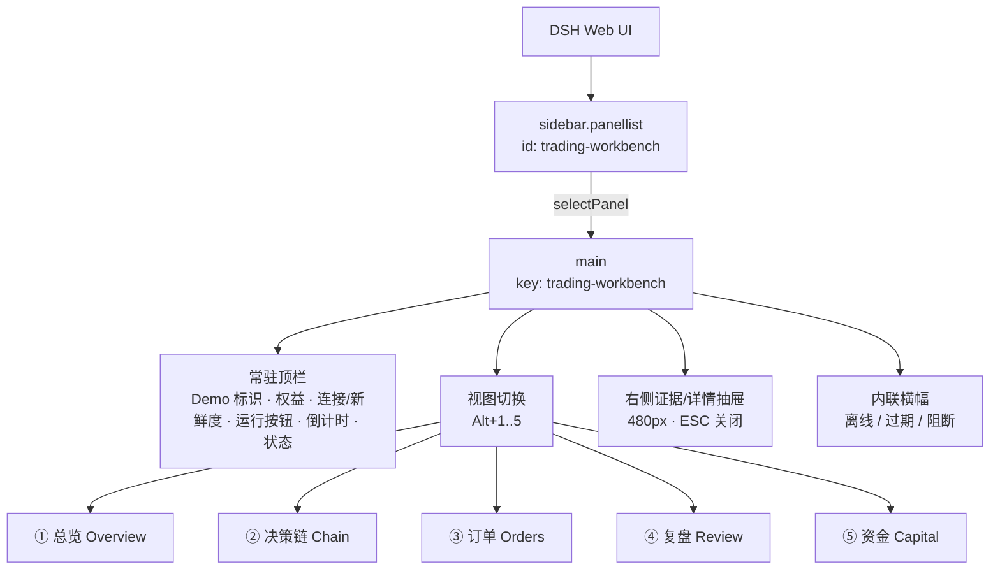
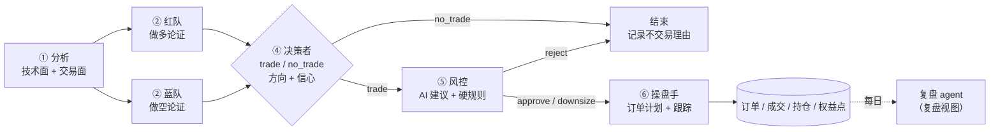
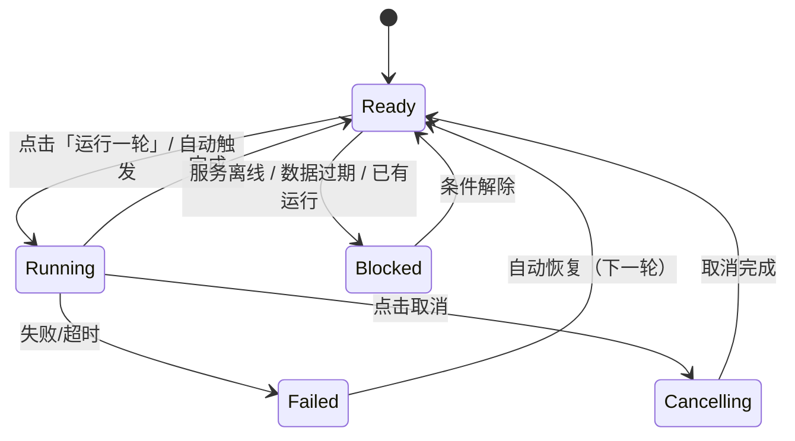
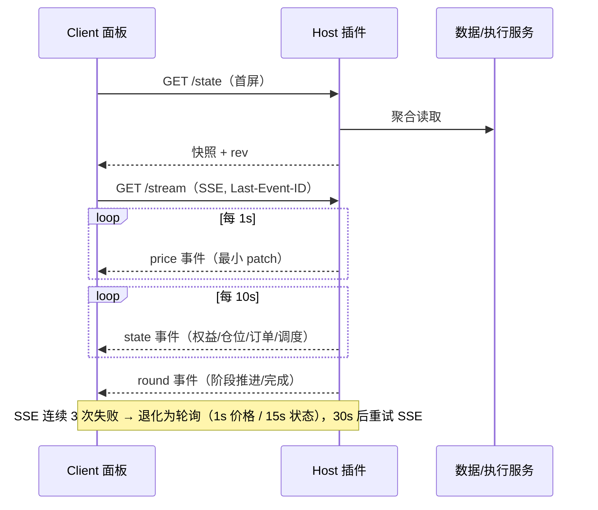

# 05 · 工作台 UI/IA 与 DSH 集成设计

- 日期：2026-11-09（Asia/Shanghai）
- 状态：设计稿（仅设计，不含前端代码、不安装插件）
- 对应基线：`00-需求基线.md` §6 问题 8（UI/IA、决策链可视化、实时刷新、状态、DSH 注册方式、主题与中英文）
- 上游输入：`00-需求基线.md` §2 已确认需求 1–17
- 下游消费者：`v1-设计方案.md` 的「UI 信息架构 / 页面组件清单 / 关键状态」章节、M2 完整 UI 里程碑

---

## 1. 结论摘要（回答问题 8）

一句话：**一个 DSH 全局主面板（`main` 槽，key = `trading-workbench`）+ 一个侧栏入口行（`sidebar.panellist`，id 相同）；面板内 5 个视图（总览 / 决策链 / 订单 / 复盘 / 资金），一条常驻顶栏承载运行控制；数据经 Host 侧只读 HTTP + SSE 端点进出，Client 只做展示与命令下发，不接触币安密钥、不调外部 LLM。**

| 决策点 | 结论 | 理由 |
|---|---|---|
| 交付形态 | DSH 插件（Host + Client 两半），一个 workspace bundle | 基线 #1；复用 Harness 主题/本地化/布局 |
| 主面板挂载 | 根级 `main` keyed slot，key = `trading-workbench` | 布局包明确「全局面板占用根级 `main` keyed slot」 |
| 侧栏入口 | 根级 `sidebar.panellist` 列表项，`id = 'trading-workbench'`，与 `main` key 同 id | 侧栏包契约：`id` 即 `main` 的 key，选择不存在的 key 会抛错 |
| 导航 | `ctx.layout.selectPanel('trading-workbench')` | 布局服务唯一选择入口，`conversation` 是保留 key |
| 视图数量 | 5（总览/决策链/订单/复盘/资金） | 基线 #13 五个核心面 + #14 移除策略相关 |
| 实时通道 | SSE 推送（价格 1s、状态 10s）+ 轮询回退 | 桌面单用户、本机 Host；SSE 比轮询省流且易降级 |
| 刷新节奏 | 价格 1s；仓位/订单/权益 10~15s；决策链进度事件驱动 | 基线 #16 |
| 运行触发 | 手动「运行一轮」+ Host 侧每 10 分钟自动；UI 只显示倒计时与状态 | 基线 #12；调度权在 Host，UI 不可信 |
| 主题 | 只用 `--dsw-alias-*` 等宿主 token；涨跌色走语义状态族，图表允许 artwork 自带调色板 | practices：token 是唯一样式依赖，字面色仅限 artwork |
| 语言 | `zh` + `en` 双基线字典（`ctx.locale.register`） | locale 包要求同时登记 zh/en |
| 覆盖层 | 不使用 `shell.overlay` / `shell.bottom`；用面板内抽屉与内联横幅 | 不抢宿主框架空间，避免与宿主模态冲突 |
| 移动端 | 不做（桌面优先，最小 1024px 宽） | 基线 #3 |

**本次无法完成的检查**：`cordis_inspect_query` 的 Client `Slots.listSubTree` / `Theme.listTokens` 连续 4 次 10s 超时（当前会话没有已连接并响应的 Harness 页面），Host `Service.listService` 的带 `input` 查询被本会话工具桥以 `"input" must be an object` 拒绝。因此 slot/key/注册 API 与 token 名称改由**本机实际安装的 DSH 0.2.2-rc.1 包文档**取证（`@deepseek-ai/dsh-client-ui-layout`、`-ui-sidebar`、`-ui-theme`、`-ui-plugin-manager`、`-ui-renderer`、`dsh-client-locale`、`dsh-client-connection`、`dsh-host-webserver`）。凡标 `⚠` 的 token 名与字段名，实现前必须用 `Theme.listTokens` / `Slots.listSubTree` 复核一次。

---

## 2. 设计输入与边界

### 2.1 必须覆盖的已确认模块（基线 §2）

| 基线 | UI 落点 |
|---|---|
| #1 插件形态、主面板 + 侧栏入口 | §3、§4 |
| #4 Demo 可下单/平仓/挂保护单 | §5.1（平仓/保护单）、§5.3（撤单/平仓）、§5.5（危险区） |
| #12 手动 + 10 分钟自动 | §7 |
| #13 权益曲线/仓位、决策链、订单成交、每日复盘、账户资金分配 | §5.1–§5.5 |
| #14 策略相关 UI 全部移除 | §17 |
| #15 深色、高信息密度、桌面优先 | §10、§11 |
| #16 1s 价格、10~15s 状态、本机单用户 | §9 |
| #7/#8 红蓝各 1 轮、决策者裁决 | §6 |

### 2.2 设计假设（与其它文档的接口，需在整合稿对齐）

- **A1**：一轮决策由 **Host 插件**编排（ai-chain 设计），UI 只读运行状态、只下发 `run` / `cancel` / Demo 操作命令。
- **A2**：行情/撮合/账本/风控若放在本地 Python 服务（arch 问题 1），则 **Host 插件是该服务的唯一代理**；浏览器不直连 Python，避免 CORS 与密钥外泄。
- **A3**：证据快照、各 agent 输出 JSON、风控硬规则命中表由 ai-chain / execution-risk 定义 schema；UI 契约见 §15。
- **A4**：数据新鲜度（`asOf`、`quality`）由 market-data 设计提供；UI 只做展示与「禁止下单」的视觉表达，**判定权威在 Host/风控**。
- **A5**：UI 不出现任何币安 API key、不出现外部 LLM 配置项；Demo 模式是硬编码标识，不可在 UI 切换。
- **A6**：v1 不做 LLM tool loop，因此 UI 没有对话输入框、没有「工具调用」时间线。

---

## 3. DSH 集成方式（具体到 slot / key / API）

### 3.1 包与两半结构

workspace bundle，包名 `@local/dsh-trading-workbench`（本地目录安装，不入 npm）。

```jsonc
// package.json（设计示意，不落地代码）
{
  "name": "@local/dsh-trading-workbench",
  "version": "0.1.0",
  "private": true,
  "type": "module",
  "exports": {
    ".": "./index.js",
    "./client": "./client.js",
    "./locale/*.json": "./locale/*.json",
    "./icon": "./icon.svg"
  },
  "files": ["index.js", "client.js", "cordis.patch.yml", "locale/*.json", "icon.svg"],
  "dsh": {
    "bundle": { "patch": "./cordis.patch.yml" },
    "client": {
      "platform": "web",
      "immediately": true,
      "inject": ["@deepseek-ai/dsh-client-ui-renderer", "@deepseek-ai/dsh-client-locale"]
    }
  }
}
```

```yaml
# cordis.patch.yml
- insert:
    - id: trading-workbench
      name: '@local/dsh-trading-workbench'
      config: {}
```

要点：
- `dsh.client.platform = 'web'`，`immediately: true`：侧栏入口必须在首屏出现，不能等面板被打开才加载。
- `dsh.client.inject` 只用于**激活顺序**（列出的 Harness Client 包），不 import 它们；`slots.inject` 本身是声明感知的，声明的槽迟到也安全。
- Host 半：`export function apply(ctx, config)`，`export const inject = ['webServer']`（没有 HTTP 服务时插件保持不激活而不是抛错）。
- Client 半：`window.__ModuleLoader__.load({ id, factory(require) { ... } })`，只 `require('react')`；**不 require 任何 `@deepseek-ai/dsh-client-*` 包**。

### 3.2 Slot 注册清单

| slot key | 作用域/类型 | 本插件用途 | 注册调用（形态） | 结论 |
|---|---|---|---|---|
| `main` | 根级、**keyed** | 主面板，`key = 'trading-workbench'` | `ctx.slots.inject('main', () => ctx.slots.register({ name: 'main', key: 'trading-workbench', locale: 'tradingWorkbench' }, WorkbenchPanel))` | **使用** |
| `sidebar.panellist` | 根级、列表 | 侧栏入口行，`id = 'trading-workbench'` | `ctx.slots.inject('sidebar.panellist', () => ctx.slots.register({ name: 'sidebar.panellist', id: 'trading-workbench', order: 40, locale: 'tradingWorkbench', label: 'panel.title' }, PanelIcon))` | **使用** |
| `sidebar.toggle.badge` | 列表（收起态） | 侧栏收起为 56px rail 时的状态点：运行中/异常 | `ctx.slots.register({ name: 'sidebar.toggle.badge', id: 'trading-workbench-status', locale: 'tradingWorkbench' }, StatusDot)` | **使用（可选降级）** |
| `shell.overlay` | 根级 | 全框架浮层 | — | **不用**：会盖住宿主框架；面板内抽屉更安全 |
| `shell.bottom` | 根级 | 全宽底部条 | — | **不用**：不占用宿主列高 |
| `shell.leading` | 根级（macOS 窗口座位） | 红绿灯旁控件 | — | **不用** |
| `conversation.*`（composer.dock 等） | 会话内 | 装饰 | — | **不用**：本工作台是全局面板，与会话解耦 |

注册约定：
- `id` 与 `main` 的 `key` **必须同为 `trading-workbench`**；`ctx.layout.selectPanel` 校验 live 的 `main` 注册表，key 不存在会抛错并保持当前选择。
- `label` 交给 `locale` 命名空间解析（`zh` / `en` 各一份），侧栏据此显示可见文本、无障碍名与收起态 tooltip；`label` 的精确取值形态（字符串 key vs 本地化对象）以 `Slots.listSubTree('sidebar.panellist')` 的注册选项为准（⚠ 本会话无法查询，实现第一步复核）。
- 每行图标是该注册渲染的组件（16px 单色 SVG，`currentColor`）；列表按 `order` 排序，面板行间距由侧栏负责（2px）。
- **面板是全局的，不隶属任何 Session**：所有注册都在插件根 ctx 上，`ctx.slots.inject` 的回调在槽声明出现/消失时自动装卸。

### 3.3 导航与选中态

| 行为 | API |
|---|---|
| 打开工作台 | `ctx.layout.selectPanel('trading-workbench')` |
| 回到对话 | `ctx.layout.selectPanel(null)`（等价 `conversation`，不改当前 Session） |
| 读取当前面板 | `ctx.layout.panelInfo` / `usePanelInfo()`（侧栏行自身用它渲染选中态） |
| 侧栏折叠 | `ctx.layout.toggleSidebar()`（工作台不主动改侧栏状态） |

- 不注册自定义全局快捷键（避免与宿主 `Mod+B`、`Cmd/Ctrl ±` 冲突）；视图切换用面板内部 Tab 与 `Alt+1..5` 局部快捷键（仅在面板获得焦点时生效）。
- 不改变当前 Session、不创建 Session、不写 Session 日志。

### 3.4 数据通道（Client ↔ Host）

**原则**：Client 无数据库、无密钥、无模型调用。所有数据经 Host 半注册的只读路由；命令经 Host 半转交编排器并做硬校验。

```js
// Host 半，apply 内（示意）
ctx.effect(() => ctx.webServer.register({
  path: '/api/trading-workbench/state',
  resource: async (request, peer) => jsonResponse(await readState()),  // 只读 GET/HEAD
}))
```

- 只读快照用 `resource(request, peer?)`（HTTP 上只有 GET/HEAD 能到，其它方法 405）。
- 流式推送用 `handler`，返回 `text/event-stream` 的 `Response`（SSE 在宿主压缩策略里被显式排除，可安全使用）。
- 命名空间固定 `/api/trading-workbench/*`，与宿主 `/api/*` 同源同 Cookie；前端 `fetch(url, { credentials: 'same-origin', cache: 'no-store' })`。
- 不用 `@Remote` / Typert：那套需要 TypeScript 生成物，外部纯 JS 插件不适用（远程装配的能力集是构建期固定的）。
- 不注册任何 Tool、不改 system prompt、不写 session 事件 → **本插件对模型上下文零影响**。

| 方法/路径 | 用途 | 返回要点 | 调用方 |
|---|---|---|---|
| `GET /health` | 健康与新鲜度 | `{ ok, serverTime, dataService:{status,version,latencyMs}, exchange:{env:'demo',baseUrl,status}, llm:{available}, risk:{canTrade} }` | 顶栏 30s + 运行前 |
| `GET /state?view=overview` | 总览聚合 | `{ equity, pnl, positions[], lastRound, tickers[], freshness }` | 总览 10s / 1s（ticker） |
| `GET /rounds?limit=&cursor=` | 轮次列表 | `{ items:[{roundId,startedAt,status,trigger,outcome}], nextCursor }` | 决策链 |
| `GET /rounds/:roundId` | 单轮完整链 | `RoundView`（§15） | 决策链 5s / SSE |
| `GET /rounds/:roundId/evidence/:agentId` | 证据快照（大对象） | `EvidenceBundle`（§15） | 抽屉打开时按需 |
| `POST /run` | 手动运行一轮 | `202 {roundId}` / `409 already_running` / `423 data_expired` / `503 orchestrator_offline` | 顶栏 |
| `POST /run/:roundId/cancel` | 取消 | `202` / `409 finished` | 顶栏 |
| `GET /orders?status=&limit=` | 订单 + 成交 | `{ orders[], fills[], protective[] }` | 订单 5–15s |
| `POST /orders/:id/cancel` | 撤单（Demo） | `202` / `423 risk_blocked` | 订单 |
| `POST /positions/:id/close` | 平仓（Demo） | `202` / `423 risk_blocked` | 总览/订单 |
| `POST /positions/:id/protect` | 挂/改 SL、TP（Demo） | `202` / `423` | 总览/订单 |
| `GET /reviews?date=YYYY-MM-DD` | 每日复盘 | `{ date, stats, attribution, reviewMarkdown, decisions[] }` | 复盘 60s / 切换日期 |
| `GET /capital` | 账户与预算 | `{ account, ledger, budgets, reconcile }` | 资金 15s |
| `POST /capital/reset` | 重置 Demo 账本与曲线（Demo only，二次确认） | `202` / `423 risk_blocked` | 资金 危险区 |
| `GET /stream?since=` | SSE | `price`(1s) / `state`(10s) / `round` / `order` / `heartbeat`(15s) | 全局 |

SSE 事件统一信封：

```
event: state
id: 10231
data: {"rev":10231,"asOf":"2026-11-09T01:52:31.402+08:00","patch":{...}}
```

- 客户端按 `rev` 丢弃乱序/重复帧；断线后带 `Last-Event-ID` 重连，Host 用 `rev` 补一次全量快照（`since` 落后超过 300 帧则直接全量）。
- 事件与轮询共用同一 `RoundView` 结构，UI 不区分来源。

### 3.5 主题接入

- 只消费 `--dsw-*` / `--dsh-*` token，不写字面 hex（图表序列与品牌图标除外，见 §11.3）。
- 明暗由宿主 `body[data-ds-dark-theme]` 决定，插件**不自己维护**主题状态、不写 `<html>`/`body` 属性。
- 组件自带样式：`apply` 内 `ctx.effect` 创建**一个** `<style>` 元素（`data-tw-style`），类名统一前缀 `.twb-`，卸载时移除；不 append 到 `document.body` 之外、不碰宿主 DOM。
- 密度、间距、圆角取自宿主语义 token（`--dsh-hairline-width`、radius scale、`--dsw-elevation-*`），与宿主同类页面（插件管理页）对齐。

### 3.6 中英文与格式化

```js
export const inject = ['slots', 'locale']
export function apply(ctx) {
  ctx.locale.register('tradingWorkbench', {
    zh: { 'panel.title': '交易工作台', /* ... */ },
    en: { 'panel.title': 'Trading workbench', /* ... */ },
  })
  // slots 注册...
}
```

- locale 契约：`ctx.locale.register(ns, { zh, en })` 要求 **zh 与 en 两个基线字典齐全**；缺 key 时回退链最后显示 key 本身，因此 key 用 `领域.组件.字段` 三段式。
- 所有可见文案、`aria-label`、tooltip、空态、错误文案都走字典；不拼字符串（占位符保留 `{var}`）。
- 数字/时间/金额：`Intl.NumberFormat(locale)` / `Intl.DateTimeFormat(locale, { timeZone: 'Asia/Shanghai' })`；UI 时间显示本地时区并在顶栏标注 `UTC+8`；价格按品种 `pricePrecision`，数量按 `qtyStep` 截断**只显示不计算**。
- 语言切换实时生效（`locale/change`），已打开的抽屉与选中视图不重置。

### 3.7 图标与插件元数据

- `icon.svg`：原创、单 viewBox、`currentColor` 主笔触 + 一枚方向性刻度（工作台语义），≤256 KiB，放包内、`files` 包含。
- locale 的 `meta`：

```json
{ "meta": {
  "title": "交易工作台",
  "description": "Harness AI 多角色决策链 + 币安 Demo 模拟盘：权益、仓位、决策链与每日复盘。"
} }
```
```json
{ "meta": {
  "title": "Trading workbench",
  "description": "Multi-role Harness AI decision chain on a Binance demo account: equity, positions, the chain, and daily reviews."
} }
```

- 侧栏入口图标与插件列表图标是两个东西：前者是 `sidebar.panellist` 注册渲染的 16px 组件，后者是 `./icon` 资源；两者视觉同源（同一条折线 + 刻度），保证「装的插件」与「用的入口」可互相认出。
- 不写 `package.json` 的 profile 配置、不动 `cordis.patch.yml`（用户态文件）；本插件自身无可调项时 `config: {}`，可调项（如 `autoRunMinutes`）放 Host `Config` schema，但**v1 由编排器决定 10 分钟，UI 只读**。

### 3.8 生命周期与释放

- 所有 timer、SSE、`fetch` abort、`<style>`、locale 注册都进 `ctx.effect` / `ctx.on`，返回清理函数；面板卸载（切走）时不销毁数据通道（插件仍激活），只暂停渲染级订阅。
- 轮次进行中卸载插件：SSE 关闭、在飞请求 abort；重新加载后从 `/state` 重建，不依赖内存。
- 不使用 `document.body` 追加 DOM；抽屉/模态都在面板 React 树内。

---

## 4. 信息架构

### 4.1 骨架



### 4.2 视图清单

| # | 视图 | 用户问题 | 首屏必须看到 | 主操作 |
|---|---|---|---|---|
| 1 | 总览 | 我现在赚多少、拿了什么、AI 上一轮说了什么 | 权益曲线 + 关键指标 + 当前仓位 + 最新决策摘要 + 行情条 | 运行一轮 / 平仓 / 改保护单 |
| 2 | 决策链 | 这一轮 AI 怎么想的、风控为什么放行/否决 | 轮次时间轴 + 六阶段轨道 + 结论 | 查看证据 / 取消运行 / 复制 JSON |
| 3 | 订单 | 下了什么单、成交没、保护单在不在 | 订单表 + 成交表 + 保护单 + 对账差异 | 撤单 / 补挂保护单 |
| 4 | 复盘 | 今天为什么赚/亏、决策质量如何 | 当日 PnL/胜率/回撤 + 归因 + 复盘报告 | 换日期 / 导出 |
| 5 | 资金 | 账户多少、预算怎么分、账本对不对 | 账户快照 + 风险预算 + 对账 | 改预算（只读展示为主）/ 重置 Demo |

### 4.3 常驻顶栏（全局壳层）

```
┌──────────────────────────────────────────────────────────────────────────────────────────┐
│ 交易工作台   [DEMO]  权益 10,842.31 USDT  +1.24% 今日   ● 数据新鲜 2s   ⏱ 下次自动 08:42  │
│                                                    [ 运行一轮 ]  [⋯]                      │
└──────────────────────────────────────────────────────────────────────────────────────────┘
```

- 左：标题（面板级 `h1`）+ `DEMO` 硬标签（不可点击、不可切换，hover 提示「仅币安 Demo，无实盘路径」）。
- 中：权益迷你数（等宽数字）+ 今日变动；`● ` 数据新鲜度胶囊（绿/黄/红，见 §8.2）；倒计时（`⏱ 下次自动 08:42` / `运行中 03:17` / `已暂停`）。
- 右：主按钮（状态机见 §7.1）、`⋯` 菜单（手动刷新、查看日志、打开插件配置页）。
- 顶栏不滚动；下方视图区独立滚动。

---

## 5. 逐视图设计

> 每个视图给：线框 → 组件/数据来源表 → 关键交互 → 专属状态。通用状态见 §8。

### 5.1 总览 Overview

```
┌──────────────────────────────────────────────┬─────────────────────────────┐
│ 权益曲线（今日 / 7日 / 全部）    基准 10,000 │ 当前仓位 2                    │
│  ╭───────────────────────────────────────╮  │ ● BTCUSDT LONG 0.012        │
│  │        ╱╲    ╱╲                       │  │   开仓 68,120.5  标记 68,402│
│  │   ╱╲  ╱  ╲  ╱  ╲╱╲                   │  │   未实现 +3.38  (+0.41%)   │
│  │╱╱  ╲╱    ╲╱        ╲                 │  │   SL 67,650  TP 69,400     │
│  ╰───────────────────────────────────────╯  │   [平仓] [保护单] [→链]    │
│  今日 +184.32 (+1.72%)   最大回撤 -0.9%      ├─────────────────────────────┤
├──────────────────────────────────────────────┤ 最新一轮 01:40 · 手动        │
│ 总权益 10,842.31 │ 今日PnL +184.32 │ 未实现 +41.20 │ 保证金 22.1% │ 可用 …  │ 分析 ● 完成  红队 ● 完成    │
├──────────────────────────────────────────────┤ 蓝队 ● 完成  决策 ● 做多     │
│ ▌BTC 68,402 +0.42%  ▌ETH 3,288.1 -0.18%  ▌SOL …                              │
├──────────────────────────────────────────────┤ 风控 ⚠ 降仓 0.6→0.5                        │
│ 今日决策 12 轮 · 交易 4 · 不交易 8 · 风控否决 1                               │ 操盘手 ● 已成交 2 单 │
└──────────────────────────────────────────────┴─────────────────────────────┘
```

| 区块 | 组件 | 数据来源 | 刷新 |
|---|---|---|---|
| 权益曲线 | `EquityChart`（面积 + 基准线 + 时间范围切换 今日/7日/全部；hover 十字光标 + tooltip：时间、权益、逐笔 PnL 增量） | `/state.equity`（`points[{t,equity}], base`） | 10s；切换范围时按需拉 `/state?view=overview&range=` |
| 关键指标条 | `MetricStrip` 6 格（总权益、今日 PnL、未实现 PnL、保证金占用率、可用余额、风险使用率），超阈值染色 | `/state.pnl`、`/state.risk` | 10s |
| 当前仓位 | `PositionCard` × N（symbol/方向/数量/开仓价/标记价/未实现/ROE/SL/TP/持仓时长/来源轮次链接） | `/state.positions`，标记价走 SSE `price` | 1s（价格）/10s（结构） |
| 最新一轮摘要 | `RoundSummary`（结论、方向、信心、风控结论、耗时；点击进决策链并定位该轮） | `/state.lastRound` | SSE `round` |
| 行情条 | `TickerStrip`（自选池 6–10 个，1 个主图 + 迷你 sparkline，24h 涨跌） | SSE `price` | 1s |
| 今日统计 | `DayStats`（轮数/交易/不交易/否决/成交单数） | `/state.dayStats` | 15s |

关键交互：
- 点仓位卡任意处 → 右侧抽屉（仓位详情：成交明细、保护单、关联轮次、该轮证据入口）。
- `平仓`：二次确认（显示数量、预估滑点区间、当前标记价、Demo 标识）→ `POST /positions/:id/close`；返回 `423` 时展示硬规则原因（不弹二次确认）。
- `保护单`：内联编辑 SL/TP，输入即做静态校验（SL 方向、最小 tick、与标记价距离），提交同走硬规则。
- 图与指标一律「只显示」，不在前端做账务计算（PnL 以后端为准；前端只有展示级千分位/精度处理）。

### 5.2 决策链 Chain（重点，详见 §6）

```
┌───────────────────────────────────────────────────────────────────────────────┐
│ 轮次 01:40:12 手动  ✔ 完成（42.8s）   [‹ 上一轮]  [下一轮 ›]  [最新]  [导出] │
├───────────────────────────────────────────────────────────────────────────────┤
│  ①分析       ②红队 ┌── ④决策 ──┐ ⑤风控          ⑥操盘手                      │
│  ● 完成  ──▶ ● 完成 (做多) ──▶ │ ◆ 做多，信心 │ ──▶ ⚠ 降仓 0.6→0.5 ──▶ ● 已成交│
│  12.1s      ● 完成 (做空) ──▶ └─ 0.62 ───────┘   AI approve + 硬规则…          │
│  3,842 tok    2,911 tok            1,204 tok        881 tok        512 tok      │
├───────────────────────────────────────────────────────────────────────────────┤
│ [证据快照] [Prompt] [输出 JSON] [硬规则] [耗时]      ← 选中节点后抽屉内切换   │
└───────────────────────────────────────────────────────────────────────────────┘
```

组件/数据来源见 §6.3–§6.5；节点状态色与失败表现见 §6.6。

### 5.3 订单 Orders

```
┌───────────────────────────────────────────────────────────────────────────────┐
│ 状态 [全部▾ 未成交 部分成交 已成交 已撤 失败]   时间 [今日▾]   搜索 symbol/单号 │
├───────────────────────────────────────────────────────────────────────────────┤
│ 订单          方向  类型   数量      价格        状态     轮次     单号      操作│
│ 01:41:03 BTC  LONG  LIMIT  0.012    68,120.5   已成交   01:40   tw-…a3  [详情] │
│ 01:41:03 BTC  —     SL     0.012    67,650     生效中   01:40   tw-…b1  [撤/改]│
├───────────────────────────────────────────────────────────────────────────────┤
│ 成交（3） 01:41:04 0.012 @68,121.0  手续费 0.41  滑点 +0.5                       │
├───────────────────────────────────────────────────────────────────────────────┤
│ 对账：本地账本 2 仓 / 交易所 2 仓 ✔ 一致（12s 前）                              │
└───────────────────────────────────────────────────────────────────────────────┘
```

| 区块 | 组件 | 数据来源 | 刷新 |
|---|---|---|---|
| 过滤器 | `FilterBar`（状态多选、时间范围、symbol、单号搜索） | 本地状态 | — |
| 订单表 | `OrderTable`（sticky header、44px 行、右侧「详情」抽屉；幂等单号列可复制） | `/orders.orders` | 有未成交 5s，否则 15s |
| 成交表 | `FillTable`（时间、数量、价、费、滑点） | `/orders.fills` | 同上 |
| 保护单 | `ProtectiveOrders`（SL/TP 是否齐全、是否被交易所接受；缺失即红条） | `/orders.protective` | 同上 |
| 对账条 | `ReconcileBar`（本地账本 vs 交易所权益/仓位；差异 → 黄条 + 「查看差异」） | `/orders.reconcile`、`/health` | 15s |

- 「保护单缺失」是**高优先级告警**：位置在订单页顶部固定条 + 总览仓位卡红边；基线 #5「开仓必须带初始 SL/TP」，UI 不提供「无保护单开仓」入口。
- 撤单/平仓均为 Demo 操作，确认框内固定提示「币安 Demo · 不涉及真实资金」。

### 5.4 复盘 Review

```
┌───────────────────────────────────────────────────────────────────────────────┐
│ 日期 [2026-11-09 ▾]   ◀ ▶      当日 12 轮 / 4 笔交易 / 胜 3 负 1 / PnL +184.32 │
├───────────────────────────────────────────┬───────────────────────────────────┤
│ 归因                                      │ 复盘报告（AI 每日复盘 agent）      │
│ 按品种  BTC +212.4 · ETH -28.1            │ ## 当日归因                        │
│ 按方向  多 +301.2 · 空 -116.9             │ - BTC 顺势多头，保护单位移及时 …   │
│ 按阶段  分析偏差 2 次 · 风控降仓 1 次     │ - ETH 逆势挂单，滑点偏高 …         │
│                                           │ （Markdown 渲染，代码块等宽）      │
├───────────────────────────────────────────┼───────────────────────────────────┤
│ 当日决策时间线（12 条，点击进链）         │ 决策质量                          │
│ ● 01:40 做多 ✔ ● 01:20 不交易 ✔ ● …      │ trade 后 2h 胜率 75% · no_trade 后  │
│                                           │ 15min 是否错过（错过 1 次，+0.3R） │
└───────────────────────────────────────────┴───────────────────────────────────┘
```

| 区块 | 组件 | 数据来源 | 刷新 |
|---|---|---|---|
| 日期选择 | `DateStepper`（今天/昨天/日历；不可选未来与无数据日） | 本地 + `/reviews` 可用日期 | — |
| 当日统计 | `DayHeader`（轮数/交易/胜负/PnL/最大回撤/平均持仓） | `/reviews.stats` | 60s / 切日 |
| 归因 | `Attribution`（按品种、方向、**决策阶段**；不按策略） | `/reviews.attribution` | 同左 |
| 复盘报告 | `ReviewMarkdown`（Markdown 渲染、等宽代码、可复制、生成时间与 token 成本角标） | `/reviews.reviewMarkdown` | 同左 |
| 决策时间线 | `DecisionTimeline`（每条：时间、结论、结果、是否被风控否决；点击跳决策链对应轮） | `/reviews.decisions` | 同左 |
| 决策质量 | `DecisionQuality`（trade 命中率、no_trade 后的机会成本、schema 校验失败次数） | `/reviews.quality` | 同左 |

- 复盘报告的 AI 生成状态单独表达：`未生成 / 生成中 / 已生成 / 生成失败（可重试）`，失败只影响该卡片，不影响其余数据。
- 明确**没有**：策略评价、策略收益排行、策略漏斗、策略切换。

### 5.5 资金 Capital

```
┌───────────────────────────────────────────────────────────────────────────────┐
│ 账户  Binance Demo · USD-M  │  钱包余额 10,801.1  │  可用 9,412.6  │ 杠杆 3x   │
├───────────────────────────────────────────┬───────────────────────────────────┤
│ 风险预算（只读展示，改配置需 Host 配置页） │ 账本对账                          │
│ 单笔风险 0.5%  ·  今日已用 0.32%          │ 本地权益 10,842.31                │
│ 日亏损上限 -2.0%（已用 -1.2%）            │ 交易所权益 10,844.02  Δ +1.71     │
│ 最大持仓 3  ·  当前 2                      │ 最近对账 12s 前 ✔                │
│ 品种敞口 BTC 22% ETH 8% SOL 0%            │ [立即对账]                        │
├───────────────────────────────────────────┴───────────────────────────────────┤
│ 资金分配语义（v1）                                                            │
│  · 分配对象 = 品种敞口名额 + 单笔风险预算 + 杠杆档，不是策略通道               │
│  · 预算由风控硬规则执行；UI 只显示已用/上限，不提供「提高上限」入口            │
├───────────────────────────────────────────────────────────────────────────────┤
│ 危险区（Demo）  [重置 Demo 账本与曲线]  ← 二次确认 + 输入 RESET + 说明不可恢复 │
└───────────────────────────────────────────────────────────────────────────────┘
```

| 区块 | 组件 | 数据来源 | 刷新 |
|---|---|---|---|
| 账户头 | `AccountHeader`（Demo 标识、钱包余额、可用、杠杆、账户模式） | `/capital.account` | 15s |
| 风险预算 | `BudgetPanel`（单笔风险、日亏损上限、最大持仓、品种敞口；只读条 + 已用刻度） | `/capital.budgets` | 15s |
| 账本对账 | `ReconcilePanel`（本地账本 vs 交易所；差异值与方向；「立即对账」） | `/capital.reconcile` | 15s / 手动 |
| 危险区 | `DangerZone`（重置 Demo 账本、新曲线起点） | `POST /capital/reset` | — |

- 基线 #17：新工作台**新账本/新曲线**，此页明确标注「账本起点 2026-11-09 01:40，旧 demo 历史不混入」。
- 不出现：实盘 key 输入、账户切换、资金划转（v1 无划转能力，只显示）。

---

## 6. 决策链可视化

### 6.1 链模型

一轮 = 5 个阶段节点（复盘 agent 按日，不参与单轮）：



说明：
- 红队/蓝队**并行**但各自 1 轮、互不可见对方论点（机制由 ai-chain 定义）；UI 上并排两张卡，标注「并行 · 互不可见」，避免用户误以为有交叉引用。
- 决策者卡同时显示「裁决依据」引用（哪一方的哪条论点被采纳，`citedPoints[]` 若契约提供则展示，否则只显示自由文本结论）。
- 风控有两条出边：`approve/downsize` → 操盘手；`reject` → 终止。降仓在 UI 上必须是**显式可见**的（`0.6 → 0.5` 这种前后对照），因为它是硬规则生效的主要证据。
- 操盘手完成后，链尾挂「结果徽标」：`2 单已成交` / `0 单（限价未触发）` / `下单失败`，点击跳到订单视图并带过滤。

### 6.2 轨道布局

- 桌面宽（≥1280）：**横向 4 列**布局 —— ①分析 | ②红/蓝上下叠 | ④决策 | ⑤风控 → ⑥操盘手（⑥ 可与 ⑤ 同列右侧，避免过长）。
- 中宽（1024–1279）：横向 3 列 + ⑥ 换行到第二行。
- 窄（<1024）：**纵向时间轨道**（左竖线 + 阶段行），每行可展开；这是桌面优先下的降级，不是移动适配。
- 轨道下方是「轮次时间线」：每条 = 一轮的迷你状态（`●●●●●●` 六点 + 结论色），支持键盘左右切换轮次；最新一轮默认选中。
- 运行中：当前节点为「进行中」（脉冲环 + 已耗时），后续节点灰显 `等待`；已完成节点可立即打开证据，未完成节点抽屉显示 `该阶段尚未产出`。

### 6.3 节点卡规范

```
┌─────────────────────────────────────────┐
│ ① 分析                      ● 完成 12.1s│
│ 趋势 上行 · 结构 HH/HL · 动能 中性偏强   │
│ 关键位 67,850 / 69,120 · 可交易性 高     │
│ 输出 schema ✔  3,842 tok   [证据] [JSON]│
└─────────────────────────────────────────┘
```

| 字段 | 来源 | 说明 |
|---|---|---|
| 阶段名 + 序号 | 静态 | 六阶段固定顺序 |
| 状态徽标 | `RoundView.nodes[*].status` | pending/running/done/warning/failed/skipped |
| 耗时 | `durationMs` | 等宽数字，>30s 标黄 |
| 摘要（≤3 行） | `node.summary`（结构化字段拼装） | 各 agent 的 `summary` 由 ai-chain 契约给出，UI 只做排版 |
| 校验标记 | `node.schema.ok` | 失败显示 `⚠ schema 校验失败`，并链到输出 JSON 的错误定位 |
| 结论徽标 | `node.verdict`（各阶段语义不同：做多/做空、trade/no_trade、approve/downsize/reject、2 单） | 统一徽标组件，语义色见 §11.2 |
| 成本 | `node.tokens{in,out}`、`node.model` | 折叠显示，展开见抽屉「耗时」页 |
| 操作 | `[证据]` `[JSON]` | 打开右侧抽屉并定位到对应页签 |

### 6.4 证据抽屉（Evidence Drawer）

- 位置：面板内右侧覆盖层，宽 `min(560px, 42%)`，不遮顶栏；背景遮罩只在本面板内。
- 行为：`Esc` 关闭、点击遮罩关闭、焦点被困在抽屉内、关闭后焦点回到触发按钮；切轮次时抽屉内容跟随（若仍打开）。
- 页签：

| 页签 | 内容 | 数据来源 |
|---|---|---|
| 证据快照 | 行情证据（品种、周期、最近 N 根 K 线摘要表、指标值、数据时间、质量标记 `quality`）、账户快照（权益/可用/持仓）、近期成交节选 | `/rounds/:id/evidence/:agentId` → `evidence` |
| Prompt | system/user 模板版本号、变量表（只读、脱敏后的键值）、token 估算 | `evidence.prompt`（Host 侧产出，密钥与路径脱敏） |
| 输出 JSON | 格式化 JSON（可折叠、可复制、行号、长文虚拟滚动）+ schema 校验结果 + 重试次数 | `node.output` / `node.schema` |
| 硬规则 | 规则表：`规则 / 阈值 / 实际值 / 结果(pass|hit) / 失败行为`；命中行高亮 | `risk.ruleHits[]`（§15） |
| 耗时 | 阶段时间线（各 agent 起止、并行关系）、模型档位、token 汇总、错误堆栈摘要 | `node.trace` |

- 脱敏底线：不显示 API key、签名、完整请求头；不显示本地绝对路径（显示 `~` 相对路径）。
- 复制/导出：抽屉底部 `复制 JSON`、`导出本轮(.json)`；导出为浏览器下载，不落服务端。

### 6.5 轮次回看与对比

- 顶部轮次条：`‹ 上一轮 / 下一轮 ›`、`最新`、日期跳转；键盘 `←/→` 在轮次间移动。
- 「对比」是 v1 的可选项（若成本允许）：选中两轮 → 节点摘要并排 diff（仅文本级）。不进 v1 核心验收，标为 P2。
- 轮次列表抽屉（点击轮次条上的日期）：最近 50 轮，列 `时间 / 触发 / 结论 / 耗时 / 成本`。

### 6.6 失败与降级表现

| 场景 | 节点表现 | 全局表现 | 可做的操作 |
|---|---|---|---|
| 单个 agent 超时 | 节点 `failed` + `超时 60s` | 顶栏「本轮失败」红胶囊 | 重跑本轮（新 roundId） |
| JSON schema 校验失败 | 节点 `warning` + `校验失败（已重试 1 次）` | 结论降级为 `no_trade`（契约在 ai-chain） | 看输出 JSON 定位字段 |
| 决策者 no_trade | ④ 卡 `不交易`（中性色），⑤⑥ 卡 `未执行` | 无告警 | 看理由 |
| 风控 reject | ⑤ 卡 `否决` 红 | 链尾 `未下单` | 看硬规则命中行 |
| 风控 downsize | ⑤ 卡 `降仓 0.6→0.5` 黄 | 链尾显示最终数量 | 看命中规则与限额 |
| 操盘手下单失败 | ⑥ 卡 `failed` + 交易所错误码 | 红条「执行失败，未产生持仓」 | 看错误、按契约决定是否重试下单 |
| 运行中取消 | 当前节点 `已取消`，后续 `skipped` | 顶栏回到就绪 | — |
| 数据过期 | 运行前直接阻断 | 红条「行情过期 00:42，已禁止下单」 | 刷新/等待 |

---

### 6.7 M1.4 透明化增补（信息清晰度）

**问题**：原 `RoundView` 只投影 `action/confidence/grade/gate`；红蓝两侧只在一侧都没被选中时才展示，且只有 `grade + gate`；决策理由、执行计划、失效条件、链路用量全部没有进 DTO。结果是"看得到发生了什么，看不到为什么"。

**新增字段**（`plugin/host/round-view.js`，全部经脱敏 + 长度上限）：

| 字段 | 内容 | 回答的问题 |
|---|---|---|
| `scorecard.red/blue` | `rr`、`stop_distance_pct`、`confidence`、`opening_confidence`、`response_confidence`、`rubric_score`、`evidence_strength`、`risk_pct`、`leverage`、`rebuttal_count` | 为什么这一侧 FAIL？两侧差在哪？ |
| `decision` | `thesis`、`case_comparison`（strength / decisive_evidence / fatal_flaw / decisive_factor / opposing_risk）、`plan`（entry/sl/tp/risk/leverage/rr/time_stop）、`invalidation`、`warnings` | 为什么做 / 为什么不做、按什么价位做、什么时候算错 |
| `chain` | `calls`、`retries`、`repaired`、`truncated`、`timeouts`、`invalid`、`tokens_in/out`、`elapsed_ms`、`deadline_ms`、`slowest`、`stopped_at` | 重试了几次、被截断几次、预算用了多少、停在哪一步 |
| `analysis.candidates` | 最多 2 条 `{symbol, side_bias, setup_type, confidence}` | 候选与主标的是否一致 |

**UI 三处**（`plugin/client.js`）：

1. **裁决卡**新增「红蓝对比」表：方向 / 评级 / 门禁（含 gate 原因）/ 盈亏比 / 止损% / 置信度 / 依据分——无论是否选中某一侧都展示；
2. **新增「决策依据」卡**：决策理由、双方决定性证据与致命缺陷、执行计划数值、失效条件、本轮警告；未到决策阶段时明确写「本轮没有到达决策阶段」，不编造；
3. **阶段瀑布**顶部新增链路用量条：调用 / 重试 / 截断 / 超时 / 用时（`已用 / 340s 预算`）/ 停在哪个阶段。

**顺带修复**：`sanitizeDetail` 曾把 `null`/`undefined` 转成字符串 `"null"`/`"undefined"` 显示到界面上，现已保持 `null`（有回归用例）。

**边界**：新字段全部来自模型输出与确定性评分卡，仍遵守"展示文本脱敏、不展示 prompt / token / 凭据"；缺失值一律显示「未提供」，不补零、不推测。

## 7. 运行控制

### 7.1 运行按钮状态机



| 状态 | 按钮文案 | 外观 | 可点击 | 倒计时区 |
|---|---|---|---|---|
| Ready | `运行一轮` | 主色实心 | 是 | `⏱ 下次自动 08:42` |
| Running | `运行中 03:17` + 取消图标 | 主色幽灵 + 进度环 | 取消可点，运行禁用 | `① 分析 → ② 红/蓝 3/6` + 已耗时 |
| Cancelling | `正在取消…` | 禁用 + spinner | 否 | 同上，标 `已请求取消` |
| Blocked(offline) | `离线` | 灰 | 否 | `—` |
| Blocked(stale) | `数据过期` | 警告色描边 | 否 | `行情过期 00:42` |
| Failed | `重试本轮` | 危险色幽灵 | 是 | 恢复后显示下一轮时间 |

### 7.2 10 分钟自动循环（M1.4 已实现）

- **调度权在 Host**：`plugin/host/scheduler.js` 每 10 分钟触发一轮，占 `slot_id` 幂等位；`/state` 与 `GET /api/schedule` 返回真实状态：

  ```json
  {
    "contract": "trading-workbench/auto-schedule/1",
    "enabled": true, "started": true, "busy": false,
    "interval_ms": 600000, "symbol": "BTCUSDT",
    "next_at": "2026-11-10T05:21:22.756Z",
    "last_tick_at": "...", "paused_until": null, "pause_reason": null,
    "rounds_last_24h": 0, "max_rounds_per_day": 96,
    "consecutive_failures": 0, "max_consecutive_failures": 3,
    "last_result": { "kind": "skip", "code": "ROUND_IN_FLIGHT", "slot_id": "..." },
    "history": [ ... 最近 10 条 ]
  }
  ```

- 底部只显示状态徽标，**不做假倒计时**：`开（每 10 分钟）` / `未启用` / `暂停中`。`next_at` 只在系统状态抽屉里作为文本展示（老 Host 没有 `schedule` 时回退「未启用（M2）」）。
- 运行中重叠：Host 记 `OVERLAP_SKIPPED`，不会叠加第二轮；同一 `slot_id` 重复触发由服务端唯一索引拒绝，不产生第二轮。
- 连续 3 轮失败 → `paused_until` 出现，自动暂停 30 分钟；UI 显示「暂停中」，恢复后自动续跑。
- 关闭方式：`WORKBENCH_AUTO_SCHEDULE=off`，或 `POST /trading-workbench/api/schedule?action=disable`。

### 7.3 运行中状态（进度）

- 面板顶栏进度环（阶段 3/6）+ 决策链轨道实时点亮；两处状态同源（SSE `round` 事件）。
- 页面其它区域**不冻结**：总览/订单仍可看（只读），资金页的预算编辑在运行中禁用（v1 预算本来只读，故无实际影响）。
- 运行中允许平仓吗？**允许**（风险优先）：平仓按钮在运行中保持可用，确认框顶部多一行「本轮 AI 仍在分析，平仓不影响其输出」。
- 取消语义必须在 UI 里说清：「取消只终止未开始的阶段；已提交到交易所的订单不会被撤回」。因此：
  - 阶段 ≤ ④ 时，取消按钮副文案「本轮尚未下单」；
  - 阶段 ≥ ⑤ 时，副文案「已进入执行阶段，取消不会撤回已提交订单，如需退出请用平仓」。
- 离开面板（切到对话）：SSE 继续（插件仍激活），侧栏 `sidebar.toggle.badge` 显示运行点；运行结束时若面板未选中，用宿主 toast 提示一次（`运行完成 · 做多 BTCUSDT`），不重复打扰。

### 7.4 幂等与冲突

- 双击运行：按钮在 `click` 后 300ms 内禁用并进入 `pending`，服务端仍以 `409` 兜底；收到 `409` 时静默切到 `Running`（不弹错）。
- 两个窗口（同一 Host 两个浏览器标签）：状态以服务端为准；后开窗口从 `/state` 对齐，不做本地协调。
- 自动运行与手动运行竞争：Host 保证唯一在跑；UI 显示 `本轮由自动触发` / `手动` 标签。

---

## 8. 空态 / 离线 / 数据过期 / 错误态

### 8.1 状态矩阵

| 视图 | 空态 | 加载 | 部分失败 | 硬失败（整页） |
|---|---|---|---|---|
| 总览 | 「还没有数据」三步引导：① 检查 Demo 连接 ② 运行一轮 ③ 回来看看（按钮直达运行） | 骨架屏：曲线占位 + 6 格指标 + 2 张仓位卡 | 权益图失败但仓位可用 → 图区显示「曲线暂不可用 · 重试」，其余正常 | 全量不可用 → 居中错误卡 + 重试 + 错误码 |
| 决策链 | 「本轮之前没有记录」+ 运行按钮 + 说明「一轮约 30–60s」 | 轨道骨架 6 节点灰块 | 部分节点证据拉取失败 → 抽屉内错误 + 重试，节点本身正常 | 轮次接口失败 → 断网/服务错误卡 |
| 订单 | 「暂无订单」+ 说明「AI 下单后会出现在这里」 | 表格 8 行骨架 | 成交表失败 → 只影响该表 | 同上 |
| 复盘 | 「今天还没有复盘」+「复盘在当日 23:55 自动生成」+ `手动生成`（若 Host 允许） | 报告 3 行骨架 + 图表占位 | 报告生成失败 → 卡片级错误 + 重试；统计仍显示 | 日期接口失败 → 错误卡 |
| 资金 | 「账户信息加载中」/「Demo 账户未就绪」+ 检查命令 | 卡骨架 | 对账失败 → 对账卡错误，其余正常 | 同上 |

### 8.2 数据新鲜度阶梯（全局唯一口径）

| 级别 | 判定 | 视觉 | 允许运行 | 允许 Demo 下单 |
|---|---|---|---|---|
| fresh | `age ≤ 3s`（价格）/`≤ 20s`（状态） | 绿点 `● 新鲜 2s` | 是 | 是 |
| stale | `3s < age ≤ 15s`（价格）/`20s < age ≤ 60s`（状态） | 黄点 `● 延迟 8s` + tooltip 各源明细 | 是（但运行前置校验会再判一次） | 是（Host 判定为准） |
| expired | `age > 15s`（价格）/`> 60s`（状态） | 红点 `● 过期 00:42` + 顶部红条 | **否**（按钮变 `数据过期`） | **否**（`423 data_expired`） |

- 阈值是 **UI 展示口径**，与 execution-risk 的硬阈值可能不同；以 Host 返回值 `freshness.level` 为准，UI 不自行升级/降级判定（避免两套真相）。
- 每个数据源单独新鲜度：`ticks`、`positions`、`account`、`orders`、`llm`；顶栏胶囊显示**最差**一级，hover 展示分源明细表。

### 8.3 错误分类与恢复动作

| 类别 | 表现 | 文案（zh） | 恢复 |
|---|---|---|---|
| 连接中断（Host 不可达） | 顶部横幅，全局面板只读 | 「与 Harness 的连接中断，正在重连…」 | 自动重连（指数退避）；恢复后自动刷新当前视图 |
| 数据服务离线 | 横幅 + 运行按钮变 `离线` | 「行情服务离线，最近数据 12s 前」 | 提供自检命令（`curl http://127.0.0.1:<port>/health`）；重试按钮 |
| 币安 Demo 不可达 | 横幅（警告级） | 「币安 Demo 不可达，本轮只分析不下单」 | 运行仍可点（若 Host 允许）；执行阶段标记阻塞 |
| 一轮失败 | 顶栏红胶囊 + 决策链节点红 | 「本轮失败：分析 agent 超时」 | `重试本轮` |
| 下单被风控拒绝 | 不弹模态；操作结果 toast + 订单页 banner | 「风控拒绝：单笔风险超限（0.8% > 0.5%）」 | 展示命中规则；无「强行下单」按钮 |
| 接口 5xx | 卡片内错误 | 「加载失败 · [重试]」+ 请求 id | 重试；连续 3 次后提示查看 Host 日志 |
| 接口 4xx（参数/状态） | 就地提示，不刷新整页 | 具体原因 | 按提示修正筛选/日期 |

原则：**错误不弹阻塞式模态**（除危险操作确认），因为交易工作台要保证「其它信息仍可读」；错误一律就近展示 + 可重试。

---

## 9. 实时刷新策略

### 9.1 通道



- SSE 为主通道；`EventSource` 不可用或连续失败 → 轮询回退；轮询期间顶栏显示 `○ 轮询模式`。
- 页面不可见（`document.visibilityState === 'hidden'`）暂停 SSE 渲染节流与轮询；恢复可见立即拉一次全量并在 200ms 内批量渲染。
- 面板未选中（`usePanelInfo().panel !== 'trading-workbench'`）时：SSE 保持（用于 badge/toast），但**不渲染**重内容；重新选中时用缓存 + 一次增量对齐。

### 9.2 刷新频率表

| 数据 | 频率 | 机制 | 备注 |
|---|---|---|---|
| 标记价 / 最新价 / 24h | **1s** | SSE `price`，批量一次（所有自选池） | 只更新文本节点，不重排布局 |
| 持仓未实现 PnL | 1s（价格驱动） | 由价格 + 持仓缓存计算展示值 | 后端也回传真值，10s 对齐一次 |
| 权益/仓位结构/调度/风控状态 | **10s**（上限 15s） | SSE `state`；回退轮询 15s | 基线 #16「10~15s」 |
| 订单/成交/保护单 | 5s（有未成交）/15s（无） | 轮询或 SSE `order` | 保护单缺失时提升到 5s |
| 决策链当前轮 | 事件驱动（阶段切换）+ 3s 心跳兜底 | SSE `round` | 运行中才高频 |
| 历史轮次详情 | 打开时一次 + 手动刷新 | 按需 | 已完成的轮不轮询 |
| 证据快照 | 抽屉打开时一次 | 按需 | 大对象不预取（>64KB 不预取） |
| 复盘 | 60s + 切日 | 按需 | 生成的报告不再变 |
| 资金/对账 | 15s | 轮询 | 对账按钮手动触发一次 |
| 健康 | 30s | 轮询 | 同时用于时钟偏移校正 |

### 9.3 性能与节流

- 单次渲染批量：同一 tick 内到达的多个 patch 合并成一次 `setState`（`requestAnimationFrame` 对齐），避免 1s × N 个字段的重排。
- 图标/图表：权益曲线历史点最多保留 5,000 点，超出后端降采样（UI 不自行抽样）；迷你 sparkline 60 点。
- 表格虚拟滚动阈值：>200 行；订单默认 100 行/页。
- 请求去重：同一 URL 在飞时不重复发；失败重试指数退避（2s/4s/8s/15s/30s 封顶）+ 抖动。
- 离开面板或标签页不可见时，1s 价格流降为 5s（不中断 SSE，只丢弃渲染帧）。

---

## 10. 布局与响应式（桌面优先）

### 10.1 布局结构

```
┌ 面板根（main 槽，占满布局主列） ─────────────────────────────────────────────┐
│ 顶栏 56px（sticky）                                                           │
├ 视图导航 40px（segment tabs，sticky） ───────────────────────────────────────┤
│ 内容区（独立滚动，max-width 1680，左右 padding 24）                           │
│   ├─ 12 列栅格，gap 16                                                         │
│   └─ 抽屉（覆盖层，右侧，560px）                                              │
└───────────────────────────────────────────────────────────────────────────────┘
```

- 尺寸基准：目标宽度 1440–1920；最小可用 1024（此时侧栏通常收起为 56px rail，内容区约 968）。
- 断点（面板宽度，非视口）：
  - `≥1440`：总览 8+4 双栏；决策链横向 4 列；订单表全列。
  - `1200–1439`：总览 7+5；决策链横向 3 列 + 换行；订单表隐藏「滑点」「手续费」列（进详情抽屉）。
  - `1024–1199`：总览上下堆叠（曲线在上）；决策链纵向时间轨道；订单表只留核心 6 列。
  - `<1024`：不承诺（基线 #3 不做移动端），只保证不横向溢出（表格横向滚动）。
- macOS/Windows 窗口：面板内容顶部要尊重宿主已发布的 `--dsh-frame-top-clearance`（入口类页面按该值补顶），避免内容压到窗口拖拽条/标题栏。
- 高信息密度：行高 44（表格）/32（列表）；正文 13px（跟随 `--dsh-content-font-size` 阶梯），数字用等宽；卡片间距 16；圆角随宿主 radius token。

### 10.2 内容区组织

- 总览：`[曲线 8 | 仓位 4]` → `[指标 12]` → `[行情条 12]` → `[今日统计 12]`。
- 决策链：`[轮次条 12]` → `[轨道 12]` → `[结果摘要 12]`。
- 订单：`[过滤器 12]` → `[保护单告警 12]` → `[订单表 12]` → `[成交表 12]` → `[对账条 12]`。
- 复盘：`[日期头 12]` → `[归因 7 | 报告 5]` → `[时间线 7 | 决策质量 5]`。
- 资金：`[账户头 12]` → `[预算 6 | 对账 6]` → `[语义说明 12]` → `[危险区 12]`。

---

## 11. 主题与视觉规范

### 11.1 token 使用（映射表）

| 用途 | token（本版本已确认的用 ✓；标 ⚠ 者实现前用 `Theme.listTokens` 复核） | 说明 |
|---|---|---|
| 页面底色 | `--dsw-alias-bg-l1` ✓ | 基础表面 |
| 卡片/抬升面 | `--dsw-alias-bg-l2` ✓ | 卡片、表头 |
| 更高层（抽屉） | `--dsw-alias-bg-l2`（+ `--dsw-elevation-panel`） ✓ | 用 elevation 而非新底色 |
| 主文字 | `--dsw-alias-label-primary` ⚠ | 标题与数值 |
| 次文字 | `--dsw-alias-label-secondary` ⚠ / `--dsw-alias-label-primary-dimmed` ✓ | 说明、单位 |
| 弱文字 | `--dsw-alias-label-tertiary` ⚠ | 时间戳、caption |
| 分隔线 | `--dsh-hairline-width` + `--dsw-alias-border-l1/l2/l3` ✓ | 表格线用 l1，卡片边用 l2，浮层边用 l3 |
| 主品牌/交互 | `--dsw-alias-state-business-primary` ✓（亦为 focus ring 基色） | 运行按钮、选中态 |
| 成功/通过 | `--dsw-alias-state-success-primary` ⚠ | 风控 approve、对账一致 |
| 警告/降仓 | `--dsw-alias-state-warning-primary` ⚠ | downsize、数据延迟 |
| 错误/否决 | `--dsw-alias-state-error-primary` ⚠ | reject、失败 |
| 完成标记 | `--dsw-alias-state-done-primary` ✓ | 阶段完成点（紫） |
| 焦点环 | `--dsw-focus-ring-color` / `--dsw-focus-ring-width` ✓ | 所有可聚焦控件 |
| 浮层/菜单 | `--dsw-specific-menu`、`--dsw-alias-menu-icon` ✓、`--dsw-menu-backdrop-filter` ✓ | 更多菜单、筛选下拉 |
| Toast | `--dsw-alias-toast-bg` / `--dsw-alias-toast-label` ✓ | 运行完成提示 |
| 滚动条 | `--dsh-scrollbar-*`、`--dsw-alias-scrollbar-*` ✓ | 内容区 |
| 字体 | `--dsw-font-family` ✓、`--ds-font-family-code` ✓、`--dsh-content-font-size` ✓、`--dsh-code-font-size` ✓ | 数字用 code 族等宽 |

规则：
1. 除图表序列与图标 artwork，**不出现字面颜色**；实现时用 grep 自查 `#[0-9a-f]{3,8}` 与 `rgb(`。
2. 明暗两套都不写死：所有颜色经 token 解析，`prefers-color-scheme` 不参与（宿主已决定）。
3. 边框用 `--dsh-hairline-width`（0.5 设备像素语义），不用 1px。

### 11.2 语义色与「涨跌」

交易 UI 需要涨/跌色，但宿主 token 表里没有「market up/down」。策略：

- **涨跌不单独依赖颜色**：始终「符号 + 颜色 + 箭头」三重编码（`▲ +1.24%` / `▼ -0.42%`），色盲与黑白打印可读。
- 涨跌色映射到语义状态族（`success` 绿 / `error` 红）而非新建 token；若主题只有中性状态色，则降级为「主文字色 + 符号」，不引入自造绿红。
- 图表序列（权益曲线、sparkline、K 线）属 artwork，允许自定义调色板，但必须在浅色/深色两套下各自可辨（≥3:1 对比），并在实现阶段与宿主页面并排目检。

### 11.3 图表规范

| 图 | 规格 |
|---|---|
| 权益曲线 | 面积图 + 基准虚线（初始权益）+ 渐变填充（主色 12%→0）；Y 轴 4 档、X 轴时间；hover 十字准星 + tooltip（时间/权益/增量）；无数据时显示基线 + 空态文案 |
| 迷你 sparkline | 60 点、线宽 1.5、无轴、无网格；涨跌用语义色；宽度自适应 96–140 |
| 仓位进度 | 保证金占用/风险使用率用水平条（轨道 `--dsw-alias-bg-l2`，填充语义色），不在图表库内 |
| 决策链 | 不用图表库：纯 CSS/SVG 轨道（点 + 连线 + 状态环），保证与宿主密度一致、可无障碍 |

- 实现约束：不引第三方图表库（避免包体积与主题不一致）；曲线用 SVG `path` + `d3-shape` 级手写路径（或极简自写），坐标映射 <100 行。
- 空图/加载图与真实图同尺寸，避免跳动（`CLS`）。

---

## 12. 中英文与文案

### 12.1 命名空间与 key 组织

```
tradingWorkbench
├─ meta.title / meta.description
├─ panel.title
├─ nav.overview / nav.chain / nav.orders / nav.review / nav.capital
├─ top.demo / top.equity / top.freshness.{fresh,stale,expired} / top.nextRun / top.running / top.autoOff
├─ run.idle / run.running / run.cancel / run.cancelling / run.blocked.{offline,stale} / run.retry
├─ chain.stage.{analysis,red,blue,decision,risk,executor}
├─ chain.status.{pending,running,done,warning,failed,skipped,cancelled}
├─ chain.verdict.{long,short,noTrade,approve,downsize,reject,ordered}
├─ drawer.tab.{evidence,prompt,json,rules,trace}
├─ state.empty.* / state.error.* / state.offline.* / state.expired.*
└─ action.close / action.protect / action.cancelOrder / action.export / action.copy
```

- 中文文案风格：短句、动词开头（`运行一轮`、`平仓`、`查看证据`）；错误文案包含「发生了什么 + 能做什么」。
- 英文：sentence case（`Run a round`、`Close position`），不复用中文标点。
- 单位与符号：`USDT`、`BTCUSDT` 不收译；`24h` / `10m` 用简短记法，tooltip 给全称。

### 12.2 格式化

| 类型 | 规则 |
|---|---|
| 金额 | `Intl.NumberFormat(locale, { minimumFractionDigits: 2, maximumFractionDigits: 2 })` + `USDT` 后缀（仅首次出现带单位） |
| 价格 | 按 `pricePrecision`（BTC 1 位、ETH 2 位、SOL 3 位等由数据层给） |
| 百分比 | 两位小数 + `%`；PnL% 带符号 |
| 时间 | `HH:mm:ss`（本地，顶栏标注 `UTC+8`）；跨日列表带日期 |
| 时长 | `<60s` 显示 `12.1s`；`≥60s` 显示 `1m 04s` |
| 大数 | 权益 ≥1e6 时用 `1.24M`（tooltip 给完整值） |

---

## 13. 前端结构与组件清单（设计层，不写代码）

```
dsh-trading-workbench/
├─ index.js                 # Host 入口：webServer 路由 + 聚合/代理 + 脱敏
├─ client.js                # Client bundle（window.__ModuleLoader__.load）
│   ├─ apply(ctx)           # locale + 两个 slot 注册 + <style> + 连接单例
│   ├─ store/               # useSnapshot（SSE+轮询合并、可见性暂停、时钟偏移）
│   ├─ shell/               # TopBar / ViewTabs / Banner / Drawer / ErrorCard / EmptyState
│   ├─ views/               # Overview / Chain / Orders / Review / Capital
│   ├─ components/          # EquityChart / Sparkline / PositionCard / MetricStrip /
│   │                       # TickerStrip / NodeCard / StageTrack / RuleTable / JsonView /
│   │                       # OrderTable / FillTable / ReconcileBar / BudgetBar / Markdown
│   └─ format/              # 数字/时间/精度/百分比（Intl 封装）
├─ locale/{zh,en}.json
├─ cordis.patch.yml
└─ icon.svg
```

- 纯 JS + React（`require('react')`），自写控件，**不 require** `@deepseek-ai/dsh-client-ui-primitives`；控件外观照宿主现有页面（插件管理页为列表参考、设置页为表单参考），类名前缀 `.twb-`。
- 单文件 `client.js` 可手写；若拆分源码，用 esbuild 打成**单文件** IIFE 载荷（`window.__ModuleLoader__.load` 形态），不引入运行时依赖。
- React 组件禁止副作用：SSE/timer 在 `apply` 的 effect 内创建，组件只消费 store 快照。

组件 → 数据映射（摘要）：

| 组件 | 关键 props | 数据来源 |
|---|---|---|
| `TopBar` | `equity, dayPnl, freshness, schedule, running, onRun, onCancel` | `/state` + SSE |
| `StageTrack` | `nodes[6], selectedStage, onSelect` | `RoundView.nodes` |
| `NodeCard` | `node, onOpenDrawer` | 同上 |
| `EvidenceDrawer` | `roundId, stage, agentId` | `/rounds/:id/evidence/:agentId`（懒加载） |
| `OrderTable` | `orders, onCancel, onOpen` | `/orders` |
| `ReconcileBar` | `local, exchange, delta, checkedAt` | `/orders.reconcile` |
| `BudgetBar` | `usedPct, limitPct, label` | `/capital.budgets` |
| `ReviewMarkdown` | `markdown, generatedAt, status` | `/reviews` |

---

## 14. 可访问性与键盘

- 语义元素：`<main>` 内容区、`<table>` 真表格（非 div 网格）、`<button>` 全部真按钮、进度用 `role="progressbar"`。
- 焦点：视图切换后焦点移到内容区标题；抽屉打开后焦点进入抽屉、`Esc` 关闭并回到触发元素；错误横幅出现时用 `aria-live="polite"`（运行状态用 `aria-live="assertive"`）。
- 键盘：`Alt+1..5` 切视图（面板内）、`←/→` 切轮次、`Esc` 关抽屉、`Tab` 顺序按视觉顺序；不劫持宿主快捷键。
- 对比度：文本 ≥4.5:1，图形/边框 ≥3:1（以宿主 token 为准，实现后目检明暗两套）。
- `prefers-reduced-motion`：关闭脉冲、曲线入场动画、抽屉滑动（改淡入）。

---

## 15. UI 数据契约（供 02/03/04/部署文档对齐）

### 15.1 `RoundView`

```jsonc
{
  "roundId": "r-20261109-014012",
  "trigger": "manual",                  // manual | auto
  "startedAt": "2026-11-09T01:40:12.311+08:00",
  "finishedAt": "2026-11-09T01:40:55.100+08:00",
  "status": "done",                     // running|done|no_trade|rejected|failed|cancelled
  "schemaVersion": 1,
  "freshness": { "level": "fresh", "asOf": "…", "maxAgeMs": 900 },
  "nodes": [
    {
      "agentId": "analysis",            // analysis|red|blue|decision|risk|executor
      "stage": 1,
      "status": "done",                 // pending|running|done|warning|failed|skipped|cancelled
      "startedAt": "…", "durationMs": 12140,
      "summary": { "trend": "上行", "structure": "HH/HL", "momentum": "中性偏强",
                    "keyLevels": [67850, 69120], "tradeable": "high" },
      "verdict": null,                  // 阶段语义见 §6.3
      "schema": { "ok": true, "issues": [] },
      "tokens": { "in": 2841, "out": 1001 },
      "model": "harness-default",       // 只展示，不配置
      "outputRef": "evidence:r-…/analysis/output.json"
    }
  ],
  "decision": { "trade": true, "side": "long", "confidence": 0.62, "reason": "…",
                 "citedBy": "red" },
  "risk": { "verdict": "downsize", "approvedQty": 0.5, "requestedQty": 0.6,
             "ruleHits": [ { "rule": "single_trade_risk", "limit": "0.5%",
                              "actual": "0.62%", "result": "hit",
                              "action": "downsize" } ],
             "aiRecommendation": "approve_with_reduce" },
  "execution": { "status": "filled", "orderIds": ["tw-…a3", "tw-…b1"],
                  "avgPrice": 68121.0, "slippageBps": 0.5 },
  "cost": { "tokensIn": 12044, "tokensOut": 4021, "ms": 42800 }
}
```

### 15.2 `EvidenceBundle`（按 agent 懒加载）

```jsonc
{
  "agentId": "risk",
  "capturedAt": "…",
  "evidence": {
    "market": { "symbol": "BTCUSDT", "timeframes": ["15m","1h","4h"],
                 "klines": [ { "tf": "1h", "count": 60, "summary": "…" } ],
                 "indicators": { "ema20": 67910.2, "rsi14": 58.4, "atr14": 412.7 },
                 "quality": { "gaps": 0, "stale": false } },
    "account": { "equity": 10842.31, "available": 9412.6, "positions": [ /* … */ ] },
    "recentTrades": [ { "symbol": "BTCUSDT", "side": "long", "pnl": 42.1 } ]
  },
  "prompt": { "templateVersion": "risk.v1", "vars": { "maxRiskPct": "0.5" },
               "systemTokens": 812, "userTokens": 2210 },
  "output": { /* agent JSON 原文 */ },
  "schema": { "ok": true, "issues": [] },
  "trace": { "phase": "risk", "retries": 0, "error": null }
}
```

### 15.3 跨文档要求

| 需求 | 由谁提供 | UI 用途 |
|---|---|---|
| `freshness.{level,asOf}`（分源） | market-data | 顶栏胶囊、运行阻断、`423` 语义 |
| `ruleHits[]`（规则/阈值/实际/结果/动作） | execution-risk | 风控节点与硬规则页签 |
| `nodes[].summary/verdict/schema` | ai-chain | 节点卡与证据抽屉 |
| `schedule.{mode,intervalMinutes,nextRunAt,lastRunAt,runningRoundId}` | arch/编排 | 倒计时与运行状态 |
| `reconcile.{local,exchange,delta,checkedAt}` | 执行/账本 | 对账条、资金页 |
| `reviews.reviewMarkdown` + `stats/attribution/quality` | ai-chain 复盘 agent | 复盘视图 |

---

## 16. 验收对照

| 验收项（任务） | 本文章节 | 自检 |
|---|---|---|
| 覆盖全部确认模块 | §2.1、§5.1–§5.5、§17 | 5 视图 + Demo 操作 + 运行控制齐 |
| 策略相关 UI 全部移除 | §17 | 显式移除表 + 反向检查清单 |
| 状态齐全（空/离线/过期/错误/运行中） | §7、§8 | 矩阵 + 阶梯 + 分类表 |
| DSH 集成具体到 slot/key/API | §3 | slot 表含 key/id/注册调用/导航 API |
| 信息架构（主面板 + 侧栏入口、五视图） | §4 | mermaid + 视图表 |
| 决策链可视化含证据抽屉 | §6 | 轨道 + 节点规范 + 5 页签抽屉 |
| 运行按钮/10 分钟倒计时/运行中状态 | §7 | 状态机 + 倒计时规则 + 取消语义 |
| 实时刷新（1s 价格、10~15s 状态） | §9 | 频率表 + SSE/回退 |
| 主题 token/中英文/图标/插件元数据 | §3.5–§3.7、§11、§12 | 映射表 + 字典 + 双 meta |
| 桌面优先布局 | §10 | 断点 + 栅格 + 宿主 clearance |
| 仅设计、无前端代码 | 全文 | 无实现代码，仅注册形态示意 |

---

## 17. 明确移除的策略相关 UI（基线 #14）与反向检查

### 17.1 移除清单

| 旧控制台/原项目中的模块 | 处置 | 说明 |
|---|---|---|
| 策略决策（`strategy_library` / `strategy_lifecycle` / `strategy_trader`） | **删除** | 新工作台没有「策略选择/策略决策」入口 |
| 策略通道（channels 页面） | **删除** | 不显示通道配置、不按通道分配资金 |
| 漏斗 / 策略评价 | **删除** | 无漏斗图、无策略评分、无排行榜 |
| 策略收益归因 | **删除** | 复盘归因只按品种/方向/决策阶段 |
| 回测 / 历史重放 | **删除** | 基线 §3 非目标 |
| 校准/信念（beliefs/calibration）类面板 | **删除** | 原「AI 自我校准」展示不进 v1 |
| 外部 LLM 配置（网关/Key/模型选择） | **删除** | AI 只用 Harness 内置，UI 不含模型选择器 |
| 实盘账户切换 / 实盘下单 | **删除** | 只有 `DEMO` 硬标签，无切换控件 |

### 17.2 反向检查（实现后自查）

1. 面板内 grep：`策略`、`strategy`、`通道`、`channel`、`漏斗`、`funnel`、`回测`、`backtest`、`实盘`、`live`、`api key`、`模型` —— 只允许出现在「已移除」的说明性文档里，不允许出现在 UI 文案与组件名中。
2. 侧栏/视图 Tab 只有 5 项，第 6 项起即为误加。
3. 资金页的「资金分配」只有预算/敞口语义，没有「按策略分配」。
4. 运行按钮附近没有「选择策略」「选择通道」下拉。
5. 复盘页没有策略维度筛选。

---

## 18. 未决问题（需用户或整合评审拍板）

| # | 问题 | 建议 | 影响 |
|---|---|---|---|
| U1 | `sidebar.panellist` 的 `label` 究竟传字符串 key 还是本地化对象（本会话无法 `Slots.listSubTree` 复核） | 实现第一步用 inspect 确认；设计上按「locale 命名空间 + key」写 | 仅注册细节，不改 IA |
| U2 | 面板是否需要「运行中跨视图常驻迷你状态条」 | 已有顶栏，v1 不加 | 密度 |
| U3 | 复盘 agent 的生成时间是 23:55 还是收盘后即时 | 由 ai-chain 决定，UI 只显示「生成中/已生成」 | 空态文案 |
| U4 | 手动平仓是否计入复盘归因 | 建议计入（标记 `source: manual`），否则复盘会漏 | 归因口径 |
| U5 | 权益曲线是否需要与基准（10,000）对比、以及是否画回撤子图 | v1 画基准线，回撤只在指标条 | 视觉 |
| U6 | 是否允许在面板内切换「自动/手动」调度 | 建议 v1 只读，配置在 Host 配置页 | 交互 |
| U7 | 多窗口同时打开时的 toast 去重 | v1 不做，靠 badge + 顶栏 | 体验 |

---

## 19. 变更记录

| 日期 | 变更 |
|---|---|
| 2026-11-09 | 初版：IA（5 视图）、决策链可视化与证据抽屉、运行/倒计时状态机、空/离线/过期/错误态、刷新策略、DSH slot 注册与导航、主题/中英文/图标/元数据、桌面布局、UI 数据契约 |
| 2026-11-09 | M1.4 实现对齐（t54）：5 视图均已实现（总览/决策链/订单/复盘/资金）；Host `/state` 已提供 `equityCurve`、`positions`、`orders`、`fills`、`reviews`、`account`、`portfolio.gaps`。空态必须展示 Host 的 `gap`/`empty_reason`，不再使用“Host 未暴露”文案；权益/账户缺口同时汇总到顶层 `gaps`。DOM/焦点环/窄屏仍需用户刷新页面目检，本会话无浏览器控制。 |
