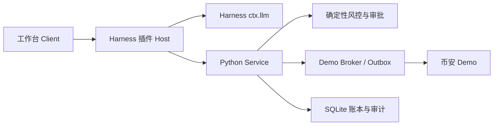

# 交易工作台系统架构审计

审计日期：2026-11-11。范围：当前 `trading-workbench` 的 Host、Client、Python Service、交易适配、风控、账本、调度与 Harness LLM 路由。

**结论：分层方向可以保留，但执行控制、交易事实回填和任务生命周期尚未形成可靠闭环。发现 9 项问题；其中 7 个反例已在隔离环境复现，涉及 6 项发现。P0 两项应阻塞自动执行能力的进一步验收。**

这里的 P0 是软件执行控制的修复优先级，不表示系统接入了实盘。本轮没有改变生产代码、控制态、调度开关、持仓或保护单，没有运行真实交易链。新增文件只有审计脚本及证据、报告。

## 审计方法与证据边界

- 阅读实际源码，并与现有总体架构和当前运行接口核对。
- 使用临时 SQLite、假交易所、假 Harness LLM、真实组件渲染器复现边界条件；没有调用真实交易接口。
- 只读查询本地账本的订单 / 成交 / 仓位事件计数。
- 源码哈希、只读运行快照与复现输出存放在 `architecture-audit-2026-11-11/`。
- 本报告的“已复现”表示确认缺陷仍存在，不是表示修复已经通过。
- 这不是完整形式化验证，也没有覆盖交易所所有异常、操作系统断电和长时间网络分区。

17:08 的只读运行快照：Service ready=true，控制态 normal，1 个持仓，保护 OK；自动调度已启用，最近 tick 为 POSITION_OPEN；Harness 路由为 `opencode-go / deepseek-v4.1-flash`；R20、R21 当前均关闭。该快照只说明当时运行状态，不证明下列竞争条件不存在。

## 当前架构与应保留的边界



保留以下设计：模型调用仅走 Harness；浏览器不持有交易所密钥；Service 独立执行确定性规则；P1 审批绑定计划，P2 再检查；交易所客户端校验 Demo 主机、禁重定向；Outbox 先记录提交意图；金额大部分使用 Decimal；对结果不确定的请求保留查询路径。

主要缺口在这些层之间：**没有共同的执行协调器 / 撤销代际，交易事实没有完整持续同步，界面缓存承担了预算权威。**

## 问题总表

| ID | 优先级 | 问题 | 验证情况 |
|---|---|---|---|
| A01 | P0 | 暂停 / 紧急控制与 P2 下单没有共同的串行化边界 | 假交易所复现暂停后仍提交成交 |
| A02 | P0 | 看门狗只释放锁，旧任务仍可继续 P1/P2 并覆盖失败状态 | 假 LLM / Service 复现 |
| A03 | P1 | 保护单触发 / 外部平仓未完整回填成交，风险归因事实不完整 | 源码 + 运行账本证据 |
| A04 | P1 | 连亏模块手续费符号错误，且未按币种处理 | Decimal 反例复现 |
| A05 | P1 | 自动轮次预算依赖仅 100 条的 Host 展示缓存 | 96 → 95 → 0 反例复现 |
| A06 | P1 | 对账和持仓监督由读请求驱动，缺独立工作循环与守护 | 生命周期 / 调用链确认 |
| A07 | P2 | 无角色模型配置，模型路由在插件加载时冻结 | 路由切换反例 + 源码确认 |
| A08 | P1 | 对账协议不一致，过期 / 查询失败也可能显示“一致” | 审计封装和真实 UI 均复现 |
| A09 | P2 | 缺少可核验的加载版本、配置版本及统一运行事实 | 源码 / 实际加载过程确认 |

## A01 · 暂停确认与订单提交之间存在竞争窗口

**证据位置**：`service/workbench_service/execution/service.py:516`、`:558`、`:572`、`:593`、`:764`；`ledger/store.py:284`。

P2 先读取 snapshot / control，再执行风控检查，之后调用 broker.open_market。`control()` 另行写控制态，并可执行紧急全平。两者没有共同的账户级执行锁或控制代际。SQLite 的单条语句锁和 Outbox 的单标的在途去重没有覆盖“读取控制态 → 最后一次批准 → 发出订单”的整个区间。

复现：P2 已计算出 approved 时暂停线程；另一个线程成功设置 pause；随后释放 P2。结果控制态仍为 pause，假交易所订单从 0 增为 1，入场 FILLED。

这说明“暂停已成功”与“不会再有尚未发出的开仓提交”并不一致。紧急全平也有类似的推断风险：全平快照取得后，旧开仓流程仍可能继续；这个更复杂的交错本轮没有单独复现。

**修复方向**：Service 建立账户级执行协调器。开仓、控制态、平仓、补挂的顺序由它统一管理；控制态变更递增 generation，撤销尚未发送的旧意图和审批；发送前在同一协调边界重新检查控制态、容量和保留额度。对已经发送到交易所的请求不能承诺“网络取消即可撤单”，应等待查询收口，或者明确显示“暂停处理中”。

**验收**：暂停响应生效后，所有旧 generation、尚未发送的 ENTRY 都不能提交；紧急流程需覆盖已有在途 ENTRY 的收口，而非只遍历一次当前持仓。不同标的并发提交也要覆盖账户总仓位 / 保证金容量，不能仅依赖单标的 business_key。

## A02 · 超时轮次失去所有权后仍可执行

**证据位置**：`plugin/host/integration.js:1457`、`:1485`、`:1576`、`:1730`、`:1775`；`host/ai/llm.js:53`。

abandonRun 将记录改为 failed，然后清空 inFlight；它没有撤销 Service 执行租约，没有链级 AbortSignal，也没有在 P1/P2 网关验证“本轮仍拥有执行权”。原代码注释还允许旧调用晚到后正常 finalize 同一轮次。

复现：假 LLM 首次输出延迟到看门狗之后。中间观察到 HOST_RUN_TIMEOUT、failed、运行锁已释放；放行旧输出后，P2 仍提交 1 次，最终状态被写回 done。

**影响**：UI 认为失败、系统开始新一轮时，上一轮可能继续执行；“失败”不能作为“没有交易”的证明。仅扩大 timeout 会改变触发概率，不能解决生命周期所有权。

**修复方向**：每轮持久化 lease / generation / deadline / revoked 状态。看门狗撤销执行权并发起取消；每个不可逆网关在 Service 验证租约。晚到输出可存审计，但不得恢复被撤销轮次的执行资格。流清理也应有界，不能无限等待忽略 abort 的 provider。

## A03 · 成交事实同步不完整

**证据位置**：`execution/broker.py:1008`、`:1045`、`:1167`、`:1244`；`ledger/store.py:455`。

当前 `_record_fills` 由本地开 / 平仓提交结果触发。reconcile 对交易所上消失的持仓删除本地镜像并写 CLOSE_EXTERNAL，没有持续按成交游标回填所有成交。`recent_close_fills` 又仅连接 purpose=EXIT 的订单，保护单触发产生的成交不在这个完整闭环中。

本轮只读账本看到：ENTRY 3、EXIT 1、PROTECTION 4；存在 1 条 CLOSE_EXTERNAL，但已记录成交仅有 ENTRY 3 条和 EXIT 1 条；保护订单镜像仍为 NEW。结合代码，不能把当前 fills 当作账户完整成交事实。

**影响边界**：交易归因、已实现统计、连亏判定缺少事实输入。当前页面注明“本地成交口径”是必要的，但风险引擎也不能把不完整流水当作完整输入。R18/R19 基于账户权益的检查不因这一项就自动失效；不能把所有风控都概括为失效。

**修复方向**：建立独立的成交 / 订单事实摄取，按交易所标的 + trade_id 幂等、持久化游标、分页与重叠补拉，涵盖保护触发、手动交易和外部平仓；手续费币种和资金费分开建模。订单状态、持仓事件、损益与风险统计从同一事实集派生，并暴露覆盖时间与缺口。

## A04 · 连亏模块错误处理手续费

**证据位置**：`execution/service.py:237–255`；`ledger/store.py:455–463`。

`_merged_close_results()` 计算 `realized_pnl + commission`，而本地成交记录中的 commission 是正数支出。它也没有读取手续费币种；不能把不同币种直接加减为 USDT。

复现设定：已实现 −0.01 USDT、手续费 0.10 USDT。应为 −0.11，当前得到 +0.09，被当成非亏损。运行账本中实际手续费字段也是正数，问题不只是测试约定。

**当前影响边界**：R20 在实际 envelope 中为关闭；本轮没有声称当前已启用连亏冷却。问题表示其统计值不可靠，启用 R20 前必须修复。新 UI 的按币种手续费汇总没有修到这条旧风险计算路径，说明同一财务概念已有两套实现。

**修复方向**：建立共用的、资产明确的成交净损益计算；完整币种信息不足时返回 unknown / 不可用，不能当成盈利。定义开仓费用如何归属到交易生命周期，覆盖分批平仓和返佣等符号。

## A05 · 展示缓存被用作预算权威

**证据位置**：`host/integration.js:630–680`；`host/scheduler.js:224`、`:342–363`。

RoundStore 默认只保留最近 100 条，包括手动和自动轮次。24 小时自动计数直接扫描这份缓存；读取 / 持久化失败主要写 warning，仍可得到空列表继续判断预算。

复现：同一时间窗口真实存在 96 条自动轮次，新增 5 条手动记录后计数已降至 95；新增到 100 条手动记录后计数为 0。重载一般不会清零，不代表这个数据源适合作为预算权威。

**修复方向**：预算由 Service 的完整持久化调度台账统计；开链前原子预留额度；明确失败 / 跳过是否计费。展示层仍可只取 100 条，但不得影响预算。权威计数不可读时应停止自动开链并显示原因。

## A06 · 监督循环依附于读请求

**证据位置**：`execution/service.py:214`、`:313–332`；`app.py:122` 生命周期；`execution/deps.py` 惰性装配。

周期对账的实现明确为 status 轮询驱动，≥30 秒一次；账户 / 权益 / 连亏更新也主要在请求触发的 heartbeat 中完成。Service 生命周期没有独立的账户监督 / 对账工作循环。当前 Service 以外部进程启动，原规划中的 managed 守护并未形成完整运行闭环。

**影响**：Host 停止、未轮询或相关读请求阻塞时，这些检测不会按承诺独立持续运行。已挂在交易所的保护单不会因为 UI 关闭而自动消失；问题是本地的持续核对、缺失检测和恢复能力依附于控制面。

此外，自动调度遇到持仓便 POSITION_OPEN 跳过，避免了白跑开仓链，但这不等于已有持仓管理链。源码没有将 time_stop_hours 落为可执行的持仓时间约束；若产品承诺自动管仓 / 时间止损，应另列未完成能力，不能只凭 execution_manage schema 宣称实现。

**修复方向**：Service 生命周期内启动可观察、可停止的独立监督 worker，分离只读 API 与工作循环；为账户单写者、请求预算、失败退避和监督进程建立明确所有权。自动修复 / 平仓策略需显式配置，不能借“增加 worker”悄悄扩展交易权限。

## A07 · Harness 内部型号无法按角色选择

**证据位置**：`host/ai/llm.js:16–23`、`:136–148`；`host/integration.js:856–858`、`:1832`；`plugin/index.js:254`；`host/ai/chain.js:376`。

用户的观察正确。当前实现存在三层限制：

1. 工作台中的分析、红队、蓝队、决策、风控、执行是本插件编排的**逻辑角色**，直接调用 ctx.llm.stream；不是 Harness 原生子智能体实例。Harness 子智能体的型号设置不会自动传到这些调用。
2. resolveHarnessRoute 只读取 agentDefaultModel.currentSelection；整条链共享同一个 route，没有 role → model 映射、型号目录接口和角色配置入口。
3. integration 在构造时保存 this.route，后续运行继续使用；切换 Harness 全局默认型号也不保证工作台立即跟随。

隔离复现：内部默认路由从测试标识 model-a 改为 model-b，resolveHarnessRoute 已返回 b，旧 integration.route 仍为 a。测试标识不表示你的 Harness 实际安装了这两个型号。

调用选项本身已有 provider/model，问题位于工作台路由与配置层，不需要新增外部 LLM SDK 或在工作台填写 API key。现有架构文档记录了 Harness 模型目录服务；新增目录接口时仍须核对当前已安装版本的真实返回契约和权限。

**改造方案**：

- Host 从当前 Harness 服务枚举可用 provider/model，区分已配置、可调用、能力未知 / 不可用状态；Client 只选内部标识，不保存凭据。
- 配置 `defaultRoute + roleRoutes`：分析、红 / 蓝开场与回应、决策、风控、执行、复盘；每个角色可“继承默认”，红 / 蓝回应默认继承各自开场。
- 在**轮次开始时**解析并冻结有效路由快照；后续配置只作用于下一轮，不能半轮切换。
- 校验上下文、最大输出、推理参数、结构化输出契约；按型号建立时间 / token 预算，不沿用单一型号的固定速率假设。
- 每次调用记录实际 provider/model、角色、配置版本和 prompt 版本。不可用时如实失败；备用型号必须显式配置，不能静默换型。
- 型号配置始终无权扩大硬风控、取消保护或直接提交订单。

验收要使用两个确实可用的 Harness 内部路由验证角色分配，并覆盖全局默认变更、型号下线、轮次中改配置及不支持参数的情况。

## A08 · 对账结果缺少统一协议和质量判定

**证据位置**：`execution/broker.py:1008–1076`；`execution/outbox.py:200–220`；`execution/service.py:748`；`plugin/client.js:2024–2041`。

Service 对账输出 `closed_external`、`outbox.checked/resolved/errors`、`exchange_reachable`、`stale`；Client 读取的是 `closed`、`outbox.pending/uncertain`，并把缺字段当空 / false 后判断 clean。没有把“交易所可达、事实新鲜、无未决订单”作为一致判据。

两个复现：

- 交易所不可达且 stale=true，operator_command 仍把审计记为 succeeded。
- 向真实 ReconcilePanel 渲染器输入 Service 形状的响应：交易所不可达、stale=true、查询错误 1、外部平仓 1；界面仍显示“本地账本与交易所一致”。

这项涉及刚新增的审计封装，也暴露出旧 UI fixture 没有使用真实 Service DTO 的问题。HTTP 调用完成、命令处理完成、业务对账一致必须分开表达。

**修复方向**：定义跨 Python / JS 的版本化响应 Schema，并用真实服务响应做契约测试；增加明确的 verification 状态：fresh / stale / incomplete / failed。只有完整新鲜且没有未决项时才能显示一致。审计记录应保存业务核验状态，不能只看 result.ok 是否显式为 false。

## A09 · 缺少加载版本和配置的可核验身份

**证据位置**：`plugin/index.js:14`、`:106`；`host/integration.js:673–680`；现有运行 / 部署记录。

多轮修改后插件版本仍固定 0.1.0；没有统一的 loaded build ID、运行配置修订和角色路由配置版本供健康接口核对。Service、Host、Client 分别加载，磁盘源码、测试版本和运行版本可能不同。静态 SERVICE_GAPS 仍含“无 Demo 凭据”和 fixture 模式文本，与当前状态冲突，虽已降到原文区，仍不是有效运行事实。

**修复方向**：发布 manifest、构建标识、配置修订及兼容矩阵；健康接口返回进程实际加载时冻结的身份，不能临时读取磁盘文件后冒充已加载版本。新增模式 / 配置时提供只读差异和迁移记录。Host JSON 可以做展示缓存，执行及审计事实以 Service 台账为权威。

## 建议修复顺序与验收门

| 阶段 | 工作 | 必须达到的验收 |
|---|---|---|
| 1 | 账户执行协调器 + 控制代际 + 轮次撤销 / lease | A01、A02 反例不能再提交订单；晚到结果不能覆盖撤销状态 |
| 2 | 完整交易事实摄取 + 共用资产明确的损益核算 | 保护单平仓、外部平仓、分批成交、手续费与连亏一致，覆盖断线补拉 |
| 3 | 独立监督 worker + 权威预算 + 对账协议 | 关闭 UI 后监督仍工作；展示缓存裁剪不影响预算；旧数据不能显示一致 |
| 4 | Harness 型号目录 + 按角色路由 + 发布身份 | 两个真实内部型号正确分配角色，配置切换只影响下一轮，运行身份可核对 |

模型选择可以先做配置协议设计，但它不应替代前两项执行边界修复，也不能用增加模型数来掩盖当前故障。

## 复现材料

在 `trading-workbench` 目录运行：

```powershell
python scripts/audit-architecture.py
node --test-force-exit scripts/audit-architecture.mjs
```

当前输出刻意确认缺陷：pause 后假订单 FILLED；−0.01 扣 0.10 算为 +0.09；stale 对账审计 succeeded；看门狗失败后仍有 P2；全局型号已变而工作台路由未变；96 轮被缓存裁剪低估；过期对账 UI 显示一致。修复后应将这些反例转成断言“不能发生”的正式回归测试。

证据文件：

- `architecture-audit-2026-11-11/python-reproductions.jsonl`
- `architecture-audit-2026-11-11/node-reproductions.jsonl`
- `architecture-audit-2026-11-11/source-manifest.json`
- `architecture-audit-2026-11-11/ledger-observations.json`
- `architecture-audit-2026-11-11/runtime-observation.json`

现有测试数量和通过状态不能替代上述跨模块不变量。本轮没有因为审计发现而擅自暂停运行；当前调度在有仓时跳过，也不能消除空仓后进入自动开仓路径时的竞争风险。
