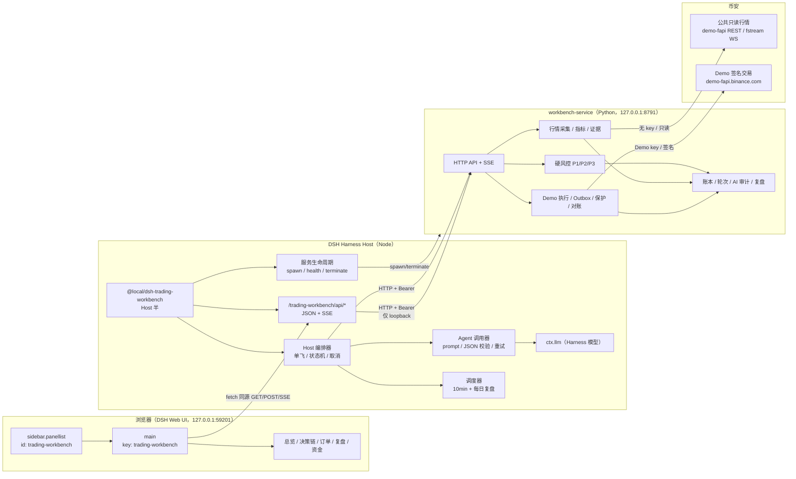
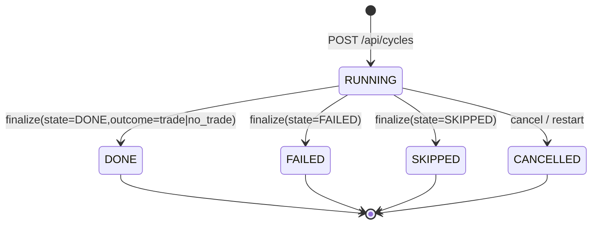
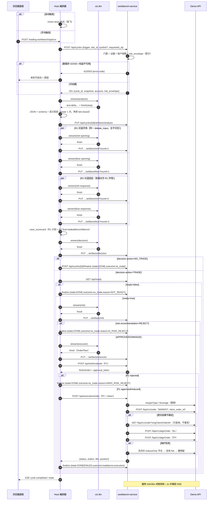
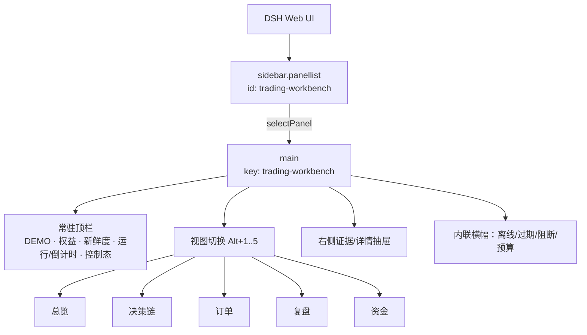

# 交易工作台 v1 设计方案（整合稿）

- 版本：v1.0（整合稿，2026-11-09，Asia/Shanghai）
- 状态：**可据此拆实现任务**；用户拍板项见 §15，未拍板项已给出默认值并明确风险。
- 唯一需求输入：`00-需求基线.md`
- 整合来源：`01-总体架构.md`、`02-AI决策链.md`、`03-Demo执行与风控.md`、`04-行情与指标.md`、`05-工作台UI.md`、`05a-DSH实测校正.md`、`06-设计评审.md`
- 本文性质：**只做设计**。未安装插件、未启动服务、未调用 LLM、未发起币安请求、未下 Demo 单、未修改 `multi-agent-trader`、未读写密钥。
- 裁决顺序：**用户决策（§15）> 领域权威（02/03/04/05）> 边界权威（01）> 旧稿**；评审 06 的 blocker/high 已在 §17 逐条处置。
- 详细附录仍以各分册为权威：`02` 的 9 份 draft-07 schema、`03` 的 26 条规则原始表与 20 条失败矩阵、`04` 的 `md-evidence/1` 完整 JSON Schema、`05` 的 95 张 UI 组件表；本文不重复粘贴全文，避免 500KB 主文档。

---

## 0. 结论摘要

1. **形态**：DSH Harness 插件（Host + Client 两半）+ 本机单 Python 服务。Host 负责 6+1 agent 编排、调度、LLM 调用、JSON 校验、UI 路由与 SSE；服务负责行情、Demo 执行、硬风控、账本、证据/轮次/审计落库。Client 只做展示与命令下发。
2. **AI**：只走 Harness `ctx.llm.stream`，不接外部 LLM API、不读 key、不硬编码 provider；v1 无 tool loop。6 个链路 agent + 1 个每日复盘 agent；红蓝默认对称两轮（R1 开场 + R2 回应，4 次辩论/8 次整链），`independent` fallback。
3. **Demo-only 的准确范围**：**签名交易/账户流量只允许 `demo-fapi.binance.com`**；**公共只读行情**独立客户端、无凭据、GET/WS 只读，默认 REST 用 `demo-fapi.binance.com`、WS 用 `wss://fstream.binance.com`；`fapi.binance.com` 仅在用户批准 U-01 后加入行情白名单。代码中不存在 live 交易常量与 live 凭据名。
4. **账本**：新库 `data/workbench-v1.sqlite`、新曲线；旧 `agent_trader.sqlite`（193MB）不 attach/不 import/不混算。会话权益 `equity_session = equity_exchange − baseline`，默认 `initial_equity=5000`（U-04）。
5. **安全双闸**：P1 计划闸（硬规则 + 一次性 `approval_token`）→ P2 提交闸（实时复算 + token 校验）；AI 风控只能收紧；开仓必须带 SL/TP，保护失败即平仓；Outbox UNKNOWN 只查询不重发；emergency **先平仓后撤单**。
6. **调度唯一**：**Host 是唯一调度器**；服务 `POST /api/cycles` 原子完成“门禁→证据→账户快照→`cycle_runs`”；行情慢循环只刷新/预取，不触发 AI；`/api/cycle/run` 只是 `POST /api/cycles` 的兼容别名。
7. **超时**：AI 链硬截止 **180s**（从 `snapshot.produced_at` 起算）；Host analysis override **50s**（chain 常量 28s）；证据门禁 **180s**；执行开始截止 130s，P1/P2/保护在剩余 50s 内完成；M1 实测 p99 后再定最终值。
8. **里程碑**：M1 最小闭环（手动一轮 + 执行/风控核心 + 总览/链骨架）；M2 完整 UI + 自动 10 分钟 + 复盘；M3 复盘优化/成本/多仓评估/tool loop v2。

---

## 1. 需求与 v1 范围

### 1.1 已确认需求（00 §2，逐条落点）

| # | 需求 | 本设计落点 |
|---|---|---|
| 1 | DSH 插件，主面板 + 侧栏入口 | §4：`main`（key=`trading-workbench`）+ `sidebar.panellist`（同 id） |
| 2 | 只用 Harness 内置 LLM，固定推理档 | §8.2：`ctx.llm.stream`；role→effort 固定；启动校验 |
| 3 | 币安 Demo，无 live 路径 | §11.1：签名交易仅 demo 域；§11.2 静态证明 |
| 4 | 允许 Demo 下单/平仓/挂保护单 | §9：P1/P2 + 手动平/减/撤/改保护；禁止手动开仓（U-05） |
| 5 | 不绑定具体策略 | 分析 agent 只做技术面/交易面；无策略模块 |
| 6 | 分析 agent 合并原情报角色 | §8.3 `analysis/1` |
| 7 | 红蓝默认对称两轮 | §8.4：R1 开场 + R2 回应，4 次辩论调用；`independent` fallback（U-06） |
| 8 | 决策者决定是否交易/方向 | §8.5 `decision/1`；只能 red/blue/NO_TRADE |
| 9 | AI 风控 + 硬规则否决/降仓 | §9.9：26 条规则 P1/P2/P3；AI 只收紧 |
| 10 | 操盘手执行并跟踪 | §8.6 + §9.4/§9.5 |
| 11 | v1 不做 tool loop；证据预加载 | §8.2；`md-evidence/1` 快照 |
| 12 | 手动 + 每 10 分钟自动 | §3.2：Host 唯一调度 |
| 13 | 权益曲线/仓位/决策链/订单成交/复盘/资金 | §10：5 视图 |
| 14 | 移除策略相关 UI | §10.6 |
| 15 | 深色、高密度、桌面优先 | §10.5：仅 14 个宿主 token |
| 16 | 本机单用户；1s 价格、10–15s 状态 | §10.5/§12.4 |
| 17 | 旧数据只读；新账本/新曲线 | §6.2/§6.5 |

### 1.2 v1 不做（00 §3）

实盘、live key、外部 LLM API、tool loop、多轮工具调用、策略决策/通道/漏斗/评价、回测/历史重放、多用户/远程/公网鉴权、移动端、限价入场（U-11）、WebSocket 私有用户流、手续费/资金费精确对账、Windows 服务化、多仓（v2 再评估）。

### 1.3 关键假设

- 本机 Windows，Python 3.13 可用；DSH 0.2.2-rc.1（desktop profile）可用。
- 币安 Demo 账户可用；账户持仓模式为 One-way 或可探测 Hedge 分支（U-03）。
- Demo 行情探针通过（§7.1）；不通过则按 U-01 决策。
- 本机单用户、服务只监听 `127.0.0.1:8791`。

---

## 2. 系统总览与边界

### 2.1 三方案对比结论（保留）

| 维度 | A′（采用） | B（全 Node） | C（复用原服务） |
|---|---|---|---|
| 形态 | 插件 Host 编排 + 单 Python 服务 | 全部在 Host/Node | 直接复用 `multi-agent-trader` |
| AI 只在 Harness | ✅ | ✅ | ❌ 需剥离外部 LLM |
| Demo-only 可证明 | ✅ 双客户端隔离 | ⚠️ 从零重写执行 | ❌ 自带 live 路径/主循环 |
| 原项目复用 | ✅ 语义移植（不 import） | ❌ 无 | ⚠️ 强耦合 |
| 失败隔离 | ✅ 双进程 | ❌ 单进程爆炸半径 | ⚠️ 原主循环 |
| 改造量 | ~3,200–3,800 行 Python + ~1,200–1,700 行 Host + UI | ~2,800–4,000 行 Node，执行语义全新 | ≥3,000 行改造且违反边界 |
| 结论 | **采用** | 仅无 Python 时降级 | 拒绝 |

**Q2 复用结论**：新写轻量 `demo_broker/demo_outbox/risk_rules/ledger`；语义移植原项目 7 条不变量（I1 POST 前落库、I2 UNKNOWN 只查询、I3 开仓必带 SL/TP 且保护失败即平仓、I4 交易所以准、I5 查询失败≠无保护、I6 先挂新后撤旧、I7 权益不可用禁开仓）与 Algo 保护单/签名/过滤器/AccountRiskGuard；不 import `BinanceFuturesBroker`/`AuditDatabase`；原项目改动 0。

### 2.2 组件图



### 2.3 职责与单一 owner 矩阵

| 组件/数据 | 职责 | **唯一写入者** | 不负责 |
|---|---|---|---|
| Client 面板 | 渲染、SSE 订阅、命令按钮、i18n/主题 | —（无持久化） | 不调模型、不持密钥、不直连 Python、不写 session |
| Host 插件 | 调度、agent 编排、prompt、JSON 校验、重试、轮次状态推进、UI 路由/SSE、服务生命周期 | 无业务 DB（仅日志/内存） | 不访问币安、不持密钥、不做最终风控 |
| 服务 API | 鉴权、编排入口、只读查询 | — | 不调 LLM、不渲染 UI |
| market 包 | 行情采集/指标/证据 | `market.sqlite3` 的 `bars`/`universe_state` | 不写交易表、不下单 |
| execution/risk 包 | 订单/保护/对账/硬规则 | `orders/order_outbox/fills/positions/...` | 不改 AI 输出、不做方向判断 |
| `cycle_runs`/`cycle_agents` | 轮次与 agent 投影 | **服务**（Host 经 API） | — |
| `ai_runs/ai_calls/ai_outputs/ai_run_events/ai_breaker/ai_budget` | AI 审计 | **服务**（Host 经 API） | — |
| `snapshots` | 证据索引（`cycle_id → path+sha256`） | **服务**（market 落盘后由服务写索引；market 不写本表） | — |
| `daily_reviews` | 复盘 | 服务（Host 经 API） | — |
| `data/.api-token` | 服务鉴权 | 先到者创建，双方只读 | — |

**调度与创建（B-01 处置）**：

| 动作 | 唯一 owner | 说明 |
|---|---|---|
| 10 分钟自动轮次 | **Host** `ctx.setInterval` | 到点调用服务 `POST /api/cycles`；服务不自行调度 AI |
| 手动“运行一轮” | Host | 同一单飞锁；`409` 兜底 |
| 生成 `cycle_id` / 证据 / 账户快照 | **服务**（`POST /api/cycles` 内原子完成） | Host 只传 `trigger/symbol/requested_at/slot_id` |
| 行情刷新/预取 | 服务 market | 不触发 AI、不创建轮次 |
| 每日复盘 | Host 定时 | 见 §3.5 |
| 订单/保护/权益 | 服务 execution | 30s 对账 + 10s 执行快照 |

### 2.4 Demo-only 边界（B-02 处置）

| 流量 | 域名 | 凭据 | 方法 | 约束 |
|---|---|---|---|---|
| 签名交易/账户 | **仅** `https://demo-fapi.binance.com` | `BINANCE_DEMO_*` | 签名 REST | 唯一 host；无 live 常量；`follow_redirects=false`；端点白名单；无提现/划转 |
| 公共行情 REST | 默认 `https://demo-fapi.binance.com`；U-01 批准后可加 `https://fapi.binance.com` | **无** | 仅 GET | 独立 `PublicMarket` 客户端；断言无 `X-MBX-APIKEY`/无签名参数；host 白名单 |
| 公共行情 WS | `wss://fstream.binance.com` | **无** | WS 只读 | Demo 无独立行情 WS；断线退 REST |

- **demo-only 约束的是“签名交易/账户流量”**，不约束“公共只读行情”。这样既满足基线 §5.2 的“拒绝非 demo base URL 下单”，也允许只读公共数据。
- 静态扫描只扫**交易生产代码**（`service/workbench_service/execution/**`），排除 `docs/`、测试负例、第三方；负例 URL 用字符串拼接或 `tests/fixtures/live_url.txt` 允许列表。
- M1 第一步做只读探针：`/time`、`/exchangeInfo`、`/klines`、`/ticker/24hr`、`/premiumIndex`、`/openInterest`，比对 demo 与公开行情 15m OHLCV/`close_time`；不通过 → 按 U-01 决策，禁止“将就错价交易”。

---

## 3. 调度、轮次与状态

### 3.1 一轮的标识

| 标识 | 生成者 | 格式 | 用途 |
|---|---|---|---|
| `cycle_id` | **服务** `POST /api/cycles` | `cyc-<UTC yyyyMMddTHHmmssZ>-<6hex>`（正则 `^cyc-[0-9]{8}T[0-9]{6}Z-[0-9a-f]{6}$`） | 权威轮次 ID；UI `roundId` 直接等于它 |
| `slot_id` | Host 传入/服务派生 | 自动：UTC 10 分钟桶 `auto:2026-11-09T01:40Z`；手动：`manual:<ISO>` | 自动轮次唯一索引，防双触发 |
| `ai_run_id` | Host 创建 | `run-<UTC>-<6hex>-r<n>` | 同 cycle 可重跑；审计单位 |
| `call_id` | Host | `<ai_run_id>:<role>:<attempt>` | 每次 LLM 尝试 |
| `client_order_id` | 服务执行器 | 见 §9.7 | 订单幂等 |
| `approval_token` | 服务 P1 | 不可猜测的 HMAC 令牌 | P2 防绕过 |

### 3.2 调度与幂等

| 场景 | 行为 |
|---|---|
| 自动 10 分钟 | Host timer 到点 → `POST /api/cycles {trigger:"auto", slot_id:"auto:<bucket>"}`；同 slot 已有 cycle → `409 E_CYCLE_DUPLICATE_SLOT`，Host 记 skipped |
| 手动运行 | Host 单飞锁；服务若已有 `RUNNING` cycle → `409 E_CYCLE_IN_PROGRESS`。双击/600ms 内重复由 Host 按钮 pending + `Idempotency-Key` 兜底 |
| 手动距上一轮 <60s | 同 symbol 且 `reuse_last_snapshot=true`（Host 默认）→ **返回上一轮 `cycle_id` 与 `reused=true`，不重复调 LLM**；只有显式 `force=true` 才新建 cycle 并复用证据（`reused_snapshot_from`） |
| 上一轮仍跑 | 不排队，返回 409；Host 显示“运行中” |
| 关闭期间错过 | 不补跑历史；标 `DATA_GAP`，下次只跑一次恢复轮 |
| 预算耗尽 | `SKIPPED(BUDGET_EXHAUSTED)`，不调 LLM |
| 数据非 GOOD 且有持仓 | MANAGE/保护；无持仓 → `NO_TRADE(DATA_NOT_GOOD)` |

> `POST /api/cycles` 返回 `reused=true` 时，Host **不得再发起 AI 调用**，直接把该 `cycle_id` 的现有 `RoundView` 返回 UI 并提示“60s 内复用上一轮”。

### 3.3 三层状态与映射（H-01 处置）

**A. 服务 `cycle_runs`（t3 权威）**

- `state ∈ RUNNING | DONE | FAILED | SKIPPED | CANCELLED`（在 t3 基础上补 `CANCELLED`）。
- `outcome ∈ trade | no_trade | error`（t3 枚举）。
- 终态不可变；重跑是新 `cycle_id`/新 `ai_run_id`。

**B. AI 链 `ai_runs.state`（02 状态机）**

`PREPARING | ANALYZING | DEBATING | SCORING | DECIDING | RISK_PREP | RISK_AI | EXEC_PLANNING | MANAGING | EXECUTING | SETTLING` + 终态 `COMPLETED | NO_TRADE | FAILED | FAILED_SAFE | ABORTED | SKIPPED`。

**C. UI `RoundView.status`**

`running | done | no_trade | rejected | failed | skipped | cancelled`（t5 原 6 个 + `skipped`；`FAILED_SAFE` 用 `failed` + `protected=true` 表达）。

**映射表**：

| `ai_runs` 终态 | `cycle_runs.state/outcome` | UI `status` | 说明 |
|---|---|---|---|
| `COMPLETED` | `DONE/trade` | `done` | 已下单/已管理，保护确认 |
| `NO_TRADE`（无拒绝码） | `DONE/no_trade` | `no_trade` | 正常不交易 |
| `NO_TRADE`（`HARD_RISK_REJECT`/`AI_RISK_REJECT`/`RISK_*`/`CONTROL_LOCKED`） | `DONE/no_trade` + `error_code` | `rejected` | 风控拒绝 |
| `FAILED` | `FAILED/error` | `failed` | 链路失败，无订单 |
| `FAILED_SAFE` | `FAILED/error` + `protected=1` | `failed`（`protected=true`） | 已保护/平仓 |
| `ABORTED` | `CANCELLED/error` | `cancelled` | 手动/重启中止 |
| `SKIPPED` | `SKIPPED/no_trade` | `skipped` | 重叠/预算/无快照 |
| 运行中（任意中间态） | `RUNNING` | `running` | — |

### 3.4 轮次状态机（服务/编排视角）



> AI 内部的 `PREPARING…SETTLING` 状态写入 `ai_runs`/`ai_run_events`；`cycle_runs` 只表达轮次生命周期。UI 的节点状态来自 `ai_runs`/`ai_run_events`。

### 3.5 每日复盘调度（H-05/A11 处置）

- 时点：**UTC 00:10（Asia/Shanghai 08:10）**，即 UTC 日切后 10 分钟；`review.schedule` 可配。
- `date` = 前一个 UTC 日；Host 调 `GET /api/reviews/{date}/context` → 复盘 agent → `PUT /api/reviews/{date}`。
- 错过只补最近一天；更早标 `SKIPPED`，不补历史。
- 复盘失败不影响交易/对账；UI 可手动重生成。
- 日亏/回撤仍按 UTC 00:00 日切（t3）；复盘展示用 Asia/Shanghai，二者字段分开。

### 3.6 一轮完整时序（可实现版）



> `debate.mode=independent` 或 R2 任一方失败时，跳过 R2 回应，决策者只看两份 R1 开场；R2 失败降级记 `DEBATE_ROUND2_DEGRADED`。
>
> `artifacts/{agent}` 需接受 `round=1|2`（或按 `call_id` 区分），否则 R1/R2 会互相覆盖；服务侧 `ai_outputs` 增加 `round` 字段。


---

## 4. DSH 插件集成

### 4.1 包与两半

```jsonc
// package.json（形态）
{
  "name": "@local/dsh-trading-workbench",
  "version": "0.1.0",
  "private": true,
  "type": "module",
  "exports": {
    ".": "./index.js",
    "./client": "./client.js",
    "./locale/*.json": "./locale/*.json",
    "./icon": "./icon.svg"
  },
  "files": ["index.js", "client.js", "cordis.patch.yml", "locale/*.json", "icon.svg", "src/**"],
  "dsh": {
    "bundle": { "patch": "./cordis.patch.yml" },
    "client": {
      "platform": "web",
      "immediately": true,
      "inject": ["@deepseek-ai/dsh-client-ui-renderer", "@deepseek-ai/dsh-client-locale"]
    }
  }
}
```

- Host 半 `index.js`：`export function apply(ctx, config)`；`export const inject = ['webServer','llm','timer']`；`agentDefaultModel`/`subprocess`/`connection` 用 `ctx.inject([...])` 可选获取。
- **零运行时 npm 依赖**：只使用 Node 内置模块 + `ctx.*` 服务；不 import `@deepseek-ai/*` 包。JSON Schema 校验器采用**构建期生成**（见 §8.10），不把 ajv 作为运行时依赖。
- Client 半 `client.js`：`window.__ModuleLoader__.load({ id:'@local/dsh-trading-workbench', factory(require){…} })`；模块对象 `inject: ['slots','locale']`；只 `require('react')`。
- 安装：`plugin_manager(action="install_bundle", target="<绝对目录>")`；以返回的 `application`/`warnings` 判定生效，安装后在有页面的会话用 `cordis_inspect_query` 复核 Slot。

### 4.2 Slot 注册（05a v2 校正，H-09）

| slot | 类型/作用域 | 本插件用法 | 注册形态 |
|---|---|---|---|
| `main` | root **keyed** | 主面板，`key='trading-workbench'` | `ctx.slots.register({ name:'main', key:'trading-workbench', locale:NS, inject:()=>({t}) }, WorkbenchPanel)` |
| `sidebar.panellist` | root **list** | 侧栏入口，`id='trading-workbench'`，`order:40` | `ctx.slots.register({ name:'sidebar.panellist', id:'trading-workbench', order:40, label:()=>t('panel.title'), locale:NS }, PanelIcon)` |
| `sidebar.toggle.badge` | root **single**，`replaceRisk:'shadows-shipped-ui'` | **v1 不使用**（状态点放顶栏） | — |
| `shell.overlay`/`shell.bottom`/`shell.leading`/`conversation.*` | — | 不使用 | — |

```js
// client.js 内的注册（示意）
const NS = 'tradingWorkbench'
const t = ctx.locale.bind(NS)
ctx.slots.inject('sidebar.panellist', () => {
  const offMain = ctx.slots.register({ name:'main', key:'trading-workbench', locale:NS, inject:()=>({t}) }, WorkbenchPanel)
  const offRow = ctx.slots.register({ name:'sidebar.panellist', id:'trading-workbench', order:40, label:()=>t('panel.title'), locale:NS }, PanelIcon)
  return () => { offRow(); offMain() }
})
```

- `label` 是**可见字符串或返回字符串的函数**，不是 locale key；`locale` 是命名空间（05a v2 已关闭 U1）。
- `main` 的 `key` 与 `sidebar.panellist` 的 `id` 必须一致；侧栏点击由宿主调用 `ctx.layout.selectPanel(id)`。
- `panelInfo` 通过 scoped layout 使用：`ctx.inject(['layout'], ({layout}) => layout.panelInfo.getSnapshot().activePanelId)`；`usePanelInfo()` 未证实，实现前复核（不阻塞）。
- Client 模块 `inject:['slots','locale']` 与 `dsh.client.inject` 是两层，二者都要有。

### 4.3 主题（05a v2 的 14 个 live token，H-09/L-03）

| token | 用途 |
|---|---|
| `--dsw-alias-bg-base` | 应用背景 |
| `--dsw-alias-bg-layer-1` | 主卡片/抬升面 |
| `--dsw-alias-bg-layer-2` | 次级嵌套面 |
| `--dsw-alias-bg-overlay` | 抽屉/浮层 |
| `--dsw-alias-border-l1` | 主细边框（1px） |
| `--dsw-alias-border-l2` | 次强边框/分隔 |
| `--dsw-alias-brand-primary` | 品牌主色/链接/选中 |
| `--dsw-alias-label-primary` | 主文字 |
| `--dsw-alias-label-secondary` | 次文字/说明 |
| `--dsw-alias-state-error-primary` | 错误/亏损/拒绝 |
| `--dsw-alias-state-idle-primary` | 中性/非活动 |
| `--dsw-alias-state-success-primary` | 成功/盈利/通过 |
| `--dsw-alias-state-warn-primary` | 警告/降仓 |
| `--dsw-specific-sidebar-fill` | 宿主侧栏专用（主面板不要当卡片底色） |

- 不再使用 05a v2 未列出的旧 token 名；以 §4.3 的 14 个为唯一列表（05a §2.1 替换表已核对）。
- 阴影用 token 派生（`color-mix(in srgb, var(--dsw-alias-label-primary) 12%, transparent)`）；涨跌用 `success/error` + 符号/箭头三重编码；图表序列属 artwork，可用自带调色板。
- 字体继承宿主；数字用系统等宽栈 `ui-monospace, SFMono-Regular, Menlo, Consolas, monospace`。

### 4.4 浏览器路由与健康

- 统一前缀 **`/trading-workbench/api/*`**（单条 `kind:'prefix'` 路由；避开宿主 `/api` 桥与 Electron IPC 桥；`dshmarket` 同先例）。
- Host 注册路由表见 §5.3；SSE 见 §5.6；健康 schema 见 §5.5。
- 同源、无 CORS；写接口只接受 `application/json`（≤64KiB）；路由只接受 loopback（`request.socket.remoteAddress` ∈ 127/8、::1），否则 403。
- **不使用** `@Remote`/Typert（需要构建期生成物）；不注册 Tool、不改 system prompt、不写 Session。

### 4.5 Host/Client 模块结构

| 半 | 模块 | 职责 |
|---|---|---|
| Host | `index.js` | `apply(ctx, config)`；注册路由/定时器/生命周期/SSE；unload 全量释放 |
| Host | `config.js` | 默认值、类型/范围校验、路径/模型路由解析 |
| Host | `lifecycle.js` | token 文件、服务探测、spawn/terminate、健康缓存、单实例、重启退避 |
| Host | `service-client.js` | 服务 HTTP 封装：Bearer、超时、GET 有限重试、POST 不自动重试、错误映射 |
| Host | `router.js` | 一条 `/trading-workbench/api` prefix 路由；method/path 分发；JSON/SSE；loopback 校验 |
| Host | `orchestrator.js` | 单飞、轮次状态机、agent 顺序/并行、取消/超时、finalize、重试边界 |
| Host | `agents.js` | prompt 渲染、`ctx.llm.stream`、chunk 收集、JSON 提取、token 统计 |
| Host | `schemas.js` + `validators/` | 构建期生成的 draft-07 校验器 + 语义校验 |
| Host | `prompts/` | 7 个 prompt 模板（版本化） |
| Host | `sse.js` | 浏览器 SSE 帧、心跳、清理、服务 SSE 合并 |
| Host | `log.js` | `[twb]` 日志、host.log、脱敏 |
| Client | `client.js` factory | `inject:['slots','locale']`；注册 locale/main/sidebar；持有 store/api |
| Client | `store` | 轻量 snapshot store（rev、状态、待确认操作）；不用第三方状态库 |
| Client | `api` | `fetch('/trading-workbench/api/*')` + `EventSource('/stream')`；abort/退避/全量刷新 |
| Client | `components`/`views` | 顶栏、5 视图、决策链、抽屉、表格、图表（SVG）、对话框 |
| Client | `styles` | `ctx.effect` 注入一个 `<style data-tw-style>`，`.twb-` 前缀，14 token |

- Client 不 import 任何 DSH Client 包；样式不写死宿主 DOM；组件在槽内渲染。
- 允许 M1 单文件 `client.js`；M2 若拆分，必须用构建产物合并仍满足 `window.__ModuleLoader__.load` 形态。

---

## 5. 服务 API 与 Host 路由契约

### 5.1 通用约定

| 项 | 约定 |
|---|---|
| 地址 | Python 服务 `http://127.0.0.1:8791`；Host 浏览器路由同源 `/trading-workbench/api/*` |
| 鉴权 | `/health` 免鉴权；其余 `/api/*` 需 `Authorization: Bearer <token>`。token 是 per-dataDir 稳定密钥，存 `data/.api-token`（0600），managed 由 Host spawn 前确保存在并 env 注入，external 由服务缺失时生成 |
| 内容 | JSON UTF-8；金额/数量/价格一律**十进制字符串**（避免 float 往返）；时间 wire 用 **UTC ISO-8601 `…Z`**；所有响应带 `trace_id` |
| 幂等 | `POST /api/cycles`/`POST /api/execution/order` 支持 `Idempotency-Key`；服务端以 `cycle_id`/`client_order_id` 保证重放安全 |
| 错误信封 | `{"error":{"code":"E_*","message":"…","retryable":false,"details":{…}},"trace_id":"…"}` |
| 大小 | 请求体 ≤64KiB（Host 路由）；服务内部 JSON ≤1MiB；大对象走文件/分页 |
| 版本 | `/health` 返回 `service_version`/`schema_version`；不兼容时 Host 禁止开仓并提示升级 |

### 5.2 服务端点（唯一实现清单）

**自检/只读**

| 方法 | 路径 | 用途 |
|---|---|---|
| GET | `/health` | 存活、版本、`venue:"demo"`、`key_fingerprint`、`ledger_id`、`phase`；不查交易所 |
| GET | `/api/ready` | 开仓就绪 `{ready, service_ready, new_entry_allowed, reasons[], control_state}`；与执行层同一判定器。`ready=false` 表示当前不允许新开仓，`service_ready=true` 只表示服务可用；无 Demo key 时 `ready=false` 且 reasons 含 `E_DEMO_CREDENTIALS_MISSING` |
| GET | `/api/status` | 账户/权益/仓位/保护/挂单/未决单/控制态/新鲜度汇总 |
| GET | `/api/equity-curve?range=&bucket=` | 权益曲线（`equity_session` 主、`equity_exchange` 副） |
| GET | `/api/orders?status=&limit=` | 订单 + 保护单 |
| GET | `/api/fills?limit=` | 成交 |
| GET | `/api/positions` | 仓位 + 保护状态 + `origin` |
| GET | `/api/risk/envelope` | P1 前的硬规则上限（caps/control/账户状态/`expires_at`），供 prompt 注入 |
| GET | `/api/market/health` | 行情 verdict/score/issues/cooldown/collector |
| GET | `/api/market/clock` | server_time/offset/rtt |
| GET | `/api/market/universe` | 白名单/deep/index/omitted/理由 |
| GET | `/api/market/klines` | 闭合 K 线（`include_live=false` 默认） |
| GET | `/api/market/prices` | 最新价/标记价（UI 1s 兜底、执行门禁） |
| GET | `/api/market/snapshot/{cycle_id}` | 证据快照（只读，审计回看） |
| GET | `/api/stream` | 服务聚合 SSE：`price`(1Hz)/`state`(5s)/`order`/`cycle`/`health` |
| GET | `/api/logs?source=&lines=` | 日志尾部（脱敏） |

**轮次与 AI 审计（Host 专用写）**

| 方法 | 路径 | 用途/幂等 |
|---|---|---|
| POST | `/api/cycles` | **唯一创建轮次入口**：门禁→证据→账户快照→`cycle_runs(RUNNING)`；返回 `{cycle_id, snapshot, account, risk_envelope}`；非 GOOD/权益不可用→423/503；已有 RUNNING→409；同 `slot_id`→409 |
| POST | `/api/cycle/run` | **兼容别名**，等价 `POST /api/cycles`（只创建轮次，不跑 AI；防止旧接口变成第二个调度器） |
| GET | `/api/cycles?limit=&cursor=` | 轮次列表 |
| GET | `/api/cycles/{id}` | 单轮完整视图（含 AI 运行/产物/风控/执行） |
| GET | `/api/cycles/{id}/evidence?agent=` | 证据抽屉：快照引用 + prompt 视图 + 产物 |
| POST | `/api/cycles/{id}/ai-runs` | 创建一次 AI 执行（`ai_run_id`, mode, trigger） |
| PUT | `/api/ai-runs/{run_id}/calls/{call_id}` | 幂等写一次 LLM 尝试（含失败）；PK `call_id` |
| POST | `/api/ai-runs/{run_id}/events` | append-only 状态迁移事件 |
| PUT | `/api/cycles/{id}/artifacts/{agent}` | 写最终接受的 agent 输出 + 更新 `cycle_agents` 投影；幂等键 `(cycle_id,agent,ai_run_id,attempt)` |
| POST | `/api/cycles/{id}/finalize` | 收口 `{state,outcome,reason,error,execution}`；只允许 RUNNING→终态；重复幂等 |
| POST | `/api/cycles/{id}/cancel` | 取消未提交轮次；已进入 P2→409 `execution_started=true` |

**执行/风控（t3 权威）**

| 方法 | 路径 | 用途 |
|---|---|---|
| POST | `/api/risk/evaluate` | **P1 计划闸**：`{cycle_id, plan, context}` → `RiskVerdict` + `approval_token`/`expires_at`；`?dry_run=1` 不发 token |
| POST | `/api/execution/order` | **P2 提交闸 + 下单**：`{cycle_id, approved_plan, approval_token}`；按 `client_order_id` 幂等 |
| POST | `/api/execution/close` | 平仓/减仓 `{symbol, qty?}` 或 `{symbol, all:true}` |
| POST | `/api/protection/repair` | 保护核对/修复（全量或 `{symbol}`） |
| POST | `/api/recovery/reconcile` | 手动全量对账（启动 12 步） |
| POST | `/api/control` | `{state: normal / pause / close_only / emergency, confirm, reason}` |
| POST | `/api/capital/reanchor` | `{confirm:"REANCHOR", verified_equity_exchange, verified_equity_session, anchor_id}`；只重建 baseline/latch，不删历史 |
| POST | `/api/orders/{cid}/resolve` | UNKNOWN 人工收口（`operator`+`evidence`，只允许无成交终态） |
| GET | `/api/reviews?date=` | 复盘列表 |
| GET | `/api/reviews/{date}/context` | 复盘输入上下文 |
| PUT | `/api/reviews/{date}` | 写回复盘（幂等） |

> `/api/market/collect` **不作为对外端点**：证据只能由 `POST /api/cycles` 原子生成，避免出现第二个创建路径（B-01/H-15）。t4 如需内部预取，用服务内部函数。

### 5.3 Host 浏览器路由

| 方法 | 路径 | 转发/编排 |
|---|---|---|
| GET | `/health` | Host 健康（§5.5） |
| GET | `/state?view=overview&range=` | Host 聚合 `/api/status`、`/api/equity-curve`、`/api/cycles`、调度器 |
| GET | `/rounds?limit=&cursor=` | 服务 `/api/cycles` |
| GET | `/rounds/:id` | 服务 `/api/cycles/{id}` → `RoundView` 映射 |
| GET | `/rounds/:id/evidence/:agent` | 服务 `/api/cycles/{id}/evidence?agent=` |
| POST | `/run` | Host 编排器：单飞→`POST /api/cycles`→跑 AI 链 |
| POST | `/run/:id/cancel` | Host 编排器 → `POST /api/cycles/{id}/cancel` |
| GET | `/orders` | 服务 `/api/orders` + `/api/fills` |
| POST | `/orders/:cid/cancel` | 服务（人工撤单，t3） |
| GET | `/positions` | 服务 `/api/positions` |
| POST | `/positions/:symbol/close` | 服务 `/api/execution/close`（二次确认） |
| POST | `/positions/:symbol/protect` | 服务 `/api/protection/repair`（或单 symbol 改保护） |
| GET | `/reviews?date=` | 服务 `/api/reviews` |
| GET | `/capital` | 服务 `/api/status` + `/api/ready` 的账户区 |
| POST | `/control` | 服务 `/api/control`（二次确认 + reason） |
| POST | `/recovery/reconcile` | 服务 `/api/recovery/reconcile` |
| POST | `/protection/repair` | 服务 `/api/protection/repair` |
| POST | `/orders/:cid/resolve` | 服务 `/api/orders/{cid}/resolve` |
| POST | `/capital/reanchor` | 服务 `/api/capital/reanchor`（**不提供删账本**） |
| GET | `/logs?source=<host 或 service>&lines=200` | Host/服务日志尾部（脱敏） |
| GET | `/stream` | Host SSE（合并服务 `/api/stream` + 本地轮次事件） |
| POST | `/service/start`、`/service/restart`、`/service/stop` | Host 生命周期（managed 模式） |
| GET | `/config` | Host 安全子集（只读；不含密钥） |

> 已废弃：`/capital/reset`（“删账本/清曲线”语义与审计要求冲突）。重锚用 `/capital/reanchor`（不删历史）。

### 5.4 P1/P2 与 `approval_token`（B-06/A5 处置）

1. P1 入参 `OrderPlan`（含 `qty/sl/tp` 十进制字符串）；服务用实时/快照事实重算，返回：
   - `verdict ∈ approved | reduced | rejected`；`approved_qty`、`leverage`、`violations[{rule,action,detail}]`、`caps`；
   - `approval_token`：`v1.<base64url(payload)>.<hmac_sha256>`，`payload={cycle_id, plan_sha256, approved_qty, leverage, exp_ms, nonce}`；TTL 60s、单次使用；服务端存 `risk_p1_verdicts(token_hash, consumed_at)`。
   - `dry_run=1` 只返回 verdict，不发 token。
2. P2 必须校验：token 签名/未过期/未使用/`plan_sha256` 与提交计划一致/`approved_qty` 未被篡改；校验失败 → `409 E_APPROVAL_INVALID`，**不重试下单**。
3. token 只存在 Host 内存（服务→Host 的 HTTPS-less loopback 响应），**不下发浏览器**、不进日志、不进 DB 明文（只存 hash）。
4. `OrderPlan` 不携带 `client_order_id`；由执行器派生（§9.7）。
5. **P1 示例（Decimal 复算）**：

```json
// 请求
{
  "cycle_id": "cyc-20261109T014520Z-7f3a1c",
  "plan": { "symbol":"BTCUSDT","side":"LONG","action":"open","entry_type":"MARKET",
            "leverage":8,"qty":"0.050","sl":"99000.0","tp":"102800.0",
            "confidence":0.72,"reasoning_ref":"decision:cyc-20261109T014520Z-7f3a1c" },
  "context": { "mark":"100200.0","snapshot_age_ms":3200,"evidence_age_ms":45000,
               "equity_session":"5000.00" }
}
// 200（单笔风险 1% = 50 USDT；SL 距离 1200 → 上限 0.041666 → step 0.001 → 0.041）
{
  "verdict":"reduced","approved_qty":"0.041","leverage":8,
  "risk":{"amount":"49.20","pct":"0.00984","rr":"2.17"},
  "violations":[{"rule":"R05","action":"downsize","detail":"risk 60.00 -> 49.20"}],
  "caps":{"max_risk_pct":"1.0","max_leverage":10,"max_notional_usd":"10000","max_open_positions":1,
          "max_margin_usage_pct":"60","min_rr":"1.2","min_notional_usd":"20",
          "sl_min_distance_pct":"0.2","sl_max_distance_pct":"5.0",
          "decision_evidence_max_age_s":180,"entry_snapshot_max_age_s":15},
  "approval_token":"v1.eyJ…","approval_expires_at":"2026-11-09T01:46:30.000Z",
  "trace_id":"01J…"
}
```

### 5.5 健康与就绪 schema（H-15/A10）

`GET /trading-workbench/api/health` 与 `/state.health` 共用：

```jsonc
{
  "serverTime": "2026-11-09T01:46:00.000Z",
  "service": { "state": "online|starting|offline", "version": "0.1.0", "ready": true,
               "reasonCode": null },
  "orchestrator": { "state": "idle|running|paused|blocked", "runningCycleId": null,
                    "nextRunAt": "2026-11-09T01:50:00Z", "intervalMinutes": 10 },
  "llm": { "available": true, "provider": "…", "model": "…", "breaker": "closed" },
  "market": { "verdict": "GOOD", "asOf": "2026-11-09T01:45:20Z", "ageMs": 42000 },
  "risk": { "canTrade": true, "controlState": "normal", "reasons": [] },
  "exchange": { "venue": "demo", "baseUrl": "https://demo-fapi.binance.com" }
}
```

`/api/ready` 的 `reasons[]` 使用 t3 §8.3 固定词表；UI 只做文案映射，不自行判定。

`GET /trading-workbench/api/state` 另含调度对象（与 `/health` 的 `orchestrator` 不重复）：

```jsonc
"schedule": {
  "mode": "auto|manual|paused",
  "intervalMinutes": 10,
  "nextRunAt": "2026-11-09T01:50:00Z",
  "lastRunAt": "2026-11-09T01:40:03Z",
  "runningCycleId": null,
  "lastOutcome": "trade|no_trade|failed|skipped"
}
```

### 5.6 SSE 帧（H-15/A9）

- 事件名固定：`price`（1Hz）、`state`（5s）、`order`、`cycle`、`heartbeat`（15s）。
- `round` 作为 `cycle` 的**别名**保留一个版本周期，最终只发 `cycle`；UI 以 `cycle` 为准。
- 帧信封：`id` 单调递增、`data.rev`；断线后**重新拉全量** `/state`+`/rounds`，v1 不做服务端补帧（`Last-Event-ID` 仅用于客户端去重）。
- Host 对每个浏览器连接单独转发；客户端断开必须清理订阅/定时器。
- 示例：

```text
event: price
id: 10232
data: {"rev":10232,"ts":"2026-11-09T01:46:01.000Z","prices":{"BTCUSDT":{"last":"100210.5","mark":"100205.1","changePct24h":"1.23"}}}

event: cycle
id: 10233
data: {"rev":10233,"cycleId":"cyc-…","status":"running","node":"decision","nodeStatus":"running"}

event: state
id: 10234
data: {"rev":10234,"patch":{"account":{"equitySession":"4987.20"},"positions":[],"schedule":{"nextRunAt":"…"}}}
```

### 5.7 关键对象示例

**`POST /api/cycles` 200/201**：

```jsonc
{
  "cycle_id": "cyc-20261109T014520Z-7f3a1c",
  "snapshot": { "snapshot_id":"ev-20261109T014520Z-7f3a1c",
                "schema_version":"md-evidence/1","path":"data/evidence/2026-11-09/cyc-…/evidence.json.gz",
                "sha256":"…","verdict":"GOOD","produced_at":"2026-11-09T01:45:20Z",
                "prompt_view":{ /* 04 渲染的紧凑视图 */ } },
  "account": { "equity_exchange":"5000.00","equity_session":"4987.20","available":"4321.55",
               "positions":[], "open_orders":[] },
  "risk_envelope": { "rule_version":"risk-rules/1","control_state":"normal","new_entry_allowed":true,
                     "caps":{ "max_risk_pct":"1.0","strong_max_risk_pct":"2.0","max_leverage":10,
                              "strong_max_leverage":15,"max_notional_usd":"10000",
                              "max_open_positions":1,"max_margin_usage_pct":"60" } },
  "server_time":"2026-11-09T01:45:20.120Z",
  "trace_id":"01J…"
}
```

**`POST /api/cycles/{id}/finalize`**：

```json
{ "state":"DONE|FAILED|SKIPPED|CANCELLED", "outcome":"trade|no_trade|error",
  "reason":"HARD_RISK_REJECT|AI_RISK_REJECT|NOT_READY|…",
  "execution":{"status":"filled|partial|rejected|protection_failed","orders":["tw-…"],"avg_price":"100210.5"},
  "error":{"code":"E_…","message":"…","retryable":true} }
```

### 5.8 错误码 owner（H-13）

- 服务错误码以 t3 §8.4 为准（`E_DEMO_GUARD_*`、`E_RISK_*`、`E_OUTBOX_*`、`E_PROTECTION_*`、`E_CYCLE_*`…）。
- Host/编排错误码补：`E_LLM_TIMEOUT`、`E_LLM_UNAVAILABLE`、`E_LLM_SCHEMA`、`E_LLM_SEMANTIC`、`E_BUDGET_EXCEEDED`、`E_ROUTE_UNSUPPORTED`、`E_SERVICE_OFFLINE`、`E_APPROVAL_INVALID`、`E_INTERNAL`。
- 所有错误带 `owner`（`host|service|market|exchange`）与 `retryable`；UI 不用 HTTP 状态推断文案。

### 5.9 契约注册表（摘要，完整见 §16.1）

- **状态**：`cycle_runs.state/outcome`、`ai_runs.state`、`RoundView.status`（§3.3）。
- **路由**：服务 `/api/*`、Host `/trading-workbench/api/*`、行情 `/api/market/*`（§5.2/5.3）。
- **SSE**：五种事件（§5.6）。
- **表**：§6.2。
- **ID**：§3.1、§9.7。
- **金额/时间**：十进制字符串、UTC `Z`。
- **配置**：§6.6/§16.3。

---

## 6. 存储、账本与进程

### 6.1 文件与路径（M-06）

```text
trading-workbench/
  service/
    workbench_service/            # Python 包
    config/app.yaml               # 服务非敏感配置
    config/risk.v1.yaml           # 26 条规则阈值（03 §7.2）
    .env.local                    # BINANCE_DEMO_*（gitignored，仅服务读取）
    requirements.txt
  data/
    workbench-v1.sqlite           # 唯一业务/审计库（WAL）
    market/market.sqlite3         # 行情 bars/universe_state
    market/state/rate_limit.json  # 429/418 冷却（重启保留）
    evidence/YYYY-MM-DD/<cycle_id>/evidence.json.gz + health.json
    evidence/latest.json
    backups/workbench-v1-<UTC>.sqlite
    logs/service.log / host.log / service-stdout.log
    .api-token                    # 0600
    service.lock                  # pid/start_at
```

- 旧库：`multi-agent-trader/data/agent_trader.sqlite` **只读参考**，运行时不 attach/不 import；UI 空态不 fallback。
- 临时/测试数据不写 `data/` 生产路径（测试用 `tmp_path`）。

### 6.2 台账矩阵（H-03/M-01/B-04）

| 表 | owner（唯一写入） | 主键 | 里程碑 | 说明 |
|---|---|---|---|---|
| `meta` | 服务 | `k` | M1 | `schema_version=1`、`ledger_id`、`created_at` |
| `cycle_runs` | 服务 | `cycle_id` | M1 | 轮次；`state/outcome`；`slot_id` 唯一（自动） |
| `cycle_agents` | 服务 | `(cycle_id,agent)` | M1 | **投影**：每个 agent 最新接受产物；历史在 `ai_outputs` |
| `ai_runs` | 服务 | `ai_run_id` | M1 | AI 执行头（02 §12） |
| `ai_calls` | 服务 | `call_id` | M1 | 每次 LLM 尝试（含失败/修复） |
| `ai_outputs` | 服务 | `output_id` | M1 | 通过/未通过的输出 |
| `ai_run_events` | 服务 | `seq` | M1 | append-only 状态迁移 |
| `ai_breaker` | 服务 | `(provider,model)` | M1 | 熔断状态（重启保留） |
| `ai_budget` | 服务 | `day` | M2 | 日预算；M1 可内存+每日重置，M2 落库 |
| `snapshots` | 服务 | `cycle_id` | M1 | `path/sha256/verdict/produced_at_ms/prompt_tokens`（04 schema） |
| `orders` | 服务 execution | `client_order_id` | M1 | t3 字段（`purpose/qty_requested/qty_filled/...`） |
| `order_outbox` | 服务 execution | `client_order_id` | M1 | UNKNOWN 恢复 |
| `order_events` | 服务 execution | `id` | M2 | 状态迁移时间线（可选） |
| `fills` | 服务 execution | `fill_id` | M1 | 交易所 tradeId |
| `positions` | 服务 execution | `(ledger_id,symbol,position_side)` | M1 | 交易所以准 |
| `position_events` | 服务 execution | `id` | M1 | OPEN/CHANGE/CLOSE/ADOPT/… |
| `equity_snapshots` | 服务 execution | `(ledger_id,ts_bucket)` | M1 | 30s 一行 |
| `risk_state` | 服务 execution | `id=1` | M1 | 日亏/回撤 latch/连亏/冷却/恢复标记 |
| `risk_events` | 服务 execution | `id` | M1 | 规则命中/控制态变更 |
| `risk_p1_verdicts` | 服务 execution | `verdict_id` | M1 | P1 结论 + token hash + plan hash |
| `risk_ai_merges` | 服务 execution | `merge_id` | M1 | AI 建议 + 最终合并（02 的合并结论在本稿拆为两张表，不建同名表） |
| `execution_plans` | 服务 execution | `plan_id` | M2 | 操盘手输出与回执审计 |
| `control_state` | 服务 execution | `id=1` | M1 | normal/pause/close_only/emergency |
| `daily_reviews` | 服务 | `date` | M2 | 复盘 |
| `schema_migrations` | 服务 | `version` | M1 | 迁移 |
| `bars`（market 库） | market | `(symbol,interval,open_time_ms)` | M1 | 闭合 K 线 |
| `universe_state`（market 库） | market | `k` | M1 | 白名单/deep/池状态 |

**唯一性约束**：`cycle_runs(cycle_id)`、自动 `slot_id` 唯一部分索引；`orders(client_order_id)`；`order_outbox` 活跃 ENTRY 业务键唯一；`equity_snapshots(ledger_id,ts_bucket)`；`risk_p1_verdicts(token_hash)`；`cycle_agents(cycle_id,agent)`。

### 6.3 证据索引与 Market DB（H-03）

- 证据文件由 market 生成并落盘；**`snapshots` 由服务在 `POST /api/cycles` 内写入**（market 不写业务库）。
- `market.sqlite3` 只存 `bars`/`universe_state`/限流状态文件；不存 `snapshots`、不存订单/权益。
- 唯一读接口：`GET /api/market/snapshot/{cycle_id}`（审计回看）与 `GET /api/cycles/{id}/evidence`（UI 抽屉）。
- `snapshot_id` 末 6 位 = canonical JSON sha256 前 6 位；`snapshots.sha256` 存全量。

### 6.4 保留、备份、迁移

| 数据 | 保留 |
|---|---|
| 证据 | 30 天（可配 7–90）；删除前写 `retention_pruned` 审计 |
| prompt/response spill | 90 天 |
| AI 输出/风控/执行审计 | 1 年 |
| 订单/成交/仓位/权益 | Demo 永久（数据量小）；30s 权益 14 天后按天聚合（M2） |
| 日志 | 服务 10MB×5、行情 10MB×5、Host 10MB×3 |

- 迁移：启动前备份 `data/backups/workbench-v1-<UTC>.sqlite`；`schema_migrations` 单向，不原地降级；版本高于代码 → 拒绝启动。
- 备份：每日一次 + 迁移前；保留 7 天；恢复 = 停服→替换库→启动对账。
- 旧库永不进入备份集合。

### 6.5 旧账本隔离（Q3/A6）

新库 `ledger_id` 在 `meta` 中生成并展示；UI 资金页显示 `ledger_id` 供人工确认“这是新账本”。旧曲线不读取、不导入、不混算；如需对比，用 `sqlite3 file:...?mode=ro` 手工查询，不在运行时。

### 6.6 配置分层（H-06）

| 层 | 位置 | 内容 | 谁改 |
|---|---|---|---|
| 插件 Config | profile `cordis.patch.yml` 的 `trading-workbench` 行 | `service.mode/port/dataDir/python`、`autoRun`、`llm` 路由与每角色 effort/超时、`ui` 默认 | 用户/插件管理器 |
| 服务配置 | `service/config/app.yaml` | 白名单、周期、限流、证据保留、日志级别、复盘时点 | 维护者 |
| 风险阈值 | `service/config/risk.v1.yaml` | 26 条规则阈值、账户/组合/保护/数据门限 | 维护者；改动需评审 |
| 密钥 | `service/.env.local` | `BINANCE_DEMO_API_KEY/SECRET` | 用户；不进其他层 |
| 运行时 | `data/` | SQLite/证据/日志/锁/token | 服务独占 |

- 优先级：显式 env（`WORKBENCH_*` 非敏感）> `app.yaml` > 内置默认；密钥只来自 `.env.local`/进程环境。
- 插件 Config 出现 `key`/`secret`/`BINANCE_*` 字段 → 启动失败（防误配）。
- `initial_equity`、端口、复盘时点等需用户拍板项见 §15。

### 6.7 进程生命周期、端口、日志与升级（Q9）

| 项 | 设计 |
|---|---|
| 运行模式 | `managed`（默认；Host 用 `ctx.subprocess.spawn` 拉起/守护，卸载时 terminate）/ `external`（用户自行启动，Host 只探测/代理）/ `disabled` |
| 启动 | `python -m workbench_service --host 127.0.0.1 --port 8791 --data-dir <data>`；Host 等待 `/health` ≤20s，之后 10s 轮询；`/api/ready` 由服务自检（§9.8 12 步） |
| 守护 | `handle.done`/连续 3 次健康失败 → 退避 2s/5s/10s 重启，最多 3 次；仍失败标 offline，不无限重启；不自动恢复在飞轮次 |
| 端口 | 服务固定 `127.0.0.1:8791`（`WORKBENCH_PORT` 可改）；端口被非本服务占用 → 不自动换端口，UI 提示改配置；DSH Web 59201 不变 |
| 单实例 | `data/service.lock`（pid+start_at）；已有活实例 → 退出码 3；Host 视为已有实例 |
| 鉴权 | §5.1；token 文件 `data/.api-token` |
| 日志 | 服务 `data/logs/service.log`（10MB×5，含请求摘要/对账/订单迁移/错误码）；Host `data/logs/host.log` + `[twb]` 控制台（轮次/耗时/token，不记 prompt 全文）；子进程 stdout/stderr collect 到文件；全部脱敏 |
| 健康 | `/health` 存活（不查交易所）、`/api/ready` 开仓就绪、`/api/market/health` 数据、`/trading-workbench/api/health` 聚合；Stale 3 次 → offline |
| 关闭 | 停新轮→abort 未提交 LLM→等 P2/保护 ≤5s→关 SSE/HTTP→关 DB→释放锁；已提交订单不撤，保护单留在交易所 |
| 崩溃 | OS 释放锁；下次启动先查询 UNKNOWN、对账、恢复；`ai_runs` 未终态标 ABORTED；`cycle_runs` RUNNING 超 10min 无心跳标 FAILED(STALE_RUNNING) |
| 升级 | 插件 `install_bundle` 覆盖 → Host 行重启 → 服务重启；服务代码更新后 `/service/restart`；DB 迁移前备份，版本高于代码拒绝启动 |
| 回滚 | 旧 bundle + 迁移前 DB 备份；不原地降级 schema；保留 7 天备份 |
| 配置 | §6.6；密钥只 `service/.env.local`；插件 Config 出现 key 字段即失败 |


---

## 7. 行情、证据与限流（04 权威）

### 7.1 数据源与域名（U-01）

- 公共只读行情：REST 默认 `https://demo-fapi.binance.com`；WS `wss://fstream.binance.com`；无 key、GET/WS 只读。
- 主网 `fapi.binance.com` **默认不启用**；仅 U-01 批准后加入 `MARKET_ALLOWED_HOSTS`，仍无 key/无签名、仅 GET。
- M1 探针：demo 与公开行情 15m OHLCV/`close_time` 偏差 <0.1% 且字段完整；不通过 → `BLOCKED`/不开新仓，等 U-01 决策（禁止错价交易）。
- `/futures/data/*` 404/字段缺失 → `DERIVATIVES_PARTIAL`（warn），不阻断核心交易；OI/多空比/taker 置 `null`。

### 7.2 币种池与每轮深度

- 可交易边界：**20 币固定白名单**（BTC/ETH/SOL/ZEC/XRP/ARB/UNI/DOGE/BNB/NEAR/SUI/FIL/ADA/LINK/OP/TRX/AAVE/AVAX/LTC/DOT + USDT），安装时复核一次并冻结（U-12）。
- 每轮：**8 deep（含全部持仓）+ 20 index 行**；deep 选择确定性：持仓 → 上一轮选中 → 24h 成交额 top3 → 异动 top2。
- 代币化股票/商品合约排除（配置黑名单）；`exchangeInfo` 每日校验 `TRADING/PERPETUAL/USDT`，失败剔除 + `UNIVERSE_INVALID_SYMBOL`，不自动补位。

### 7.3 周期与指标

- 周期：15m 主分析（500 根 warmup）+ 1h/4h/1d（300/300/200）；高周期由 15m 聚合、每根闭合 REST 校准。
- 指标：EMA20/50/200、RSI14、MACD(12,26,9)、ATR14+ATR%、ADX14、BB(20,2)+带宽分位、Donchian/区间位置、量能比、taker 买入比、资金费率、OI 及 15m/1h 变化、多空账户比、主动买卖比、点差/盘口失衡。
- 全部只读**闭合 bar**，warmup 为 NaN，无未来函数；`final` 三态 `true/false/null`，`null` 不当 `true`。

### 7.4 循环（B-01 修正后）

| 节拍 | 周期 | 发起 | 做什么 | **不做什么** |
|---|---|---|---|---|
| P1 价格推送 | 1s | WS 帧 → 服务→Host→UI | 最新价/标记价/盘口；持仓浮盈重算 | 不落库每次 tick、不调 LLM |
| P2 快循环 | 30s | 服务定时器 | 持仓/焦点币 OI、标记价、新鲜度、bar 闭合、UI 状态（10s 执行快照） | **不调 LLM、不下单、不创建 cycle** |
| P3 数据刷新/预取 | 10min + 手动 | 服务定时器 | 刷新 K 线/池/指标缓存；为下一次 `POST /api/cycles` 预热 | **不生成证据、不触发 AI、不创建 cycle**（证据只在 `POST /api/cycles` 内生成） |
| P4 维护 | 1h/1d | 服务定时器 | 池排序、exchangeInfo、清理/保留 | 不做决策 |

- 证据生成：`POST /api/cycles` 内**同步**完成：时钟校→新鲜度→24h ticker（缓存）→deep 集合→指标→衍生品→组装/校验→落盘→`snapshots`→`cycle_runs`；p95 ≤6s（不含 LLM）。
- 手动 <60s 复用证据：`reuse_last_snapshot=true` 时直接引用上一 `snapshots` 行，`reused_snapshot_from` 记录；不重复权重。
- 启动回补：先 8 deep（≤10s 可用），其余 12 币后台按 weight=1 慢补；失败 `BOOTSTRAP_INCOMPLETE`。

### 7.5 限流

- 本地预算 600 weight/min（官方 2400 的 25%）；后台 75%、普通 90% 让路；`/futures/data` 独立 800 次/5min。
- 429 默认冷却 60s（夹 5–3600）、418 默认 480s（夹 480–604800），**均不重试**；冷却跨重启保留（`data/market/state/rate_limit.json`）。
- 交易与行情共享出口：交易签名请求也经过同一预算/冷却（至少共享 429/418 状态），否则 418 可能由交易触发而行情不知。
- 稳态预计 14–19 weight/min（含 10s 执行快照 ~72/min 另计后仍 <10% 预算）；突发回补峰值 ~300/2min。

### 7.6 质量门禁（04 权威）

阈值（硬编码默认 + 配置）：

| 数据 | fresh | unusable |
|---|---|---|
| ticker（WS） | ≤5s | >15s 升 error；>60s STALE |
| 15m 闭合 bar | ≤960s | >1800s |
| 1h/4h/1d | 3900/15600/93600s | 7200/28800/172800s |
| OI 当前 | ≤120s | >600s |
| 证据快照本身 | ≤300s | >600s |
| **决策证据（R14）** | ≤130s | **>180s 拒绝新开** |
| **下单时点价（R14）** | ≤5s | **>15s 拒绝新开** |
| 时钟偏差 | ≤1s | >5s BLOCKED |

四态：`GOOD`（可开新仓/平/减/调仓）、`DEGRADED`（只平/减/保护）、`STALE`（只保护性指令）、`BLOCKED`（任何新订单不允许，仅告警/人工）。判定是确定性代码，AI 不能改变；23 个 issue code 见 04 §9.3（`KLINE_*`/`TICKER_STALE`/`IP_BANNED_418`/`CLOCK_SKEW`/`PERSIST_FAILED`/`DERIVATIVES_PARTIAL`…）。

### 7.7 证据快照 `md-evidence/1`（H-14）

**顶层必填**：`schema_version`、`snapshot_id`、`cycle_id`、`mode:"demo"`、`produced_at_ms`、`produced_at`（**UTC Z**，M-05 修正）、`as_of`、`data_health`、`market`、`universe`、`symbols`、`limits`、`provenance`、`delivery`。

- `data_health`: `{verdict, score, issues[{code,severity,scope,detail}], sources{rest,ws}}`。
- `universe`: `{whitelist, deep[{symbol,reason[]}], index[], omitted[]}`；`symbols` 键集合必须等于 `deep+index`。
- deep 块：`price{last,mark,bid,ask,spread_bps,pct_24h,quote_vol_24h_usd,age_s}`、`trend{15m,1h,4h,1d,aligned}`、`timeframes{15m,1h,4h,1d}`（EMA/RSI/MACD/ATR/ADX/BB/volume/structure/candles）、`derivatives{funding,oi,...}`、`levels`、`flags`。
- index 块：1 行 7 字段（symbol/last/pct_24h/quote_vol/trend_15m/spread/age）。
- `limits.prompt_token_budget`：**分析切片 3500**（`analysis_prompt_budget`）；两轮证据切片总预算 12.9k 由 02 的切片表定义；全轮 p50 51.7k / 硬 60k input。
- `delivery`: `{order_gate_ttl_s:180, price_ttl_s:15, audience:"operator|execution", render:"md-evidence-prompt/1"}`。
- `provenance`: `{service_version, requests, cache_hits, sha256}`；`snapshot_id` 末 6 位 = canonical sha256 前 6。
- 示例（节选，完整见 04 §10.3）：

```json
{
  "schema_version": "md-evidence/1",
  "snapshot_id": "ev-20261109T014520Z-7f3a1c",
  "cycle_id": "cyc-20261109T014520Z-7f3a1c",
  "mode": "demo",
  "produced_at": "2026-11-09T01:45:20Z",
  "as_of": { "server_time_ms": 1794188719960, "offset_ms": -60,
             "last_closed_bar": {"15m":"2026-11-09T01:30:00Z","1h":"2026-11-09T01:00:00Z"} },
  "data_health": { "verdict":"GOOD","score":0.95,"issues":[],
                   "sources":{"rest":{"state":"ok","weight_used_1m":132},
                              "ws":{"state":"live","last_frame_age_s":0.4}} },
  "universe": { "whitelist":["BTCUSDT","ETHUSDT","…"],
                "deep":[{"symbol":"BTCUSDT","reason":["held","top_volume"]}],
                "index":["ETHUSDT","…"],"omitted":[] },
  "symbols": { "BTCUSDT": { "depth":"deep",
      "price":{"last":68234.5,"mark":68240.1,"spread_bps":0.15,"pct_24h":2.35,"age_s":0.4},
      "trend":{"15m":"up","1h":"up","4h":"range","1d":"up","aligned":false},
      "timeframes":{"15m":{"ready":true,"ema20":67410.2,"rsi14":61.2,
                     "atr_pct":0.61,"adx14":27.4,"macd":{"line":210.4,"signal":180.2},
                     "bb":{"width_pct":2.38},"structure":{"range_pos":0.78}}},
      "derivatives":{"funding_rate":0.0001,"oi_change_15m_pct":1.2},
      "flags":["near_24h_high"] } },
  "limits": {"prompt_token_budget":3500,"prompt_tokens_estimated":3200,"dropped_fields":[]},
  "delivery": {"order_gate_ttl_s":180,"price_ttl_s":15,"audience":"operator",
               "render":"md-evidence-prompt/1"}
}
```

- **权威唯一**：`04` 是 `md-evidence/1` 唯一 schema；`02` 的 `ai-evidence-view/1` 只是**投影规则**（可删字段、加 `view_sha256`），不得改字段名/枚举/阈值；不得定义独立完整 schema。投影字段缺失时 AI 必须标 `null`，不能猜。
- 证据文件布局：`data/evidence/YYYY-MM-DD/<cycle_id>/evidence.json.gz` + `health.json` + `latest.json`（缓存，损坏不影响审计）。

### 7.8 行情 API

按 §5.2；字段以 04 §14 为准。`/api/market/health` 固定字段：`verdict/score/stale/snapshot_age_ms/evidence_age_ms/price_age_ms/cooldown_s/issues/sources/collector{pid,started_at,last_frame_at}`。

---

## 8. AI 决策链（02 权威）

### 8.1 角色与固定档（Q4）

| # | 角色 | 输入 | 输出 schema | effort | p95/硬超时 | max output |
|---|---|---|---|---|---|---|
| 1 | 分析 | 证据投影 + 账户/仓位/近期交易 sidecar | `analysis/1` | high | 25s/28s（chain；Host 50s） | 8000 |
| 2 | 红队（LONG） | 证据 + 分析；R1 开场 / R2 只看蓝队 R1 开场 | `debate_case/1`（round=1/2） | high | R1 20/32；R2 25/32 | 4800 / 5850 |
| 3 | 蓝队（SHORT） | 证据 + 分析；R1 开场 / R2 只看红队 R1 开场 | `debate_case/1`（round=1/2） | high | R1 20/32；R2 25/32 | 4800 / 5850 |
| 4 | 决策 | 分析 + 2 开场 + 2 回应 + `case_scorecard` | `decision/1` | max | 20s/30s | 4500 |
| 5 | 风控 AI | 决策 + 硬规则 envelope/precheck + 账户 | `risk_advice/1` | max | 10s/14s | 1600 |
| 6 | 操盘手 | 决策 + final risk + 行情/仓位 | `execution_entry/1`（MANAGE 为 `execution_manage/1`） | low | 15s/20s | 2000 |
| 7 | 每日复盘 | 当日轮次/订单/成交/权益/风险 | `review_report/1` | high | 90s/150s | 3000 |

- 默认两轮：红蓝各 2 次调用，整链 8 次；`debate.mode=independent` fallback 时红蓝各 1 次、整链 6 次。
- 紧凑首调 prompt（P1.7/P1.8）：共同只输出 JSON、省略可选 prose；analysis candidates ≤2、thesis ≤300、key_evidence_refs ≤4、warnings ≤3；红蓝 opening 必须 `rebuttal=[]`、`responds_to=null`，response 才允许 rebuttal；thesis ≤300、evidence ≤3、opponent_steelman ≤250、rebuttal ≤2 且 counter ≤150；schema 上限仍为 steelman 600 / counter 400。
- P1.8 caps：analysis 8000、opening 4800、response 5850、decision 4500；`MAX_OUTPUT_TOKENS=10000`，单角色 cap 合计 37.4k，但每轮 output 硬预算仍为 **16k**（按实际 usage，p50 ≈9.8k），不能把 37.4k 当作预算。

- 同一轮所有角色共用同一 provider/model；只有 effort 不同。
- 启动时用 `ctx.llm.resolveModelInfo` 校验每个 effort 是否存在；显式配置不支持 → 插件启动失败；跟随默认且不支持 → 用模型默认并警告（不静默改显式配置）。
- 推理档不可在轮内切换；`max` 档若 provider 不支持 → 该角色失败，不降档（U-08 可配置）。

### 8.2 LLM 调用契约（B-05 处置）

- **唯一调用面**：`ctx.llm.stream({ provider, model, messages, system, maxTokens, temperature, reasoningEffort, signal })`。
- **不要求 Session/Agent**：`sessionId` 是可选审计字段，可省略/为 `null`；不使用 dsh-llm 的内部消息构造 helper、不 import 其内部类。
- 用户消息用请求态格式：`{ role:'user', content:[{type:'text', text}] }`（无 `id`/`source` 亦可）。
- 流处理：监听 `type==='text-delta'` 累加 `text`；`type==='finish'` 读取 `reason.kind ∈ stop|max-tokens|error|aborted`；`usage` 块取 token；`block-*` 仅用于调试。
- **不传 tools**、不 spawn subagent、不读 key、不硬编码 provider endpoint、不访问外部网络（Host 只访问本机服务）。
- 启动/首次使用探针：最小插件调用一次 `ctx.llm.stream`（无 sessionId、无 tools），记录 `finish`/`usage` 与错误码；探针失败 → UI 显示模型不可用，不进入 AI 轮次。
- `purpose` 可省略；如需标记用常量 `trading-workbench.ai-chain.<role>`（传输元数据，不承诺语义）。

### 8.3 Prompt 契约（02 §5）

- 公共 system 前缀（所有角色逐字节相同）：身份/证据边界/JSON-only/禁止外部事实/安全红线/时间与精度。
- 每角色 system 追加职责与输出 schema；user 由 `md-evidence` 投影 + `ai-context/1` sidecar + 上游输出组成。
- 版本：`analysis.v1/red.v2/blue.v2/decision.v2/risk.v1/execution.v1/review.v1`；U-06 两轮升级 red/blue/decision；prompt 变更升版本并记录 `prompt_sha256`。
- 禁止把自由文本当订单：非 JSON/Schema 失败 → 修复 1 次 → 仍失败 `NO_TRADE`。
- 修复约束：只修格式/缺失字段/枚举；不得改 `side/symbol/entry/sl/tp/risk_pct/leverage`；论点变化 → `REPAIR_DRIFT` 拒绝。

### 8.4 红蓝机制（Q5，U-06）

- 默认 **`debate.mode=symmetric_two_round`**；红队固定 `LONG`，蓝队固定 `SHORT`，同一 `debate_input`（除 role/side 外字节级相同）。
- **R1 开场**：红队多头开场、蓝队空头开场；并行、互不可见、各 1 次；输出 `debate_case/1`（`round=1`，`responds_to=null`，`rebuttal=[]`）。
- **R2 回应**：蓝队看红队 R1 开场后回应、红队看蓝队 R1 开场后回应；并行、各 1 次；每方只看到对方 R1，不看对方 R2；输出 `debate_case/1`（`round=2`，`responds_to` 指向对方 R1 `call_id`，`rebuttal` 1–3 条）。R2 `tradeable=true` 时 `plan_draft` 必须与己方 R1 逐字段相同；`tradeable=false` 时 `plan_draft=null`。
- **调用数**：辩论 4 次（红开/蓝开/红回/蓝回），整链 8 次（分析/红开/蓝开/红回/蓝回/决策/风控/操盘手）；比原独立陈述 +2 次、约 +30–40s。
- 代码计算 `case_scorecard`（确定性）：用 R1 计划 + R2 final `tradeable/confidence`；`confidence=min(opening,response)`、`tradeable=opening&&response`、`evidence_strength=max`；gate/裁决规则同 02 §7.3–§7.4。
- 决策者看 analysis + 2 开场 + 2 回应 + scorecard；只能 `red/blue/NO_TRADE`；`red→LONG`、`blue→SHORT`；gate FAIL 不可选；tie → `NO_TRADE`；选低分方需 `score_override=true` + rationale；`plan` 复制所选案例 **R1 开场**。
- **fallback `independent`**：只跑 R1 两份独立陈述（2 次辩论、整链 6 次），决策者只看两份开场；`debate.mode=independent` 显式配置或 R2 失败时启用。R2 任一方失败/超时/无效 → 丢弃双方回应，降级 `independent`，记 `DEBATE_ROUND2_DEGRADED`；R1 任一方失败 → `DEBATE_INCOMPLETE`，不做单边决策。
- U-06 已由用户 2026-11-09 澄清：默认两轮；原“独立陈述”保留为 fallback，不再是 v2 项。

### 8.5 决策输出 `decision/1`

必填：`action(TRADE|NO_TRADE)`、`side`、`selected_case(red|blue|null)`、`symbol`、`confidence`、`thesis`、`case_comparison{red,blue,decisive_factor,opposing_risk}`、`score_override`、`override_rationale`、`plan`、`no_trade_reason`、`invalidation`、`evidence_refs`、`warnings`；`TRADE` 时 `confidence ≥0.55`、`side` 与 `selected_case` 一致、`plan` 原样复制所选案例 **R1 开场**的 entry/SL/TP（只允许下调 risk/leverage）；`NO_TRADE` 时 side/selected_case/symbol/plan 全 `null`。

### 8.6 操盘手输出 `execution_entry/1`

必填：`mode:"ENTRY"`、`executable`、`blocked_reason`、`symbol`、`side`、`order_plan`、`preflight`、`rationale`、`warnings`。

`order_plan` 必填：`symbol/side/action:"open"/entry_type:"MARKET"/leverage/qty/sl/tp/confidence/reasoning_ref/execution_policy`；`qty/sl/tp` 十进制字符串；`execution_policy{max_slippage_bps, on_protection_failure:"CLOSE_POSITION", protection_retry_max:0..1}`（v1 上限 1，H-07）。

`preflight` 必填：`reference_price/notional_usd/risk_usd/risk_pct/margin_required_usd/estimated_fee_usd/checks[]`；`checks` 覆盖 R01/R02/R04/R05/R06/R07/R08/R09/R10/R12/R14/R15/R22/R23。

`execution_manage/1`：`actions[]` 仅 `HOLD/CLOSE/REDUCE/REPAIR_PROTECTION`；不得 `TRAIL_SL`/反手/加仓。

### 8.7 风控 AI `risk_advice/1`

必填：`recommendation(APPROVE|DOWNSIZE|REJECT)`、`size_multiplier(0..1)`、`max_risk_pct`、`max_leverage`、`concerns[]`、`conditions[]`、`reasoning`、`confidence`、`warnings`。语义：APPROVE→乘数 1.0；DOWNSIZE→<1 且至少 1 条 concern；REJECT→0 且至少 1 条 concern。

### 8.8 输出 schema 清单与校验（H-16）

| schema | 用途 | 校验器 |
|---|---|---|
| `analysis/1` | 分析 | draft-07 → **构建期生成**的 `validators/analysis.js` |
| `debate_case/1` | 红/蓝 | 同上 |
| `decision/1` | 决策 | 同上 |
| `risk_advice/1` | 风控 | 同上 |
| `execution_entry/1` | 操盘手 ENTRY | 同上 |
| `execution_manage/1` | 操盘手 MANAGE | 同上 |
| `review_report/1` | 复盘 | 同上 |
| `ai-evidence-view/1` | 投影 | 不是独立 schema，仅字段白名单 + `view_sha256` |
| `md-evidence/1` | 证据 | 04 的 schema，服务端校验 |

**校验器策略**：开发期用 `ajv` + `ajv-formats` 把 9 个 schema 编译为纯 JS 校验器（提交到 `plugin/validators/`，约 30–60KB），运行时**零 npm 依赖**；CI 用 `ajv` 对 12 个示例做正/负校验。若构建环境不可用，退化为手写校验器，但必须覆盖所有必填/枚举/范围/allOf 分支。严禁运行时只用 `JSON.parse` 当校验。

**必填字段速查（契约摘要；完整类型/枚举/`additionalProperties:false` 见 02 附录 B）**：

| schema | required（简） |
|---|---|
| `analysis/1` | `schema_version, cycle_id, agent, mode, market_read, symbols_analyzed, candidates, primary_symbol, stand_aside, stand_aside_reason, confidence, evidence_refs, warnings` |
| `debate_case/1` | `schema_version, cycle_id, agent, symbol, side, round, responds_to, rebuttal, tradeable, confidence, thesis, evidence, trigger, plan_draft, invalidation, opponent_steelman, no_case_reason, warnings`；`opponent_steelman.maxLength=600`、`rebuttal.counter.maxLength=400`（`target_claim` 仍 180）；prompt 紧凑：thesis/steelman ≤300/250、evidence/rebuttal ≤3/2、counter ≤150 |
| `decision/1` | `schema_version, cycle_id, agent, action, side, selected_case, symbol, confidence, thesis, case_comparison, score_override, override_rationale, plan, no_trade_reason, invalidation, evidence_refs, warnings` |
| `risk_advice/1` | `schema_version, cycle_id, agent, recommendation, size_multiplier, max_risk_pct, max_leverage, concerns, conditions, reasoning, confidence, warnings` |
| `execution_entry/1` | `schema_version, cycle_id, agent, mode, executable, blocked_reason, symbol, side, order_plan, preflight, rationale, warnings` |
| `execution_manage/1` | `schema_version, cycle_id, agent, mode, action, position_id, symbol, orders, reason, urgency, warnings` |
| `review_report/1` | `schema_version, review_id, review_date, agent, period, summary, process_assessment, what_worked, what_failed, risk_events, execution_issues, lessons, proposed_adjustments, evidence_refs, warnings` |

**语义校验（Schema 之后）**：红蓝 side 锁、symbol 一致、R1/R2 `responds_to` 目标正确、R2 plan 复制锁（tradeable=true 时必须等于 R1）、决策 side/所选案例一致、决策 plan 复制 R1、qty/sl/tp 方向与 RR、confidence 阈值、`primary_symbol` 不可变、证据引用存在；失败 → repair 1 次或 no_trade。

### 8.9 编排状态机与单飞

- 状态机按 02 §8.3（`PREPARING→…→DEBATING（R1）→DEBATING2（R2）→SCORING→…→SETTLING`）；每次迁移写 `ai_run_events`；状态落库后再调 LLM；崩溃以 DB 为准。`independent` fallback 时 `DEBATING` 直接到 `SCORING`。
- `EXECUTING` 一旦进入不允许 abort 直接退出；必须等 P2/保护回执或对账。
- 同一 `cycle_id` 只允许一个非终态 `ai_run`；同 `cycle_id` 可重跑 `r2`，但必须新 `ai_run_id`。
- 单飞：Host 内存锁 + 服务 `cycle_runs` RUNNING 唯一 + `slot_id` 唯一；三重防双触发。
- MANAGE 模式：有持仓时只跑分析+操盘手（2 次调用），只允许 HOLD/CLOSE/REDUCE/REPAIR_PROTECTION；不跑红蓝/决策/风控 AI（平仓是风险收敛方向，t3 允许 close_only 下执行）。

### 8.10 时间预算（H-12 统一）

| 阶段 | p95 | 硬上限 | 说明 |
|---|---|---|---|
| 数据/证据（服务） | ≤6s | 8s | 不含 LLM |
| 分析 | 25s | 50s（Host override；chain 常量 28s） | Host 实际单次超时 50s |
| R1 红蓝开场（并行） | 20s | 32s | 取两者较慢 |
| R2 红蓝回应（并行） | 25s | 32s | 只读对方 R1 开场 |
| 决策（看 4 份） | 20s | 30s | — |
| 风控 AI | 10s | 14s | — |
| 操盘手 | 15s | 20s | — |
| **AI 链全局** | **≈120s** | **180s（从 `produced_at` 起算）** | 唯一值；单阶段 timeout=`min(role_hard, remaining−2s)`，剩余 <3s 不发起新调用 |
| P1/P2/保护 | — | 剩余 ≤50s | 执行开始截止 130s；证据门禁 180s 在 P2 前复核 |
| **端到端** | **≈127s（6+120+1）** | **180s（证据门禁）** | M1 实测 p99；证据门禁 180s、下单 ticker 15s |
| 复盘 | 90s | 150s | 不阻塞交易 |

> **Host analysis override**：Host integration 将 analysis hard 从 chain 常量 28s 覆盖为 **50s**（t72 由 55s 收紧至 45s，t80 放宽至 50s）。按此口径，分析+R1+R2+决策+风控+操盘手角色硬限小计为 **178s**（50+32+32+30+14+20），≤180s 链截止，留 2s；含数据/P1/P2/代码的端到端硬上界为 **195s**，超过 180s 时由全局 chain deadline 截断，不能当作可用预算。chain 常量 28s 口径的完整表累计仍为 173s。

### 8.11 重试、降级、熔断

- 重试：transport/超时/5xx/429/空响应/max_tokens/JSON/Schema/语义 → 最多 2 次尝试（含 1 次修复/退避 1.5s/4s + jitter）；401/403/404/模型不存在/上下文超长/abort → 不重试，立即失败。
- 修复不改变论点；`REPAIR_DRIFT` 拒绝。
- 降级矩阵按 02 §9.3：分析失败→no_trade；R1 红/蓝任一失败→DEBATE_INCOMPLETE；R2 任一方失败→丢弃双方回应，降级 `independent`（`DEBATE_ROUND2_DEGRADED`）；硬规则拒绝→跳过 AI 风控；风控 AI 失败→默认拒绝（`hard_only_half` 默认关，U-14）；执行门禁失败→不下单。
- 熔断：连续 3 次 transport/timeout/5xx → 开 15min；1h 内 5 次 → 30min；401/403/模型不存在 → 60min + 人工；状态落 `ai_breaker`，重启保留；熔断不影响 t3 的保护/平仓/对账。
- 预算：每轮 ≤14 次调用/60k input/16k output；**M1 手动不设日预算**；M2 自动前按实测重定（不沿用旧 7M/1.8M）；UI 显示每轮/（M2）每日预算。费用单价由用户配置，文档不报“报价”。

### 8.12 风控 AI 与硬规则合并（R00/R00 与 02 §10）

1. 决策前：`GET /api/risk/envelope` → 注入分析/红蓝/决策 prompt（caps/control/account）。
2. 决策后：Host 按决策 plan 计算初始 qty → `POST /api/risk/evaluate` P1。
3. P1 `rejected` 或 control 非 normal → 跳过 AI 风控，`NO_TRADE(HARD_RISK_REJECT/CONTROL_LOCKED)`。
4. P1 `approved/reduced` → 风控 AI（`risk_advice/1`）→ 合并：`final_qty = min(P1.approved_qty, qty×AI.size_multiplier)`；`final_leverage = min(P1.leverage, AI.max_leverage)`；风控条件不满足 → `NO_TRADE(RISK_CONDITION_UNMET)`。
5. 操盘手用 final risk 生成 `OrderPlan` → P2 再跑全部适用规则；以 P2 的 `approved_qty` 为准。
6. AI 说 approve 不产生放行；AI 说 reject 一定不放行；AI 只能收紧（R00）。
7. `risk_p1_verdicts` 存 P1；`risk_ai_merges` 存 AI 建议 + final；两者不合并为同名表（B-04）。

### 8.13 审计（B-04）

- 每次尝试一行 `ai_calls`（`call_id` PK；`round` 1/2；prompt/response sha256、usage、延迟、finish、校验错误、provider/model/effort、`session_id` 可空）。
- 每次输出一行 `ai_outputs`（`round`、valid、output_json、semantic_errors、sha256）。
- 每次迁移一行 `ai_run_events`（append-only）。
- 每轮一行 `ai_runs`（state/outcome/reason/token/route/config_snapshot）。
- `cycle_agents` 是**投影**（最新接受结果），不是审计真源；attempt 历史只在 `ai_calls/ai_outputs`。
- Host 通过 §5.2 的 `POST /api/cycles/{id}/ai-runs`、`PUT /api/ai-runs/{run_id}/calls/{call_id}`、`POST /api/ai-runs/{run_id}/events`、`PUT /api/cycles/{id}/artifacts/{agent}` 写入；服务是唯一 DB 写入者。
- 不存密钥；prompt/response 超 256KB 落 spill 文件；保留 90 天/1 年（§6.4）。

### 8.14 no_trade 与终态

- 终态：`COMPLETED/NO_TRADE/FAILED/FAILED_SAFE/ABORTED/SKIPPED`；映射 §3.3。
- `NO_TRADE` 必须带 reason_code（02 §9.6 全表）；UI 显示 code + 中文解释 + 下一步。
- `FAILED_SAFE` 表示已保护/平仓（如保护失败紧急平仓、UNKNOWN 收口），UI 红色但状态可解释。

---

## 9. Demo 执行与硬风控（03 权威）

### 9.1 账户选择与接管（Q3）

| 方案 | 结论 |
|---|---|
| A 复用现有 demo 账户 | 不推荐（旧仓/挂单/杠杆/历史污染） |
| **B 新建独立 Demo 账户/新 key** | **推荐（U-02 默认建议 B）** |
| C 复用 + 接管前置 | 仅当用户无法新建：必须满足空仓、无普通挂单、无 Algo 单、本地库空/`account_ref` 一致；否则 `E_TAKEOVER_BLOCKED` 拒绝启动 |

账户基线（一次性人工设置，代码不代改）：One-way（推荐；Hedge 则走 `positionSide` 分支）、ISOLATED、杠杆按单设置、关闭多资产模式、可选 IP 白名单。

### 9.2 密钥与凭据

- 只存 `service/.env.local`（gitignored）；变量名仅 `BINANCE_DEMO_API_KEY/SECRET`；代码中不存在 `*_LIVE_*`。
- 服务启动读一次入内存；不热更新；日志 `redact()`：key 只留 `sha256[:8]`，signature/Authorization 永不打印。
- Host 只拿到 `key_fingerprint` 与 `key_source`；UI 不显示完整 key、不提供 key 输入框。

### 9.3 账本与权益（Q3）

| 口径 | 公式 | 用途 |
|---|---|---|
| `equity_exchange` | `totalMarginBalance` | 账户真实状态；风控最后手段 |
| `equity_session` | `equity_exchange − baseline` | UI 主曲线、单笔/日亏/回撤分母 |
| `wallet_balance` | `totalWalletBalance` | 已实现收益 = 钱包余额 − 锚点钱包 |
| `upnl` | `totalUnrealizedProfit` | 展示；不参与日亏 |

- 锚点：`baseline = equity_exchange(首次) − initial_equity`；`baseline<0 → 0`；记 `anchor_id`、`account_ref`。
- 权益不可用时不写 baseline；恢复后重算。
- 状态损坏：`recovery_required=true` → `ready=false`，只允许平仓；恢复用 `POST /api/capital/reanchor`（`confirm:"REANCHOR"` + 人工核验权益），不删除历史。
- 旧历史：新库/新 `ledger_id`/新曲线；旧库只读参考（§6.5）。

### 9.4 订单生命周期（状态机 + 13 步）

**状态**：`SUBMITTING/UNKNOWN/ACKNOWLEDGED/NEW/PARTIALLY_FILLED/FILLED/CANCELED/EXPIRED/REJECTED`；单调 rank `SUBMITTING(0)<UNKNOWN(5)<ACKNOWLEDGED(10)<NEW(20)<PARTIALLY_FILLED(30)<终态(40)`；终态不可回退；`accepted_qty = cumulative_filled + working + terminal_unfilled` 恒等；只由 POST 响应 + GET 查询两处写（无私有 WS）。

**市价开仓 13 步**：

1. P2 复检（实时 `positionRisk/account`，重跑 R02/R03/R05–R07/R14/R15/R17/R22/R23）→ 拒绝 `E_RISK_*`，不发单。
2. 设 ISOLATED/杠杆（`-4046` 视为成功；失败 `E_LEVERAGE_SET`，不猜上限）。
3. 计算 qty = risk_amount/|entry−SL| → P1/P2 降仓 → `floor_to_step`；0/低于 min → `E_RISK_BELOW_MIN`。
4. SL/TP 按 tick 方向安全取整（LONG SL 向下/TP 向上；SHORT 反之）；越界拒绝。
5. `outbox.prepare(cid, ENTRY)` → `SUBMITTING`；写库失败禁止发单（`E_LEDGER_WRITE`）。
6. `POST /fapi/v1/order`（MARKET，`newClientOrderId=cid`）；明确拒绝→REJECTED；超时/网络→UNKNOWN。
7. 轮询 `GET /fapi/v1/order?origClientOrderId=` 最多 8×600ms；未终态记 `fill_unconfirmed=true` 继续。
8. `GET /fapi/v2/positionRisk` 取真实仓位；0 成交 → 收口 `E_ZERO_FILL`。
9. 挂 SL：`POST /fapi/v1/algoOrder`（`STOP_MARKET`+`closePosition=true`+`workingType=MARK_PRICE`+`priceProtect=true`+`clientAlgoId`）；失败重试 1 次。
10. 挂 TP：同上 `TAKE_PROFIT_MARKET`；失败重试 1 次。
11. 保护失败兜底：**先市价 reduceOnly 平掉真实仓位 → 复核 flat → 再撤残留保护单**（B-03 修正）；平仓失败→`control=emergency`+`E_PROTECTION_FAILED`+人工。
12. 校验覆盖：`openAlgoOrders` 该 symbol 恰好 1 STOP + 1 TP；缺失/重复走修复；仍失败→步 11。
13. 记账：orders/fills/positions/position_events/权益补拍；记账失败不回滚交易所动作，写 `risk_events(critical)` 并对账修复。

### 9.5 平仓/减仓/部分成交/撤单

- 平仓：读真实仓位（无仓 `E_NO_POSITION` 幂等成功）→ qty=min(请求,真实)→Outbox EXIT reduceOnly→MARKET（Hedge 用 positionSide）→等成交→复核余量最多再发 1 次→仓位 0 撤该 symbol 全部 Algo（失败告警下轮重试）→订单级 PnL（`userTrades.realizedPnl`；缺失留空不估算）。
- 部分成交：保护以 `positionRisk` 真实量为基数，`closePosition=true` 自动覆盖；完全未成交取消保护计划并收口；平仓未平完保留仓位、下轮继续、不新开。
- 撤单/改单：无 amend；cancel+replace；保护重建**先挂新→校验→撤旧**（I6）；`-2011` 视为已撤；UNKNOWN 撤单前先查询。

### 9.6 保护失败判定

| 情形 | 判据 | 动作 |
|---|---|---|
| 确证失败 | Algo 明确拒绝且重试 1 次仍失败 | 先平仓（reduceOnly）→复核 flat→撤残留 |
| 确证缺失 | `openAlgoOrders` 成功但 STOP/TP 数量≠1 | 先挂缺失侧→校验→仍缺→平仓 |
| 观测失败 | 查询异常/超时（`None`） | **不平仓、不重挂**；`protection_status=UNKNOWN`；120s 未恢复→emergency |

收养仓位：`origin=EXTERNAL` 或无保护 → 按 `mark×(1∓2%)` SL、`mark×(1±4%)` TP 兜底，critical 事件，UI 红标；不允许裸仓超过 1 个快循环（10s）。

### 9.7 `clientOrderId`（H-13 统一）

```text
普通单：tw-<cycle_id[4:]>-<act><n>
  cycle_id = cyc-20261109T014000Z-a1b2c3
  前缀     = tw-20261109T014000Z-a1b2c3-
  act      = o(open) / c(close) / r(reduce)
  n        = 本轮该 symbol 动作序号（0 起）
  例：tw-20261109T014000Z-a1b2c3-o0   （≤36）
保护单：twp-<sha256(cycle_id|symbol|sl|tp)[:16]>
  例：twp-3f9c1a77b2e04d18
```

- 只由服务执行器生成；AI 不输出、不保存。
- 幂等：同 `client_order_id` UNIQUE；同轮重复意图由 Outbox 业务键唯一索引拒绝；POST 超时以 `origClientOrderId` 查询，不重发。

### 9.8 Outbox、对账与启动

- Outbox：`prepare→acknowledge/mark_unknown/reconcile`；`UNKNOWN` 只查询，窗口 2/4/8/16/32/60s，总窗口约 2 分钟；>120s 禁新开+人工。
- 启动 12 步：配置/demo guard → DB/迁移 → token → 单实例锁 → 监听 → 时钟校准 → `exchangeInfo` 过滤器 → 持仓模式 → 账户/权益 → 持仓/挂单/Algo → 未决 Outbox → baseline/风险状态 → `ready`。任一步失败不进入 normal，允许 close_only 并显示 reason。
- 周期：10s 执行快照（L1）、30s 权益/仓位落库（L2）、R18/R19/R23/R24/R25 巡检；权重与行情共享预算。
- 重启：未终态 `ai_runs` 标 `ABORTED(BY_RESTART)` → `POST /api/recovery/reconcile` → `ready` → 下一轮；不补跑历史。

### 9.9 硬风控 26 条（t3 §7.2/7.3）

`equity=equity_session`；`used_margin=Σ position.margin`；动作 `REJ/DWN/ADJ/SKIP/LATCH/KILL`；P1/P2/P3 为执行点。

| ID | 规则 | 判据 | 动作 | 时点 |
|---|---|---|---|---|
| R00 | AI 只能收紧 | `final=min(ai,hard)`；AI approve 不放行 | 恒成立 | P1 |
| R01 | 品种白名单 | symbol∈universe && TRADING && USDT | REJ | P1,P2 |
| R02 | 单标的单方向 | 无现存仓位；同向不加、反向不反手 | REJ | P1,P2 |
| R03 | 最大并发 | `open_positions+1 ≤ 1`（只约束新开） | REJ | P1,P2 |
| R04 | 杠杆上限 | `1≤lev≤min(10/15, exchange_max)`；超限拒绝不静默降 | REJ | P1,P2 |
| R05 | 单笔风险 | `qty×abs(entry−SL) ≤ equity×1%/2%` | DWN | P1,P2 |
| R06 | 单笔名义 | `qty×entry ≤ equity×2.0` | DWN | P1,P2 |
| R07 | 保证金占用 | `used_margin+qty×entry/lev ≤ equity×60%` | DWN→REJ | P1,P2 |
| R08 | SL/TP 必填+方向 | 均>0；LONG SL<entry<TP；SHORT 反之 | REJ | P1,P2 |
| R09 | SL 距离 | `0.2% ≤ abs(entry−SL)/entry ≤5%` | REJ | P1,P2 |
| R10 | 盈亏比 | `abs(TP−entry)/abs(entry−SL) ≥1.2`；强信心 ≥2.0 | REJ | P1,P2 |
| R11 | 爆仓距离 | `(1/lev−mmr) ≥ 2×SL距离` | REJ | P1,P2 |
| R12 | 最小名义/数量 | `notional ≥ max(20,minNotional)`；`qty≥max(minQty,step)` | REJ | P1,P2 |
| R13 | 精度 | qty floor to step；价格方向安全取整 | ADJ | P1,P2 |
| R14 | 数据新鲜度 | 下单快照 ≤15s；决策证据 ≤180s | REJ | P1,P2 |
| R15 | 异常行情 | 60s 标记价变动≥3% / 标记-指数偏离≥1% / spread≥50bp | REJ | P1,P2 |
| R16 | 重复单 | 同 cid / 同业务键在途 | SKIP | P1,P2 |
| R17 | 未决订单 | unknown/submitting>0 → 禁新开（平仓不受限） | REJ | P1,P2,P3 |
| R18 | 日亏熔断 | 日亏≥3% | LATCH→close_only | P3 |
| R19 | 会话回撤 | 回撤≥8% | LATCH→emergency | P3 |
| R20 | 连亏冷却 | 连亏 2 笔→4h 禁新开 | LATCH(临时) | P3（M1 代码保留/默认关，M2 开） |
| R21 | 交易频率 | 日开仓≤12；单 symbol≤3 | REJ | P1（同上 M2 开） |
| R22 | 控制态 | `control_state==normal` | REJ | P1,P2 |
| R23 | 保护覆盖 | 所有持仓 `protection_status==OK` | REJ | P1,P2,P3 |
| R24 | 保证金率 | `maintMargin/equity_exchange ≥80%` | KILL | P3 |
| R25 | 权益可用 | equity 新鲜≤60s 且>0 | REJ | P1,P2,P3 |

### 9.10 两闸门 + 巡检、控制态与 kill switch

- P1 计划闸（`/api/risk/evaluate`）：纯规则 + token；`?dry_run=1` 无 token。
- P2 提交闸（`/api/execution/order`）：读实时真值复算全规则 + token 校验；P1 后状态漂移仍可拒/降。
- P3 巡检（10s/30s）：R18/R19/R23/R24/R25 → latch/control 迁移；规则源唯一 `risk_rules.py`。
- 控制态：`normal`（全允许）、`pause`（禁开新仓，平/保护可）、`close_only`（禁开，平/减/保护可）、`emergency`（禁开、禁改保护、立即全平）。
- 自动迁移：R18→close_only（次日 UTC 日切+手动确认解除）；R19→emergency（**仅手动 + reanchor**）；保护缺失>120s→emergency；UNKNOWN>120s→close_only；权益 stale>120s→emergency；连续 3 次提交拒绝→close_only。
- **emergency 顺序（B-03 修正）**：① 市价 reduceOnly/closePosition 平全部真实仓位（分批、重试）→ ② 复核 `positionRisk` 全 0 → ③ 撤全部普通单 + Algo 保护单 → ④ 写 `risk_events`/`control_state`。若平仓失败：保留保护单、`E_EMERGENCY_CLOSE_FAILED`、人工；**绝不先撤保护造成裸仓**。
- Kill switch 状态落库，重启沿用，不自动回 normal；文件/库损坏 → fail-closed `close_only`。

### 9.11 API/错误/ready

按 §5.2/§5.8 与 t3 §8.3/8.4；`ready.reasons[]` 固定词表（`DEMO_GUARD_FAILED`、`SERVICE_STARTING`、`EXCHANGE_UNREACHABLE`、`SYMBOL_FILTERS_UNAVAILABLE`、`POSITION_MODE_UNPROVEN`、`EQUITY_UNAVAILABLE`、`RISK_STATE_CORRUPT`、`CONTROL_NOT_NORMAL`、`ORDER_OUTBOX_UNKNOWN`、`ORDER_OUTBOX_SUBMITTING`、`PROTECTION_MISSING:<SYM>`、`MARKET_STALE`、`MARKET_ANOMALY`、`DAILY_LOSS_LATCHED`、`DRAWDOWN_LATCHED`）。

> 实现对齐（2026-11-09）：`/api/ready` 的 `ready` 与 `new_entry_allowed` 是**开仓就绪**，与 `/api/status.readiness`、`/api/risk/envelope.new_entry_allowed` 使用同一执行层 blockers；`service_ready` 单独表示服务可用。无 Demo key 时 `ready=false`、`new_entry_allowed=false`、`reasons` 非空，Host 仍可用 `service_ready=true` 发起会收口为 no_trade 的轮次。旧版 `/api/ready` 曾把 `ready` 写成服务探测成功，是 t55 发现的矛盾，当前已修正。

### 9.12 失败矩阵

跨组件矩阵见 §13；执行侧 20 条（F01–F20）与恢复步骤以 03 §9 为权威；本文 §13 使用统一编号 `F-A01…` 避免与 03 同号混淆。

## 10. UI / IA 与 DSH 呈现

### 10.1 信息架构



### 10.2 五视图

| # | 视图 | 首屏必须 | 主操作 |
|---|---|---|---|
| 1 | 总览 | 权益曲线 + 指标条 + 当前仓位 + 最新轮次摘要 + 行情条 | 运行一轮、平仓、改保护 |
| 2 | 决策链 | 轮次时间轴 + 五段轨道（分析→红/蓝→决策→风控→操盘手）+ 结论 | 查看证据、取消运行、导出 JSON |
| 3 | 订单 | 订单表 + 成交 + 保护单 + 对账差异 | 撤单、补挂保护、UNKNOWN 收口 |
| 4 | 复盘 | 当日 PnL/胜率/回撤 + 归因 + 复盘报告 | 切日期、重新生成 |
| 5 | 资金 | 账户快照 + 风险预算 + 对账 + 控制态/危险区 | 重锚、暂停/恢复、全平、紧急停止 |

- 决策链节点状态：`pending/running/done/warning/failed/skipped/cancelled`；**节点状态与订单状态分离**，不混用枚举。
- 证据抽屉 5 页签：证据快照 / Prompt / 输出 JSON / 硬规则 / 耗时与 token。
- 顶栏：`DEMO` 硬标签（不可切换）、`equitySession`、最差新鲜度、运行按钮、`nextRunAt` 倒计时、控制态徽标、预算/熔断提示。
- 不使用 `sidebar.toggle.badge`；不使用 `shell.overlay`/`shell.bottom`；不 append DOM；不写 Session。

### 10.3 UI DTO 映射（H-08）

**原则**：服务 wire 用 snake_case + 十进制字符串 + UTC Z；Host 在边界映射成 UI camelCase；UI **不计算账务**、不自行做风险判定。金额/数量在 UI 仍以字符串保存并格式化显示，禁止 float 往返。

| 服务字段 | UI 字段 | 规则 |
|---|---|---|
| `cycle_id` | `roundId` | 直接同值（`cyc-…`），不使用旧轮次 ID 格式 |
| `cycle_runs.state/outcome/error_code` | `status` | 按 §3.3 映射；`FAILED_SAFE`→`failed`+`protected=true` |
| `started_at/finished_at` | `startedAt/finishedAt` | UTC Z → 前端本地格式化 |
| `equity_session/equity_exchange` | `equity.session/equity.exchange` | 字符串；UI 格式化 |
| `positions[].qty/entry_price/mark_price/upnl` | `positions[].qty/entry/mark/upnl` | 字符串；展示精度按 tick/step |
| `risk_p1_verdicts.verdict` | `risk.verdict` | `approved/reduced/rejected` → 通过/降仓/拒绝 |
| `risk_ai_merges.final_json` | `risk.aiRecommendation/final` | 只读展示 |
| `orders[].client_order_id` | `orders[].id` | 字符串 |
| `data_health.verdict` | `freshness.level` | Host 输出 `GOOD/DEGRADED/STALE/BLOCKED`；UI 不自行算阈值 |
| `snapshots.produced_at` | `freshness.asOf` | UTC Z |
| `ai_runs`/`ai_calls` | `nodes[]/cost` | 由 Host 聚合；`tokens.in/out` 类型 number |
| `ai_calls.round` | `nodes[].round` | 红蓝各两轮；决策链显示 4 条 debate 节点；`independent` 时只有 2 条 |
| `schedule.running_cycle_id` | `schedule.runningCycleId` | 统一命名 |

**`RoundView` 示例（修正版：5000 / 1 仓 / 1% / 3% / 8% / 字符串）**：

```jsonc
{
  "roundId": "cyc-20261109T014520Z-7f3a1c",
  "trigger": "manual",
  "startedAt": "2026-11-09T01:45:20.120Z",
  "finishedAt": "2026-11-09T01:46:40.500Z",
  "status": "done",
  "schemaVersion": 1,
  "freshness": { "level": "GOOD", "asOf": "2026-11-09T01:45:20Z", "snapshotAgeMs": 42000 },
  "nodes": [
    { "agentId":"analysis","stage":1,"status":"done","durationMs":12140,
      "summary":{"regime":"trend_up","primarySymbol":"BTCUSDT","tradeable":"high"},
      "schema":{"ok":true,"issues":[]},"tokens":{"in":5120,"out":1430},
      "model":"harness-default","outputRef":"ai_outputs:…" },
    { "agentId":"red","round":1,"stage":2,"status":"done","durationMs":8300 },
    { "agentId":"blue","round":1,"stage":2,"status":"done","durationMs":9100 },
    { "agentId":"red","round":2,"stage":3,"status":"done","durationMs":7900 },
    { "agentId":"blue","round":2,"stage":3,"status":"done","durationMs":8100 },
    { "agentId":"decision","stage":4,"status":"done","durationMs":6400 },
    { "agentId":"risk","stage":5,"status":"done","durationMs":3200 },
    { "agentId":"executor","stage":6,"status":"done","durationMs":7100 }
  ],
  "decision": { "trade":true,"side":"LONG","confidence":"0.72","selectedCase":"red",
                "reason":"结构突破 + 回踩确认；蓝队失效点更近" },
  "risk": { "verdict":"reduced","approvedQty":"0.036","requestedQty":"0.050",
            "ruleHits":[{"rule":"R05","limit":"1.0%","actual":"1.20%","result":"hit","action":"downsize"}],
            "aiRecommendation":"DOWNSIZE","multiplier":"0.9" },
  "execution": { "status":"filled","orderIds":["tw-20261109T014520Z-7f3a1c-o0"],
                 "avgPrice":"100210.5","slippageBps":"1.0" },
  "cost": { "tokensIn":45200,"tokensOut":9800,"ms":80380 }
}
```

- `freshness.snapshotAgeMs` 来自 Host；不使用旧稿的固定毫秒阈值；阈值以 t3/04 为准。
- UI 不再使用旧枚举值；`ruleHits[].rule` 用 `R05`。
- 基准/示例统一 `initial_equity=5000`、单笔 1%、日亏 3%、回撤 8%、最多 1 仓；若 U-04 改值，只改配置与示例，不改公式。

### 10.4 运行控制与手动操作（H-10）

| 操作 | 入口 | 前置/确认 | 说明 |
|---|---|---|---|
| 运行一轮 | 顶栏 | 服务 ready；二次确认可不做 | `POST /run`；409 静默转 running；`reused=true` 时 toast“60s 内复用上一轮，未重新分析” |
| 取消运行 | 顶栏 | 阶段≥⑤提示“已提交订单不撤回” | 只 abort 未提交阶段 |
| 暂停跑轮 | 危险区 | 二次确认 + reason | `POST /control {state:"pause"}` |
| 恢复运行 | 危险区 | reason 必填；R19 未解除时无效 | `normal` 不能解除 R19 latch |
| 全平 | 危险区/仓位卡 | 二次确认（显示数量/标记价/DEMO） | `/execution/close {all:true}` |
| 紧急停止 | 危险区 | 二次确认 + 输入 `EMERGENCY` | 先平仓→复核 flat→撤单（§9.10） |
| 重新对账 | 资金/订单 | — | `/recovery/reconcile` |
| 修复保护 | 订单/仓位 | — | `/protection/repair` |
| UNKNOWN 收口 | 订单 | operator+evidence | 只允许无成交终态 |
| 重锚基线 | 资金危险区 | `confirm:"REANCHOR"`+人工核验权益 | 不删除历史/不重置曲线 |
| 手动平仓/减仓/改保护 | 仓位卡/订单 | 二次确认 | 走硬风控；不改方向/不加仓 |
| 手动开仓 | — | **不提供**（U-05） | 只能由 AI 链 + P1/P2 产生 |

**禁止**：`/capital/reset` 式“删除账本/清空曲线”；策略/通道/漏斗/回测/实盘/模型选择器/API key 输入。

### 10.5 主题、i18n、状态

- 主题：只用 §4.3 的 14 个 live token；组件样式在 `ctx.effect` 内注入一个 `<style data-tw-style>`，类名前缀 `.twb-`；卸载移除。
- 语言：`ctx.locale.register('tradingWorkbench', {zh,en})`；所有可见文案/`aria-label`/tooltip/空态/错误走字典；`Intl.NumberFormat`/`Intl.DateTimeFormat`；UI 显示本地时区并标 `UTC+8`（可配），wire 仍 UTC Z。
- 状态矩阵：空态/加载/部分失败/整页失败；离线（Host 不可达）、服务离线、数据过期、预算耗尽、熔断、控制态锁定、运行中、取消中；错误就近展示 + 重试，不弹阻塞模态（危险操作除外）。
- 刷新：SSE 主（price 1s、state 5–10s、cycle 事件驱动）+ 轮询回退；页面隐藏暂停渲染；面板未选中保持 SSE 但不渲染重内容。
- 可访问性：抽屉焦点陷阱/ESC、运行按钮 `aria-busy`、风险色不只靠颜色（符号/文字）。

### 10.6 明确移除（基线 #14）

策略决策/策略通道/漏斗/策略评价/策略收益归因/回测/历史重放/校准信念/外部 LLM 配置/实盘切换。实现后 grep 面板文案与组件名：`策略|strategy|通道|channel|漏斗|funnel|回测|backtest|实盘|live|api key|模型` 只允许出现在“已移除”说明。

---

## 11. 安全、密钥与审计

### 11.1 Demo-only 范围（B-02/U-01）

- **签名交易/账户**：唯一 host `demo-fapi.binance.com`；无 live 常量、无 live 凭据名、无提现/划转端点、`follow_redirects=false`。
- **公共只读行情**：独立客户端；默认 `demo-fapi.binance.com` + `wss://fstream.binance.com`；U-01 批准后才可加 `fapi.binance.com`；无 key/无签名/仅 GET/WS；host 白名单断言。
- 两个客户端不共享 session/凭据/transport；交易层不 import 行情层；行情层不可能下单。
- 配置 schema 只接受 `environment:"demo"`；API 不提供环境切换；UI 只有不可点击的 `DEMO` 标签。

### 11.2 静态可证明

1. 扫描范围 = `service/workbench_service/execution/**` + `demo_broker.py`；排除 docs/测试负例/第三方。
2. 交易生产代码中排除 `demo-fapi.` 后 `fapi.binance.com` 命中 0；`BINANCE_LIVE|EXECUTION_MODE=live|environment="live"` 命中 0。
3. 负例：`tests/fixtures/live_url.txt` 存放拼接后的 URL 或 allowlist；`T10` 构造非法 host 必须抛 `DemoGuardViolation` 且 `httpx` 调用 0 次。
4. `MARKET_ALLOWED_HOSTS` 唯一常量；market transport 断言无 `X-MBX-APIKEY`/无签名参数。
5. CI 脚本输出扫描文件列表与命中数；M1 记录 demo 探针结果。

### 11.3 密钥与 token（H-06）

- 币安密钥：`service/.env.local`；只服务读取；日志脱敏（key 指纹、签名/Authorization 永不打印）；不进插件 Config/前端 bundle/DB/文档。
- 服务 token：`data/.api-token`（0600，原子创建，稳定 per dataDir）；managed 由 Host 在 spawn 前确保存在并 env 注入；external 由服务缺失时生成；双方只读；轮换=删文件+重启；日志不含 token。
- `.gitignore` 至少覆盖：`service/.env.local`、`trading-workbench/.env.local`、`data/`、`*.sqlite*`、`logs/`。

### 11.4 AI 输出与订单安全

1. 结构化：JSON 提取 + draft-07 + 语义校验；失败修复 1 次；仍失败 no_trade，不下单。
2. 无 tool loop：模型不能直接发单；订单只能由 executor 输出 → P1/P2。
3. 双闸：P1 token（HMAC、TTL 60s、单次、plan hash）+ P2 复算；AI/UI 不能跳过。
4. 硬上限不可突破：AI 只收紧；P1 取 min；P2 再校验。
5. 幂等：`client_order_id` UNIQUE + Outbox 业务键 + `slot_id` 唯一 + `Idempotency-Key`。
6. 保护：开仓必带 SL/TP；保护失败先平仓；查询失败≠无保护；裸仓不允许超过 10s。
7. 最后保险：单笔/杠杆/名义/持仓/日亏/回撤/保证金率/控制态/kill switch。
8. 审计：每轮证据 + agent 输入输出 + 风控 + 订单/成交 + 权益快照；UI 可回看；不可篡改历史。

### 11.5 浏览器/本机

- 服务只绑 loopback + Bearer；Host 路由只接受 loopback + 同源；无 CORS 放开。
- 浏览器不直连 8791、不接触 token/密钥；UI 不渲染模型 HTML；JSON 转义。
- 审计/日志保留与脱敏按 §6.4；本机单用户，不引入账号体系；远程访问需另行设计。

---

## 12. 性能、成本、容量与 SLO

### 12.1 端到端 deadline（唯一口径，H-12）

| 段 | p95 | 硬限 | 备注 |
|---|---|---|---|
| 数据/证据 | 6s | 8s | 服务；不含 LLM |
| AI 链 | 120s | **180s（`produced_at` 起算）** | 单阶段 `min(role_hard, remaining−2s)`；剩余<3s 不发新调用；Host analysis override 50s |
| P1+P2+保护 | 5s | 50s | 与 AI 串行；证据 age 在 P2 前 ≤180s；执行开始截止 130s |
| 端到端 | 127s | 180s | 证据门禁 180s；M1 实测 p99 后定最终值 |
| 每日复盘 | 90s | 150s | 独立，不阻塞交易 |

> 两轮辩论使 AI 段从约 90s 增至约 120s；证据门禁相应从 120s 放到 **180s**，链硬截止 **180s**。M1 实测 p99 后按 180s 校准，不再收紧到 150s；**不允许未实测沿用旧 110s/120s 口径**。

### 12.2 Token / 费用 / 限流

- 每角色 max input/output 按 §8.1；每轮硬上限 **60k input / 16k output / 14 次调用**；**M1 手动轮次不设日预算**；M2 自动前按实测重定（不沿用旧 7M/1.8M）。
- FULL（默认两轮）p50 ≈51.7k input/9.8k output；MANAGE ≈7.2k/2.2k（约为 FULL 的 1/4）；`independent` fallback ≈35k/7.4k。
- 费用 = Σ(tokens×单价)，单价由用户在 Harness/配置中提供；文档不报固定价；UI 显示估算。示例单价 ¥2/M input、¥8/M output 时，FULL p50 约 ¥0.18/轮、最坏约 ¥0.25/轮；M1 手动按轮计费。
- Provider RPM/TPM：M1 实测；每轮红蓝 2 并发、共 2 轮；429 退避按 `Retry-After`；连续失败熔断；不并发多轮。
- 行情权重：稳态 14–19/min + 10s 执行快照约 72/min，总 <15% 本地预算 600/min；突发回补峰值 <600/2min。

### 12.3 容量

| 数据 | 估算 |
|---|---|
| bars | 12–14MB（20 币 ×5700 行） |
| 证据 | ≈1MB/天，30 天 ≈30MB |
| 主库（订单/成交/权益/审计） | Demo 规模 <100MB/年；索引后 <200MB |
| 日志 | ≤50MB（轮转） |
| 备份 | 7 天 × 主库大小 |
| 合计 | <400MB（不含旧库） |

### 12.4 SLO（Demo 单机）

- Host `/health` 30s 内可见服务状态；服务崩溃 ≤3 次退避重启；不无限重启。
- 手动一轮成功率（非 no_trade）≥95%（数据/模型正常时）；失败必落 `ai_runs/cycle_runs` 原因。
- 100% 订单带保护；0 重复订单（同一 `client_order_id`）；0 裸仓 >10s。
- 30s 对账；权益快照 30s；UI 状态 5–10s、价格 1s。

---

## 13. 失败矩阵与恢复（统一编号）

> 执行侧细节以 03 §9 F01–F20 为准；行情侧以 04 §9/§13 为准。本文用 `F-Axx` 跨组件编号，避免同号歧义（M-03）。

| # | 场景 | 检测 | 行为 | 恢复 |
|---|---|---|---|---|
| F-A01 | 服务未安装/启动失败 | spawn 失败/退出码 | UI 离线 + 指引；不开轮 | 修 Python/路径；重启 |
| F-A02 | 服务崩溃/被杀 | `/health` 连续 3 次失败 | 标 offline；在飞轮次 failed；退避重启 3 次 | 自动/手动 |
| F-A03 | 端口被占/非本服务 | `/health` 不匹配 | 不自动换端口；提示改配置 | 改 port/停占用 |
| F-A04 | 单实例冲突 | 锁活 | 退出码 3；Host 视为已有实例 | 关闭重复 |
| F-A05 | Demo REST 不可达 | transport error | GET 退避；POST UNKNOWN 只查询；不开新仓 | 等恢复/人工 |
| F-A06 | 429/418 | 状态/Retry-After | 冷却（429≥60s、418≥480s）不重试；只保护/平仓 | 冷却结束 |
| F-A07 | 时钟/签名 -1021/-1022 | 错误码 | GET 重校准后重试 1 次；POST 转查询 | 自动 |
| F-A08 | 行情 DEGRADED/STALE/BLOCKED | 04 四态 | 开仓 423；平/减/保护按状态 | GOOD 后下轮 |
| F-A09 | 权益不可用/锚点损坏 | `/api/ready` reasons | 禁开新仓；不写 baseline；只保护/平仓 | 人工 reanchor |
| F-A10 | LLM 超时/限流/5xx | finish/异常 | 可重试错误重试 1 次；否则 failed | 下轮/手动 |
| F-A11 | LLM 鉴权/无适配器/上下文超限 | 失败码 | 不重试；failed；UI 配置提示 | 修 Harness 模型 |
| F-A12 | 输出非 JSON/Schema/语义失败 | 解析/校验 | repair 1 次；仍失败 no_trade | 修 prompt/下轮 |
| F-A13 | 部分成交/未成交 | 订单查询 | 真实 qty；未成交收口不标 FILLED | 对账/人工 |
| F-A14 | 提交结果 UNKNOWN | 超时 | Outbox UNKNOWN → 按 cid 查询；不重发；禁新开 | 查询收口/人工 resolve |
| F-A15 | 保护失败/缺失 | 覆盖校验 | 重试 1 次；仍失败先平仓→复核 flat→撤残留 | 人工复核 |
| F-A16 | 重复触发（自动+手动/双窗口） | Host 单飞 + `slot_id` 唯一 | 409/跳过；只产生一轮 | 等当前轮 |
| F-A17 | Host/服务重启时轮次在飞 | `ai_runs` 非终态 | 标 ABORTED(BY_RESTART)；先对账；订单/保护照常 | 手动重跑（新 cycle） |
| F-A18 | SSE 断线 | EventSource error | 退避重连 + 全量刷新 | 自动 |
| F-A19 | DB 锁/损坏/迁移失败 | 启动/运行错误 | fail-closed，`ready=false`；不自动修复 | 备份恢复/人工 |
| F-A20 | 预算耗尽/熔断 | 日预算/失败计数 | 停 FULL/停 AI；确定性保护继续；UI 显示 | 次日/人工 |

**重启恢复顺序**：读 `ai_runs` 非终态 → 标 ABORTED → `POST /api/recovery/reconcile` → `ready` → 下一轮。**不续跑 LLM 链**（模型调用不可重放）。

---

## 14. 里程碑与验收

### 14.1 统一里程碑（H-11）

| 里程碑 | 必须做 | 可后置 |
|---|---|---|
| **M1 最小闭环** | 6 链路 agent + 手动一轮；红蓝默认对称两轮（R1 开场/R2 回应，`independent` fallback）；P1/P2/token；市价开仓 + SL/TP；Outbox/UNKNOWN；保护失败平仓；R00–R19/R22–R25（R20/R21 代码保留默认关）；总览 + 决策链（M1.4 已交付完整 5 视图）；服务 `/health`/`/api/ready`；日志脱敏；Demo/LLM 探针；新库/新账本 | 每日复盘；20 币 index/衍生品深度；证据抽屉 5 页签；`score_override`/`hard_only_half`；external 模式/升级/备份 UI；R20/R21 启用 |
| **M2 完整 UI/自动** | 5 视图；10 分钟自动；SSE/轮询；复盘；订单/成交/资金；控制态/危险区；i18n/主题；R20/R21；外部模式/备份 | 多窗口对比、跨视图迷你条、toast 去重、回放/重算 |
| **M3 优化** | 权益归因；成本/延迟看板；规则调档；多仓 v2 评估；tool loop v2（仅评估） | 策略/通道/漏斗（基线已移除） |

**M1 原计划明确不做**：每日复盘、完整 5 视图、20 币全深/衍生品全量、自动调度、外部模式、UI 危险区完整、多仓。  
> 实现进展（2026-11-09）：M1.4 已提前交付完整 5 视图；每日复盘、自动调度、外部模式等仍未做，详见 §14.1 与 `08-M1.5-集成与最终验收.md`。

### 14.2 M1 出口测试（可执行）

1. **LLM 探针**：无 Session/无 tools 调 `ctx.llm.stream`，拿到 `finish`+`usage`；`NO_ADAPTER/MISSING_CREDENTIAL/AUTH` 有 UI 表现。
2. **Demo 探针**：只读 `/time`、`/exchangeInfo`、`/klines`、`/ticker/24hr`、`/premiumIndex`、`/openInterest`；比对 demo/公开 15m；不下单。
3. **Schema**：7 个 agent schema + 证据/投影校验器（共 9 份，见 02 附录 B）+ 12 示例正/负校验；`additionalProperties:false`；语义测试（side 锁、R1/R2 plan 复制锁、responds_to 目标）。
4. **P1/P2**：token 过期/重放/plan 篡改/无 token 全部拒绝；P2 复算降仓；`dry_run` 不发 token。
5. **Outbox**：UNKNOWN 只查询不重发；超 120s 禁新开；人工 resolve。
6. **保护**：挂单失败→先平仓→复核 flat→撤残留；查询失败不平仓；emergency 顺序断言（平仓 API 先于 cancel）。
7. **双触发**：自动+手动、双窗口、Host 重启只产生一轮；`slot_id` 唯一。
8. **状态映射**：02 每个终态 → `cycle_runs` → `RoundView.status`；`SKIPPED/FAILED_SAFE` 有落点。
9. **权重**：10s L1 + 慢循环 + 执行请求共享 600/min；429/418 冷却跨重启。
10. **UI**：slot 注册真实页面目检；14 token 无裸色；label 本地化；`RoundView` 示例通过 schema；无策略/实盘/模型选择器。
11. **账本**：新库/新曲线；旧库 0 写入；`ledger_id` 可见；reanchor 不删历史。

### 14.3 文档级验收（本稿自检）

- [x] 单文档自洽：状态/错误/SSE/表/路由/时间/金额/ID 各一套（§3/§5/§6/§9）。
- [x] 方案对比结论保留（§2.1）。
- [x] 6 agent 契约 + 复盘（§8/§2.1）。
- [x] 硬风控 26 条 + 订单生命周期（§9.4/§9.9）。
- [x] 证据 schema（§7.7）+ UI IA（§10）+ 安全（§11）。
- [x] M1/M2/M3 + 验收 gate（§14）。
- [x] 未决问题单列（§15）+ 决策记录（§15.3）。
- [x] 评审 B/H 全部处置（§17）。

---

## 15. 用户拍板项、默认项与决策记录

### 15.1 必须由用户拍板的 15 项（U-01…U-15）

| # | 问题 | 建议/默认 | 影响 |
|---|---|---|---|
| U-01 | 公共只读行情是否允许 `fapi.binance.com`？ | 默认 **不允许**；先用 demo REST + `fstream` WS 探针；探针不一致才申请；若仍不批准 → `BLOCKED`，不开新仓（只允许保护/平仓） | 交易边界/数据可信度 |
| U-02 | 是否新建独立 Demo 账户/新 key？ | **建议新建（B）**；否则复用需接管前置，不满足拒启 | 旧仓/历史污染风险 |
| U-03 | 账户持仓模式 One-way 还是 Hedge？ | **建议 One-way**；Hedge 则启用 `positionSide` 分支 | `reduceOnly`/保护/平仓语义 |
| U-04 | `initial_equity` 取多少？ | **5000**（可配，首次锚定）；若选 500/10000 只改配置与示例 | 单笔/日亏/回撤绝对值 |
| U-05 | UI 是否允许手动开仓？ | **不允许**；只允许平/减/撤/改保护 | 安全面/责任 |
| U-06 | 红蓝是否要“看到对方后再回应一次”？ | **默认要**：`symmetric_two_round`，R1 开场 + R2 回应，4 次辩论/8 次整链；`independent` 保留 fallback（2 次辩论/6 次整链） | 成本/延迟/门禁；用户 2026-11-09 已确认 |
| U-07 | 复盘时点/时区？ | **UTC 00:10（CST 08:10）**；日切 UTC；UI 本地展示 | 复盘归因/日切 |
| U-08 | 日预算 7M/1.8M、固定档 high/max/low 是否接受？ | 接受；80% 降级/100% 停 AI；费用单价用户配置 | 成本/可用性 |
| U-09 | 阈值组（1%/2%、10/15x、3%/8%、1.2、0.2–5%、最多 1 仓）是否接受？ | 接受（Demo 保守起点）；整体调档需评审 | 风控强度 |
| U-10 | 是否允许用户在币安网站手工操作？ | **允许但标 EXTERNAL**，收养+兜底保护 | 对账/告警 |
| U-11 | 是否接受 v1 不限价入场？ | **接受**（只 MARKET） | 状态机/裸仓窗口 |
| U-12 | 20 币白名单是否安装时冻结？ | **冻结一次**（人工复核）；运行时不换池 | 归因/评估口径 |
| U-13 | 浏览器路由用 `/trading-workbench/api/*`？ | **接受**（避开宿主 `/api` 桥） | 前端/代理 |
| U-14 | `score_override` / `hard_only_half` 是否启用？ | **v1 两者默认关**；若用户选 B，`score_override` 开+审计，`hard_only_half` 仍不提供 | AI 稳定性/安全 |
| U-15 | 手动平仓是否计入复盘归因？ | **计入**（`source:manual`） | 复盘完整性 |

> U-06 已于 2026-11-09 由用户澄清为默认对称两轮；`independent` 仅作 fallback。其余 UI/实现细节默认按本稿执行，不阻塞实现。
>
> U-08 的 7M/1.8M 仅作为 **M2 自动轮次**的候选日预算；M1 手动轮次不设日预算，M2 自动化前按实测重定（U-06 变更连带，不改变 U-08 的“接受固定档”结论）。

### 15.2 已给默认、不阻塞实现（需记录）

| # | 问题 | 默认 |
|---|---|---|
| D-01 | 每轮标的选择 | 自动轮次 Host 按白名单轮换给 `symbol_hint`（跳过持仓）；分析 agent 从 8 deep 中最终选 `primary_symbol`；手动可指定 |
| D-02 | 自动轮次在 Host 关闭期间补跑 | 不补跑；`DATA_GAP`，下次一次恢复轮 |
| D-03 | 服务生命周期 | 默认 managed；external 可选 |
| D-04 | 服务端口 | 8791 + `data/.api-token` |
| D-05 | Python/依赖 | 3.13 + 独立 venv + lock；M1 部署前补齐 |
| D-06 | 单轮最大持仓 | 1（02/03 一致） |
| D-07 | 分析候选上限 | 3（primary=第 1） |
| D-08 | 复盘 agent 失败 | `REVIEW_PENDING`，可手动重生成 |
| D-09 | 行情 index 层 | M1 先用 24h ticker 行；衍生品 M2 |
| D-10 | 日志/证据保留 | 见 §6.4 |
| D-11 | UI 迷你状态条/多窗口 toast | v1 不做 |
| D-12 | 自动/手动切换入口 | UI 只读，配置在 Host |
| D-13 | 权益曲线基准/回撤子图 | 5000 基准线；回撤只在指标条 |
| D-14 | 复用账户的接管前置 | 空仓/无挂单/无 Algo/账本干净，否则拒启 |
| D-15 | 手动作业计数 | 平仓不计入“开仓次数”，计入复盘 |
| D-16 | 交易与行情限流共享 | 同一进程/出口；共享 429/418 冷却 |
| D-17 | 复盘是否计入未成交/跳过 | 只计终态轮次，跳过单列 |
| D-18 | UI 证据抽屉页签 | 5 页签；大对象懒加载 |
| D-19 | 失败重试 | 见 §8.11；写操作永不盲目重试 |
| D-20 | `risk_ai_failure_policy` | 默认 `reject`；`hard_only_half` 关闭 |
| D-21 | deep 币数量 | 先 8；M1 实测 token/延迟后可调 6–10 |
| D-22 | token 估算系数 | M1 用真实 tokenizer 校准一次，只影响预算 |
| D-23 | index 币 OI 变化 | 只对 deep 算；index 的 OI 变化置 `null` |
| D-24 | 1m 微结构块 | M1 不做，M2 再评估 |

### 15.3 决策记录（DD-01…DD-21 关键设计决策）

| # | 决策 | 理由 | 落点 |
|---|---|---|---|
| DD-01 | 采用 A′（Host + 单 Python 服务） | AI 在 Harness、执行复用、隔离、单一出口 | §2.1 |
| DD-02 | Host 唯一调度；服务 `POST /api/cycles` 原子创建 | 消除双调度/双证据 | §2.3/§3.2 |
| DD-03 | demo-only 仅约束签名交易；公共行情独立只读 | 解决静态扫描与 WS 冲突 | §2.4/§11.1 |
| DD-04 | emergency 先平仓后撤单 | 消除裸仓窗口 | §9.10 |
| DD-05 | 服务 DB 唯一 owner；ai_* 审计表 + cycle_agents 投影 | 满足 per-attempt 审计/重启 | §6.2/§8.13 |
| DD-06 | 不要求 Session；不用内部消息构造 helper | 平台事实 + 零依赖 | §8.2 |
| DD-07 | P1 一次性 approval_token（HMAC/TTL/单次） | 防 P2 绕过 | §5.4 |
| DD-08 | 三层状态映射 | 消除四套枚举 | §3.3 |
| DD-09 | 服务生成 cycle_id；slot_id 唯一；手动复用证据 | 幂等/审计 | §3.1/§3.2 |
| DD-10 | snapshots 单库单写；market 只存 bars/universe | 消除双表 | §6.3 |
| DD-11 | 浏览器 `/trading-workbench/api/*`；roundId=cycle_id | 避开宿主桥/统一 ID | §4.4/§10.3 |
| DD-12 | 复盘 UTC 00:10 | 对齐日切 | §3.5 |
| DD-13 | token 稳定 `data/.api-token`；密钥仅 `service/.env.local` | 重启可用/安全 | §6.6/§11.3 |
| DD-14 | 新增 `/api/risk/envelope`；接受并 clamp `execution_policy`；`violations` 唯一 | 对齐 02/03 | §5.2/§9.9 |
| DD-15 | Host 边界 DTO 映射；UI 不算账 | 修正 05 | §10.3 |
| DD-16 | 按 05a v2 修正 slot/label/badge/token/panelInfo | 实测结论 | §4.2/§4.3 |
| DD-17 | UI 增加控制态/危险区；删除 reset 语义 | 可恢复/审计 | §10.4 |
| DD-18 | 统一 M1/M2/M3 与裁剪 | 避免范围蔓延 | §14.1 |
| DD-19 | AI 链硬截止 180s；证据门禁 180s | 两轮辩论约 +30–40s，留 50s 执行 | §8.10/§12.1 |
| DD-20 | clientOrderId 统一 `tw-/twp-` | 单一格式/幂等 | §9.7 |
| DD-21 | U-06 默认 `symmetric_two_round`（R1 开场 + R2 回应，4 次辩论/8 次整链）；`independent` 保留 fallback | 用户 2026-11-09 澄清；对称回应、决策者信息完整；成本/延迟可测 | §8.4/§15.1 |

### 15.4 源文档问题映射（无漏项）

| 来源 | 问题 | 处置 |
|---|---|---|
| t1 §15 | Q1→U-01；Q2→U-02；Q3→U-03；Q4→U-04；Q5→D-03；Q6→D-01；Q7→D-02；Q8→U-13；Q9→U-08；Q10→U-07；Q11→U-05；Q12→D-05 | 全部映射 |
| t2 §15.5 | Q1→U-09/U-14；Q2→D-06；Q3→U-07；Q4→已核实（B-05）；Q5→U-08；Q6→D-07；Q7→U-14；Q8→U-14；Q9→v2；Q10→U-06 | 全部映射 |
| t3 §13 | Q1→U-02；Q2→U-04；Q3→U-03；Q4→U-10；Q5→D-13；Q6→U-09；Q7→U-11；Q8→D-04；Q9→D-19/§12.4 | 全部映射 |
| t4 §17 | Q1→U-01；Q2→U-12；Q3→D-21；Q4→D-22；Q5→§6.4；Q6→D-24；Q7→D-23 | 全部映射 |
| t5 §18 | U1→已关闭（05a）；U2→D-11；U3→U-07；U4→U-15；U5→D-13；U6→D-12；U7→D-11 | 全部映射 |
| 06 §8 | U-01…U-15 | 本表 |

---

## 16. 附录

### 16.1 契约注册表（一页纸）

| 类别 | 契约 |
|---|---|
| 状态 | `cycle_runs.state/outcome`；`ai_runs.state`；`RoundView.status`（§3.3） |
| 错误 | 服务 `E_*`（03 §8.4）+ Host `E_LLM_*/E_SERVICE_OFFLINE/E_APPROVAL_INVALID`（§5.8） |
| 就绪 | `ready.reasons[]`（03 §8.3） |
| SSE | `price/state/cycle/order/heartbeat`；`rev`；断线全量（§5.6） |
| 表 | §6.2 的 owner/主键/里程碑 |
| 路由 | 服务 `/api/*`；Host `/trading-workbench/api/*`；行情 `/api/market/*`（§5.2/5.3） |
| 时间/单位 | wire UTC Z；金额/数量/价格十进制字符串；tick/step 由服务对齐 |
| 配置 | 插件 Config / `service/config/app.yaml` / `risk.v1.yaml` / `.env.local` / `data`（§6.6） |
| 风控 | R00–R25（§9.9） |
| 预算 | §8.1/§12.2 |
| ID | `cycle_id`、`slot_id`、`ai_run_id`、`call_id`、`client_order_id`、`approval_token`（§3.1/§9.7） |

### 16.2 DSH 事实（05a v2 + 01 核实）

- `main`：root keyed；`key` 必填；`locale/inject` 通用选项可用；`key='trading-workbench'` 未被占。
- `sidebar.panellist`：root list；`id` 必填、`order` 可选、`label` 为字符串/函数；`locale` 可用；`id` 与 `main.key` 同值。
- `sidebar.toggle.badge`：root **single**，无 slot 专属选项，`replaceRisk:'shadows-shipped-ui'`；v1 不用。
- `ctx.layout`：`selectPanel(id|null)`、`toggleSidebar()`；`panelInfo` 通过 scoped `ctx.inject(['layout'])` 使用；`usePanelInfo()` 未证实。
- 14 个 live theme token（§4.3）；其他旧 token 名不存在。
- `dsh.client`（激活顺序）与 Client 模块 `inject:['slots','locale']` 是两层。
- `ctx.llm.stream` 不要求 Session；`sessionId` 可选；chunk `text-delta/usage/finish`。
- `ctx.subprocess`：`spawn({argv,cwd,stdio,graceMs,env})` → `done/terminate/waitForExit/collected`。
- `webServer`：`register({kind:'exact'|'prefix', path, handler(request,response)})`；匹配 exact→最长 prefix→fallback。
- 安装：`plugin_manager install_bundle`；读 `application/warnings`；以 `cordis_inspect_query` 复核。

### 16.3 配置样例

```yaml
# profile cordis.patch.yml（由插件管理器/用户维护）
- insert:
    - id: trading-workbench
      name: '@local/dsh-trading-workbench'
      config:
        service: { mode: managed, port: 8791, dataDir: 'C:\Users\Tao\Desktop\币安\trading-workbench\data' }
        autoRun: { enabled: true, intervalMinutes: 10 }
        ai: { debate: { mode: symmetric_two_round } }   # independent = fallback
        llm: { provider: null, model: null }   # null=跟随 agentDefaultModel
        review: { scheduleUtc: '00:10' }
```

```yaml
# service/config/risk.v1.yaml（节选；完整按 03 §7.2）
risk:
  version: 1
  session: { initial_equity: 5000.0, anchor_mode: exchange_snapshot }
  per_trade: { max_risk_pct: 0.010, strong_max_risk_pct: 0.020, strong_min_confidence: 0.65,
               max_leverage: 10, strong_max_leverage: 15, max_notional_multiple: 2.0,
               min_risk_reward: 1.2, sl_min_distance_pct: 0.002, sl_max_distance_pct: 0.050 }
  portfolio: { max_open_positions: 1, max_symbol_positions: 1, max_margin_usage: 0.60 }
  loss: { daily_loss_stop: 0.030, max_drawdown_from_peak: 0.080,
          consecutive_losses: 2, consecutive_loss_cooldown_hours: 4 }
  protection: { require_initial_sl_tp: true, allow_sl_only: false,
                fallback_sl_pct: 0.02, fallback_tp_pct: 0.04,
                place_retry: 1, missing_escalate_seconds: 120 }
  data_freshness: { entry_snapshot_max_age_ms: 15000, decision_evidence_max_age_ms: 180000,
                    equity_block_new_ms: 60000, equity_emergency_ms: 120000 }
  anomaly: { mark_move_60s_pct: 0.030, mark_index_deviation_pct: 0.010, max_spread_bps: 50 }
  orders: { min_notional_usdt: 20.0, max_orders_per_cycle: 2, max_trades_per_day: 12,
            max_trades_per_symbol_per_day: 3, unknown_block_new_order: true }
  control: { auto_emergency_margin_ratio: 0.80, auto_close_only_consecutive_errors: 3 }
```

### 16.4 文件树

```text
trading-workbench/
  plugin/  package.json cordis.patch.yml index.js client.js locale/*.json icon.svg src/ validators/
  service/ workbench_service/ market/ execution/ risk/ ledger/ routes/ config/ app.yaml risk.v1.yaml .env.local requirements.txt
  docs/    00-需求基线.md … 06-设计评审.md v1-设计方案.md
  data/    workbench-v1.sqlite market/market.sqlite3 evidence/ backups/ logs/ .api-token service.lock
```

### 16.5 术语

- **cycle**：一次决策轮次；`cycle_id` 权威；UI `roundId` 同值。
- **ai_run**：一次 AI 链执行；同 cycle 可 `r1/r2`；`ai_run_id` 审计单位。
- **FULL/MANAGE**：无持仓完整链/有持仓只管理。
- **P1/P2/P3**：计划闸/提交闸/巡检闸。
- **Outbox**：POST 前落库 + UNKNOWN 只查询。
- **evidence / md-evidence/1**：行情证据快照（04 权威）。
- **ready**：`/api/ready` 开仓就绪，与执行层同一判定器。
- **envelope**：P1 前的硬规则上限视图。

### 16.6 与分册的关系

| 分册 | 权威内容 | 本稿使用 |
|---|---|---|
| 00 | 需求 | 全文约束 |
| 01 | 边界/进程/DSH 事实/初步 API | §2/§3/§4/§5/§6/§11 |
| 02 | prompt/输出 schema/编排/重试/预算/审计 | §8（schema 全文见 02 附录 B） |
| 03 | 账户/订单/保护/对账/26 规则/失败矩阵 | §9（规则/失败全文见 03） |
| 04 | `md-evidence/1`/指标/门禁/限流/API | §7（schema 全文见 04 §10.4） |
| 05 | IA/视图/状态/组件/DTO | §10（组件表见 05） |
| 05a | DSH 实测校正 | §4.2/§4.3/§16.2 |
| 06 | 评审与整合大纲 | §17 处置 |

---

## 17. 评审 blocker/high 处置表（06 → 本稿）

### 17.1 Blocker（6/6 关闭）

| # | 结论 | 处置位置 |
|---|---|---|
| B-01 调度不唯一 | **关闭**：Host 唯一调度；服务 `POST /api/cycles` 原子创建；行情 P3 只刷新；`/api/cycle/run` 仅别名 | §2.3/§3.2/§7.4 |
| B-02 Demo-only 边界冲突 | **关闭**：仅签名交易 demo-only；公共行情独立白名单；静态扫描限定交易生产代码；U-01 默认不批主网 | §2.4/§11.1/§11.2 |
| B-03 emergency 先撤保护 | **关闭**：先平仓→复核 flat→再撤单；平仓失败保留保护 | §9.10 |
| B-04 审计无 owner/主键冲突 | **关闭**：服务 DB 唯一 owner；`ai_*` per-attempt；`cycle_agents` 投影；`risk_p1_verdicts`/`risk_ai_merges` 拆分；API 写入端点 | §6.2/§8.13/§5.2 |
| B-05 sessionId 必填/内部构造 helper | **关闭**：不要求 Session；request-only user message；`sessionId` 可选审计；M1 探针 | §8.2/§14.2 |
| B-06 approval_token 未落地 | **关闭**：P1 发 token（HMAC/TTL/单次/plan hash），P2 校验；表/API/示例齐全 | §5.4/§9.9 |

### 17.2 High（16/16 关闭或有明确处置）

| # | 结论 | 处置位置 |
|---|---|---|
| H-01 四套状态枚举 | **关闭**：三层状态 + 映射表；`cycle_runs` 补 CANCELLED；UI 补 skipped | §3.3 |
| H-02 cycle_id/slot_id | **关闭**：服务生成；slot_id 入请求/表；手动复用语义明确 | §3.1/§3.2 |
| H-03 snapshots 双库/路径 | **关闭**：workbench DB 单写；market 只 bars/universe；路径 `evidence/<date>/<cycle>` | §6.1/§6.3/§7.7 |
| H-04 A1/A2 未传导 | **关闭**：全文统一 `/trading-workbench/api/*`；`roundId=cycle_id`；`runningCycleId` | §4.4/§10.3/§5.3 |
| H-05 复盘时点 | **关闭**：UTC 00:10；日切 UTC；错过只补一天 | §3.5 |
| H-06 token/路径 | **关闭**：`data/.api-token` 稳定；`service/.env.local`；轮换/权限 | §6.6/§11.3 |
| H-07 execution_policy/envelope/blocking | **关闭**：新增 `/api/risk/envelope`；接受并 clamp；`violations` 唯一 | §5.2/§9.9 |
| H-08 DTO/枚举/阈值 | **关闭**：DTO 映射表；示例 5000/1%/3%/8%/1 仓/字符串 | §10.3 |
| H-09 05a v2 未落地 | **关闭**：label 函数、无 badge、14 token、scoped panelInfo、双 inject、U1 关闭 | §4.2/§4.3 |
| H-10 缺控制态/危险区 | **关闭**：pause/close_only/emergency/normal、UNKNOWN、reanchor；删除 reset | §10.4 |
| H-11 里程碑不一致 | **关闭**：统一 M1/M2/M3 + M1 出口测试 | §14 |
| H-12 110s/120s 零余量 | **关闭**：AI 180s、证据 180s、执行开始 130s；M1 实测 p99 | §8.10/§12.1 |
| H-13 clientOrderId 两套 | **关闭**：统一 `tw-/twp-`，≤36；服务生成 | §9.7 |
| H-14 证据 TTL/预算/投影漂移 | **关闭**：仅 04 权威；投影规则；3500 分析切片/两轮 12.9k/51.7k p50；180s/600s 分层 | §7.7/§8.10 |
| H-15 API/SSE/health 四套 | **关闭**：§5.2/5.3/5.5/5.6 单一清单；契约注册表 | §5/§16.1 |
| H-16 零依赖 vs ajv/inject | **关闭**：构建期生成校验器；运行时零依赖；双 inject 明确 | §4.1/§8.8 |

### 17.3 Medium/Low（摘要）

| # | 处置 |
|---|---|
| M-01 表数/owner | §6.2 台账矩阵（26 表，分 M1/M2）；03 的 11 表与 01/02 表合并，不重名 |
| M-02 L1 10s vs 30s | L1=10s 执行快照（内存/UI），L2=30s 落库/权益；预算合并（§9.8/§12.2） |
| M-03 F 编号 | 本文用 `F-Axx`；03 保留 `F01–F20`，引用带文档号 |
| M-04 P1 示例数值错 | 重算示例：5000/1%/0.041/49.20/2.17（§5.4） |
| M-05 时间格式 | wire 统一 UTC Z；04 `produced_at` 示例改 Z；UI 本地展示（§5.1/§7.7） |
| M-06 配置/密钥路径 | §6.6/§16.4 唯一目录树 |
| M-07 health/schedule 字段 | §5.5 `HostHealthView`；`runningCycleId` |
| M-08 旧示例基准值 | 全文示例改 5000；U-04 可选 500/10000 |
| L-01 usePanelInfo | 用 scoped `layout.panelInfo`；标“实现前复核”（§4.2） |
| L-02 RoundView skipped | 已加（§3.3/§10.3） |
| L-03 token 旧名 | §4.3 14 token；旧 token 不再出现 |
| L-04 cycle_id 示例 | 全文用 `cyc-…` 正则（§3.1） |
| L-05 超时文案 | 引用 02 每角色超时；180s 全局、180s 证据门禁（§8.10） |
| L-06 交叉引用 | 本稿按“§ + 标题”引用；分册按名称引用；U1 关闭 |

### 17.4 t1 §14 A1–A12 落实表

| # | t1 决定 | 本稿落点 | 状态 |
|---|---|---|---|
| A1 | 浏览器命名空间 `/trading-workbench/api/*` | §4.4/§5.3/§10.2 | ✅ |
| A2 | `cycle_id` 权威，`roundId` 别名 | §3.1/§10.3 | ✅ |
| A3 | Host 唯一调度；服务按需证据；慢循环只刷新 | §2.3/§3.2/§7.4 | ✅ |
| A4 | `/api/cycle/run` 作为 `/api/cycles` 别名 | §5.2 | ✅ |
| A5 | P1 一次性 `approval_token`，P2 校验 | §5.4/§9.9 | ✅ |
| A6 | 轮次/agent 产物落服务 DB | §6.2/§8.13 | ✅ |
| A7 | 8791 + Bearer + `data/.api-token` | §5.1/§6.6/§11.3 | ✅ |
| A8 | 公共行情只读边界（demo-only 范围） | §2.4/§7.1/§11.1 | ✅ 默认不批主网（U-01） |
| A9 | 服务 `/api/stream` 聚合 SSE | §5.6/§7.4 | ✅ |
| A10 | Host `/health` 聚合四块 | §5.5 | ✅ |
| A11 | 复盘 Host 调度（UTC 00:10） | §3.5 | ✅ |
| A12 | 服务独立 venv（Python 3.13） | §6.1/§16.4/§14.1 | ✅ M1 部署前补齐 |

### 17.5 评审结论对照

- 06 要求“先修 blocker/high 再整合”：本稿已在正文落地，§17 逐条映射；无未处置 blocker/high。
- 06 要求“统一状态/错误/SSE/表/路由/时间/金额/ID”：§5/§6/§16.1。
- 06 要求“M1 裁剪”：§14.1。
- 06 要求“用户拍板清单”：§15.1。

---

## 18. 变更记录

| 日期 | 变更 |
|---|---|
| 2026-11-09 | v1.0 整合稿：合并 01–05/05a，采纳 06 评审；关闭 6 blocker + 16 high；统一调度/状态/API/表/安全边界；新增 15 项用户拍板与决策记录；M1/M2/M3 与验收 gate。 |
| 2026-11-09 | U-06 对齐：默认 `symmetric_two_round`（R1 开场 + R2 回应，4 次辩论/8 次整链），`independent` fallback；AI 硬截止 140s、证据门禁 180s、执行开始 130s；FULL p50 53k/9.8k、硬 60k/16k；M1 手动不设日预算；新增 DD-21。 |
| 2026-11-09 | M1.5 实现对齐（t54）：M1.4 已交付 5 视图完整工作台（非“链骨架”），Host `/state` 暴露权益/仓位/订单/成交/复盘/账户与 gaps；服务 cycle/evidence/audit 持久化已接入 Host 手一轮；真实 Demo 只读/下单因无 key 未测；最终以当前 revision 的回归为准。 |


